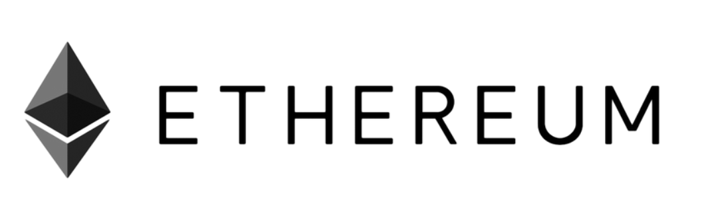
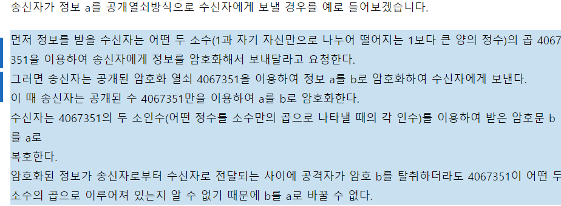

> **TL;DR** — 블록체인은 거래 기록을 중앙기관이 아니라 참여자 전체가 나눠 갖는 구조다. 1️⃣ 블록체인·이더리움의 기본 개념과 2️⃣ NFT·지갑까지 이어지는 흐름을 정리했다.

난이도 : ★☆☆☆☆

1️⃣ `블록체인 / 탈중앙화` 2️⃣ `이더리움 / 가스` 3️⃣ `NFT`

## ✅ 왜 알아야 하나

요즘 유행하고 많은 사람과 기업이 관심 있는 주제라 내가 아는 선에서 조사한 부분을 정리해두려고 한다. 이 분야에 관심은 있지만 장난삼아 투기로 뛰어드는 사람들에게도 도움이 됐으면 하는 마음으로 적었다. 더 중요한 건 앞으로 모든 기업에서 필요해질 부분이고, 코딩을 배우는 데도 도움이 될 것 같아 기록해둔다.

현재는 메타버스를 출시한 곳들이 가상화폐·NFT를 아직 본격적으로 쓰고 있지 않지만, 곧 출시할 더 샌드박스에서 최초 사례가 나올 것 같다.

## ✅ 블록체인이란

쉽게 말하면 은행 시스템의 문제를 해결하려고 만든 구조다.

예를 들어 사람들이 돈을 이체하거나 거래하는 부분을 각 은행이 관리하는데, 만약 은행이 망하거나 다른 은행에 인수되면 해당 계좌의 돈은 증발해버릴 수 있다(대출은 인수한 은행으로 넘어간다. 없어지지는 않는다).

이런 문제 때문에 나카모토 사토시가 2009년에 비트코인이라는 암호화폐를 만들었다. 당시에는 사람들이 사기다, 도박이다 하며 외면했는데, 시대를 앞서 나간 것 같고 지금은 코로나와 경제 위기를 거치면서 더 부각된 것 같다.

블록체인 기술은 모든 데이터를 중앙기관(은행)이 관리하는 게 아니라, 참여자 사이에 데이터를 기록해서 나눠 저장하도록 한다. A라는 사람의 거래 내역을 수정하려면 은행은 직접 고치면 되지만, 블록체인은 그 코인을 이용하는 모든 사람의 기록을 함께 수정해야 한다(모든 기록이 모든 참여자에게 남기 때문에 보안이 강하고, 코인이 사라져도 이력은 남는다).

해커가 기록을 수정하려면 그만한 규모의 서버를 갖춰야 하는데 현실적으로 불가능에 가깝다. 이렇게 투명하게 공개된 거래 내역(장부)이 여러 사람의 체인으로 연결돼 있는 걸 탈중앙화라고 부른다. 비트코인 때와 달리 지금은 속도까지 개선된 이더리움 2세대를 사용하고 있다.

**이더리움 장부(메인넷)**: [Ethereum (ETH) Blockchain Explorer — etherscan.io](https://etherscan.io/) — 이더리움으로 들어오거나 나가는 거래 내역을 전부 조회할 수 있다.

### 합의 메커니즘과 51% 공격

참여자들이 새 블록을 장부에 추가할 때 "어떤 기록이 진짜인지" 다 같이 동의하는 규칙을 합의 메커니즘(consensus mechanism)이라고 부른다. 비트코인과 (2022년 이전) 이더리움이 쓰던 방식은 작업증명(Proof of Work, PoW)으로, 연산 문제를 가장 먼저 푼 참여자에게 새 블록을 기록할 권한을 주는 방식이다. 이더리움은 2022년 9월 "The Merge"를 거쳐 지분증명(Proof of Stake, PoS) 방식으로 전환했는데, 코인을 예치(스테이킹)한 양에 비례해 기록 권한을 배분해서 전력 소비를 크게 줄인 게 특징이다.

해커가 기록을 조작하려면 전체 네트워크 연산력(PoW 기준)이나 예치된 지분(PoS 기준)의 절반 이상을 장악해야 하는데, 이를 51% 공격이라고 부른다. 참여자가 많을수록 이 공격에 드는 비용이 기하급수적으로 커지기 때문에 "탈중앙화된 네트워크일수록 안전하다"는 말이 나온다.

자주 하는 오해 하나는 "블록체인 = 완전한 익명"이라는 생각이다. 실제로는 가명성(pseudonymity)에 가깝다 — 지갑 주소 자체는 익명이지만 모든 거래 내역이 영구히 공개되기 때문에, 주소와 실제 신원이 한 번이라도 연결되면 그 지갑의 과거·이후 거래 전체가 추적 가능해진다.

## ✅ 이더리움

앞서 말한 비트코인(가상화폐 1세대)은 개인 간 돈 거래만 가능했지만, 이더리움은 물품을 사고팔 때도 사용하고 수수료도 매길 수 있도록 설계돼 있다. 가상의 물품인 NFT(게임 캐릭터의 옷, 게임 속 땅 등)를 거래할 때는 이더리움이 사실상 필수다.

이더리움 거래에는 반드시 필요한 코인이 하나 더 있는데, 바로 가스(가상화폐)다. 가상 컴퓨터에서 수많은 코드가 돌아가는데, 그 과정에서 휘발유 같은 역할을 하는 게 가스라고 생각하면 된다.

2013년에 만들어진 이더리움은 이후 해커에게 공격당한 적도 있지만, 위험에 대비해 만들어둔 제2의 코인인 하드포크(이더리움 클래식) 덕분에 위기를 넘길 수 있었다.

전기 소비도 줄어들고 속도도 빠르기 때문에 많은 사람이 이더리움을 대표 코인 후보로 보고 투자하고 있고, 지금은 많은 기업이 눈여겨보고 있다.

## ✅ 채굴

흔히 생각하는 광산에서 금을 캐는 것과는 다른 개념이다. 모든 사람의 거래는 체인처럼 암호로 기록돼서 서로 공유하고 있는데, 그 암호를 풀어서 장부에 남겨야 기록이 완성된다. 채굴이란 이 암호를 푸는 역할을 말한다.

채굴하려면 CPU 과부하에 대비해 성능 좋은 컴퓨터를 갖추고 24시간 구동시켜야 한다. 그러면 일정한 수수료(코인)를 지급받을 수 있다.

위는 하나의 예시일 뿐이고, 실제로는 문제를 푸는 데 5년씩 걸리기도 한다고 한다.

## ✅ NFT

대체 불가능 토큰이라고 하는데, 쉽게 설명하면 이렇다. 피카소의 그림이라고 주장하는 미술품이 있고 그게 진품으로 감정되고 세상에 하나뿐이라면 대체 불가능 토큰으로 분류된다(내가 만든 것이라도 하나뿐이면 NFT다).

NFT 마켓에서 직접 판매할 수 있고, 음악 저작권이나 내가 만든 게임 캐릭터 옷 등도 NFT로 분류되어 판매할 수 있다. 현실에서 많은 돈을 들여 전시를 열지 않아도 마켓에서 직접 판매하거나, 소장 목적으로 구매하는 사람도 많다.

자주 헷갈리는 지점은 NFT를 사면 그 이미지·캐릭터의 저작권까지 갖게 된다고 생각하는 것이다. 실제로는 마켓이나 프로젝트마다 다르지만, 대부분 NFT 소유권은 "이 토큰의 소유자가 나"라는 사실을 증명할 뿐이고 저작권(복제·배포·2차 창작 권리)은 별도 계약이 없는 한 원작자에게 남아 있는 경우가 많다.

## ✅ 메타마스크

크롬 확장판 가상화폐 지갑이다. 보안이 강화돼서 원화로 교환한 뒤 보내는 게 아니라 지갑에서 다른 사람의 지갑으로 코인을 바로 보낼 수 있다. 단, 보낼 때 수수료를 이더리움이나 가스로 내야 하고 비용은 대략 15,000원 정도로 알고 있다.

만든 지 얼마 안 됐는데, 현재 정부가 9월에 가상화폐 거래소를 거의 없앤다는 법안을 준비 중이라 이런 부분이 걱정된다면 지갑을 하나 만들어서 개인적으로 보관하는 게 적절할 것 같다.

[MetaMask Download](https://metamask.io/download) — 크립토 지갑이자 블록체인 앱으로 가는 관문.

## ✅ 유니스왑 인터페이스

메타마스크가 지갑·개인통장 형태라면, 유니스왑은 A라는 코인을 B라는 코인으로 바꿔주는 서비스다. 상장된 코인 기준으로 동작하고, 이것도 이더리움 또는 가스 수수료가 붙는다.

[Uniswap Interface](https://app.uniswap.org/#/swap)

## ✅ 오픈씨

세계 최초이자 최대 규모의 NFT 마켓이다. 구매·소장·판매가 가능하고 가격도 직접 책정할 수 있다. 다만 지갑을 따로 등록해야 하는 것으로 보인다.

[OpenSea: Buy NFTs, Crypto Collectibles, and more on Ethereum](https://opensea.io/)

## ✅ 정리

- 블록체인은 거래 기록을 중앙기관이 아니라 참여자 전체가 나눠 갖는 탈중앙화 구조임
- 이더리움은 개인 간 거래를 넘어 물품 거래·수수료(가스)까지 지원하는 2세대 가상화폐임
- NFT는 하나뿐인 자산을 증명하는 토큰이고, 메타마스크·유니스왑·오픈씨는 각각 지갑·교환·마켓 역할을 함

## 참고한 링크

- [Ethereum (ETH) Blockchain Explorer](https://etherscan.io/)
- [MetaMask Download](https://metamask.io/download)
- [Uniswap Interface](https://app.uniswap.org/#/swap)
- [OpenSea](https://opensea.io/)
