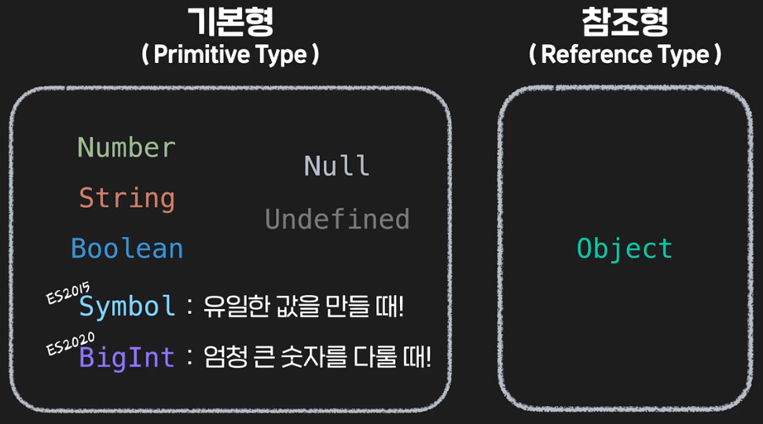
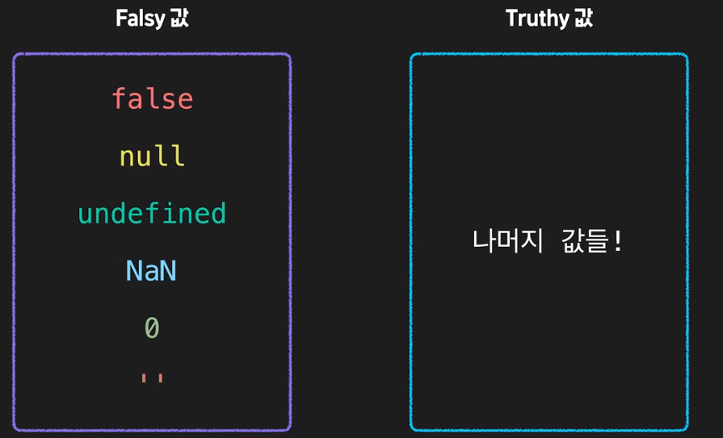
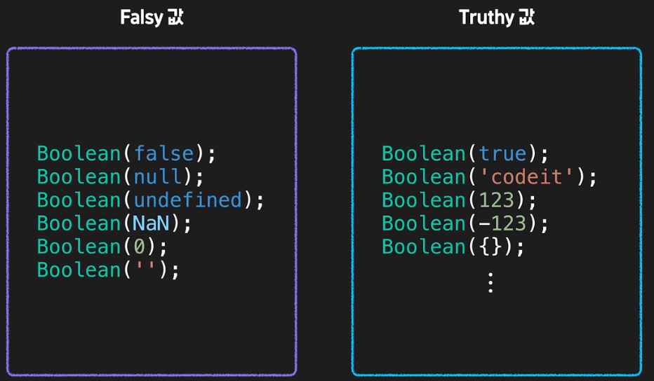

> **TL;DR** — `var`는 쓰지 않는다. 재할당이 필요 없으면 `const`, 필요하면 `let`을 쓴다. 1️⃣ 스코프와 2️⃣ 호이스팅 방식의 차이를 알면 이 결론이 왜 맞는지 이해된다.

난이도 : ★☆☆☆☆

1️⃣ `블록 스코프 vs 함수 스코프` 2️⃣ `호이스팅` 3️⃣ `var / let / const`

참고한 곳(잘 정리돼 있다): [\[자바스크립트\] 변수 선언 방식 차이: var / let / const](https://curryyou.tistory.com/192)

## ✅ ECMAScript와 모던 자바스크립트

ECMA(국제표준화기구)에서 자바스크립트 규정을 ECMA-262로 문서화했는데, 그 내용이 ES다.

**모던 자바스크립트** — 현 시점에 사용하기 적합한 범위 안에서 최신 표준을 준수하는 자바스크립트를 말한다.

**자바스크립트 vs ES**

- JavaScript는 프로그래밍 언어이고, ECMAScript는 그 언어의 표준
- ECMAScript는 JavaScript가 갖춰야 할 내용을 정리한 '설명서'이고, JavaScript는 그 설명서를 준수해서 만든 '결과물'
- ECMAScript는 JavaScript뿐 아니라 모든 스크립팅 언어가 지켜야 하는 표준
- JavaScript는 ECMAScript를 기반으로 하지만, ECMAScript에 정의된 내용 외에 WebIDL의 표준화 기술도 함께 사용함(DOM: HTML을 JS에서 다루는 객체·문법)

## ✅ 자바스크립트 데이터 타입 종류



## ✅ typeof 연산자의 실체

- 키워드 다음에 공백을 두고 값을 써도 되고, 함수처럼 괄호로 감싸서 써도 됨
- 연산 결과가 모든 타입과 1:1로 매칭되지는 않음
- `typeof null`은 문자열 `'null'`이 아니라 `'object'`가 리턴됨
- 자바스크립트에서 함수는 객체로 취급되지만, `typeof 함수`는 `'object'`가 아니라 `'function'`이 리턴됨

```javascript
console.log(typeof 'codeit');   // string
console.log(typeof Symbol());   // symbol
console.log(typeof []);         // object
console.log(typeof {});         // object
console.log(typeof true);       // boolean
console.log(typeof (false));    // boolean
console.log(typeof 123);        // number
console.log(typeof NaN);        // number
console.log(typeof 456n);       // bigint
console.log(typeof undefined);  // undefined
```

## ✅ boolean이 아닌데 boolean처럼 동작하는 값들

자바스크립트에서는 boolean형이 아니라도 다른 데이터 타입이 boolean형으로 자동 형변환된다.





```javascript
console.log(Boolean(false));   // false
console.log(Boolean(123));     // true
console.log(Boolean(0));       // false
console.log(Boolean('Sdas'));  // true
console.log(Boolean(NaN));     // false
console.log(Boolean(undefined)); // false
console.log(Boolean(''));      // false
console.log(Boolean(null));    // false
console.log(Boolean(true));    // true
console.log(Boolean(-123));    // true
console.log(Boolean({}));      // true
console.log(Boolean([]));      // true
```

## ✅ AND(&&)와 OR(||) 연산의 진실

불리언을 조합해서 출력하는 게 아니라 값을 '선택'하는 연산이다.

1. AND(`&&`) — 좌측값이 참이면 우측값 출력, 좌측값이 거짓이면 좌측값 출력
2. OR(`||`) — 좌측값이 참이면 좌측값 출력, 좌측값이 거짓이면 우측값 출력
3. 연산 우선순위는 `&&`가 `||`보다 높음
4. null 병합 연산자(`??`)는 `||`와 비슷해 보이지만 다름 — 좌측이 `null`/`undefined`면 우측 출력, 아니면 좌측 출력

```javascript
console.log('codeit' && 'javs'); // true && true → 우측 출력(javs)
console.log(0 && 'javas');       // false && true → 좌측 출력(0)
console.log('codeit' || 'javs'); // true || true → 좌측 출력(codeit)
console.log(0 || 'javas');       // false || true → 우측 출력(javas)
console.log(0 ?? 'javas');       // 좌측이 null/undefined 아님 → 좌측 출력(0)
console.log(null ?? 'javas');    // 좌측이 null → 우측 출력(javas)

// Quiz
function print(value) {
  const message = value || 'Codeit';
  console.log(message);
}
print();             // Codeit 출력
print('javaScript'); // javaScript 출력
```

## ✅ var, let, const 차이 5가지

### 1. 중복 선언 가능 여부

`var`는 중복 선언이 가능하고, `let`/`const`는 불가능하다.

```javascript
console.log('----var차례---');
var vtest3 = '안녕';
var vtest3 = '잘가';
console.log(vtest3); // 잘가

console.log('----let차례---');
let vtest2 = '안녕';
// let vtest2 = '잘가'; // Error
console.log(vtest2);

console.log('----const차례---');
const vtest1 = '안녕';
// const vtest1 = '잘가'; // Error
console.log(vtest1);
```

### 2. 재할당 가능 여부

`var`, `let`은 값 재할당이 가능하고, `const`는 불가능하다.

```javascript
console.log('----var차례---');
var vtest3 = '안녕';
vtest3 = '잘가';
console.log(vtest3); // 잘가

console.log('----let차례---');
let vtest2 = '안녕';
vtest2 = '잘가';
console.log(vtest2); // 잘가

console.log('----const차례---');
const vtest1 = '안녕';
// vtest1 = '잘가'; // Error
console.log(vtest1);
```

### 3. 변수 스코프 유효 범위

`var`는 함수 레벨 스코프(function-level scope)라서 함수 블록 기준으로 유효 범위가 정해진다(for·if·while 블록은 해당 안 됨). `let`, `const`는 블록 레벨 스코프(block-level scope)라서 블록 기준으로 유효 범위가 정해진다.

> 스코프 — 변수가 유효하게 참조될 수 있는 범위

```javascript
console.log('----var차례---');
for (var i = 0; i < 5; i++) {
  console.log(i); // 0~4
}
console.log(i); // 5

console.log('----let차례---');
for (let i = 0; i < 5; i++) {
  console.log(i); // 0~4
}
// console.log(i); // Error

console.log('----const차례---');
for (const i = 0; i < 5; i++) {
  console.log(i); // 0~4
}
// console.log(i); // Error
```

### 4. 변수 호이스팅 방식

`var`는 변수 호이스팅이 일어난다. `let`, `const`도 호이스팅은 일어나지만 동작 방식이 다르다(선언 전 접근 시 에러).

> 호이스팅 — 선언을 나중에 해도 그 변수를 미리 참조할 수 있는지에 대한 동작 방식

```javascript
console.log('----var차례---');
console.log(vtest1);
var vtest1 = 'var입니다';
console.log(vtest1);

console.log('----let차례---');
// console.log(ltest2); // Error
let ltest2 = 'let입니다';
console.log(ltest2);

console.log('----const차례---');
// console.log(ctest3); // Error
const ctest3 = 'const입니다';
console.log(ctest3);
```

### 5. 전역 객체 프로퍼티 여부

`var`로 선언한 변수는 전역 객체(브라우저 환경에서는 `window`)의 프로퍼티가 된다. `let`, `const`로 선언한 변수는 전역 객체 프로퍼티가 되지 않는다.

## ✅ 정리

구글 자바스크립트 스타일 가이드 기준 결론이다.

- `const`와 `let`으로 변수를 선언함
- 재할당할 일이 없다면 `const`를 기본값으로 사용함
- `var`는 사용하지 않음

## 참고한 링크

- [\[자바스크립트\] 변수 선언 방식 차이: var / let / const](https://curryyou.tistory.com/192)
