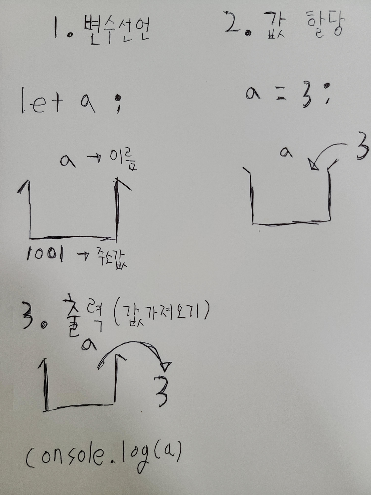
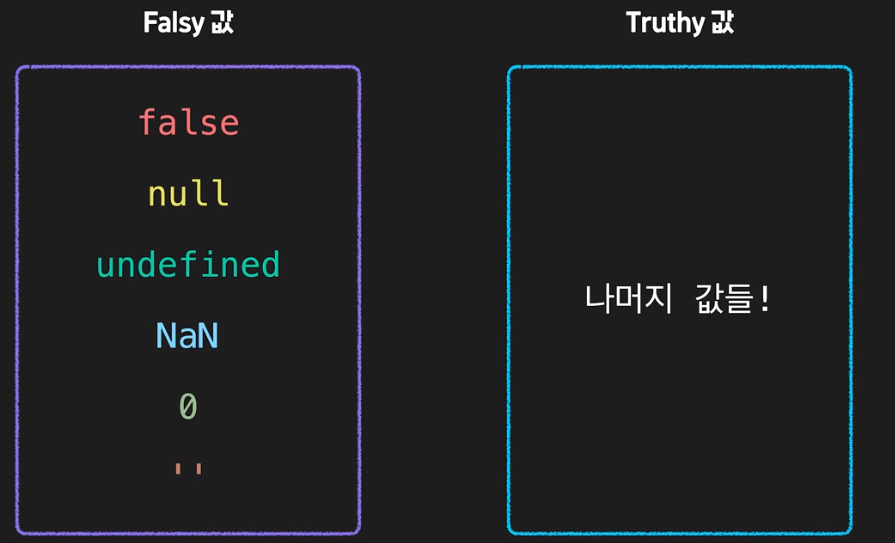
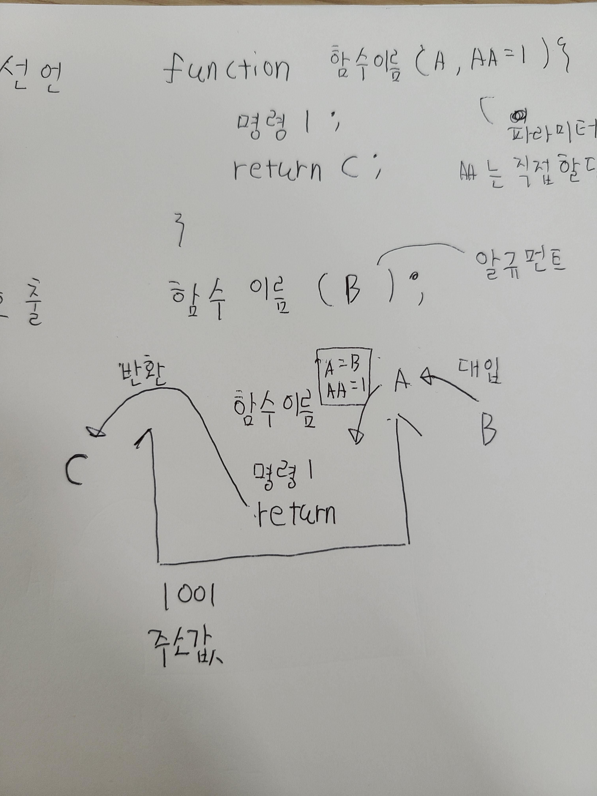

> **TL;DR** — 변수는 값을 담는 바구니, 함수는 명령어의 집합체다. 1️⃣ `var`·`let`·`const`의 차이와 2️⃣ 타입별 연산 결과만 확실히 잡아도 자바스크립트 기초의 절반은 끝난다.

난이도 : ★☆☆☆☆

1️⃣ `var/let/const` 2️⃣ `데이터 타입별 연산` 3️⃣ `함수 선언 방식`

## ✅ 왜 알아야 하나

부트캠프 1주차에 정리한 자바스크립트 기초 문법 노트다. 변수 선언, 데이터 타입, 함수, 조건식은 이후 모든 코드의 토대가 되는 부분이라 여기서 헷갈리면 뒤에서 계속 발목을 잡는다.

먼저 콘솔에 값을 찍는 방법부터 짚고 가면 이렇다.

| 함수 | 정의 |
|------|------|
| `document.write()` | 웹 페이지에 직접 글자를 출력함 |
| `console.log()` | 콘솔에 값을 출력함 |
| `alert()` | 입력을 받지 않고 메시지 창만 띄움 |
| `prompt()` | 사용자 입력을 받아 메시지 창을 띄움 |

## ✅ 변수가 필요한 이유

변수는 숫자·문자·객체·함수 등 여러 종류의 데이터를 담고 뺄 수 있는 바구니 같은 존재다. 주소값으로 직접 접근하는 것보다 이름(변수명)으로 접근하는 게 편해서 이름을 붙인 것이다. 자바스크립트는 같은 변수에 여러 타입의 값을 넣을 수 있다.

```javascript
// 변수 선언과 할당
let numerad;        // 선언
numerad = 3;         // 할당
let numerad2 = 3;    // 선언 + 할당
console.log(numerad2); // 3
```



**전역변수 vs 지역변수**

- 전역변수 : 함수 외부에서 선언 — 프로그램 전체에서 접근 가능
- 지역변수 : 함수 내부에서 선언 — 함수 실행 중에만 존재

```javascript
function fn() {
  let localNum = 40; // 지역변수
  console.log(localNum);
}
let globalNum = 30;  // 전역변수
console.log(globalNum);
```

## ✅ var, let, const 차이

| 항목 | var | let | const |
|------|-----|-----|-------|
| 중복 선언 | O | X | X |
| 재할당 | O | O | X |
| 스코프 | 함수 | 블록 | 블록 |
| 호이스팅 | O | X | X |

```javascript
// 중복 선언 — var만 가능
var vtest = '안녕';
var vtest = '잘가';
console.log(vtest); // 잘가

// 스코프 — var는 함수 레벨, let/const는 블록 레벨
for (var i = 0; i < 5; i++) { console.log(i); }
console.log(i); // 5 — 블록 밖에서도 접근 가능

for (let j = 0; j < 5; j++) { console.log(j); }
// console.log(j); // ReferenceError — 블록 밖 접근 불가

// 호이스팅 — var는 선언 전에 접근해도 undefined, let/const는 에러
console.log(vHoist); // undefined
var vHoist = 'var입니다';
// console.log(lHoist); // ReferenceError
let lHoist = 'let입니다';
```

**변수가 필요한 이유** — 값을 바구니에 담아 필요할 때마다 꺼내 쓸 수 있고, 주소값 직접 접근보다 안정적이기 때문이다.

## ✅ 데이터 타입의 종류

| 구분 | 기본 타입 | 예시 | 참조 타입 | 예시 |
|------|-----------|------|-----------|------|
| 정의 | 값 자체가 변수에 들어감 | | 주소값이 변수에 들어감 | |
| 종류 | Number, String, Boolean, undefined, Null | `let a = 1;` `let a = 'my';` `let a = true;` `let a;` `let a = null;` | 배열, 객체, 함수 | `let a = [1, 'str', true];` `let a = { key: 'val' };` `function f(a) { return a; }` |

```javascript
let undef;         // undefined — 선언만 하고 값을 할당하지 않은 상태
console.log(undef);
let nul = null;    // null — 값이 없음을 사용자가 명시적으로 지정한 상태
console.log(nul);
```

`undefined`는 "선언은 했지만 할당하지 않은 상태"고, `NaN`은 `Number` 타입의 하위 개념이라 `typeof`로 확인하면 `Number`가 나온다. `NaN`이 출력되는 대표 케이스는 다음과 같다.

1. 숫자로 읽을 수 없음 — `parseInt('abc')`, `Number(undefined)`
2. 결과가 허수인 계산 — `Math.sqrt(-1)`
3. 피연산자가 NaN — `7 ** NaN`
4. 정의할 수 없는 계산식 — `0 * Infinity`
5. 문자열 포함 + 덧셈 아닌 연산 — `'가' / 3`

### 타입 간 연산 결과

```javascript
console.log(20 + 'str');       // '20str' — 숫자가 문자열로 변환
console.log(20 + true);        // 21 — true는 1로 변환
console.log(20 + undefined);   // NaN — undefined는 숫자 연산 불가
console.log(20 + null);        // 20 — null은 0으로 변환
console.log('str' + true);     // 'strtrue'
console.log('str' + undefined);// 'strundefined'
console.log('str' + null);     // 'strnull'
console.log(true + undefined); // NaN
console.log(true + null);      // 1 — true(1) + null(0)
console.log(null + undefined); // NaN — undefined는 숫자 연산 불가
```

### Boolean 형 변환



```javascript
console.log(Boolean(100));     // true — 0이 아닌 숫자
console.log(Boolean(0));       // false
console.log(Boolean('str'));   // true
console.log(Boolean(''));      // false — 빈 문자열
console.log(Boolean({}));      // true — 객체
console.log(Boolean([]));      // true — 배열
console.log(Boolean(null));    // false
console.log(Boolean(undefined)); // false
console.log(Boolean(NaN));     // false
```

### 연산자 우선순위

| 순위 | 종류 | 예시 |
|------|------|------|
| 1 | 단항 연산자 | `!`(논리부정), `~`(비트부정), `++`·`--`(증감) |
| 2 | 산술 연산자 | `+ - * /`, `%`(나머지), `**`(거듭제곱) |
| 3 | 시프트 연산자 | `<<`, `>>` |
| 4 | 관계 연산자 | `< <= > >= == !=` |
| 5 | 논리 연산자 | `&& \|\| ??` |
| 6 | 조건 연산자 | `? :` |
| 7 | 대입 연산자 | `= += -= *= /=` |

```javascript
console.log(3 == '3');            // true — 동등연산자는 타입 무시하고 값만 비교
console.log(true == 1);           // true
console.log(3 === '3');           // false — 일치연산자는 타입까지 비교
console.log(3 < 4 ? 12 : 2);      // 12 — 삼항 연산자
console.log(2 ** 3);              // 8 — 거듭제곱
```

동등연산자(`==`)는 값만 같으면 true, 일치연산자(`===`)는 값과 타입이 모두 같아야 true다. `in`은 왼쪽 속성이 오른쪽 객체·배열에 포함되는지, `instanceof`는 왼쪽 객체가 오른쪽 객체의 자식(인스턴스)인지 확인한다.

### Number·String 자주 쓰는 메서드

```javascript
// Number
(3.14159265).toFixed(2);   // '3.14'
(255).toString(16);         // 'ff' — 16진수 변환
Number.parseInt('12 34');   // 12 — 첫 숫자만 정수로 변환

// String
'   JavaScript   '.trim();          // 'JavaScript'
'JavaScript'.toUpperCase();          // 'JAVASCRIPT'
'자바스크립트'.concat('는 좋다');      // '자바스크립트는 좋다'
'abcDEFabc'.slice(2, 6);             // 'cDEF'
'abcDEFabc'.charAt(0);               // 'a'
'abcDEFabc'.indexOf('abc', 3);       // 6 — 인덱스 3부터 탐색
```

## ✅ 함수의 정의와 호출



| 종류 | 특징 |
|------|------|
| 함수 선언식 | 선언 전에도 호출 가능(호이스팅). 함수 스코프 |
| 함수 표현식 | 함수를 값처럼 사용. 호이스팅 불가. 할당된 변수 스코프를 따름 |
| 즉시 실행 함수 | 선언과 동시에 실행. 외부에서 재사용 불가. 초기화 코드에 자주 씀 |
| 화살표 함수 | 익명 함수의 축약형. 인자 1개면 소괄호 생략 가능. `arguments`와 호환 안 됨 |

```javascript
// case1 : 함수 선언식
function greet(name) { console.log(`나는 ${name}`); }
greet('지수');

// case2 : 함수 표현식
let greet2 = function greetFn(name) { console.log(`나는 ${name}`); };
greet2('지수');
// greetFn('지수'); // ReferenceError — 함수 표현식 내부 이름은 밖에서 접근 불가

// case3 : 즉시 실행 함수
(function (name) {
  console.log(`나는 ${name}`);
})('지수');

// case4 : 화살표 함수
((name) => console.log(`나는 ${name}`))('지수');
```

**파라미터 vs 아규먼트**

- 파라미터 : 함수 선언 시 소괄호 안에 작성하는 것. 함수 블록 안에서만 사용 가능
- 아규먼트 : 호출 시 소괄호 안에 넣는 실제 값
- 파라미터 > 아규먼트 : 남는 파라미터는 `undefined`
- 파라미터 < 아규먼트 : 남는 아규먼트는 기본적으로 사용 불가 (`arguments` 객체나 rest 파라미터로 받아야 함)

## ✅ 조건문과 반복문

```javascript
// if ~ else if ~ else
let num = 1;
if (num) {
  console.log('num은 true입니다'); // 1은 truthy
} else if (num === null) {
  console.log('num은 null입니다');
} else {
  console.log('아무 조건도 아닙니다');
}

// switch ~ case (내부적으로 일치연산자 ===)
switch (num) {
  case true:
    console.log('num은 true입니다');
    break;
  case null:
    console.log('num은 null입니다');
  default:
    console.log('아무 조건도 아닙니다'); // 실행됨
}
```

**자주 하는 실수 — switch에서 break를 빠뜨리면**

위 예시의 `case null:` 아래에는 일부러 `break`를 안 넣어서 `default`까지 같이 실행되도록 했다(폴스루, fall-through). 의도한 폴스루라면 상관없지만, 대부분의 실수는 `break`를 깜빡해서 원치 않는 case까지 줄줄이 실행되는 경우다. 각 `case` 끝에는 `break`(또는 `return`)를 명시적으로 넣는 습관을 들이는 게 안전하다.

```javascript
// for와 while — 결과는 동일
for (var i = 1; i < 5; i++) {
  console.log(i); // 1~4
}
console.log(i); // var는 스코프가 함수 레벨이라 5도 출력됨

var j = 1;
while (j < 5) {
  console.log(j); // 1~4
  j++;
}
console.log(j); // 5
```

## ✅ 정리

- 변수는 값을 담는 바구니. `var`(함수 스코프·호이스팅 O·중복선언 O), `let`/`const`(블록 스코프·호이스팅 X)로 나뉨
- 데이터 타입은 값 자체를 담는 기본 타입(Number·String·Boolean·undefined·Null)과 주소값을 담는 참조 타입(배열·객체·함수)으로 구분됨
- 타입이 다른 값끼리 연산하면 암묵적 형변환이 일어남 — 특히 `undefined` 연산은 대부분 `NaN`이 됨
- 함수는 선언식·표현식·즉시실행·화살표 4가지 방식으로 만들 수 있고, 각각 호이스팅·스코프가 다름
- `switch`는 내부적으로 일치연산자(`===`) 기준으로 비교함

## 참고한 링크

- [연산자 우선순위 - JavaScript | MDN](https://developer.mozilla.org/ko/docs/Web/JavaScript/Reference/Operators/Operator_Precedence)
- [코딩교육 티씨피스쿨](https://tcpschool.com/javascript/js_standard_numberMethod)
- [자바스크립트 메모리 관리(Garbage Collection)에 대해 알아보자](https://helloinyong.tistory.com/292)
