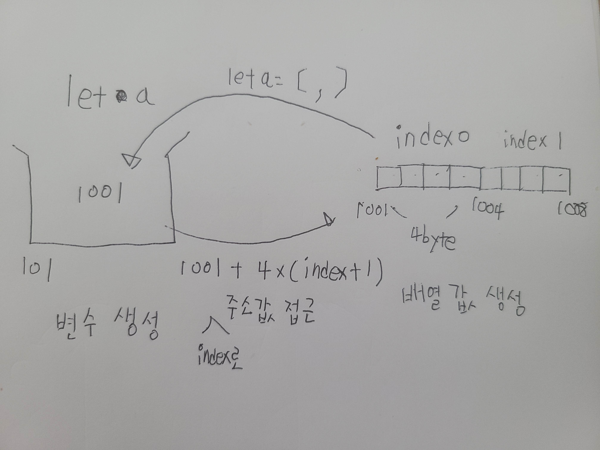

> **TL;DR** — 배열은 인덱스와 값으로 이뤄진 참조 타입이다. 1️⃣ `push`·`splice` 같은 변형 메서드와 2️⃣ `forEach`·`map`·`reduce` 같은 순회 메서드를 구분해서 익히면 반복문을 직접 안 짜도 되는 경우가 많아진다.

난이도 : ★★☆☆☆

1️⃣ `배열의 참조 특성` 2️⃣ `배열 메서드` 3️⃣ `forEach/map/reduce`

## ✅ 왜 알아야 하나

배열은 매일 쓰는데도 `slice`와 `splice`를 헷갈리거나, `sort()`가 기본적으로 숫자를 문자열처럼 정렬한다는 걸 모르고 넘어가는 경우가 많다. 배열이 참조 타입이라는 것부터 짚고 메서드를 정리하면 이런 함정을 피할 수 있다.

## ✅ 배열이란

- 인덱스와 값으로 이뤄진 하나의 묶음
- 여러 데이터를 한 공간에 저장해두고 필요할 때 꺼내 쓰기 위해 사용함
- 자바스크립트는 어떤 값이든 배열의 요소가 될 수 있고, 크기가 고정되지 않은 동적 배열임
- **참조 타입**이라 배열을 다른 변수에 대입하면 같은 데이터를 가리킴(주소값 공유) — 값이 아니라 주소가 복사된다는 점이 핵심
- 인덱스가 음수면 맨 마지막부터 역순으로 접근



```javascript
let myArr = [1, '1', true, [null], undefined, function () {}, [], {}];
console.log(myArr);
console.log(myArr[1], typeof myArr[1]); // '1' string — 대괄호로 요소 접근

let myArrCopy = myArr;   // 주소값을 복사 — 같은 배열을 가리킴
myArrCopy[1] = 200;
console.log(myArr[1]);    // 200 — 같은 배열이라 원본도 바뀜
console.log(myArr.length); // 8
```

## ✅ 배열 메서드 — 추가·확인·합치기·제거·추출·정렬

| 메서드 | 정의 | 원본 변형 여부 |
|--------|------|---------------|
| `push` | 맨 뒤에 값 추가, 리턴값은 배열 길이 | O |
| `unshift` | 맨 앞에 값 추가, 리턴값은 배열 길이 | O |
| `Array.isArray` | 배열 여부 체크, 리턴 Boolean | - |
| `indexOf` | 값의 인덱스 확인, 없으면 -1 | - |
| `concat` | 두 배열을 합쳐 새 배열 리턴 | X |
| `shift` | 맨 앞 값 제거, 리턴은 삭제된 값 | O |
| `pop` | 맨 뒤 값 제거, 리턴은 삭제된 값 | O |
| `splice` | 지정 위치 제거·추가, 리턴은 삭제된 값들의 배열 | O |
| `slice` | 범위 지정 복사, 리턴은 새 배열 | X |
| `sort` | 콜백 기준 정렬. 콜백 없으면 유니코드 기준 오름차순 | O |
| `reverse` | 인덱스 순서 뒤집기 | O |
| `join` | 배열 요소를 합쳐 문자열로 리턴 | X |

```javascript
// 값 추가
let arr = [0, null];
arr[2] = '400';        // 인덱스로 직접 추가
console.log(arr.push('300'));    // 4 — 맨 뒤에 추가, 리턴은 길이
console.log(arr.unshift('10'));  // 5 — 맨 앞에 추가

// 확인하기
console.log(Array.isArray(arr));    // true
console.log(arr[1]);                // null — 인덱스 → 값
console.log(arr.indexOf(null));     // 1 — 값 → 인덱스, 없으면 -1

// 합치기
let arr2 = [100, [], 20, 0, 90];
console.log(arr.concat(arr2));      // 원본은 그대로, 새 배열 리턴

// 값 제거
console.log(arr2.shift());  // 100 — 맨 앞 제거
console.log(arr2.pop());    // 90 — 맨 뒤 제거
console.log(arr2.splice(0, 2, 20, 30)); // (시작, 삭제개수, 추가값...) → 삭제된 값들의 배열

// 값 추출
console.log(arr2.slice(0, 2)); // 원본 변형 없이 잘라서 새 배열 리턴

// 정렬 + 뒤집기 — sort()는 기본적으로 유니코드(문자열) 기준!
let nums = [1, 20, 10, 5, 29];
console.log(nums.sort());          // [1, 10, 20, 29, 5] — 문자열 기준 정렬이라 직관과 다름
console.log(nums.sort((a, b) => a - b)); // [1, 5, 10, 20, 29] — 숫자 기준 정렬은 콜백 필요
console.log(nums.reverse());       // [29, 20, 10, 5, 1]
```

## ✅ 반복문 — for와 while

- 동일한 동작을 원하는 횟수만큼 반복할 때 사용
- `for(초기값; 조건문; 증감식)` — 초기값·증감식을 반복문 안에 담고 싶을 때
- `while(조건문)` — 초기값·증감식을 밖에서 관리하고 싶을 때
- `continue`는 이후 코드를 건너뛰고 다음 반복으로, `break`는 반복문 자체를 종료

```javascript
// 반복문으로 값 채우기
let evenArr = [];
for (let i = 1; i < 7; i++) {
  evenArr.push(i);
}
console.log(evenArr); // [1, 2, 3, 4, 5, 6]

// forEach로 값 꺼내기
evenArr.forEach((value) => console.log(value));

// break — 조건 만나면 반복문 탈출
evenArr = [];
let i = 1;
while (true) {
  if (i > 6) break;
  evenArr.push(i);
  i++;
}
console.log(evenArr); // [1, 2, 3, 4, 5, 6]

// continue — 특정 값만 건너뛰기
evenArr = [];
i = 0;
while (i < 6) {
  i++;
  if (i === 2) continue; // 2 제외
  evenArr.push(i);
}
console.log(evenArr); // [1, 3, 4, 5, 6]
```

## ✅ for...of vs for...in

- `for...in` — 객체에서 주로 씀. 배열이면 index, 객체면 key를 순서대로 받음
- `for...of` — 배열에서 주로 씀. value를 순서대로 받음

```javascript
for (let index in evenArr) {
  console.log(index, evenArr[index]); // index value 형태
}
for (let value of evenArr) {
  console.log(value); // value만
}
```

## ✅ 배열 반복 메서드 — forEach, map, filter, find, some, every, reduce

콜백 자리에는 보통 익명 함수를 넣는다.

| 메서드 | 정의 | 리턴 |
|--------|------|------|
| `forEach` | 값을 순차적으로 꺼냄 | 없음 |
| `map` | 값을 순차적으로 꺼내 가공 | 새 배열 |
| `find` | 조건에 맞는 첫 요소를 찾으면 즉시 종료 | 값 (없으면 undefined) |
| `filter` | 조건에 맞는 요소만 추림 | 새 배열 |
| `every` | 모든 요소가 조건을 만족하는지 | Boolean |
| `some` | 조건을 만족하는 요소가 하나라도 있는지 | Boolean |
| `reduce` | 누산기를 사용해 값을 누적 계산 | 최종 누산기 값 |

```javascript
let arr = [1, 20, 30, 10, 20];

// forEach — 리턴 없음
arr.forEach((value, index) => console.log(`${index}번째 값 ${value}`));

// map — 리턴 배열
let mapped = arr.map((value, index) => `${index}번째 값 ${value}`);

// filter — 조건에 맞는 요소만
let filtered = arr.filter((value) => value === 20); // [20, 20]

// find — 조건에 맞는 첫 값만, 찾으면 바로 종료
let found = arr.find((value) => value === 20); // 20

// some / every — Boolean 리턴
let hasBig = arr.some((value, index) => value + index > 5);  // true
let allBig = arr.every((value, index) => value + index > 5); // false

// reduce — 누산기(acc)에 값을 누적. 두 번째 인자는 초기 누산기 값(생략 가능하지만 권장)
let sum = arr.reduce((acc, value, index) => {
  return value + index; // sum += el 과 비슷한 개념
}, 2);
```

## ✅ 정리

- 배열은 참조 타입이라 그냥 대입하면 원본과 값을 공유함 — 복사가 필요하면 `slice()`나 spread 구문을 쓸 것
- `sort()`는 기본이 문자열(유니코드) 기준 정렬이라 숫자 정렬엔 콜백이 필요함
- `push/pop/shift/unshift/splice/sort/reverse`는 원본을 바꾸고, `concat/slice`는 새 배열을 리턴함
- 반복 로직이 필요하면 직접 for/while을 짜기 전에 `forEach/map/filter/find/some/every/reduce`로 해결되는지 먼저 확인할 것

## 참고한 링크

- [7.25 코드잇(자바스크립트-중급) - 배열 메소드](https://zibu-story.tistory.com/115)
- [8.05 알고리즘 문제 - 숫자야구 게임 만들기](https://zibu-story.tistory.com/125)
