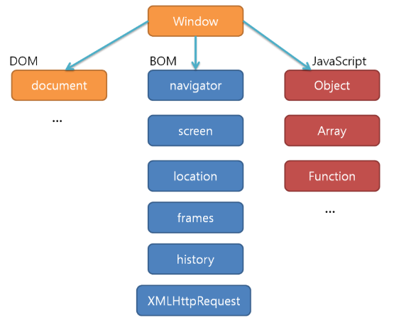

> **TL;DR** — 객체는 key로 value를 구분하는 데이터 집합이다. 1️⃣ 점 표기법과 대괄호 표기법의 차이, 2️⃣ 브라우저가 제공하는 내장 객체 DOM·BOM만 구분해도 기초는 충분하다.

난이도 : ★★☆☆☆

1️⃣ `점 표기법 vs 대괄호 표기법` 2️⃣ `DOM/BOM` 3️⃣ `라이브러리 vs 프레임워크`

## ✅ 왜 알아야 하나

배열이 index로 값을 구분한다면 객체는 key로 값을 구분한다. 순서가 없다는 게 배열과의 결정적 차이인데, 그래서 여러 객체를 배열에 담아 쓰는 패턴(`[{...}, {...}]`)이 실무에서 자주 나온다. 여기에 브라우저가 기본 제공하는 DOM·BOM 객체까지 구분해두면 "객체"라는 말이 나올 때 헷갈리지 않는다.

## ✅ 객체란

- 일반 데이터(변수)와 함수(메서드)의 집합체
- key와 value로 구성되며 순서가 없음 — 그래서 여러 객체를 배열에 담아 활용하는 경우가 많음
- 자바스크립트에서 객체는 값으로 쓰일 수 있음
- 하나의 객체(설계도)로 다양한 인스턴스(설계도로 찍어낸 제품)를 만들 수 있음
- key로 올 수 있는 타입 : 변수, 문자열, 표현식, 불린, 숫자(내부적으로 문자열로 자동 변환)
- value로는 모든 타입이 올 수 있음

```javascript
// 객체 리터럴 방식
let h = 10;
let obj = {
  a: 1,              // key 변수, value 숫자 → 프로퍼티
  true: true,         // key 불린, value 불린
  [1 + 2]: 'axo',      // key 표현식(계산 결과 '3'), value 문자열
  f: (a, b = 1) => a + b, // key 문자, value 함수 → 메서드
  ['za' + 1]: [1, 2, 3],  // key 표현식('za1'), value 배열
  h,                   // 프로퍼티 축약 → h: h
  greet() { console.log('안녕'); } // 메서드 축약
};
console.log(obj);
```

## ✅ 객체 접근 방법

- **대괄호 표기법** — key가 어떤 형태든 접근 가능. key와 같은 값을 변수에 담아 대괄호에 넣어도 표현식으로 인식해 접근됨
- **점 표기법** — key가 숫자형 문자열이면 사용 불가. 연산이 필요한 접근(변수를 통한 동적 접근)도 불가능
- 삭제는 `delete`를 써야 완전히 제거됨

```javascript
console.log(obj.a);       // 1 — key가 일반 변수명이면 둘 다 가능
console.log(obj['a']);
console.log(obj.true);    // key가 불린이어도 둘 다 가능
console.log(obj[3]);      // key가 숫자형 문자열이면 대괄호만 가능
console.log(obj.f(1));    // value가 함수여도 둘 다 접근 가능
console.log(obj.za1[0]);  // value가 배열이면 둘 다 접근 가능

let keyName = 'a';
console.log(obj[keyName]); // 1 — 변수에 담아 대괄호로 접근하면 표현식으로 처리됨
console.log(obj.keyName);  // undefined — 점 표기법은 변수를 key로 못 씀

// 수정 · 삭제 · 추가
obj['za1'] = 20;    // 수정
delete obj.greet;    // 삭제 — delete를 써야 완전히 제거됨
obj[20 + 1] = '값';  // 추가
console.log(obj);
```

## ✅ 배열 + 객체 활용 예시

배열은 순서가 있고 객체는 다양한 타입의 key를 가질 수 있다는 각자의 장점을 합쳐서, 실무에서는 객체 배열(`[{...}, {...}]`) 형태를 가장 많이 쓴다.

```javascript
let students = [
  { name: '지수', score: 20 },
  { name: '지영', score: 20 },
  { name: '수지', score: 40 }
];
students.push({ name: '진수', score: 70 }); // 배열에 객체 추가

let total = 0;
students.forEach((el) => {
  total += el.score;
  console.log(`이름 : ${el.name}, 성적 : ${el.score}`);
});
console.log(`총점 : ${total}, 평균 : ${Math.floor(total / students.length)}`);
```

## ✅ 내장 객체 — DOM과 BOM

자바스크립트 자체가 기본 제공하는 객체를 내장 객체라 하고(`Number`, `Error`, `Math`, `Date` 등), 직접 만드는 건 사용자 정의 객체다. 그중 프론트엔드에서 매일 마주치는 게 DOM과 BOM이다.

- **DOM(Document Object Model)** — 문서에 대한 모든 정보를 담는 객체. HTML·CSS를 제어하고 태그를 추가·삭제할 수 있음. `document` 객체로 접근
- **BOM(Browser Object Model)** — 브라우저에 대한 모든 정보를 담는 객체 (뒤로가기, 북마크 등). `window`, `history`, `location` 객체로 접근




## ✅ 라이브러리 vs 프레임워크

| 구분 | 정의 | 예시 |
|------|------|------|
| 프레임워크 | 프로그램의 틀·뼈대를 미리 만들어둔 것. 완성된 상태는 아님 | Node.js, React |
| 라이브러리 | 특정 기능을 구현하기 위한 API(도구·함수) 집합. 불러와서 호출하는 방식 | jQuery |

## ✅ 정리

- 객체는 key-value 쌍의 집합이고 순서가 없음 — 순서가 필요하면 객체 배열로 관리함
- 점 표기법은 정적인 key에, 대괄호 표기법은 동적인(표현식·숫자형 문자열) key에 사용함
- 객체 삭제는 `delete`로 해야 완전히 제거됨
- DOM은 문서(HTML/CSS) 제어, BOM은 브라우저(히스토리·위치 등) 제어를 담당함
- 프레임워크는 틀 안에서 코드를 짜는 방식, 라이브러리는 필요할 때 가져다 쓰는 방식이라는 게 핵심 차이임

## 참고한 링크

- [7.29 코드잇 - 객체의 모든 것 (쓰는법 4가지, 추상화, 상속, 캡슐화, 다형성)](https://zibu-story.tistory.com/120)
- [[javascript] 8. 객체 모델 정리](https://doitnow-man.tistory.com/134)
- [표준 내장 객체 - JavaScript | MDN](https://developer.mozilla.org/ko/docs/Web/JavaScript/Reference/Global_Objects)
- [프레임워크와 라이브러리의 차이](https://web-front-end.tistory.com/63)
