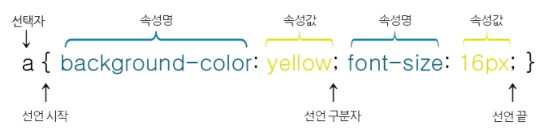

> **TL;DR** — CSS는 HTML로 만든 구조를 꾸미는 도구다. 모든 태그는 기본적으로 block 아니면 inline이고, 속성은 폰트/정렬/박스/배경/영역 카테고리로 나눠 익히면 정리가 된다.

난이도 : ★★☆☆☆

1️⃣ `display 속성` 2️⃣ `박스 모델` 3️⃣ `선택자`

## ✅ 왜 알아야 하나

CSS 속성이 워낙 많아서 처음엔 뭘 언제 써야 할지 감이 안 왔다. 카테고리별로 나눠서 정리하고 나니, 특히 `display`가 `inline`이냐 `block`이냐에 따라 나머지 정렬·박스 속성이 어떻게 먹히는지 감이 잡혔다.

## ✅ CSS란 (Cascading Style Sheets)

- HTML에서 글이나 이미지, 링크 같은 구조를 만들었다면 CSS는 그걸 꾸미는 역할을 함
- 대부분의 스타일 속성은 CSS에서 처리함
- 속성과 값의 쌍으로 선언함



## ✅ CSS 속성 종류

참고: [CSS 속성 총정리](http://tcpschool.com/css/intro)

### 자주 쓰는 것

| 속성 | 설명 |
| --- | --- |
| `min-width`, `max-width` | 화면을 줄이거나 늘릴 때 최소·최대 길이를 정함 |
| `display` | `inline` — 다른 요소와 같은 줄에 머무르려 하고, 필요한 만큼만 가로를 차지함. 가로·세로 길이 개념이 없어 텍스트처럼 다룸 / `block` — 새 줄로 넘어가고 가로를 최대한 차지함. 가로·세로 길이 설정 가능 / `inline-block` — 같은 줄에 머물면서 크기 조절이 가능한, inline의 확장판 |
| `list-style` | `ul`·`ol`의 앞머리 기호를 없앨 때 `none` 사용 |

### 폰트 관련

| 속성 | 설명 |
| --- | --- |
| `color` | 폰트 색상 설정 |
| `font-size` | 폰트 크기. `px`는 절대값(자식이 정의한 것만 봄), `rem`/`em`은 상대값(부모가 정의한 `font-size`의 배수. `em`은 자신이 정의하면 부모 값을 무시), `%`는 부모의 `font-size`나 `width` 기준 |
| `text-decoration` | 글자에 줄을 긋는 속성. `underline`(밑줄), `overline`(윗줄), `line-through`(가운데 줄), `none`(줄 없애기) |

### 가로·세로 정렬

| 속성 | 설명 |
| --- | --- |
| `text-align` | inline 요소를 가로 가운데 정렬 |
| `margin-left/right: auto` | block 요소를 가로 가운데 정렬 |
| `vertical-align` | baseline 기준으로 세로 정렬 |

### 박스(Boxing) 관련

| 속성 | 설명 |
| --- | --- |
| `margin` | 테두리(border) 바깥쪽 여백 |
| `border`, `border-radius`, `border-위치` | 테두리 스타일(굵기·종류·색). `radius`는 모서리를 둥글게. `dotted`는 점선, `dashed`는 파선. `border-bottom`처럼 위치를 지정하면 그쪽에만 생기고, `0`이나 `none`이면 없어짐 |
| `padding` | 테두리(border) 안쪽 여백 |

### 배경 관련

| 속성 | 설명 |
| --- | --- |
| `background-color`, `background-image` | 배경에 넣을 색·이미지 지정 |
| `background-size` | `cover` — 비율을 유지하며 화면을 꽉 채움 / `contain` — 가로·세로 중 먼저 채워지는 쪽에 맞춤 |
| `background-position` | 잘릴 때 보이는 부분·배경 이미지 위치 설정. 가로(`left`/`center`/`right`), 세로(`top`/`center`/`bottom`) |
| `background-repeat` | 남는 공간을 채우는 방식. `repeat-x`/`repeat-y`(가로 또는 세로만 반복), `repeat`(둘 다 반복), `space`(반복 후 남는 공간을 이미지 간 여백으로 배분), `round`(반복 후 남는 공간을 이미지 확대로 배분) |

### 영역 관련 (여기부터 난이도가 좀 있음)

| 속성 | 설명 |
| --- | --- |
| `overflow` | `hidden` — 넘치는 부분 숨김 / `scroll` — 스크롤로 확인 가능, 내용이 안 넘쳐도 스크롤이 생김 / `auto` — 내용이 넘칠 때만 스크롤 생김 |
| `box-shadow` | 그림자 지정. 가로(px), 세로(px), 흐림 정도(px), 크기(px), 색 순서 |
| `box-sizing` | `border-box`를 주면 지정한 가로·세로 길이에 padding이 포함되도록 계산해서, padding 때문에 크기가 커지는 걸 방지함 |
| `position` | `relative` — 원래 위치 기준 이동, 다른 요소에 영향 안 줌 / `static` — 기본값, 위치 속성 무시 / `fixed` — 브라우저 기준 고정, 스크롤해도 그대로 있음 / `absolute` — 가장 가까운 `position` 지정된 부모 기준 이동 |
| `float`, `clear` | 그리드를 만드는 방법 |

**함정 — margin collapse(마진 병합)**

세로 방향으로 인접한 두 블록 요소의 `margin-top`/`margin-bottom`은 두 값이 더해지는 게 아니라, 둘 중 더 큰 값 하나로 합쳐진다(margin collapse). 예를 들어 위 요소의 `margin-bottom: 20px`과 아래 요소의 `margin-top: 30px`이 만나면 실제 간격은 50px이 아니라 30px이 된다. 가로 방향 마진이나 `padding`에는 이 현상이 없고, `display: flex`/`grid` 컨테이너 내부 자식에게도 적용되지 않는다.

**box-sizing 기본값** — `box-sizing`의 기본값은 `content-box`다. `width`/`height`로 지정한 값은 콘텐츠 영역만의 크기이고, `padding`·`border`는 그 바깥에 추가로 더해진다. 그래서 `padding`을 주면 요소의 실제 크기가 지정한 값보다 커지는 문제가 생기는데, `box-sizing: border-box`를 주면 `padding`·`border`까지 포함해서 지정한 크기 안에서 계산되므로 레이아웃이 훨씬 예측 가능해진다.

## ✅ 폰트 설정 방법

1. 사용자가 가진 폰트 사용 — `font-family: 폰트1, 폰트2, 폰트종류;` (폰트1이 없으면 폰트2, 그것도 없으면 폰트종류 중 있는 걸 사용)
2. 구글 폰트 사용 — fonts.google.com에서 폰트를 고르고, HTML 코드를 `head` 태그 안에 넣은 뒤 CSS 코드를 붙여넣음
3. 다운받은 폰트 파일 사용

```css
@font-face {
    src: url(파일경로);
    font-family: 이름설정;
}
/* 이후 font-family에 "이름설정"을 넣어서 사용 */
```

4. 폰트 종류
   - Serif(궁서체, Times) — 끝이 구부러져 있음
   - Sans-serif(굴림체, Arial) — 끝에 구부러진 게 없음
   - Monospace(Courier) — 글자 사이 폭이 같음
   - Cursive(필기체, Comic Sans MS) — 긴 글에는 안 맞고 머리말용
   - Fantasy(Impact 등) — 장식용

## ✅ CSS 선택자

- `A {}` — 기본적인 방법
- `A > B {}` — A의 바로 직속 자식인 B를 가진 모든 태그
- `A, B {}` — A와 B 둘 중 하나라도 해당하는 태그
- `A B:nth-child(n) {}` — A의 자식인 B 중 n번째
- `A B:first-child {}` — A의 자식인 B 중 첫 번째(마지막은 `last-child`)
- `A B:not(:first-child) {}` — A의 자식인 B 중 첫 번째만 제외한 나머지
- `A:hover {}` — 마우스가 A에 올라갔을 때

## ✅ 실무 팁

**반응형 웹 만들기**

```css
@media (min-width: 750px) {
  /* 가로가 750px 이상일 때 적용할 속성 */
}
```

**자바스크립트로 CSS 다루기**

- jQuery를 이용하는 방법(아직 미학습)
- `document.getElementsByClassName`으로 클래스를 찾아 속성을 추가하는 방법

**자바스크립트로 HTML 다루기**

- DOM 객체를 이용해 태그 추가, 자식 태그 접근이 가능함

## ✅ 정리

- CSS는 속성-값 쌍으로 선언하고, 태그를 꾸미는 역할을 함
- 속성은 폰트/정렬/박스/배경/영역으로 나눠서 외우면 헷갈리지 않음
- `display`가 `inline`이냐 `block`이냐가 나머지 정렬·박스 속성의 동작을 좌우함

## 참고한 링크

- [CSS 속성 총정리](http://tcpschool.com/css/intro)
