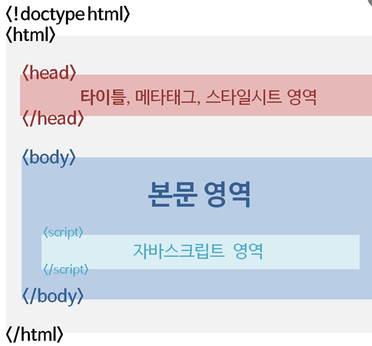
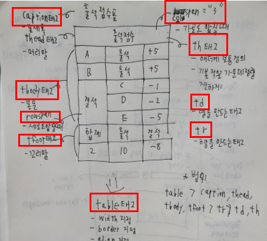
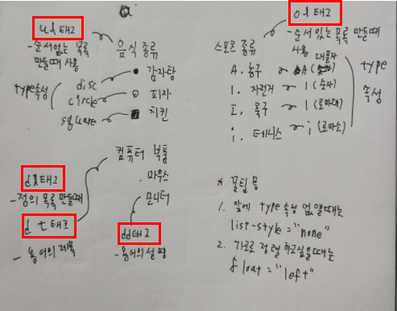

> **TL;DR** — HTML은 정적인 웹 페이지를 만드는 마크업 언어다. 자주 쓰는 태그 종류를 익히고, 문서 안에서 CSS·JavaScript를 연결하는 두 가지 방법(외부 파일 vs 인라인)만 구분하면 기본기는 끝난다.

난이도 : ★☆☆☆☆

1️⃣ `HTML 태그 종류` 2️⃣ `CSS·JS 연결 방법`

## ✅ 왜 알아야 하나

웹 퍼블리싱을 처음 시작하면서 정리한 HTML 기초다. 태그마다 역할이 있고, HTML 문서 안에서 CSS·JavaScript를 연결하는 방법이 여러 개인데 언제 뭘 써야 하는지 헷갈렸다. 이번 글에서 태그 종류와 연결 방법을 한 번에 정리했다.

## ✅ HTML이란 (Hypertext Markup Language)

- 정적인 웹 페이지를 만드는 언어
- 메모장·한글·워드 등 문서 작성이 가능한 프로그램에서는 모두 작성 가능함
- HTML 문서는 태그라는 명령어로 구성됨. 확장자는 `.html`
- 태그는 기본적으로 시작 태그 `<>`와 종료 태그 `</>` 한 쌍으로 구성됨
- HTML 태그로는 연산이 안 되고 텍스트로만 인식함
- 하이퍼텍스트(다른 페이지로 이동할 수 있는 기능)를 가진 문서를 만드는 언어



## ✅ HTML 태그 종류 (자주 쓰는 것 위주)

참고: [태그의 모든 것](http://tcpschool.com/html-tags/input)

### 기본 태그

| 태그 | 설명 |
| --- | --- |
| `<!DOCTYPE html>` | 문서 타입을 알려주는 태그. 맨 위에 쓰고, 그 아래 `<html>` 태그가 옴 |
| `<meta charset="UTF-8">` | 현재 페이지의 속성과 정보를 표시함. 한글 표시를 위해 필요 |
| `<title>` | 문서 제목 |
| `<html>`, `<head>`, `<body>` | HTML의 최상위 태그. `head`는 meta·link·style·script 태그가 오는, 화면에 안 보이는 부분. `body`는 화면에 보이는 부분으로 각종 태그가 들어감 |
| `<hr>`, `<b>`, `<i>`, `<small>`, `<u>`, `<strong>`, `<em>`, `<br>`, `<del>` | 순서대로 구분선, 굵게, 기울임, 작게, 밑줄, 굵게(의미상), 기울임(의미상), 줄바꿈, 취소선 |
| `<h1>` ~ `<h6>` | 머리말 태그. 숫자가 클수록 글씨 크기는 작아짐 |
| `<p>` | 문단을 표현할 때 쓰는 태그. 안에 단문·장문이 옴 |
| `<div>` | 블록 요소로, 요소들을 그룹화할 때 사용함. 레이아웃 구현에 씀 |
| `<span>` | 인라인 요소로, 인라인 요소들을 그룹화할 때 사용함. 기본적으로 자신이 포함한 콘텐츠 크기만큼만 차지함 |
| `<a>` | 링크 이동에 쓰는 태그. `href` 속성으로 이동할 url 지정(`#+id`값을 주면 해당 id로 포커싱), `target` 속성으로 열리는 위치 지정(`_self`는 현재 브라우저, `_blank`는 새 브라우저) |
| `` | 이미지 삽입 태그. `src`는 이미지 경로, `title`은 마우스 오버 시 설명, `alt`는 웹 접근성을 위한 대체 텍스트, `width`/`height`는 크기 지정 |
| `<form>` | 데이터를 서버로 넘길 때 사용함. `action`은 전송할 서버 파일, `name`은 식별용 이름, `target`은 처리 결과를 표시할 프레임, `method`는 전송 방식(`get`은 url에 노출, `post`는 노출 안 됨) |
| `<input>` | 사용자 입력을 받거나 값을 지정함. `type`으로 형태 지정(`text`·`password`·`button` 등), `name`은 서버로 전달되는 변수명, `value`는 초기값, `maxlength`는 최대 글자 수, `checked`는 기본 선택 여부, `onclick`은 클릭 이벤트(자바스크립트 함수 연결) |

### 표 관련 태그

| 태그 | 설명 |
| --- | --- |
| `<table>` | 테이블 최상위 태그 |
| `<rowspan>` | 셀을 세로로 합칠 때 사용 |
| `<colspan>` | 셀을 가로로 합칠 때 사용 |
| `<tr>`, `<td>` | row(행), col(열)을 만드는 태그 |
| `<th>` | 테이블 헤더 정의. 가운데 정렬·굵게 속성이 자동으로 부여됨 |
| `<caption>` | 표 제목을 붙일 때 사용 |
| `<thead>`, `<tbody>`, `<tfoot>` | 표의 머리말·본문·꼬리말을 담당하는 그룹화 태그 |



### 리스트 관련 태그

| 태그 | 설명 |
| --- | --- |
| `<ul>` | 순서 없는 목록. 글머리 기호를 붙임. `type` 속성으로 기호 지정 가능(`disc` 검은 동그라미, `circle` 투명 동그라미, `square` 검은 사각형. 없애려면 `list-style: none`) |
| `<ol>` | 순서 있는 목록. `type` 속성으로 항목 형태 지정(`1` 숫자, `A`/`a` 알파벳 대·소문자, `I`/`i` 로마 숫자 대·소문자) |
| `<li>` | `ul`, `ol` 태그 내부에서 목록 내용을 작성하는 태그 |
| `<dt>`, `<dd>`, `<dl>` | 정의 목록, 용어의 제목, 용어에 대한 설명 |



### 선택 그룹 관련 태그

| 태그 | 설명 |
| --- | --- |
| `<select>` | 드롭다운으로 여러 목록을 정의함. 박스 형태로 나오고 스크롤해서 원하는 항목을 고름 |
| `<optgroup>` | `select` 안의 선택 목록들을 그룹으로 묶어 큰 카테고리를 만듦 |
| `<option>` | `select` 태그 안의 선택 가능한 목록 |
| `<fieldset>` | `form` 태그 안의 목록들을 그룹화할 때 사용. `border` 속성이 기본으로 입혀져 테두리가 생김 |
| `<legend>` | `fieldset` 테두리 중간에 설명을 적을 때 사용 |
| `<label>` | 보통 `input` 태그 앞에 써서 이름·나이·성별 같은 라벨을 붙임 |

## ✅ HTML에서 CSS·JavaScript 연결하기

### HTML에서 CSS 접근

```html
<!DOCTYPE html>
<html>
    <head>
        <meta charset="utf-8">
        <link href="ex01.css" rel="stylesheet" type="text/css"/> <!-- case1 : css 파일 연결 -->
        <style>
            p {
                color: #000;
            }
        </style> <!-- case2 : 여러 태그에 속성을 한 번에 입힐 때 -->
    </head>

    <body>
        <p style="color: blue;"></p><!-- case3 : 하나의 태그에만 적용할 때(인라인) -->
    </body>
</html>
```

### HTML에서 JavaScript 다루기

```html
<!DOCTYPE html>
<html>
    <head>
        <meta charset="utf-8">
        <script src="ex01.js" type="text/javascript"></script> <!-- case1 : js 파일 연결 -->
        <script>
            function a() {
                return 10;
            }
        </script> <!-- case2 : 문서 안에서 직접 여러 함수를 쓸 때 -->
    </head>

    <body>
        <input type="button" onclick="a()"><!-- case3 : 하나의 태그에 이벤트로 연결할 때 -->
    </body>
</html>
```

CSS·JS 모두 외부 파일로 분리해서 `<link>`/`<script src>`로 연결하는 방식이 기본이고, 문서 안에 직접 쓰는 `<style>`/`<script>`나 인라인 속성은 예외적으로만 쓰는 게 유지보수에 낫다.

## ✅ 정리

- HTML은 태그라는 명령어로 구성된 마크업 언어이고, 연산이 아니라 텍스트로 인식됨
- 태그는 기본/표/리스트/선택 그룹으로 나눠서 외우면 헷갈리지 않음
- CSS·JS 연결 방법은 외부 파일 연결이 기본, 문서 내 작성과 인라인은 상황별 예외

## 참고한 링크

- [태그의 모든 것](http://tcpschool.com/html-tags/input)
