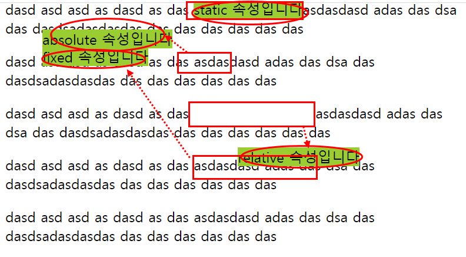
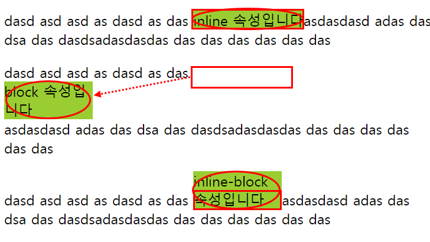
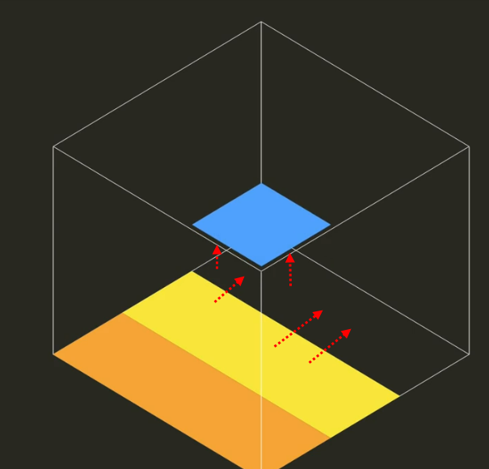
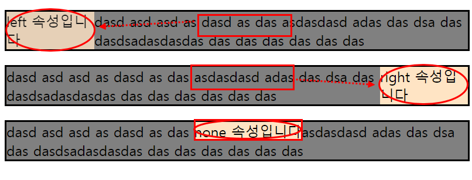

> **TL;DR** — `position`은 요소를 기준점 대비 어디로 옮길지, `display`는 요소가 줄을 차지하는 방식을, `float`는 요소를 좌우로 띄워 다음 요소가 남은 공간을 차지하게 만드는 속성이다. 지금은 flex를 더 많이 쓰지만 세 속성 다 기본기로 알아둬야 한다.

난이도 : ★★☆☆☆

1️⃣ `position 속성값` 2️⃣ `display 속성값` 3️⃣ `float 속성값`

## ✅ 왜 알아야 하나

position·display·float는 웹 퍼블리싱에서 숨 쉬듯 다루게 되는 속성인데, 그만큼 제대로 짚고 넘어가야 나중에 flex를 배워도 헷갈리지 않는다. 각 속성을 왜 쓰는지부터, 속성값별 차이를 코드 실습으로 확인했다.

## ✅ Position 파트

### 왜 쓰는가

`position` 속성을 지정하지 않으면 기본값 `static`을 갖는다. 이 경우 고정된 위치에서 요소를 움직일 수 없다(`top`, `left` 속성을 줘도 무반응).

### 속성값

| 속성값 | 설명 |
| --- | --- |
| `static` | 위치 속성(`top`, `left` 등)이 요소에 아무런 영향을 안 줌. 기본값 |
| `relative` | 이동하기 전 위치를 기준으로 움직임 |
| `fixed` | 브라우저 기준으로 움직임. 스크롤을 내려도 계속 고정된 자리에 있음 |
| `absolute` | 가장 가까운 `position`이 지정된 부모 요소를 기준으로 움직임 |

### 직접 확인해보기

참고: 화살표는 이동 방향, 네모 박스는 현재 위치, 원은 속성값 지정 후 위치를 뜻함



```css
/* position 속성 실습 */
.static {
    background-color: yellowgreen;
    position: static;
    top: 50px;
    left: 50px;
}
.absolute {
    background-color: yellowgreen;
    position: absolute;
    left: 50px;
    top: 50px;
}
.relative {
    background-color: yellowgreen;
    position: relative;
    left: 50px;
    top: 50px;
}
.fixed {
    background-color: yellowgreen;
    position: fixed;
    left: 50px;
    top: 50px;
}
```

## ✅ Display 파트

### 왜 쓰는가

각 태그마다 `display` 속성이 이미 지정돼 있어서, 예를 들면 `span` 태그 안 텍스트를 가로·세로로 조정하거나 여러 `div` 태그를 같은 줄에 머물게 할 수 없다. `display` 속성을 바꾸면 `span`이 같은 줄에 있게 하는 성질을 `div`에도 적용할 수 있다.

### 속성값

flex는 다음 글([Flex 개념과 속성 총정리](/posts/css-flex-basics))에서 다룬다.

| 속성값 | 설명 |
| --- | --- |
| `inline` | 각 태그가 브라우저에서 자기 영역만 차지함(가로·세로 박스 개념 없음). 줄바꿈 없이 같은 라인에 있음 |
| `block` | 각 태그가 가로 영역을 브라우저 너비만큼 차지함(크기 조정 가능). 각자 다른 라인에 있음 |
| `inline-block` | 줄바꿈 없이 같은 라인에 있으면서(inline 성질) 크기 조정도 가능함(block 성질) |

### 직접 확인해보기

참고: 화살표는 이동 방향, 네모 박스는 현재 위치, 원은 속성값 지정 후 위치를 뜻함



```css
/* display 속성 실습 */
.inline {
    background-color: yellowgreen;
    display: inline;
    width: 100px;
}
.block {
    background-color: yellowgreen;
    display: block;
    width: 100px;
}
.inline-block {
    background-color: yellowgreen;
    display: inline-block;
    width: 100px;
}
```

## ✅ Float 파트

### 왜 쓰는가

보통 block 상태에서는 요소가 한 영역을 혼자 차지하는 경향이 있다. inline 속성값을 주고 position으로 이동하려면 생각보다 복잡해지고, 요소가 여러 개면 불가능할 수도 있다. 그래서 여러 요소를 정렬하고 싶을 때 float를 쓴다.

### 속성값

참고: 파란색 박스는 float 지정 요소, 노란색·주황색 박스는 기본값, 화살표는 이동 방향을 뜻함

| 속성값 | 설명 |
| --- | --- |
| `left` | 요소를 왼쪽 끝으로 이동시키고 위로 띄워, 밑에 남은 공백을 다음 요소가 차지하게 함(정렬) |
| `right` | 요소를 오른쪽 끝으로 이동시키고 위로 띄워, 밑에 남은 공백을 다음 요소가 차지하게 함(정렬) |
| `none` | 요소를 띄우지 않음. 기본값 |

브라우저를 3차원으로 생각하면 float 동작이 이해하기 쉽다.



### 직접 확인해보기

참고: 검정 박스는 상위 태그, 네모 박스는 현재 위치, 원은 이동 후 위치, 화살표는 이동 방향을 뜻함



```css
/* float 실습 */
p {
    background-color: gray;
    border: 2px solid black;
}
.left {
    background-color: bisque;
    float: left;
    width: 100px;
    opacity: 0.8;
}
.right {
    background-color: bisque;
    float: right;
    width: 100px;
}
.none {
    background-color: bisque;
    float: none;
    width: 100px;
}
```

## ✅ 정리

- `position`은 기준점(`static`/`relative`/`fixed`/`absolute`) 대비 요소를 어디로 옮길지 결정함
- `display`는 요소가 줄을 어떻게 차지하는지(`inline`/`block`/`inline-block`)를 결정함
- `float`는 요소를 좌우로 띄우고 남은 공간을 다음 요소가 채우게 함 — 여러 요소 정렬에 쓰지만 지금은 flex로 대체되는 추세임

## 참고한 링크

- [Flex 개념과 속성 총정리](/posts/css-flex-basics)
