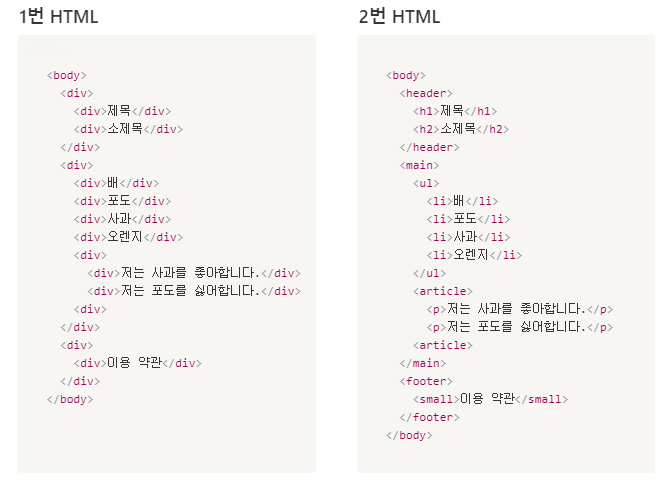
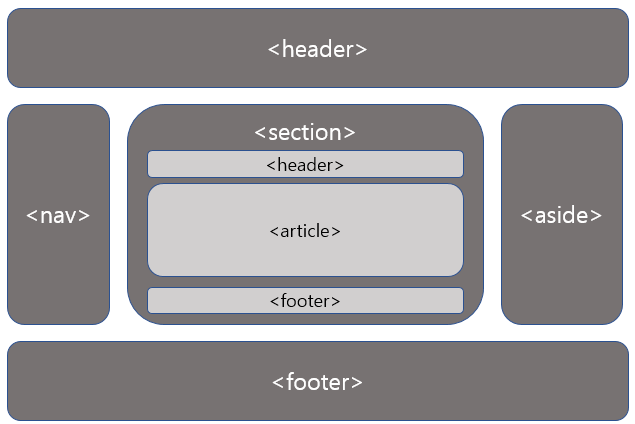

> **TL;DR** — 시맨틱 태그는 `div`로도 대체 가능하지만, 구조를 사람과 검색엔진이 더 쉽게 이해하게 해준다. `img` 태그는 콘텐츠 중심(로드 실패 시 표시 필요), `background-image`는 디자인 중심(반복·세밀한 조정 가능)이라는 기준으로 갈라 쓰면 된다.

난이도 : ★☆☆☆☆

1️⃣ `시맨틱 태그 종류` 2️⃣ `img vs background-image`

## ✅ 왜 알아야 하나

기능이 있는 태그(`a`, `img` 등)는 저마다 의미가 명확한데, 그룹화용 태그(`div`, `section` 등)도 정말 의미가 다 다를까? 개념을 모르고 그냥 쓰면 어떤 문제가 생기는지부터 짚어보고, 왜 시맨틱 태그를 써야 하는지 정리했다.

## ✅ 시맨틱 웹이란

시맨틱 웹(Semantic Web)은 "의미론적인 웹"이라는 뜻으로, 기계가 이해할 수 있는 형태로 제작된 웹을 의미한다(물론 사람도 이해할 수 있음).

## ✅ 시맨틱 태그를 왜 쓰나

- `div`만으로 정의해도 코드는 돌아가지만, 다른 개발자가 볼 때 구조를 더 쉽게 파악하도록 의미론적으로 태그를 나눔
- 검색엔진이 중요한 부분과 덜 중요한 부분을 파악하는 데 도움이 돼서 검색 효율이 올라감
- 검색엔진에 노출되기 쉬워짐
- 건물을 지을 때 각 공간에 이름을 붙이듯, 구조를 쉽게 이해하기 위해 씀



## ✅ 시맨틱 태그 종류

| 태그 | 설명 |
| --- | --- |
| `<section>` | 하나의 주제를 그룹화할 때 사용. 예: 뉴스 기사의 제목 |
| `<article>` | 하나의 주제에 대해 독립적으로 설명할 때 사용. 예: 뉴스 기사, 블로그 글, 광고글 |
| `<details>` | 사용자가 보거나 숨길 수 있는 추가 세부 정보를 정의 |
| `<footer>` | 화면 하단에 위치하는 정보를 정의. 예: 이메일, 저작권 표시 |
| `<header>` | 화면 상단에 위치하는 정보를 정의 |
| `<main>` | 화면 중간에 위치하는, 주가 되는 콘텐츠를 정의 |
| `<nav>` | 보통 `header` 영역 아래에 위치하며 메뉴를 표현 |
| `<time>` | 날짜나 시간을 정의 |



원래는 `div`로 다 감싸고 `display` 속성으로 상태를 바꿀 수 있으니 그룹화 태그는 아무거나 써도 되는 줄 알았는데, 새로 알게 됐다. 다만 태그 종류가 늘어날수록 코드량도 늘어나서, 규모가 커지면 태그만으로 구분하기 힘들어질 수도 있겠다 싶다.

## ✅ img 태그 vs background-image 속성

이미지는 보통 `img` 태그나 `background-image` 속성으로 넣는데, 방식이 비슷하다고 하나만 쓰면 될까 하는 의문에서 출발했다.

### 상황 1 — 이미지 로드가 실패하면?

- `img` 태그 — broken image 아이콘과 지정한 `alt` 텍스트가 화면에 뜸. 의도적으로 오류를 나타내고 싶을 때 좋음(콘텐츠·사용자 중심)

```html

```


- `background-image` 속성 — 대체 텍스트가 없어서 아무것도 표시되지 않음(배경화면이라). 오류를 의도적으로 감추고 싶을 때 좋음(디자인 중심)

### 상황 2 — 이미지를 반복 출력하거나 디자인적으로 꾸미고 싶다면?

- `img` 태그 — 콘텐츠·사용자 중심이라 크기 수정만 가능하고 디자인적 수정은 불가능함. 예: 단순히 사진만 보여줄 때
- `background-image` 속성 — 반복·세밀한 사이즈 수정 등 디자인적으로 자유로움. 예: 홈페이지 배경을 꾸밀 때


```css
/* 가로와 세로 모두 반복 */
background-repeat: repeat;
```

### 상황 3 — 프린트로 출력하는 경우라면?

- `img` 태그 — 이미지가 포함돼서 출력됨
- `background-image` 속성 — 이미지가 제외되고 출력됨

## ✅ 정리

- 시맨틱 태그는 `div`의 대체제가 아니라, 구조를 사람과 검색엔진에게 명확히 알려주는 수단임
- `img` 태그는 콘텐츠·사용자 중심(로드 실패 시 대체 텍스트 필요), `background-image`는 디자인 중심(반복·세밀한 조정 가능)이라는 기준으로 갈라 쓰면 됨
- 프린트 출력 여부도 두 방식을 가르는 실질적인 차이점임(`img`는 포함, `background-image`는 제외)
