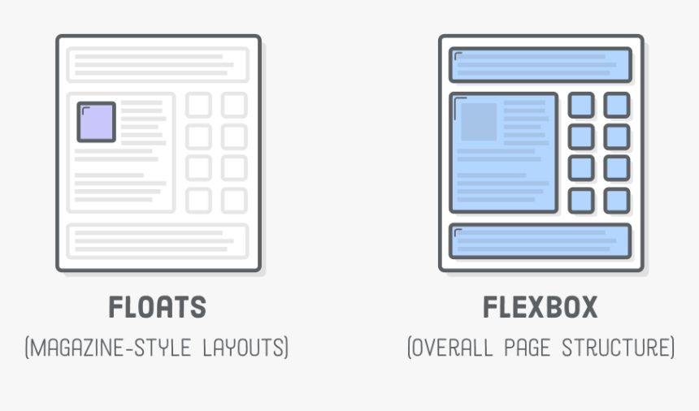

> **TL;DR** — float는 방향(left/right)밖에 없고 clear까지 같이 써야 해서 불편하다. Flex는 부모 태그에 정렬 속성을, 자식 태그에 순서·정렬 속성을 지정해서 원하는 위치로 자유롭게 이동시킬 수 있다.

난이도 : ★★★☆☆

1️⃣ `justify-content / align-items` 2️⃣ `flex-direction / flex-wrap` 3️⃣ `order / align-self`

## ✅ 왜 알아야 하나

실무에서는 float보다 flex를 훨씬 자주 쓴다고 한다. float는 `left`·`right` 방향밖에 없고 `clear`까지 병행해야 하는 불편함이 있는데, flex는 속성별로 간격·위치가 지정돼 있어서 훨씬 자유롭게 정렬할 수 있다.


## ✅ float 대신 flex를 쓰는 이유

float는 `display` 속성에 따라 동작이 달라지고, 원하는 위치(상하좌우 간격)로 자유롭게 이동시킬 수 없다는 한계가 있다(`left`/`right`밖에 없음). 게다가 `clear` 속성까지 같이 써야 하는 불편함이 있다(특히 세로 정렬할 때). 이런 문제를 보완해서 나온 게 flex고, 속성별로 간격·위치가 지정돼 있어서 자유롭게 이동시킬 수 있다.



## ✅ Flex 개념 잡기

실습: [flexboxfroggy.com](https://flexboxfroggy.com/#ko) (개구리 잡기 게임으로 flex 속성을 익힐 수 있음)
참고: [studiomeal.com/archives/197](https://studiomeal.com/archives/197)

### 코드로 확인하기

```css
.container {
  display: flex;              /* 반드시 부모에 flex를 선언해야 자식에게 flex 속성이 적용됨 */
  justify-content: center;    /* 가로(주축) 가운데 정렬 */
  align-items: center;        /* 세로(교차축) 가운데 정렬 */
  flex-wrap: wrap;
  gap: 8px;                    /* 요소 사이 간격 — margin 없이 간격을 줄 때 사용 */
}
.item {
  order: -1;             /* 이 요소만 맨 앞으로 이동 */
  align-self: flex-end;  /* 이 요소만 교차축 기준 바닥에 정렬 */
}
```

### 부모 태그에 지정하는 속성

**justify-content** — 주축(가로) 방향 정렬

| 속성값 | 설명 |
| --- | --- |
| `flex-start` | 요소들을 컨테이너의 왼쪽으로 정렬 |
| `flex-end` | 요소들을 컨테이너의 오른쪽으로 정렬 |
| `center` | 요소들을 컨테이너의 가운데로 정렬 |
| `space-between` | 요소들 사이에 동일한 간격을 둠 |
| `space-around` | 요소들 주위에 동일한 간격을 둠 |

**align-items** — 교차축(세로) 방향 정렬

| 속성값 | 설명 |
| --- | --- |
| `flex-start` | 요소들을 컨테이너의 꼭대기로 정렬 |
| `flex-end` | 요소들을 컨테이너의 바닥으로 정렬 |
| `center` | 요소들을 컨테이너의 세로 가운데로 정렬 |
| `baseline` | 요소들을 컨테이너의 시작 위치에 정렬 |
| `stretch` | 요소들을 컨테이너에 맞도록 늘림 |

**flex-direction** — 정렬 방향

| 속성값 | 설명 |
| --- | --- |
| `row` | 요소들을 텍스트 방향과 동일하게 정렬 |
| `row-reverse` | 요소들을 텍스트 반대 방향으로 정렬 |
| `column` | 요소들을 위에서 아래로 정렬 |
| `column-reverse` | 요소들을 아래에서 위로 정렬 |

**flex-wrap** — 줄바꿈 여부

| 속성값 | 설명 |
| --- | --- |
| `nowrap` | 모든 요소를 한 줄에 정렬 |
| `wrap` | 요소들을 여러 줄에 걸쳐 정렬 |
| `wrap-reverse` | 요소들을 여러 줄에 걸쳐 반대로 정렬 |

**flex-flow** — direction과 wrap을 한 번에

```css
/* flex-direction, flex-wrap을 같이 지정 */
flex-flow: <'flex-direction'> || <'flex-wrap'>;
```

**align-content** — 여러 줄일 때의 정렬(flex-wrap이 wrap일 때만 의미 있음)

| 속성값 | 설명 |
| --- | --- |
| `flex-start` | 여러 줄을 컨테이너의 꼭대기에 정렬 |
| `flex-end` | 여러 줄을 컨테이너의 바닥에 정렬 |
| `center` | 여러 줄을 세로 가운데에 정렬 |
| `space-between` | 여러 줄 사이에 동일한 간격을 둠 |
| `space-around` | 여러 줄 주위에 동일한 간격을 둠 |
| `stretch` | 여러 줄을 컨테이너에 맞도록 늘림 |

### 자식 태그에 지정하는 속성

**flex-grow / flex-shrink / flex-basis** — 자식 요소가 남는 공간을 어떻게 나눠 갖거나 줄어들지 결정

| 속성 | 설명 |
| --- | --- |
| `flex-grow` | 남는 공간을 늘어날 비율로 분배. 기본값 `0`(안 늘어남). 형제 요소보다 값이 클수록 더 많이 늘어남 |
| `flex-shrink` | 공간이 부족할 때 줄어드는 비율. 기본값 `1`(줄어듦). `0`을 주면 줄어들지 않음 |
| `flex-basis` | 늘어나거나 줄어들기 전 기준이 되는 크기. `width`/`height`보다 우선 적용됨 |
| `flex` | 위 세 속성을 한 번에 지정하는 축약형. `flex: 1;`은 `flex: 1 1 0%;`와 같음 |

```css
.item {
  flex-grow: 1;    /* 남는 공간을 형제와 동일 비율로 나눠 가짐 */
  flex-shrink: 1;
  flex-basis: 200px;
}
```

**order** — 자식 태그의 순서를 바꿀 때 사용

```css
/* 지정한 태그만 이동 */
order: 음수(왼쪽) 또는 양수(오른쪽);
```

**align-self** — 특정 자식 하나만 교차축 정렬을 다르게 줄 때

| 속성값 | 설명 |
| --- | --- |
| `flex-start` | 해당 요소를 컨테이너의 꼭대기에 정렬 |
| `flex-end` | 해당 요소를 컨테이너의 바닥에 정렬 |
| `center` | 해당 요소를 세로 가운데에 정렬 |
| `stretch` | 해당 요소를 컨테이너에 맞도록 늘림 |

## ✅ 정리

- float는 방향이 `left`/`right`뿐이고 `clear`까지 챙겨야 해서 불편함 — flex가 그 대안
- 부모 태그는 `justify-content`(가로)·`align-items`(세로)·`flex-direction`·`flex-wrap`으로 정렬 기준을 잡음
- 자식 태그는 `order`(순서)·`align-self`(개별 정렬)로 세부 조정함

## 참고한 링크

- [Flexbox Froggy — 실습 게임](https://flexboxfroggy.com/#ko)
- [스튜디오밀 Flex 정리](https://studiomeal.com/archives/197)
