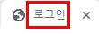
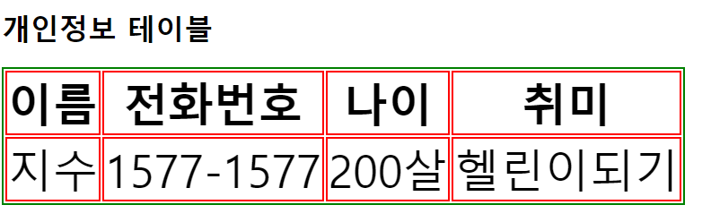
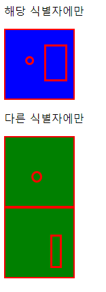

> **TL;DR** — title 태그는 SEO와 탭 표시에 쓰이고, 테이블은 thead/tbody/tfoot 구조로 짠다. hover는 형제 선택자(`+`)로 다른 요소에 효과를 줄 수 있고, media 쿼리는 `only screen and (조건)` 형태로 적용 범위를 좁힌다.

난이도 : ★☆☆☆☆

1️⃣ `title 태그` 2️⃣ `hover 형제 선택자` 3️⃣ `media 쿼리`

## ✅ 왜 알아야 하나

레플릿 문제를 풀다 보면 당연하게 쓰던 태그인데 막상 "왜 쓰는지" 물어보면 대답을 못 하는 경우가 많았다. title 태그, 테이블 태그, hover, media 쿼리가 그랬다. 모르는 채로 넘어가면 나중에 똑같은 실수를 반복하게 되어서, 막힐 때마다 메모장에 적어두고 문제를 다 푼 뒤 한 번에 정리했다.

## ✅ title 태그는 왜 쓰는가

`title` 태그는 검색 엔진이 검색 결과에 페이지를 나열하는 순서를 정할 때 쓰는 요소 중 하나다. 검색 결과 페이지를 보는 사람의 시선을 끄는 첫 "후크" 역할도 한다. 보통 `head` 영역에 쓰고, 브라우저 탭 아이콘 옆에 글자로 표시된다.

```html
<title>로그인</title>
```



지켜야 할 규칙은 이렇다.

- 한두 단어짜리 제목은 피하고 설명 문구를 쓴다
- 검색 엔진은 보통 앞의 55~60자만 보여주므로 중요한 내용을 앞에 배치한다
- 키워드만 나열하는 "키워드 얼룩"은 금물 — 검색 순위가 떨어질 수 있다
- 사이트 내에서 제목이 겹치지 않게 한다

(출처: [MDN — title](https://developer.mozilla.org/en-US/docs/Web/HTML/Element/title))

## ✅ 테이블 태그 구조 정리

테이블은 `thead`(설명 영역), `tbody`(본문), `tfoot`으로 구성된다는 걸 코드로 짜보면서 확실히 잡았다.



```html
<!DOCTYPE html>
<html lang="en">
  <head>
    <meta charset="UTF-8" />
    <meta name="viewport" content="width=device-width, initial-scale=1.0" />
    <title>테이블 태그 정리</title>
    <link rel="stylesheet" href="asd.css" />
  </head>
  <body>
      <table>
        <thead><!-- 상단 영역, 예: 테이블 설명 -->
            <h1>개인정보 테이블</h1>
        </thead>
        <tbody><!-- 메인 영역, 예: 본문 -->
            <tr><!-- 행 -->
                <th>이름</th><!-- 머릿말 -->
                <th>전화번호</th>
                <th>나이</th>
                <th>취미</th>
            </tr>
            <tr>
                <td>지수</td><!-- 열 -->
                <td>1577-1577</td>
                <td>200살</td>
                <td>헬린이되기</td>
            </tr>
        </tbody>
        <tfoot></tfoot>
      </table>
    </body>
</html>
```

```css
tr td {
    border: 2px solid red;
    font-size: 50px;
}
th {
    border: 2px solid red;
    font-size: 50px;
}
table {
    border: 2px solid green;
}
```

## ✅ hover로 다른 요소에 효과 주기

내 요소가 아니라 다른 요소에 hover 효과를 주려면 형제 선택자(`+`)를 쓴다. (참고: [hover 다른 요소 적용 예시](https://joooohee.tistory.com/52))



```html
<!DOCTYPE html>
<html lang="en">
  <head>
    <meta charset="UTF-8" />
    <meta name="viewport" content="width=device-width, initial-scale=1.0" />
    <title>테이블 태그 정리</title>
    <link rel="stylesheet" href="asd.css" />
  </head>
  <body>
      <div>
        <p>해당 식별자에만</p>
        <div class="first-box"></div>
      </div>
      <div>
        <p id="text-box">다른 식별자에만</p>
        <div class="second-box"></div>
        <div class="third-box"></div>
      </div>
    </body>
</html>
```

```css
.first-box, .second-box, .third-box {
    background-color: green;
    border: 2px solid red;
    height: 100px;
    width: 100px;
}

.first-box:hover { /* 마우스를 올린 본인이 바뀜 */
    background-color: blue;
    cursor: pointer;
    opacity: 0.8;
}

.second-box:hover + .third-box { /* 마우스를 올린 요소가 아닌 형제가 바뀜 */
    background-color: blue;
    cursor: pointer;
    opacity: 0.8;
}
```

**일반 형제 선택자(~) vs 인접 형제 선택자(+)** — `+`는 바로 다음에 오는 형제 요소 하나만 선택하고, `~`(물결)는 이후에 오는 모든 형제 요소를 선택한다.

```css
.second-box:hover ~ .third-box { /* + 대신 ~를 쓰면 바로 다음이 아니어도 이후 모든 형제에 적용 */
  background-color: blue;
}
```

## ✅ 그 밖에 몰랐던 코드

**viewport meta 태그** — 모바일에서 필수로 넣어야 하는 설정이다.

```html
<meta name="viewport" content="width=device-width">
```

디바이스의 가로 크기를 웹 페이지의 가로 크기로 맞춘다는 뜻이다. 이걸 빼면 모바일에서 데스크탑 버전이 축소되어 보이는 현상이 생긴다.

**속성 선택자로 조건부 스타일링**

```css
input[type="text"]::placeholder {
  color: red;
}
```

`type`이 `text`인 요소 중 `placeholder`만 빨간색으로 바꾼다.

**media 쿼리 조건 조합**

```css
@media only screen and (min-width: 320px) and (max-width: 480px) {}
```

- `only` — 구형 브라우저가 스타일을 잘못 적용하는 걸 막는다. 구형 브라우저는 `only`를 만나면 쿼리를 무시하고 뒷부분을 읽지 않는다
- `screen` — 화면이 있는 기기에만 스타일을 적용하도록 미디어 유형을 지정한다
- `and` — 여러 미디어 특성을 조합할 때 쓴다

## ✅ Summary

- title 태그는 SEO와 탭 표시를 위해 head에 작성하고 55~60자 이내로 핵심을 앞에 둠
- 테이블은 thead/tbody/tfoot 구조로 짜야 의미가 명확해짐
- 다른 요소에 hover 효과를 주려면 형제 선택자(`+`)를 씀
- media 쿼리는 only/screen/and 조합으로 적용 범위를 좁힘

## 참고한 링크

- [MDN — title](https://developer.mozilla.org/en-US/docs/Web/HTML/Element/title)
- [hover 다른 요소 적용 예시](https://joooohee.tistory.com/52)
