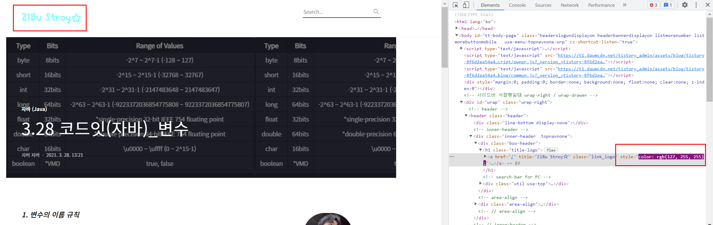

> **TL;DR** — Date 객체는 `new Date()`로 만들고 `get*` 계열 메서드로 값을 꺼낸다. String은 `startsWith`/`includes`/`split` 같은 메서드로 검사·가공하고, 객체는 `length`가 없는 대신 `Object.keys/values/entries`로 순회한다.

난이도 : ★☆☆☆☆

1️⃣ `Date 객체 메서드` 2️⃣ `String 메서드` 3️⃣ `Object.entries`

## ✅ 왜 알아야 하나

HTML/CSS 파트보다 자바스크립트 객체 파트가 확실히 어려웠다. 지금 겪는 이 수준은 나중에 리액트에 비하면 발끝도 안 될 거라는 걸 알면서도, 일단 레플릿 문제를 풀다가 막힌 Date·String·Object 관련 메서드부터 정리해두기로 했다.

## ✅ Date 객체 메서드

- `Date` 객체 생성자에 날짜를 인자로 넘기면 그 값으로 세팅되고, 아무것도 안 넘기면 현재 날짜·시간으로 세팅된다
- 메서드는 점 표기법(`.`)으로 접근한다

```javascript
// Date 객체 생성
let date1 = new Date('December 17, 2019 03:24:00');
let date3 = new Date(2019, 5, 1);
let rightNow = new Date();

// Date 객체 메서드 활용
let year = rightNow.getFullYear();
let month = rightNow.getMonth() + 1;
let date = rightNow.getDate();
let day = rightNow.getDay();
let currentHour = rightNow.getHours();
let currentMin = rightNow.getMinutes();
let currentTime = rightNow.getTime();

console.log(date1);       // 2019-12-16T18:24:00.000Z
console.log(date3);       // 2019-05-31T15:00:00.000Z
console.log(rightNow);    // 2021-08-21T07:55:47.424Z
console.log(year);        // 2021
console.log(month);       // 8
console.log(date);        // 21
console.log(day);         // 6
console.log(currentHour); // 16
console.log(currentMin);  // 55
console.log(currentTime); // 1629532547424
```

| Date 메서드 | 설명 |
| --- | --- |
| `getFullYear()` | 연도 |
| `getMonth()` | 월 (0부터 시작 — +1 해줘야 함) |
| `getDate()` | 일 |
| `getDay()` | 요일 (정수로 반환) |
| `getHours()` | 시 |
| `getMinutes()` | 분 |
| `getSeconds()` | 초 |
| `getTime()` | 1970년 1월 1일 0시부터 현재까지를 밀리초로 반환 |
| `Date.now()` | 1970년 1월 1일 00:00:00(UTC)부터 현재까지를 밀리초 단위 정수로 반환 |
| `Date.parse()` | 1970년 1월 1일 00:00:00(UTC)부터 인자로 전달된 시점까지를 밀리초 단위 정수로 반환 |

(참고: [Date 객체 관련 정리](https://goddaehee.tistory.com/234))

## ✅ String 메서드

```javascript
// 실험 대상 문자열
let str = "I am business man how are you";

console.log(str.startsWith('I'));    // true
console.log(str.startsWith('am'));   // false
console.log(str.endsWith('am'));     // false
console.log(str.endsWith('you'));    // true
console.log(str.includes('you'));    // true
console.log(str.includes('a'));      // true
console.log('abc'.repeat(3.5));      // abcabcabc
console.log(str.split(" "));         // [ 'I', 'am', 'business', 'man', 'how', 'are', 'you' ]
```

| String 메서드 | 설명 |
| --- | --- |
| `startsWith` | 인자로 넣은 값이 문자열 맨 앞에 있는지 확인, `Boolean` 반환 |
| `endsWith` | 인자로 넣은 값이 문자열 맨 뒤에 있는지 확인, `Boolean` 반환 |
| `includes` | 인자로 넣은 값이 문자열 전체에 포함되어 있는지 확인, `Boolean` 반환 |
| `repeat` | 문자열을 반복, 인자로 정수를 받고 `String` 반환 |
| `split` | 특정 기준으로 문자열을 나눠 배열로 반환, 인자로 구분 문자를 받음 |

(추가 String 메서드는 [이전 글](https://zibu-story.tistory.com/118) 참고)

## ✅ 객체 key·value 접근 메서드

객체는 `length` 메서드를 쓸 수 없다 — 길이를 바로 구할 수 없다는 뜻이다. 대신 `Object.keys/values/entries`로 순회한다.

```javascript
// 실험할 객체
let myPeople = {
    name: 'jisue',
    age: 21,
    live: '인천 방구석'
};

console.log(myPeople.length());       // TypeError
console.log(Object.keys(myPeople));   // [ 'name', 'age', 'live' ]
console.log(Object.values(myPeople)); // [ 'jisue', 21, '인천 방구석' ]
console.log(Object.entries(myPeople));// [ [ 'name', 'jisue' ], [ 'age', 21 ], [ 'live', '인천 방구석' ] ]
```

| 메서드 | 설명 |
| --- | --- |
| `Object.keys()` | 객체의 키로 이루어진 배열 반환 |
| `Object.values()` | 객체의 값으로 이루어진 배열 반환 |
| `Object.entries()` | `[key, value]` 쌍의 배열 반환 |

(객체 자체에 대한 정리는 [이전 글](https://zibu-story.tistory.com/128) 참고)

## ✅ 그 밖에 궁금했던 것들

- **`'use strict'`는 왜 파일 맨 위에 쓸까** — 다른 언어라면 에러가 날 부분을 자바스크립트는 유하게 넘어가는 경우가 있는데, 엄격 모드는 그런 부분을 엄격하게 관리하겠다는 선언이다 ([참고](https://m.blog.naver.com/on21life/221654555798))
- **템플릿 리터럴 `${ }` 안에 배열을 넣으면?** — 문자열로 변환되어 반환된다 ([MDN — 템플릿 리터럴](https://developer.mozilla.org/ko/docs/Web/JavaScript/Reference/Template_literals))
- **도커란?** — 애플리케이션을 신속하게 구축·테스트·배포할 수 있는 소프트웨어 플랫폼. 부트캠프 과정이 끝나면 따로 공부할 예정 ([참고](https://aws.amazon.com/ko/docker/))

## ✅ 번외 — 개인 블로그 스타일링 삽질

개강 전에 블로그를 꾸며보려고 구글 폰트를 가져다 썼는데, 블로그 상단 로고에 마우스를 올리면 의도치 않게 그라데이션처럼 색이 바뀌는 현상이 생겼다. 검사 도구로 확인해보니 RGB 값 중 하나가 랜덤으로 오르내리는 것 같은데, 정확한 원인은 아직 못 찾았다.



## ✅ Summary

- Date 객체는 `new Date()`로 생성하고 `get*` 메서드로 연·월·일·시각 값을 꺼냄
- String은 `startsWith/endsWith/includes/split` 등으로 검사·가공함
- 객체는 `length`가 없는 대신 `Object.keys/values/entries`로 순회함

## 참고한 링크

- [Date 객체 관련 정리](https://goddaehee.tistory.com/234)
- [String 메서드 이전 정리](https://zibu-story.tistory.com/118)
- [객체 관련 이전 정리](https://zibu-story.tistory.com/128)
- [MDN — 템플릿 리터럴](https://developer.mozilla.org/ko/docs/Web/JavaScript/Reference/Template_literals)
