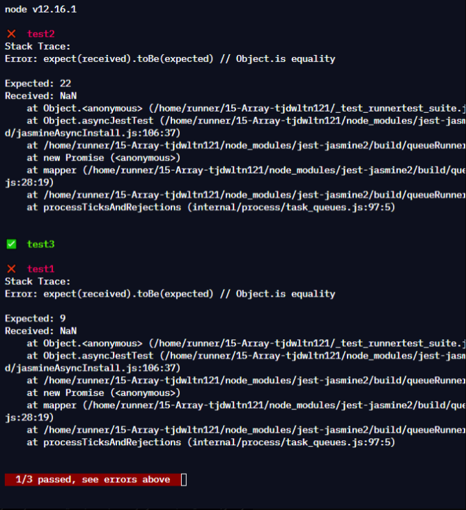

> **TL;DR** — 위코드 프리코스 1주차, 레플릿 HTML/CSS 문제를 풀고 개념을 정리하며 자기주도 학습 루틴에 적응한 한 주였음.

## ✅ 상황 (Situation)

사전 스터디 때는 가볍게 여겼는데 막상 개강하니 첫 주부터 빡센 일정이 시작됐다. 팀은 남자들만 모인 구성이라 열정만큼은 넘쳤다. 하루 일과는 오전 출석 체크(Daily Kickoff) → 팀원과 일정 정리 → 멘토 세션(현업 팁 위주) → 개인 학습(레플릿 풀이) → 점심 → 팀 소통 → 개인 시간 → Daily Wrap-up → Team Wrap-up 순서로 돌아갔고, 멘토가 개입하는 시간보다 개인 학습·팀 과제 시간이 90%를 차지했다.

| 시간 | 내용 |
| --- | --- |
| 07:00 | 기상 |
| 07:30 ~ 09:00 | 운동 |
| 09:00 ~ 09:30 | 아침 식사 |
| 10:00 ~ 10:30 | Daily Kickoff + 일정 정리 + 멘토 세션 |
| 11:00 ~ 13:30 | 레플릿 풀기 |
| 13:30 ~ 14:00 | 점심 |
| 14:00 ~ 15:00 | 멘토 설명 + 팀 과제 논의 |
| 15:00 ~ 17:00 | 레플릿 풀기 |
| 17:00 ~ 17:30 | 저녁 |
| 18:00 ~ 18:30 | Daily Wrap-up |
| 18:30 ~ | 레플릿 풀기 |

## ✅ 목표와 내 역할 (Task)

1주차 목표는 명확했다. HTML/CSS 레플릿 문제를 전부 풀고, 막힌 개념을 정리해서 TIL로 남기고, 팀 알고리즘 과제와 Semantic Web 조사 글을 완성하는 것. 개인 과제와 팀 과제를 모두 챙기면서 그룹 면접 대비 질문까지 준비해야 했다.

## ✅ 한 것 (Action)

평일에는 계획한 15개 항목을 전부 끝냈다.

- 레플릿 HTML/CSS 파트 전체 풀이 + 틀린 문제 VS Code에서 재구현
- 막힌 개념 서칭 후 정리, Semantic Web/Semantic Tag 주제로 글 작성
- 컴퓨터 사고 알고리즘 팀 과제
- `position`/`display`/`float` 속성 TIL 정리
- 자바스크립트 시험 준비, 웹서비스 역사 조사
- hover 관련 미해결 문제 재도전 후 반영

가장 시간을 많이 쓴 건 HTML/CSS 25번 문제였다. 검색창 아이콘을 세로 가운데 정렬하려는데 `vertical-align`만으로는 `position`과 호환이 안 됐다 — `flex`와 `position`을 같이 써야 한다는 걸 알게 됐다. 브라우저 크기를 줄이면 텍스트박스가 깨지는 문제는 `%` 기반 크기 조정에 `hidden` 처리를 더해 해결했고, Font Awesome 아이콘이 깨지는 건 `class`를 `fa`가 아니라 `fas`로 바꿔서 잡았다.

주말엔 자바스크립트 레플릿 풀이, 나머지 TIL 정리는 끝냈지만 개인 홈페이지 수정, 1주차 후기 작성, DOM 복습, SQL 이론 암기는 다음 주로 미뤘다.

## ✅ 결과 (Result)

평일 계획 15개 항목은 전부 완료했고, 주말 계획 6개 중 4개를 다음 주로 넘겼다. Semantic Tag, viewport meta, title 태그, `position` 속성값들, `inline`/`inline-block`/`block`/`none` 차이, flex 같은 개념을 코드로 정리해두는 습관이 생겼다. 멘토링 방식도 파악했다 — 질문해도 정답을 바로 주지 않고 관련 검색어나 자료를 알려주는 자기주도 학습 방식이었다.

## ✅ 배운 점 / 아쉬운 점

- 잘한 것: 막힌 부분을 메모장에 모아뒀다가 한 번에 정리하는 습관을 들인 것, 팀 단위로 움직이며 서로 도운 것
- 아쉬운 점: 주말 계획의 절반 이상을 다음 주로 미룬 것, 아직 시간 배분이 서툴다는 것
- 다음에 다르게 할 것: 주말 목표를 더 현실적인 개수로 잡고 우선순위를 명확히 할 것

## 참고한 링크

- [8.18 Semantic Web·Semantic Tag 정리](https://zibu-story.tistory.com/139)
- [8.19 position/display/float 속성 정리](https://zibu-story.tistory.com/141)
- [8.21 Flex 개념·속성 정리](https://zibu-story.tistory.com/138)
