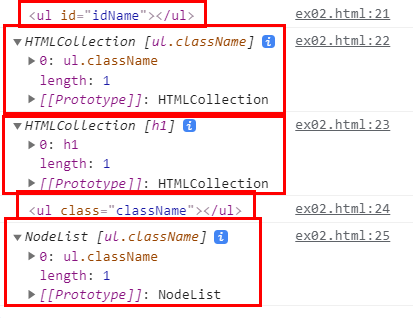
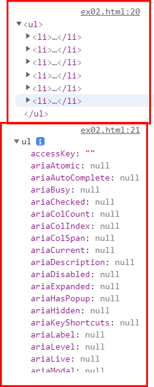
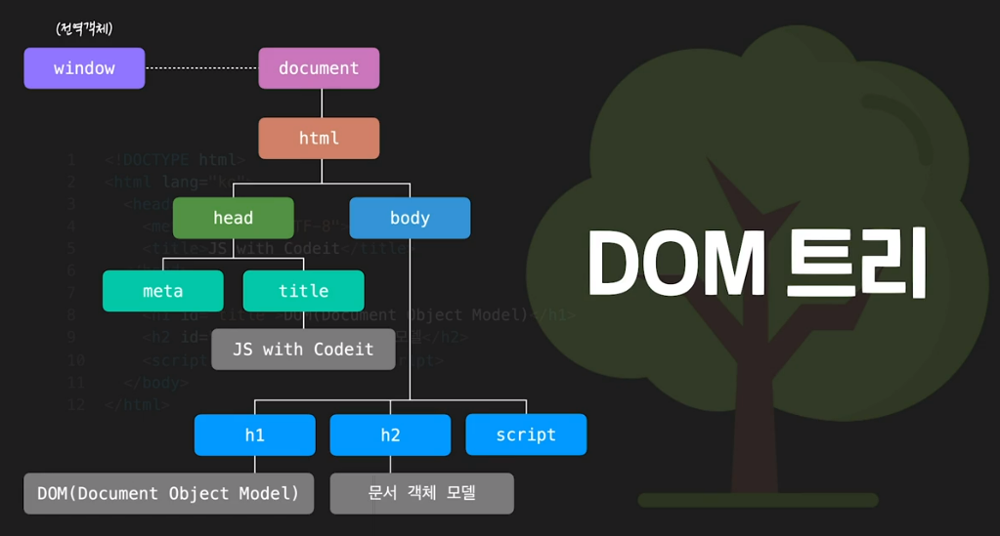
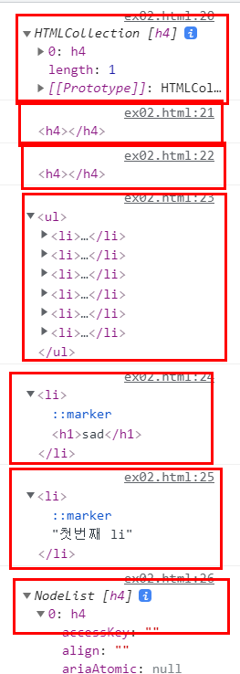
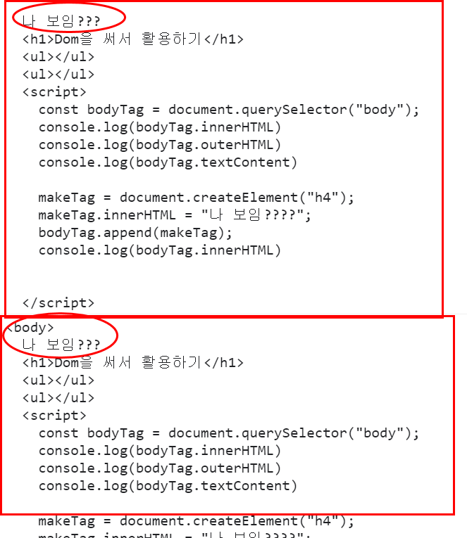
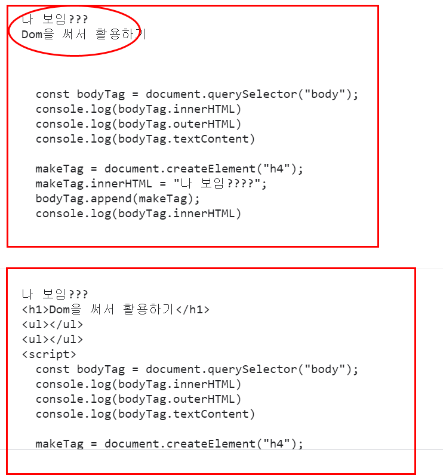

> **TL;DR** — DOM은 HTML 태그를 계층 구조의 객체로 표현한 것이다. 1️⃣ 노드를 가져오는 메소드와 2️⃣ 노드를 추가·수정·삭제하는 메소드만 구분하면 동적 HTML의 절반은 이해한 것이다.

난이도 : ★★☆☆☆

1️⃣ `querySelector 계열` 2️⃣ `노드 간 이동` 3️⃣ `노드 추가/삭제`


## ✅ 왜 알아야 하나

React를 배우기 전에 무조건 알아야 하는 개념이다. 동적인 HTML을 HTML이나 CSS가 아니라 JS로 동작시키는 것이라고 생각하면 된다.


## ✅ DOM은 왜 쓰는가

참고: [MDN — Window](https://developer.mozilla.org/ko/docs/Web/API/Window)

- 웹 페이지 내의 모든 HTML 태그를 계층화시켜 객체로 나타낸 것
- 자바스크립트로 HTML과 CSS를 조작할 수 있게 해줌
- 여기서 가장 중요한 건 DOM이 객체라는 점
- Window는 모든 브라우저 객체 중 최상단에 있는 객체
- `console` 객체도 사실은 `window.console`

아래 두 코드는 지금은 비슷해 보이지만, 데이터가 100만 개라고 하면 반복문으로 DOM을 조작해 HTML을 찍어내는 쪽이 훨씬 가독성이 좋아진다.

```html
<!-- DOM 없이 HTML만으로 표현 -->
<body>
  <h1>Dom을 안 쓰고 html만으로 표현하기</h1>
  <ul>
    <h4>하루 일과</h4>
    <li>일어나기</li>
    <li>잠자기</li>
    <li>씻기</li>
    <li>먹기</li>
  </ul>
  <ul>
    <h4>위코드란</h4>
    <li>힘들다</li>
    <li>새롭다</li>
    <li>눈물난다</li>
    <li>시간이 부족하다</li>
  </ul>
</body>
```

```html
<!-- DOM을 써서 반복문으로 렌더링 -->
<body>
  <h1>Dom을 써서 활용하기</h1>
  <ul></ul>
  <ul></ul>
  <script>
    let firstDB = ["하루 일과", "일어나기", "잠자기", "씻기", "먹기"];
    let secondDB = ["위코드란", "힘들다", "새롭다", "눈물난다", "시간이 부족하다"];

    const bodyTag = document.querySelector("body");
    const firstUlTag = bodyTag.children[1];
    const secondUlTag = bodyTag.children[2];

    let makeTag;

    const makeTagFuntion = (el, index) => {
      if (!index) {
        makeTag = document.createElement("h4");
        makeTag.innerHTML = el;
        firstUlTag.append(makeTag);
      } else {
        makeTag = document.createElement("li");
        makeTag.innerHTML = el;
        firstUlTag.append(makeTag);
      }
    };

    firstDB.forEach(makeTagFuntion);
    secondDB.forEach(makeTagFuntion);
  </script>
</body>
```

## ✅ HTML 요소 가져오는 방법

유사 배열이란 배열과 다르다. 인덱스로 접근은 가능하지만 배열 메소드는 사용할 수 없다.

| document 메소드 | 설명 |
| --- | --- |
| `getElementById()` | 인자로 준 id 식별자에 해당하는 요소를 그대로 반환. 존재하지 않으면 `null` |
| `getElementsByClassName()` | 인자로 준 class를 쓰는 태그들을 유사 배열에 담아 반환. `push` 같은 배열 메소드는 못 씀. 존재하지 않는 class면 빈 `HTMLCollection[]` 반환(`null`이 아님) |
| `getElementsByTagName()` | 태그 이름을 넣으면 해당 태그 목록을 유사 배열로 반환. `*`를 넣으면 모든 태그를 가져옴 |
| `querySelector()` | 형식 그대로 반환. 어떤 식별자든 인자로 전달 가능. class 식별자를 넣어도 첫 번째 요소 하나만 반환 |
| `querySelectorAll()` | class처럼 여러 값을 유사 배열(`NodeList`)로 가져올 때 씀. 존재하지 않는 class면 빈 `NodeList[]` 반환 |

> 보통은 `querySelector`를 가장 많이 쓴다. DOM 탐색의 첫 단계이자 핵심이니 꼭 직접 구현해본다.

```html
<body>
  <h1>HTML 태그값 가져오는 메소드</h1>
  <ul></ul>
  <ul class="className"></ul>
  <ul id="idName"></ul>
  <script>
    const getElementByIdF = document.getElementById("idName");
    const getElementsByClassNameF = document.getElementsByClassName("className");
    const getElementsByTagNameF = document.getElementsByTagName("h1");
    const querySelectorF = document.querySelector(".className");
    const querySelectorAll = document.querySelectorAll(".className");

    console.log(getElementByIdF);
    console.log(getElementsByClassNameF);
    console.log(getElementsByTagNameF);
    console.log(querySelectorF);
    console.log(querySelectorAll);
  </script>
</body>
```



## ✅ 이벤트 속성 부여

이벤트 종류 모음: [zibu-story.tistory.com/110](https://zibu-story.tistory.com/110)

| 이벤트 접근 | 설명 |
| --- | --- |
| `요소.addEventListener()` | 첫 번째 인자는 이벤트 종류, 두 번째 인자는 콜백 함수. 콜백을 밖에서 따로 선언했다면 `함수()`가 아니라 함수명만 넣는다. 두 번째 인자의 콜백 파라미터에는 `event`가 들어오고, 각 이벤트의 메소드·프로퍼티를 자유롭게 쓸 수 있다(안 써도 무관) |

보통은 가독성 때문에 두 번째 인자로 넘길 익명 함수를 밖에서 먼저 정의한다고 한다.

```html
<body>
  <button type="button">버튼</button>
  <input type="text" placeholder="여기 입력해보세요">
  <script>
    const buttonEvent = document.getElementsByTagName("body")[0];
    buttonEvent.addEventListener("click", e => {
      alert("클릭 이벤트");
      console.log("클릭이벤트");
    });

    const inputEvent = document.getElementsByTagName("input")[0];
    console.log(inputEvent);
    inputEvent.addEventListener("keydown", e => {
      alert("적을때 이벤트");
    });
  </script>
</body>
```

## ✅ console.dir vs console.log

값을 확인할 때는 보통 `log`를 주로 쓰고, 나중에 JSON을 다룰 때는 `dir`을 많이 쓰게 될 것 같다.

| 콘솔 메소드 | 설명 |
| --- | --- |
| `console.dir()` | 문자열 표시 형식으로 출력. 객체 속성을 더 자세히 보여줌. 여러 값을 전달해도 첫 번째 값만 출력. DOM 객체는 객체 형태로 출력 |
| `console.log()` | 전달받은 값 위주로 출력. 여러 값을 쉼표로 구분하면 전부 출력. DOM 객체는 HTML 형태로 출력 |

```html
<body>
  <ul>
    <li></li><li></li><li></li><li></li><li></li><li></li>
  </ul>
  <script>
    const ulTag = document.getElementsByTagName("ul")[0];
    console.log(ulTag);
    console.dir(ulTag);
  </script>
</body>
```



## ✅ DOM 트리와 노드 용어 정리

HTML에서 계층 구조로 부모 태그·자식 태그가 있듯이, DOM으로 가져온 객체도 동일하게 부모 노드·자식 노드로 이루어져 있다.

- 요소 노드 — 태그를 표현하는 노드
- 텍스트 노드 — 문자를 표현하는 노드. 자식 노드를 가질 수 없음
- 형제 노드 — HTML에서 같은 선상에 있는 노드들 사이의 관계
- 자식 노드 — 나를 기준으로 하위 태그
- 부모 노드 — 나를 기준으로 상위 태그



## ✅ 노드 간 이동

Node 간 이동, 즉 태그와 텍스트를 모두 이동하고 싶을 때는 아래 메소드에서 `Element`만 빼면 된다. 단, `children()` 메소드는 `childNodes`로 표기하고 리턴 타입이 `NodeList`가 된다.

| 노드 이동 메소드 | 설명 |
| --- | --- |
| `children()` | 지정 요소의 자식 요소 모음. 리턴 타입 `HTMLCollection` |
| `firstElementChild()` | 지정 요소의 첫 번째 자식 요소 |
| `lastElementChild()` | 지정 요소의 마지막 자식 요소 |
| `parentElement()` | 지정 요소의 부모 요소 |
| `previousElementSibling()` | 지정 요소의 이전(왼쪽) 요소 |
| `nextElementSibling()` | 지정 요소의 다음(오른쪽) 요소 |

```html
<body>
  <ul>
    <li>첫번째 li</li>
    <li><h4></h4></li>
    <li><h1>sad</h1></li>
    <li></li><li></li><li></li>
  </ul>
  <script>
    const ulTag = document.getElementsByTagName("li")[1];
    console.log(ulTag.children);
    console.log(ulTag.firstElementChild);
    console.log(ulTag.lastElementChild);
    console.log(ulTag.parentElement);
    console.log(ulTag.nextElementSibling);
    console.log(ulTag.previousElementSibling);
    console.log(ulTag.childNodes);
  </script>
</body>
```



## ✅ 노드 전체 가져오기와 추가/삭제

| 노드 전체 가져오기 | 설명 |
| --- | --- |
| `innerHTML` | 요소 노드 내부의 HTML 코드를 문자열로 리턴. 내부 HTML을 수정할 때 자주 씀 |
| `outerHTML` | 요소 노드 자체의 전체 HTML 코드를 문자열로 리턴. 값을 새로 할당하면 요소 자체가 교체되니 주의 |
| `textContent` | 요소 노드 내부에서 HTML을 제외한 텍스트만 리턴. HTML 태그를 써도 전부 텍스트로 처리됨 |

**문제**: `innerHTML`/`outerHTML`로 직접 조작하면 기존 HTML의 태그·속성이 보존되지 않는다(자체 요소를 건드리고 수정하기 때문). 기본적으로 들여쓰기·엔터까지 포함해서 출력된다.

**해결책**: 새로운 노드를 만들어서 CSS 속성을 부여하고 기존 노드에 추가한다.

- 요소 만들기 — `document.createElement()`
- 요소 노드 꾸미기 — `element.textContent`, `element.innerHTML` 등
- 요소 노드 추가·이동 — `element.prepend`, `element.append`, `element.after`, `element.before`
- 요소 노드 삭제 — `element.remove()`

```html
<body>
  나 보임???
  <h1>Dom을 써서 활용하기</h1>
  <ul></ul>
  <ul></ul>
  <script>
    const bodyTag = document.querySelector("body");
    console.log(bodyTag.innerHTML);
    console.log(bodyTag.outerHTML);
    console.log(bodyTag.textContent);

    makeTag = document.createElement("h4");
    makeTag.innerHTML = "나 보임????";
    bodyTag.append(makeTag);
    console.log(bodyTag.innerHTML);
  </script>
</body>
```





## ✅ CSS 속성 부여·삭제

표준과 비표준의 차이를 알아야 하는데, 비표준 속성은 DOM 프로퍼티로 변환되지 않아서 `style` 프로퍼티보다는 아래 메소드가 추천된다. `style`은 고정적으로 값을 부여하고 싶을 때 주로 쓴다. 참고: [표준/비표준 모드 설명](https://kyoung-jnn.tistory.com/entry/HTML-CSS-DOCTYPE-%EA%B3%BC-%ED%91%9C%EC%A4%80-%EB%B9%84%ED%91%9C%EC%A4%80-%EB%AA%A8%EB%93%9C-Standard-Quirks-mode)

| CSS 조작 메소드 | 설명 |
| --- | --- |
| `getAttribute()` | 속성에 접근해 값을 꺼낼 때 사용. 인자로 속성명만 주면 됨 |
| `setAttribute()` | 속성에 접근해 값을 넣을 때 사용. 첫 번째 인자는 속성명, 두 번째 인자는 값 |
| `removeAttribute()` | 속성에 접근해 값을 제거할 때 사용. 인자로 속성명만 주면 됨 |

```html
<body>
  <p><a id="abc" href="#">CODING FACTORY</a></p>
  <script>
    document.getElementById('abc').setAttribute('href', 'https://zibu-story.tistory.com/');
  </script>
</body>
```

class 식별자를 부여·삭제할 때 이런 메소드를 쓰는 이유는, `style` 프로퍼티나 `setAttribute`가 여러 값을 한 번에 전달하지 못하기도 하고, CSS 속성을 JS에서 직접 부여하는 게 관심사 분리에 맞지 않기 때문이다.

| class 식별자 메소드 | 설명 |
| --- | --- |
| `classList.add()` | 인자로 여러 식별자를 전달해 추가 가능 |
| `classList.remove()` | 인자로 여러 식별자를 전달해 삭제 가능 |
| `classList.toggle()` | 하나의 값을 전달하고, 두 번째 인자로 추가/삭제를 강제할 수 있음. 두 번째 인자 없이 쓰면 이미 있으면 삭제, 없으면 추가. 상황을 잘 파악한 뒤 쓰는 게 좋음 |

```html
<body>
  <p><a href="#">CODING FACTORY</a></p>
  <style>.abc{color: red;}</style>
  <script>
    document.querySelector('a').classList.add('abc');
  </script>
</body>
```

## ✅ 정리

- DOM은 HTML 태그를 계층화한 객체이고, JS로 HTML·CSS를 조작하는 통로임
- 요소를 가져올 때는 `querySelector`/`querySelectorAll`을 가장 많이 쓰고, 나머지 메소드는 반환 타입 차이를 기억해두면 됨
- 노드를 직접 `innerHTML`로 조작하기보다 `createElement` + `append`로 새 노드를 만들어 추가하는 편이 안전함
- CSS 속성은 `setAttribute`/`classList`로, 인라인 `style`은 고정값에만 최소로 사용함

## 참고한 링크

- [MDN — Window](https://developer.mozilla.org/ko/docs/Web/API/Window)
- [이벤트 종류 모음](https://zibu-story.tistory.com/110)
- [표준/비표준 모드(Standard/Quirks mode)](https://kyoung-jnn.tistory.com/entry/HTML-CSS-DOCTYPE-%EA%B3%BC-%ED%91%9C%EC%A4%80-%EB%B9%84%ED%91%9C%EC%A4%80-%EB%AA%A8%EB%93%9C-Standard-Quirks-mode)
