> **TL;DR** — `create-react-app`(CRA)으로 Node.js 설치부터 프로젝트 생성, 샘플 앱 실행, 빌드로 용량 줄이기, `serve`로 로컬 배포 확인까지 리액트 개발 환경을 한 번에 세팅하는 과정을 정리한다.

난이도 : ★☆☆☆☆

1️⃣ `create-react-app` 2️⃣ `npm run build` 3️⃣ `폴더 구조`


## ✅ 왜 알아야 하나

리액트를 처음 배우면서 제일 먼저 막힌 건 코드가 아니라 개발 환경 설치였다. Node.js는 뭐고 npm이랑 npx는 뭐가 다른지, `create-react-app`을 어디에 설치해야 하는지부터 헷갈렸다. 첫 고비를 넘기고 나서, 나중에 다시 까먹었을 때 참고하려고 설치 과정을 TIL로 정리해뒀다.


## ✅ CRA(create-react-app)란

Node.js와 npm이 이미 깔려 있다는 전제로, `npx`나 전역 설치한 `create-react-app` 명령으로 리액트 프로젝트의 초기 개발 환경을 한 번에 만들어주는 스캐폴딩 도구다.

### 1. Node.js + npm 설치

[노드 홈페이지](https://nodejs.org/ko/)에서 설치 파일을 받아 실행하면 VSCode에도 자동으로 적용된다.

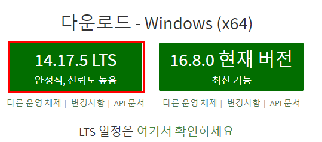

### 2. create-react-app 전역 설치

터미널(윈도우면 검색창에 `cmd`)을 열고 아래 명령을 입력한다.

```bash
npm install -g create-react-app
# 어디서든 create-react-app 명령을 쓸 수 있게 전역 설치
```

아래처럼 출력되면 정상이다. 실패하면 명령 맨 앞에 `sudo`를 붙여서 다시 실행한다.

```bash
Please specify the project directory:
create-react-app

For example:
create-react-app my-react-app

Run create-react-app --help to see all options.
```

## ✅ 직접 해보기 — 프로젝트 생성부터 확인까지

### 프로젝트 폴더 만들기

폴더를 하나 만들고(이미 있는 폴더를 써도 무방) 터미널에 경로를 드래그해서 이동한다. 이때 `cd`를 먼저 입력하고 한 칸 띄운 다음 드래그해야 경로가 제대로 붙는다.

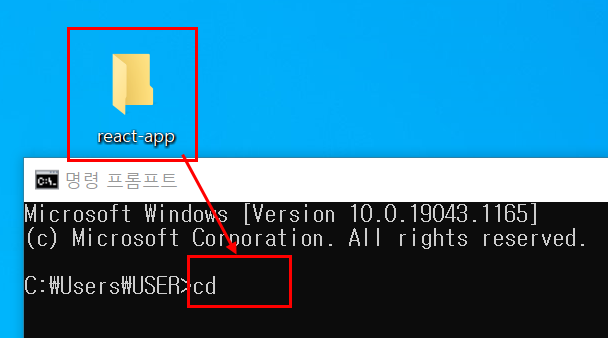

*파일을 드래그하는 장면 — cd 입력 후 띄어쓰기 하고 드래그해야 함*

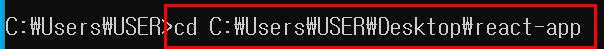

*드래그 후 결과*

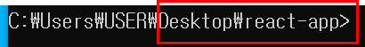

*엔터하면 경로가 자동 입력된다*

### 리액트 파일 설치

만든 폴더로 들어간 다음 리액트 관련 파일을 내려받는다.

```bash
create-react-app .
# 현재 폴더에 리액트 전체 파일을 내려받겠다는 뜻

create-react-app
# 설치 전에 create-react-app이 제대로 깔려 있는지 확인용
```

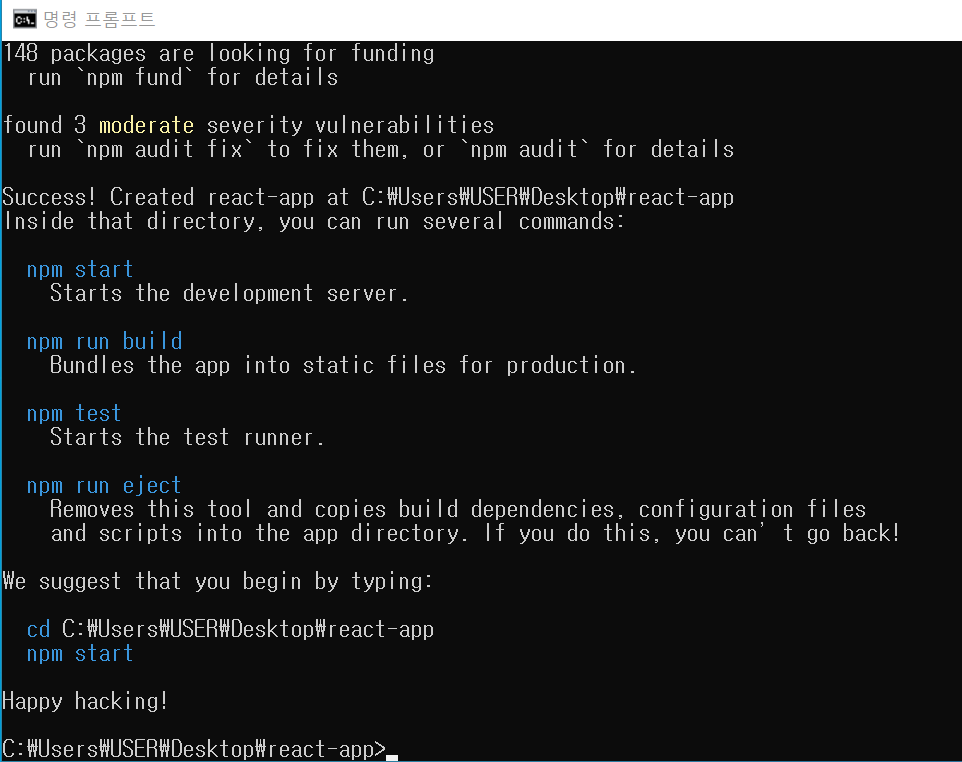

*설치 완료 후 터미널 상황*

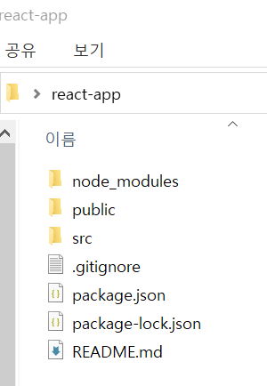

*설치 후 폴더 상황*

### 샘플 앱 실행

폴더 안으로 들어가서 VSCode를 열고, 상단 메뉴에서 보기 → 터미널로 내장 터미널을 띄운다. `npm run start`를 입력하면 개발 서버가 뜬다(`npx`로도 되지만 그러면 서버를 한 번만 띄워준다).

```bash
npm run start
```

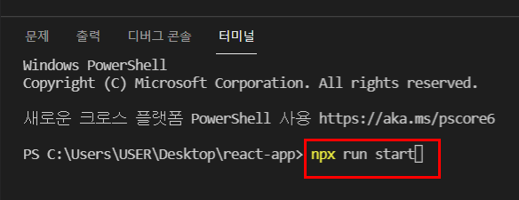

*터미널상 코드 실행*

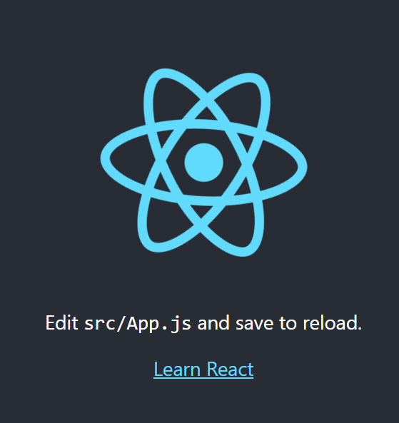

*실행 완료 시 보이는 화면*

리액트가 기본으로 제공하는 샘플 웹이니 당황할 필요 없다. 종료할 땐 `ctrl+c`.

## ✅ 실무에서는 이렇게 쓴다 — 빌드와 배포

샘플 웹의 개발자 도구를 열어보면 리액트가 기본 제공하는 파일들 때문에 용량이 꽤 크다(1.7MB). 불필요한 파일을 걷어내고 코드를 간소화하려면 빌드를 거쳐야 한다(472KB까지 줄어든다). `public/index.html`이 이 과정에서 간소화된다.

```bash
npm run build
```

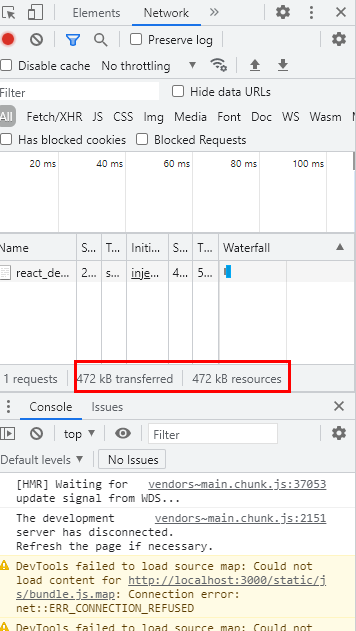

*빌드 완료 상황*

빌드가 끝나면 아래처럼 출력되고 `build` 폴더가 자동으로 생긴다.

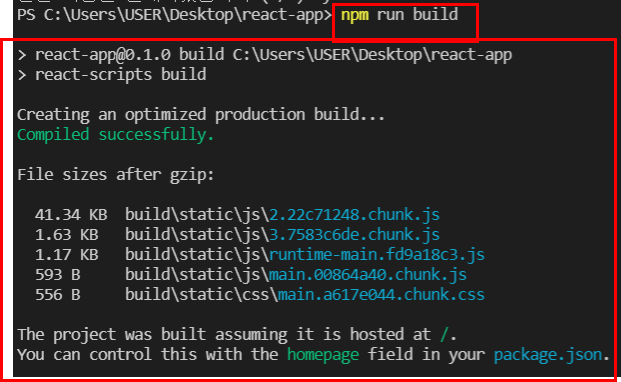

*터미널 출력 결과*

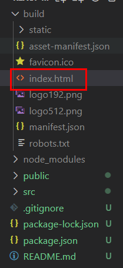

*build 폴더 생성 화면*

로컬에서 빌드 결과를 서버로 띄워 확인하고 싶으면(선택 사항, 서버 주소는 3000에서 5000으로 바뀐다) 아래처럼 한다. `npx`로 실행했다면 `ctrl+c`로 나가는 순간 서버도 종료된다.

```bash
npm install -g serve   # npm으로 서버 설치
npx serve -s build     # npx로 서버 실행
```

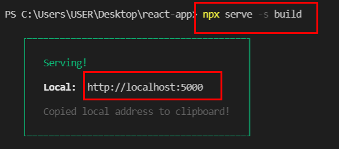

*결과 터미널*

서버가 뜨면 자동 생성된 URL로 들어가서 빌드된 앱을 확인할 수 있다.

마지막으로 크롬 확장 프로그램 React Developer Tools를 추가해두면 개발자 도구에서 JSX 트리를 바로 볼 수 있어 유용하다.

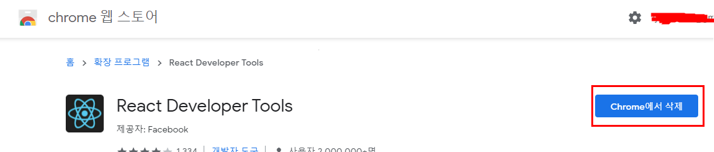

*리액트 확장 프로그램 추가 화면*

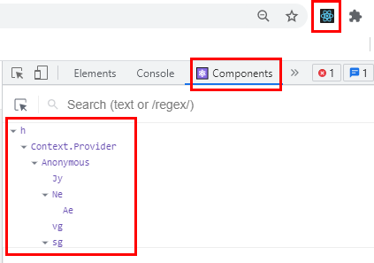

## ✅ 기본 폴더 구성 이해하기

처음 볼 땐 낯설 수 있는 CRA 기본 구조를 정리했다.

1. `public/index.html`은 실질적으로 화면을 그리는 메인 파일이다. `id="root"` 값을 가진 태그는 반드시 있어야 한다.

```html
<noscript>You need to enable JavaScript to run this app.</noscript>
<div id="root"></div>
```

2. `src/index.js`는 `App.js`가 반환한 JSX를 `index.html`의 `root` 태그 안에 그려주는 역할을 한다. 아래 코드는 반드시 있어야 하고, `App`은 import로 연결돼 있어야 한다.

```javascript
import App from './App';

ReactDOM.render(
  <React.StrictMode>
    <App />
  </React.StrictMode>,
  document.getElementById('root')
);
```

3. `src/App.js`의 `App` 컴포넌트는 JSX 문법으로 만든 화면을 `index.js`로 전달하는 역할을 한다. 기본은 함수형으로 생성되며, 클래스형으로 바꾸고 싶다면 아래처럼 수정한다. 태그 하나로 전체를 감싸야 하고, 그 안에는 보통 직접 만든 컴포넌트를 채운다.

```javascript
// 함수형 컴포넌트
import './App.css';

function App() {
  return (
    <div className="App">
      {/* 여기 안에 원래 있던 리액트 기본 제공 마크업은 지워도 됨. 여기에 직접 만든 컴포넌트가 들어감 */}
    </div>
  );
}

export default App;

// 클래스형 컴포넌트로 바꾼 경우
import './App.css';
import { Component } from 'react';

class App extends Component {
  render(props) {
    return (
      <div className="App"></div>
    );
  }
}

export default App;
```

4. 직접 만드는 폴더·파일은 전부 `src` 폴더 안에 둔다.
5. `src/App.css`, `src/index.css`, `public` 안의 이미지들은 리액트가 기본 제공하는 것들이라 지워도 상관없다.

## ✅ Summary

- Node.js·npm 설치 → `create-react-app` 전역 설치 → 프로젝트 폴더에서 `create-react-app .`으로 초기화하는 순서로 진행함
- `npm run build`로 불필요한 파일을 걷어내고 용량을 줄인 뒤 `serve`로 로컬 배포 결과를 확인할 수 있음
- `public/index.html` → `src/index.js` → `src/App.js` 세 파일의 연결 관계만 이해하면 CRA 기본 구조는 끝임

## 참고한 링크

- [생활코딩 — React](https://opentutorials.org/module/4058)
- [생활코딩 React 개발 환경](https://velog.io/@chez_bono/%EC%83%9D%ED%99%9C%EC%BD%94%EB%94%A9-React-%EA%B0%9C%EB%B0%9C-%ED%99%98%EA%B2%BD)
- [React 공식 문서 — 시작하기](https://ko.reactjs.org/docs/getting-started.html)

