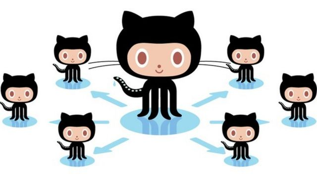
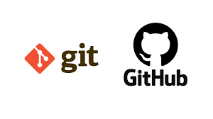
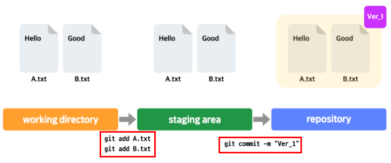
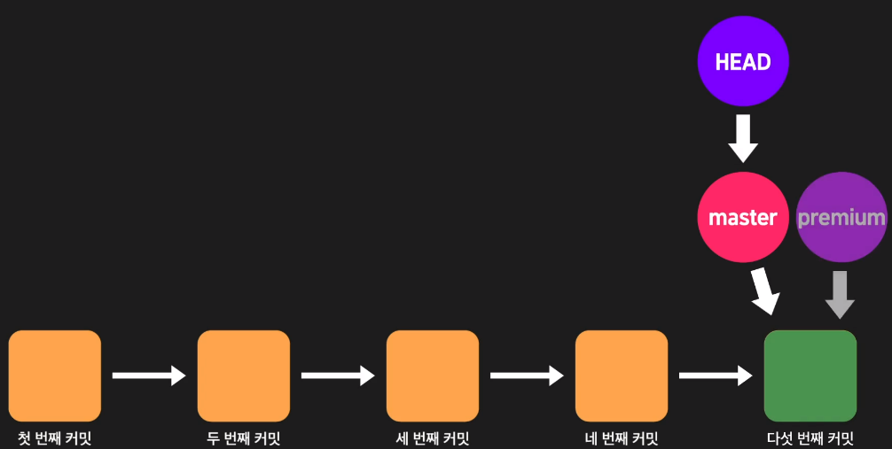
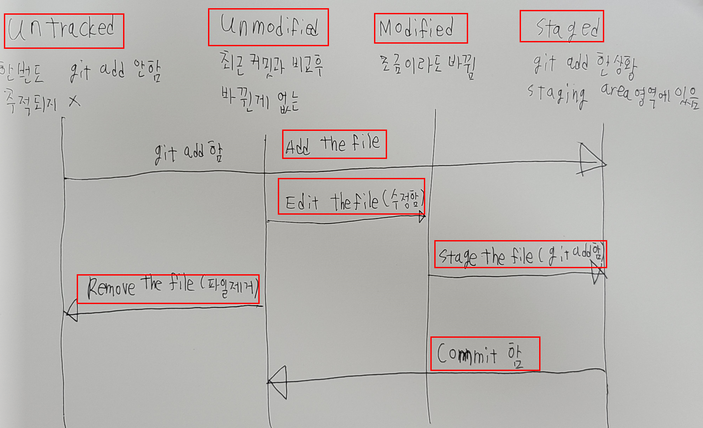
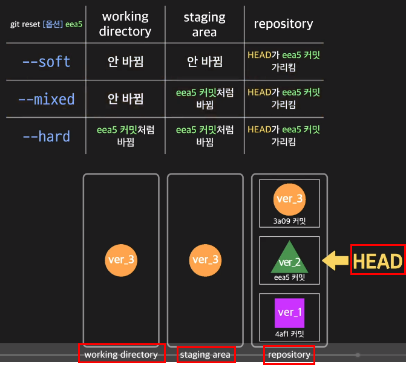

> **TL;DR** — Git은 로컬에서 버전을 관리하는 도구고, GitHub는 그걸 원격 저장소에 호스팅해서 협업을 가능하게 해주는 서비스다. 파일 상태(untracked → staged → unmodified)의 흐름과 기본 명령어만 손에 익히면 나머지는 필요할 때 찾아 쓰면 된다.

난이도 : ★☆☆☆☆

1️⃣ `Git vs GitHub` 2️⃣ `파일 상태 흐름` 3️⃣ `Git Bash 명령어`

## ✅ 왜 알아야 하나

Git을 왜 쓰는지, GitHub와는 뭐가 다른지 헷갈린 채로 명령어만 따라 치던 시기가 있었다. 이번 글에서 개념부터 파일 상태, 실습으로 직접 커밋·브랜치·푸시까지 정리했다.



## ✅ Git 들어가기 전 — 서버 모델 vs 분산 모델

| 모델 | 설명 |
| --- | --- |
| 서버 모델(클라이언트) | 하나의 중앙 서버가 존재하며, 클라이언트들은 중앙 서버에서 자기 파트만 가져와 작업하고 다시 통합함. 대표적으로 CVS, Subversion(SVN) |
| 분산 모델 | 중앙 서버는 있지만, 클라이언트들이 각자 컴퓨터에 전체 사본을 가지고 작업함. 대표적으로 Git |

## ✅ Git vs GitHub (웹 호스팅 시스템)

| 구분 | 설명 |
| --- | --- |
| Git (로컬 영역) | 버전별로 관리 가능한 형상관리 도구. 소스 코드를 USB나 메일로 주고받는 건 낭비고 보안 위험도 있어서 이를 해결하는 수단으로 쓰임. 리누스 토르발스가 만듦. 버전별로 어느 부분이 수정·삭제됐는지 확인 가능하고 이전 버전으로 되돌아갈 수 있음. Git 자체 커널(git bash)에서 명령어를 씀. 분산 버전 관리라 인터넷이 없는 곳에서도 개발 가능하고, 중앙 저장소가 날아가도 복구 가능함 |
| GitHub (리모트 영역) | 로컬에서만 버전을 관리하면 그 컴퓨터가 다운될 때 복구가 불가능해서, 중앙 서버에서 관리(호스팅)해줌. `push`·`pull`로 여러 사람과 코드를 공유하며 협업함. 예: GitHub, GitLab, BitBucket |



## ✅ Git 필수 용어

| 용어 | 설명 |
| --- | --- |
| Repository | 작업 폴더를 Git이 관리하게 되면 그 폴더를 레포지토리라고 함. 만드는 명령어는 `git init`(이미 있으면 초기화됨). 커밋하면 파일·데이터가 레포지토리로 이동해 push 준비를 마침 |
| Commit | 변경된 작업 상태를 점검하고 확정해서 저장소에 저장하는 작업 |
| Working Directory | 현재 바라보고 있는 폴더. Git이 관리하기 전 작업 공간 |
| Staging Area | Git이 관리하기 전 준비 단계. 작업 폴더에서 바로 commit하는 게 아니라 `add`로 이 단계를 거친 뒤 레포지토리로 이동함 |
| Head | branch가 직접 commit을 가리키고, head는 branch를 가리키며 간접적으로 commit에 접근함. 경우에 따라 head가 직접 commit을 가리킬 수도 있음 |
| Branch | 가지 또는 분기점. 여러 버전을 나눌 때 씀. `master` 브랜치는 첫 커밋 시 자동 생성됨 |
| Merge | 현재 branch와 입력한 branch 내용을 합쳐 새 커밋을 만드는 것. 충돌(conflict)이 날 수 있으니 주의 |
| README | GitHub에서 프로젝트를 간략히 설명하는 파일. `.md`(마크다운) 확장자로 씀 |





## ✅ Git 파일 상태

파일이 지금 어떤 상태인지, 어떤 액션으로 상태가 바뀌는지를 구분하면 `add`·`commit`이 명확해진다.

| 상태 | 설명 |
| --- | --- |
| Untracked | Git이 추적하지 않는 상태. 한 번도 `git add`를 안 한 상태 |
| Staged | Tracked 상태. `git add`로 staging area에 들어간 상태 |
| Unmodified | Tracked 상태. 커밋 후 수정하지 않은 상태 |
| Modified | Tracked 상태. 최근 커밋과 비교해서 바뀐 상태 |

| 액션 | 상태 변화 |
| --- | --- |
| Add the file | untracked → staged |
| Edit the file | unmodified → modified |
| Stage the file | modified → staged |
| Remove the file | unmodified → untracked |
| Commit | staged → unmodified |



## ✅ Git Bash 명령어

### 기본적으로 알아야 하는 명령어

| 명령어 | 설명 |
| --- | --- |
| `mkdir 이름` | 워킹 디렉토리(폴더) 생성 |
| `cd 프로젝트이름/` | 폴더 안으로 이동 |
| `cd ..` | 상위 폴더로 이동 |
| `git init` | 레포지토리 생성. 이미 있으면 초기화됨 |
| `git config user.name "이름"` | 커밋 전 필요. 사용자 이름 등록 |
| `git config user.email "이메일"` | 커밋 전 필요. 사용자 이메일 등록 |
| `git add 파일이름` | 커밋 전 필요. 안 하면 untracked 상태. working → staging 이동 |
| `git add .` | 전부 add |
| `git reset 파일이름` | add한 것 취소 |
| `git reset --속성` | `hard`·`mixed`·`soft` 속성에 따라 파일 내용이 달라짐 |
| `git commit -m "메모"` | 커밋 메시지 남기기 |
| `git commit` | 텍스트 에디터에서 커밋 메모 작성. `i`로 insert 진입, `Esc` 후 `:wq`로 저장 |
| `git commit --amend` | 새 커밋이 아닌 기존 커밋을 덮어씀. 메모도 수정 가능 |
| `touch 파일이름` | 새 파일 생성 |
| `git branch 브랜치이름` | 브랜치 생성. 인자 없으면 브랜치 전체 조회 |
| `git branch -d 브랜치이름` | 브랜치 삭제 |



### 호스팅 관련 명령어

| 명령어 | 설명 |
| --- | --- |
| `git remote add origin 깃허브url` | 깃허브 url을 origin이라는 이름으로 등록 |
| `git push -u origin master` | 로컬 master가 origin을 계속 가리키도록 설정하고 내용을 전송 |
| `git push` | 로컬 → 리모트. 프로젝트 주인만 기본 가능, 협업하려면 권한 설정 필요 |
| `git revert 커밋아이디` | push 전에 되돌리고 싶은 커밋을 선택하면 새 커밋이 생성되며 이전 상태로 복귀 |
| `git fetch` | 리모트 → 로컬. merge는 따로 해야 함. 변경 사항 점검할 때 사용 |
| `git pull` | 리모트 → 로컬. merge까지 자동으로 해줌 |
| `git clone 깃허브url` | 다른 사람 프로젝트를 가져올 때 사용 |

### 그 외 명령어 (태그·merge 등)

| 명령어 | 설명 |
| --- | --- |
| `git config alias.별명 '내용'` | 명령어를 별명으로 축약 |
| `git diff 커밋아이디` | 두 커밋·브랜치의 차이를 보여줌 |
| `git tag 태그이름 커밋아이디` | 커밋에 태그 달기 |
| `git tag -d 지울태그명` | 태그 삭제 |
| `git show 태그이름` | 태그 정보 확인 |
| `git checkout 브랜치이름` 또는 `커밋아이디` | 브랜치를 쓰면 head가 해당 브랜치를, 커밋아이디를 쓰면 head가 직접 해당 커밋을 가리킴 |
| `git checkout -b 브랜치이름` | 브랜치 생성 후 바로 이동 |
| `git merge 브랜치이름` | 현재 branch와 입력한 branch를 합쳐 새 머지 커밋을 만듦 |
| `git merge --abort` | merge 취소 |
| `git rebase 브랜치이름` | 대상 브랜치 내용을 가져와 현재 브랜치와 병합 없이 이어붙인 것처럼 만듦(merge와는 다름) |
| `git rebase --continue` | rebase 중 충돌 해결 후 이어서 진행 |
| `git stash` | 작업 내용을 스택에 저장하고 이전 커밋 상태로 돌아감. 커밋 안 하면 다른 브랜치로 못 가기 때문 |
| `git stash apply` | 스택에 저장한 내용을 다시 가져옴. 기존이 아닌 다른 브랜치에서도 적용 가능 |
| `git stash drop/pop 아이디` | stash 목록 중 하나를 골라 삭제/적용 후 삭제 |

**함정 — 이미 push한 브랜치를 rebase하면** — `rebase`는 커밋 히스토리 자체를 새로 만드는(커밋 해시가 바뀌는) 작업이다. 나만 보는 로컬 브랜치를 정리할 때는 안전하지만, 이미 원격에 push해서 다른 사람도 받아 간 브랜치를 rebase하면 그 사람의 히스토리와 어긋나서 이후 push/pull 시 충돌이 크게 난다. "공유된 브랜치는 rebase하지 않는다"가 일반적인 원칙이고, 이미 push한 커밋을 rebase했다면 `--force`로 강제 push해야 하는데 이는 다른 협업자의 작업을 덮어쓸 위험이 있어 조심해야 한다.

### 목록 조회 명령어

| 명령어 | 설명 |
| --- | --- |
| `ls`, `ls -a` | 목록 조회 |
| `git branch` | 브랜치 목록 조회 |
| `git log --pretty=oneline` | 커밋 히스토리를 한 줄씩 조회 |
| `git log --pretty=oneline --all` | 모든 브랜치의 커밋 목록 조회 |
| `git log --pretty=oneline --all --graph` | 모든 브랜치의 커밋 목록을 그래프로 조회 |
| `git log` | 지금까지의 커밋 이력(아래로 갈수록 오래됨), 커밋 해시 확인 가능 |
| `cat 파일명` | 해당 파일의 working directory 내용을 읽음 |
| `git tag 태그이름` | 태그 목록 확인 |
| `git stash list` | 스택에 저장한 커밋 목록 확인 |
| `git help 명령어` | 명령어 상세 설명 |
| `git reflog` | Head가 이제까지 가리켰던 커밋 목록 |
| `git blame 파일` | 파일의 각 부분을 언제 누가 어떤 커밋으로 수정했는지 확인 |
| `git status` | 현재 브랜치·상태 확인 |
| `git show 커밋아이디` | 해당 커밋 내용을 자세히 확인 |

## ✅ 직접 확인해보기

### 1. 프로젝트 디렉토리 생성 및 레포지토리 생성

```bash
USER@DESKTOP MINGW64 ~/Desktop/코드잇/gitHub  <-- 현재 경로
$ mkdir MathTool  <-- 프로젝트 디렉토리 생성

USER@DESKTOP MINGW64 ~/Desktop/코드잇/gitHub
$ cd MathTool/  <-- MathTool 폴더 안으로 이동

USER@DESKTOP MINGW64 ~/Desktop/코드잇/gitHub/MathTool
$ git init  <-- 비어 있는 레포지토리 생성
Initialized empty Git repository in C:/Users/USER/Desktop/코드잇/gitHub/MathTool/.git/

USER@DESKTOP MINGW64 ~/Desktop/코드잇/gitHub/MathTool (master)
$ cd .git  <-- 레포지토리 안으로 이동
$ ls -al
drwxr-xr-x 1 USER 197121   0 Aug 10 17:11 ./
drwxr-xr-x 1 USER 197121   0 Aug 10 17:11 ../
-rw-r--r-- 1 USER 197121  23 Aug 10 17:11 HEAD
-rw-r--r-- 1 USER 197121 130 Aug 10 17:11 config
-rw-r--r-- 1 USER 197121  73 Aug 10 17:11 description
drwxr-xr-x 1 USER 197121   0 Aug 10 17:11 hooks/
drwxr-xr-x 1 USER 197121   0 Aug 10 17:11 info/
drwxr-xr-x 1 USER 197121   0 Aug 10 17:11 objects/
drwxr-xr-x 1 USER 197121   0 Aug 10 17:11 refs/
```

### 2. 새 파일 커밋 등록하기

```bash
$ cd ..
$ git config user.name "jisue"       # 필수 1 : 사용자 이름
$ git config user.email "본인 이메일"  # 필수 2 : 사용자 이메일
$ git add calculator.js               # 커밋 전 필요. 안 하면 untracked
$ git add License
$ git commit -m "Create calculator.js and License"  # 필수 3 : 커밋 메시지
[master (root-commit) 6744671] Create calculator.js and License
 2 files changed, 7 insertions(+)
 create mode 100644 License
 create mode 100644 calculator.js

$ git status
On branch master
Changes to be committed:
        modified:   calculator.js
```

### 3. 새 폴더에 파일 만들고 한 번에 등록·취소하기

```bash
$ mkdir meeting-log
$ cd meeting-log/
$ touch day1  # 새 파일 생성
$ touch day2
$ cd ..
$ git add meeting-log/   # 한 번에 추가
$ git add .              # 전체 추가
$ git reset calculator.js  # 등록 취소
Unstaged changes after reset:
M       calculator.js
```

### 4. GitHub에 연결하기

```bash
$ cd MathTool/
$ git remote add origin https://github.com/seong-ji-sue/Box.git
$ git push -u origin master
Enumerating objects: 10, done.
Counting objects: 100% (10/10), done.
Delta compression using up to 8 threads
Compressing objects: 100% (7/7), done.
Writing objects: 100% (10/10), 738 bytes | 738.00 KiB/s, done.
Total 10 (delta 1), reused 0 (delta 0), pack-reused 0
remote: Resolving deltas: 100% (1/1), done.
To https://github.com/seong-ji-sue/Box.git
 * [new branch]      master -> master
Branch 'master' set up to track remote branch 'master' from 'origin'.
```

### 5. 브랜치 만들기

```bash
$ git branch premium         # premium 브랜치 생성
$ git checkout premium       # head가 premium을 가리키도록 전환
Switched to branch 'premium'

$ git status
On branch premium
nothing to commit, working tree clean

$ git push   # master는 -u 해뒀지만 premium은 안 해줬음
fatal: The current branch premium has no upstream branch.
To push the current branch and set the remote as upstream, use

    git push --set-upstream origin premium
```

## ✅ 실무에서 마주친 질문 — 로컬 코드를 두 개의 원격 저장소에?

프로젝트 팀 레포지토리에 과제를 push한 상태에서, 개인 GitHub 레포지토리에도 같은 코드를 올리고 싶은 상황이었다. 멘토님께 여쭤본 답은 이랬다.

- 로컬 하나를 서로 다른 두 remote에 push해서 관리하는 경우는 거의 없음
- `repository fork` 기능을 쓰면 의도대로 적용 가능함 — 특정 레포를 바라보는 제2의 레포지토리를 만들어 연동함

## ✅ 정리

- Git은 로컬 버전 관리 도구, GitHub는 그걸 원격에서 호스팅하는 서비스임 — 역할이 다름
- 파일 상태는 untracked → staged → unmodified/modified 흐름으로 움직이고, `add`·`commit`이 각 전환을 담당함
- 기본 명령어(`init`·`add`·`commit`·`push`·`pull`·`branch`)만 손에 익으면 나머지는 그때그때 찾아 쓰면 됨

## 참고한 링크

- [Git fork와 clone의 차이점](https://velog.io/@imacoolgirlyo/Git-fork%EC%99%80-clone-%EC%9D%98-%EC%B0%A8%EC%9D%B4%EC%A0%90-5sjuhwfzgp)
