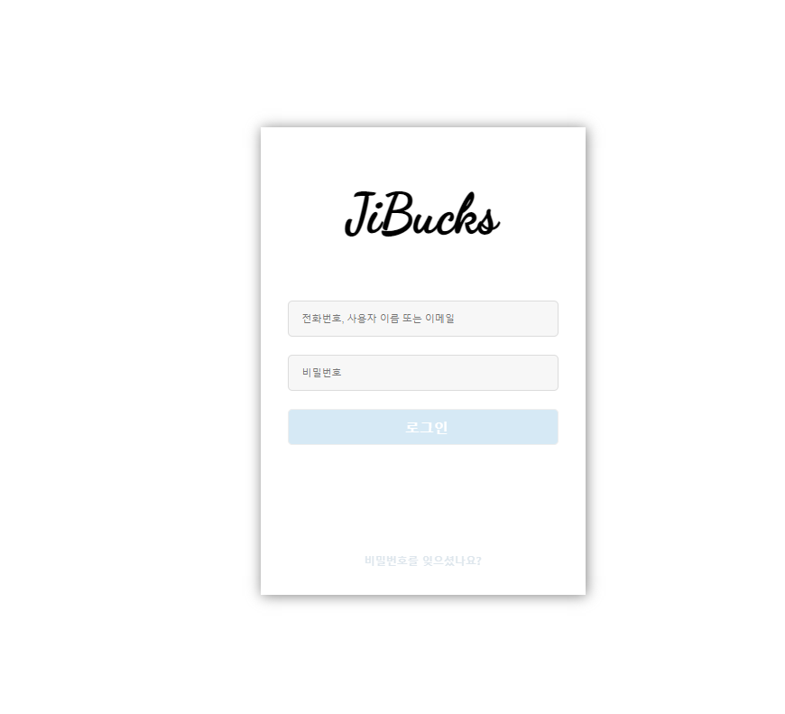
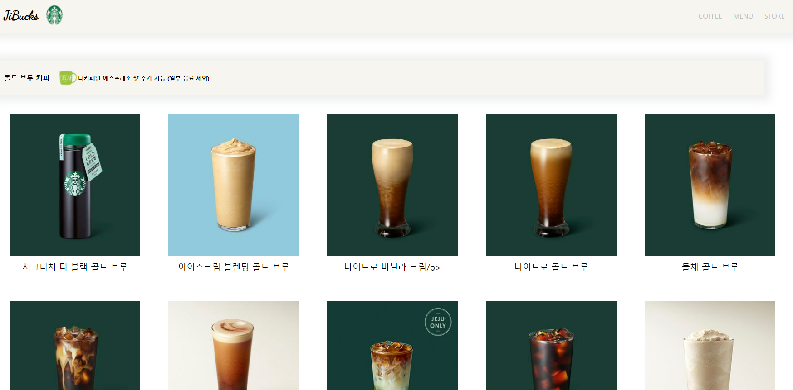
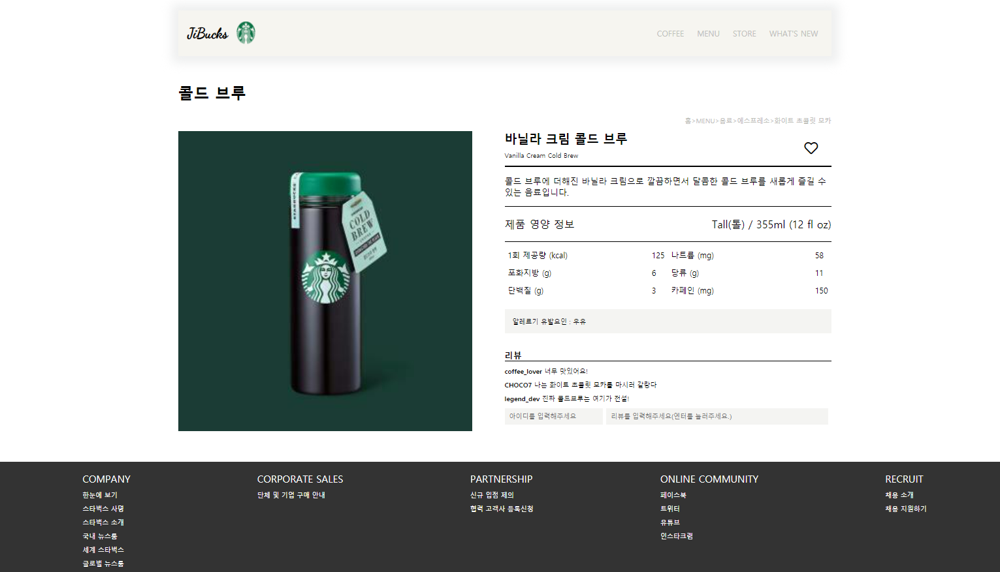

> **TL;DR** — 스타벅스 클론(Webucks) 미션 6개를 로그인·리스트·상세 페이지 순서로 구현하며 DOM·Flex·Semantic 태그를 한 번에 체화한 프로젝트였음.

## ✅ 상황 (Situation)

2주차 핵심 과제는 Webucks — 스타벅스 사이트를 HTML·CSS·JavaScript로 클론하는 프로젝트였다. 로그인, 커피 리스트, 커피 상세 3개 페이지를 미션 단위로 나눠 구현하는 구조였고, 1주일 안에 도전과제까지 끝내기엔 시간이 늘 빠듯했다.

## ✅ 목표와 내 역할 (Task)

미션 1~6을 순서대로 완주하는 것이 목표였다.

- 미션 1 — 로그인 페이지 레이아웃 구현
- 미션 2 — 로그인 페이지 기능 구현 (버튼 활성화 조건, 페이지 이동)
- 미션 3 — 커피 리스트 페이지 레이아웃 구현
- 미션 4 — 커피 상세 페이지 레이아웃 구현
- 미션 5 — 커피 상세 페이지 기능 구현 (좋아요, 댓글)
- 미션 6 — 도전과제 (댓글 삭제, 개별 좋아요, 비밀번호 검증, 반응형)

## ✅ 한 것 (Action)

로고는 이미지 태그와 구글 폰트 중 하나로 구현했고, 로그인 박스는 `form`과 `input`으로 레이아웃을 짰다. 아이디에 `@`가 포함되고 비밀번호가 8자 이상이면 로그인 버튼이 연한 파란색에서 진한 파란색으로 활성화되도록 구현했고, 조건을 만족한 채 버튼을 누르면 리스트 페이지로 넘어가게 했다.

커피 리스트 페이지는 콜드 브루·브루드 커피 두 종류를 flex로 배치하고, 이미지에 마우스를 올리면 확대되는 효과를 실제 스타벅스 사이트를 참고해 구현했다. 상세 페이지엔 알러지 정보 박스를 필수로 넣었고, 좋아요 버튼을 누르면 하트 색이 붉게 바뀌도록, 리뷰 입력창에 엔터를 치면 댓글이 추가되도록 구현한 뒤 2차 리팩토링을 진행했다.

도전과제로는 리뷰 댓글 삭제, 리뷰별 개별 좋아요, 이메일 형식에 맞으면 테두리가 초록색으로 바뀌는 검증, 영문 대소문자·특수문자·숫자를 포함한 8자 이상 비밀번호 검증, 비밀번호 입력창의 show/hide 토글, 리스트 페이지 반응형까지 구현했다.

과정에서 잡은 것들:

- Semantic 태그를 고려해서 마크업해야 한다는 것
- `flex`로 정렬하려면 상위 태그가 있어야 한다는 것
- `id` 선택자가 CSS 우선순위 중 가장 높다는 것
- `script` 태그는 맨 아래에 두거나 `defer` 속성을 준다는 것
- `addEventListener`는 이벤트가 끝나는 지점의 태그를 대상으로 지정한다는 것
- 경로 이동은 `location.href` 속성으로 처리한다는 것

## ✅ 결과 (Result)

로그인·리스트·상세 3개 화면을 도전과제까지 포함해 완성했다. 금요일에 멘토가 무작위로 코드를 골라 zoom에서 깃으로 피드백을 주는 시간이 있었는데, 고칠 부분이 많아서 하루 종일 리팩토링에 매달렸다.

## ✅ 배운 점 / 아쉬운 점

- 잘한 것: 미션을 순서대로 밟으면서 DOM·Flex·Semantic 태그를 한 번에 체화한 것
- 아쉬운 점: 도전과제까지 욕심내다 보니 시간이 항상 빠듯했던 것, 반응형을 뒤늦게 고려한 것
- 다음에 다르게 할 것: 처음부터 반응형을 염두에 두고 레이아웃을 설계하기

## 참고한 링크

- [Webucks 클론 코딩 레포 및 미션](https://github.com/wecode-bootcamp-korea/webucks-javascript/issues)
- [Font Awesome](https://fontawesome.com/)
- [Flexbox Froggy](https://flexboxfroggy.com/#ko)
