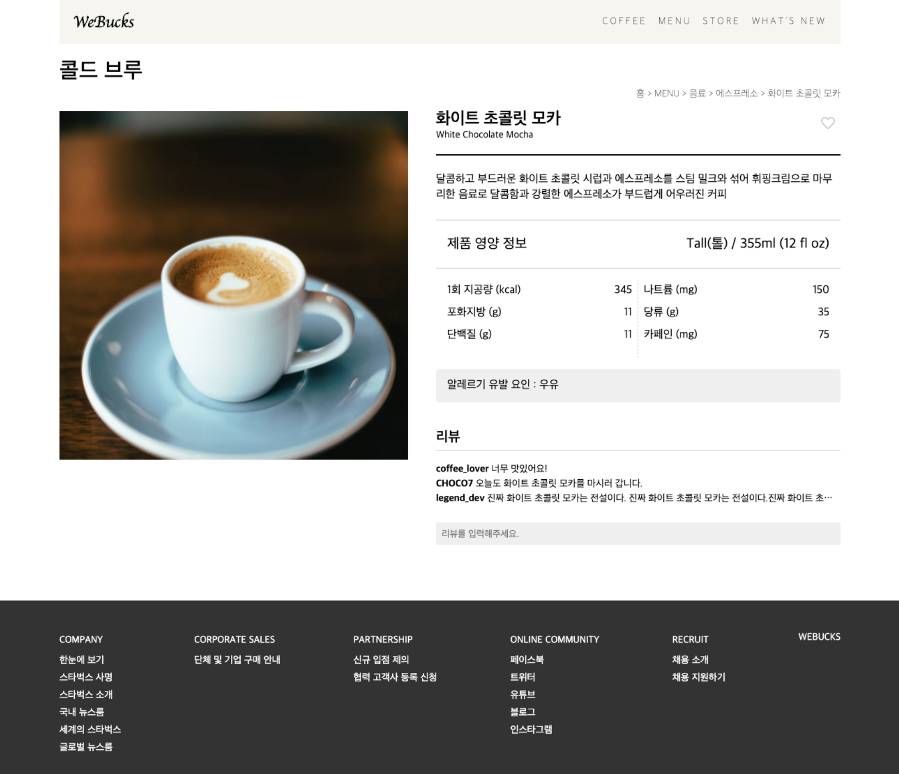

> **TL;DR** — 2주차엔 DOM 개념을 정리하고 Webucks(스타벅스) 클론 프로젝트를 진행했다. 다음 주가 리액트라는 걸 알고 다들 미리 긴장한 한 주였음.

## ✅ 상황 (Situation)

1주차 HTML/CSS 레플릿을 마치고 2주차엔 DOM 개념과 Webucks 클론 프로젝트에 들어갔다. 첫 프로젝트를 끝냈다는 성취감과 별개로, 다음 주가 리액트라는 걸 알고 있어서 다들 긴장한 분위기였다.

## ✅ 목표와 내 역할 (Task)

DOM 개념을 정리하고 예시 코드로 확인하는 것, Webucks 미션을 최대한 진행하는 것, git/github 사용법을 TIL로 정리하는 것이 이번 주 목표였다. SQLD 문제 복습과 flex 복습도 병행했다.

## ✅ 한 것 (Action)

평일엔 계획한 13개 항목을 전부 끝냈다.

- 코드잇·노션·생활코딩을 참고해 DOM 개념(노드 탐색, 요소 생성·삭제, 이벤트 리스너 등록 같은 기본 조작) 정리 후 예시 코드로 확인
- SQLD 1회차 문제 재풀이, 자바스크립트 레플릿 시험 재도전
- JS 트러블슈팅 팀 과제, DOM 개인 과제
- Webucks 미션 1 완료 후 미션 5까지 진행, 미션 3까지 끝내고 1차 리팩토링
- git/github TIL 재정리, flex TIL 재정리
- git 관련 질문을 멘토에게 올리고 답변 받은 내용을 적용

주말엔 github TIL 작성, 생활코딩 리액트 강좌 수강 및 실습, 학점은행 강의 2개는 끝냈지만, ZiBu 개인 페이지 수정, 2주차 후기 작성, `transform`/`transition` 정리, 리액트 TIL·개념 정리, 취업지원제도 확인은 다음으로 미뤘다.

아직 못 잡은 것도 정리해뒀다 — flex 완전 정복(개구리 문제 반복 필요), `id` 속성의 CSS 우선순위, 이벤트 발생 시 경로 이동 방법, `defer`, `transform`/`transition`. 반대로 git fork로 프로젝트 레포를 내 레포로 가져오는 방법은 이번 주에 해결했다.

## ✅ 결과 (Result)

Webucks 미션 5까지 진행했고, 금요일 멘토가 진행한 랜덤 코드 리뷰에서 피드백을 받은 뒤 하루 종일 리팩토링에 매달렸다. 리액트 사전 학습으로 생활코딩 강좌를 다 듣고 실습까지 마쳐서 다음 주를 준비했다.

## ✅ 배운 점 / 아쉬운 점

- 잘한 것: 과제를 빨리 끝내면 다른 사람과 코드를 비교해볼 여유가 생긴다는 걸 체감한 것, 팀원들이 실력이 좋아서 질문하며 많이 배운 것
- 아쉬운 점: 주말 계획을 절반도 못 지킨 것, flex와 CSS 우선순위 규칙에 아직 구멍이 많다는 것
- 다음에 다르게 할 것: 진도를 최대한 빨리 끝내고 남는 시간을 리팩토링과 리액트 예습에 투자하기 (덤으로, 지하 식당 중국집이 진짜 맛있다는 것도 이번 주의 발견 ㅋㅋ)

## 참고한 링크

- [DOM 완전히 잡아가기 — 이론 정리](https://zibu-story.tistory.com/105)
- [Git vs GitHub 차이 정리](https://zibu-story.tistory.com/132)
- [Webucks 클론 코딩 레포](https://github.com/wecode-bootcamp-korea/webucks-javascript/issues)
