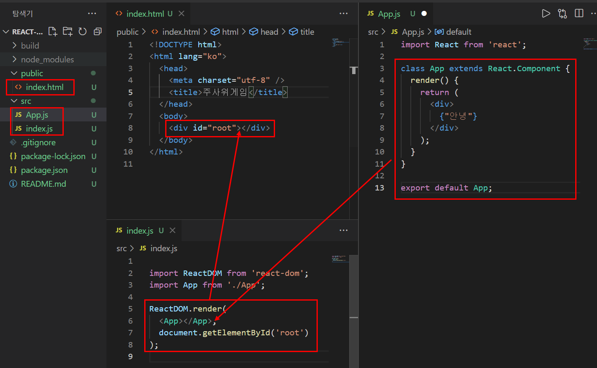
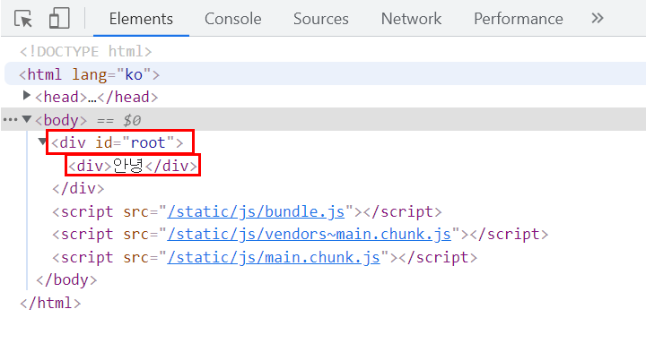

> **TL;DR** — 리액트를 설치했다면 다음은 코드다. 컴포넌트 작성 규칙, Router 기본 컴포넌트, State와 Props의 차이, 이벤트 핸들링까지 — 실제로 코드를 치기 전에 꼭 알아야 하는 것들을 정리했다.

난이도 : ★☆☆☆☆

1️⃣ `state` 2️⃣ `props` 3️⃣ `이벤트 핸들링`

## ✅ 왜 알아야 하나

리액트 설치까지 끝냈다면 이제 코드를 칠 차례다. Props와 State, 이벤트를 다루는 방법은 리액트로 뭔가를 만들려면 반드시 알아야 하는 기본기다.

시작하기 전에 지켜야 할 것들부터 정리한다.

1. 컴포넌트의 `return` 값은 하나의 태그로 감싸야 한다
2. `class`는 자바스크립트 예약어와 겹치므로 `className`으로 지정한다
3. JSX 안에서 자바스크립트 코드를 쓰려면 `{}`로 감싼다
4. 태그 속성은 카멜케이스로 쓴다
5. 컴포넌트나 태그에 이벤트를 걸 때는 콜백 함수를 대입한다
6. 이벤트 콜백 함수 안의 `this`는 별도로 바인딩하지 않으면 원하는 값을 가리키지 않는다
7. CRA로 처음 만들면 `index.html`, `index.js`, 최소 하나의 공통 컴포넌트는 반드시 있어야 한다(나머지는 지워도 무방)
8. 컴포넌트를 만들어 `index.js`에 전달하면 `ReactDOM.render`가 `index.html`의 `root` 태그 안에 그려준다
9. `Link`, `Router`, `Switch`, `Route`처럼 이미 만들어진 컴포넌트도 있다

## ✅ 컴포넌트란

동적인 HTML 코드를 JSX 문법으로 쪼개서 만든, 자바스크립트화된 HTML 조각이다. 컴포넌트 합성을 통해 UI를 재사용하고 독립적인 단위로 나눠서 생각할 수 있게 해준다. React 공식 문서도 상속 대신 컴포넌트를 쪼개서 합성하는 방식을 권장한다.

HTML 코드는 `index.html`에서만 쓰고 나머지는 전부 자바스크립트 코드로 작성한다. 컴포넌트를 만드는 방법은 함수형과 클래스형 두 가지다.

```javascript
// 함수형 컴포넌트
import React from 'react';

function ReactFunc(props) {
  // ...statements
}
```

```javascript
// 클래스형 컴포넌트
import React from 'react';

class ReactFunc extends React.Component {
  constructor(props) {
    super(props);
    this.state = {};
  }

  render() {
    return (
      // ...statements
    );
  }
}
```

## ✅ 직접 확인해보기 — 코드 동작 흐름

작성한 코드가 브라우저에서 어떻게 그려지는지 개발자 도구로 직접 확인해봤다.



*코드상 이미지*



*브라우저 개발자도구*

## ✅ Router 기본 컴포넌트

`path` 속성으로 원하는 URL을 지정하면 그 경로에 맞는 컴포넌트를 렌더링해준다. 브라우저 새로고침 없이 컴포넌트만 바뀌기 때문에 마치 모바일 앱처럼 빠르게 화면이 전환된다.

`<a>` 태그와 `<Link>` 컴포넌트의 차이: `<a>`는 페이지 바깥으로 이동할 때 쓰고, `<Link>`는 한 컴포넌트 안에서 경로를 주고받을 때 쓴다.

| 컴포넌트 | 역할 |
|---|---|
| `BrowserRouter` | URL과 UI를 동기화하는 라우터. History API로 새로고침 없이 주소를 바꾸고, 관련 정보를 props로 조회할 수 있게 해줌 |
| `Switch` | 자식 `Route` 중 매칭되는 첫 번째 라우트만 렌더링함. 없으면 `/`가 포함된 다른 경로(`/detail`, `/login` 등)까지 다 같이 렌더링되는 문제가 생김 |
| `Route` | `path` 속성으로 지정한 URL에 접속하면 해당 컴포넌트만 렌더링함. `exact`를 주면 경로가 완전히 일치해야 함 |
| `Link` | `<a>`와 비슷하지만 지정한 URL로 새로고침 없이 이동시켜줌. 단, 페이지가 아예 바뀌면 기존 컴포넌트가 들고 있던 상태값은 사라질 수 있음 |

```javascript
// index.js
import { BrowserRouter } from "react-router-dom";
// ...

// App.js
import { Route, Link, Switch } from "react-router-dom";
import Detail from "./Detail";
import Main from "./Main";

function App() {
  return (
    <div className="App">
      <Switch>
        <Route exact path="/" component={Main} />
        <Route path="/detail" component={Detail} />
      </Switch>
      <Link to="/">
        <button>홈으로</button>
      </Link>
      <Link
        to={{
          pathname: '/detail',
          state: {              // state로 데이터를 함께 실어 보낼 수 있음
            imgURL: data.img,
            coffeeName: data.name,
          },
        }}
      >
        <button>디테일페이지로</button>
      </Link>
    </div>
  );
}

// detail.js
let listLocation = this.props.location.state; // App.js에서 Link로 전달한 값 사용
```

## ✅ Props와 State — 가장 중요한 개념

| 구분 | 특징 |
|---|---|
| `props` | 상위 컴포넌트가 하위 컴포넌트로 데이터를 전달하는 통로. 태그 속성으로 객체를 넘기면 하위에서 `this.props`로 받음. 읽기 전용이라 직접 수정할 수 없고, 수정하려면 상위 컴포넌트의 `state`를 바꿔야 함. 생성자에서 `super(props)`로 전달 가능. 기본값은 `defaultProps` |
| `state` | 컴포넌트 내부에 값을 저장하고 그 안에서 값을 바꿈. 생성자에서 `this.state`로 초기값을 지정하고, 값을 바꾸려면 반드시 `setState` 메서드를 써야 함. 자식에게 값을 수정하게 하려면 `setState` 메서드 자체를 넘기고, 값을 읽게 하려면 `this.state`를 넘기면 됨. `state`가 바뀌면 `render`가 다시 실행돼 화면이 갱신됨 |

자식 컴포넌트 입장에서는 태그 속성으로 받은 값이 `state`에서 왔는지, `props`에서 왔는지, 아니면 수동으로 입력된 값인지 구분할 수 없다는 점도 알아둬야 한다.

```javascript
// App.js
import React from 'react';
import Detail from './detail';

class App extends React.Component {
  constructor() {
    super();
    this.state = { // state 생성
      num: 1
    };
  }
  render() {
    return (
      <div>
        <button onClick={() => {
          this.setState({ // state 수정
            num: this.state.num + 1
          });
        }}>
          <Detail value={this.state}> {/* detail에 state 넘기기 */}
          </Detail>
        </button>
      </div>
    );
  }
}

export default App;

// detail.js
import React from 'react';

class detail extends React.Component {
  render() {
    return (
      <div>
        <p>{this.props.value.num}</p> {/* props로 state 객체 받기 */}
      </div>
    );
  }
}

export default detail;
```

### setState는 왜 비동기처럼 동작하나

[React 공식 문서 — State and Lifecycle](https://ko.reactjs.org/docs/state-and-lifecycle.html)에 따르면, React는 성능을 위해 여러 `setState()` 호출을 하나의 업데이트로 묶어서 처리할 수 있다. 그래서 `this.props`와 `this.state`는 비동기적으로 업데이트될 수 있어, 다음 state를 계산할 때 이 값들에 그대로 의존하면 안 된다.

```javascript
// Wrong
this.setState({
  counter: this.state.counter + this.props.increment,
});

// Correct
this.setState((state, props) => ({
  counter: state.counter + props.increment
}));
```

객체 대신 함수를 인자로 넘기는 형태를 쓰면, 그 함수는 이전 state를 첫 번째 인자로, 업데이트 시점의 props를 두 번째 인자로 받는다.

## ✅ 이벤트 다루는 법

- `form` 태그에서 이벤트가 발생하면 안의 태그들이 이벤트를 발생시켜도 무시된다(가능하면 form 자체를 안 쓰는 게 낫다)
- 이벤트의 기본 동작을 막으려면 `e.preventDefault()`를 쓴다
- 이벤트 콜백 안에서 `this`는 기본적으로 아무것도 가리키지 않으므로, 콜백 함수 뒤에 `.bind(this)`를 붙여야 한다
- `bind`의 두 번째 인자는 콜백 함수의 첫 번째 파라미터로 전달된다

| 이벤트 | 발생 시점 |
|---|---|
| `onChange` | 태그의 value 값이 바뀔 때 |
| `onClick` | 마우스 왼쪽 버튼을 누를 때 |
| `onKeyPress` | 키보드 버튼을 누르는 순간 |
| `onSubmit` | 폼 데이터를 전송하려는 순간 |

```javascript
// App.js
import React from 'react';
import Detail from './detail';

class App extends React.Component {
  constructor() {
    super();
    this.state = { // state 생성
      num: 1
    };
  }
  render() {
    return (
      <div>
        <button onClick={function (e) {
          e.preventDefault(); // onClick 기본 동작 무시
          this.setState({ // state 수정
            num: this.state.num + 1
          });
        }.bind(this)}> {/* 이벤트 콜백에서는 bind로 this를 지정해줘야 함 */}
          <Detail value={this.state}> {/* detail에 state 넘기기 */}
          </Detail>
        </button>
      </div>
    );
  }
}

export default App;
```

## ✅ Summary

- 컴포넌트는 함수형·클래스형 두 방식으로 만들 수 있고, `return`은 하나의 태그로 감싸야 함
- `props`는 읽기 전용 하향 데이터, `state`는 컴포넌트 내부 값이며 반드시 `setState`로만 바꿔야 함
- 이벤트 콜백 안 `this`는 `bind(this)`로 직접 연결해야 하고, 기본 동작을 막으려면 `e.preventDefault()`를 씀

## 참고한 링크

- [컴포넌트(Component)란?](https://pstudio411.tistory.com/entry/%EC%BB%B4%ED%8F%AC%EB%84%8C%ED%8A%B8Component%EB%9E%80?category=920340)
- [리액트를 다루는 기술 — 4장 이벤트 핸들링](https://velog.io/@younho9/%EB%A6%AC%EC%95%A1%ED%8A%B8%EB%A5%BC-%EB%8B%A4%EB%A3%A8%EB%8A%94-%EA%B8%B0%EC%88%A0-4%EC%9E%A5-%EC%9D%B4%EB%B2%A4%ED%8A%B8-%ED%95%B8%EB%93%A4%EB%A7%81)
- [React Switch는 언제 써야 할까](https://baeharam.netlify.app/posts/react/why-switch-is-needed)
- [React Router — Link](https://reactrouter.com/web/api/Link)
- [React 공식 문서 — SyntheticEvent](https://reactjs.org/docs/events.html)
