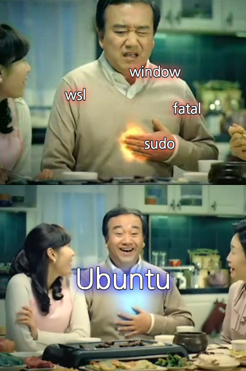

> **TL;DR** — 위코드 Foundation 3~4주차는 리액트의 계절이었다. 바닐라 코딩으로 만든 webucks 프로젝트를 리액트로 옮기고, 팀원·멘토 리뷰를 받으며 미션 9종을 완료했다. 조금이라도 뒤처진다 싶으면 바로 복습해야 따라갈 수 있는 밀도였다.

난이도 : ★☆☆☆☆

## ✅ 상황 (Situation)

3주차, 4주차는 리액트의 계절이었다. 무시하고 넘어갈 수 없고, 조금이라도 뒤처진다 싶으면 바로 복습·예습을 해야 하는 밀도였다. 2주차 주말에 모두가 복습을 신신당부해서 생활코딩을 완주했는데, 처음부터 개념을 잡고 시작하는 방식이 아니라 코드를 쳐가며 배우는 방식이라 기초가 약하면 꽤 힘들 수 있다(자바스크립트·HTML·CSS 과정을 먼저 듣는 걸 추천).

3주차는 바닐라 코딩으로 만든 webucks 프로젝트를 리액트화(CSS → SCSS, HTML → JSX)하는 데 시간이 많이 들었다. 미션 자체는 바닐라 코딩과 비슷하지만 초기 세팅과 목데이터 만들기가 앞에 추가돼서, 처음부터 컴포넌트를 나눠서 시작하는 게 유리했다.

## ✅ 목표와 내 역할 (Task)

3주차는 개인 과제 위주로 리액트 초기 세팅과 컴포넌트 분리를, 4주차는 멘토·팀원 리뷰를 받으며 리팩토링과 기능 구현을 완료하는 것이 목표였다. 리뷰가 있는 4주차는 코드 고치는 데 시간이 오래 걸리지만, 3주차보다는 상대적으로 여유가 있었다.

### 3주차 체크리스트

- 평일
  - [x] 노션 React 글 1~5(이벤트까지) 읽기
  - [x] 리액트 파일·폴더 구조 노션 참고해서 정리 글 다시 올리기
  - [x] 미션 0B, 0C 완성하기(모르는 건 구글링)
  - [x] 데이터 처리 방법 멘토님께 질문하기
  - [x] 새로 만든 컴포넌트의 SCSS도 분리하기
  - [x] 리액트 코드 관련 TIL 작성하기
  - [x] 미션 3까지 끝내기
  - [x] Detail 페이지용 목데이터 만들기
- 주말
  - [x] SQLD 자격증 시험
  - [x] 취업지원제도 신청
  - [ ] props, state 복습 및 TIL 작성
  - [ ] 생활코딩 내용 기반 직접 구현해보기
  - [ ] 3주차 노션 내용 참고해 TIL 작성
  - [ ] 모르는 것 정리해서 TIL 작성

### 4주차 체크리스트

- 평일
  - [x] props, state 복습 및 TIL 작성
  - [x] 재난지원금 신청
  - [x] 좋아요 버튼을 JSON 데이터로 분류해서 구현
  - [x] state에 직접 접근해서 값을 꺼내지 않고 setState로 수정하도록 변경
  - [x] 리뷰 id로 index 대신 다른 방법 고민
  - [x] 리팩토링 노션 글 참고해서 코드 다시 수정
  - [x] 리액트 시험 준비
  - [x] 종로점에서 팀원들과 코드 공유
  - [x] 3주차 노션 내용 참고해 TIL 작성
  - [x] 모르는 것 정리해서 TIL 작성
  - [x] 멘토 리뷰 반영해서 고치기(reset, common은 개인적으로 수정)
  - [x] 팀별 JSON 데이터 만들기
  - [x] 미션 모두 완료
  - [x] 팀원 코드 리뷰 남기기
- 주말
  - [x] 코드잇 자바스크립트 중급 — 비동기 함수 편 복습
  - [x] Node.js 개념 잡기(노션 참고)
  - [x] 코드잇 Node.js 강의
  - [x] 다음 주 일정 개인 노션에 정리
  - [x] 어제 남은 비동기 파트 마저 듣기

## ✅ 한 것 (Action)

3~4주차 동안 했던 것과 배운 것을 정리하면 다음과 같다.

- CRA로 리액트 초기 세팅하고 폴더 구조 구성하기
- HTML/CSS를 리액트로 옮기기 — HTML은 `render`의 리턴값으로, CSS는 SASS 문법으로 교체
- 팀 프로젝트를 리액트로 진행하는 방법(폴더 구성, clone·push 흐름)
- HTML을 컴포넌트 단위로 쪼개서 재사용하기
- `Router`로 경로 이동 구현하기
- `<a>` 태그와 `<Link>`의 차이, `class` 대신 `className`을 써야 하는 이유
- `button`, `form` 태그에서 이벤트 전달하는 법
- 멘토·동기 코멘트를 서로 주고받으며 코드 고치기
- 상위 컴포넌트에서만 `state`를 관리하도록 구조 잡기
- 리액트 모의 면접
- 로그인 컴포넌트에서 인증·인가 흐름 구현해보기

*우분투 관련 짤 — 리액트 기간 체감을 표현*

### 면접 대비 질문 목록

멘토님이 정리해준 면접 질문 목록을 그대로 남긴다. 지금 봐도 실무 면접에서 그대로 나올 법한 질문들이다.

- JSX란 무엇인가
- React란 무엇인가
- CRA란 무엇인가
- 컴포넌트란 무엇인가
- React에서 Sass를 쓰는 이유는 무엇인가
- React Router를 쓰는 이유는 무엇인가
- 라이브러리와 프레임워크의 차이는 무엇인가
- mock data를 쓰는 이유는 무엇인가
- SPA란 무엇인가
- 생명주기(lifecycle) 메서드는 무엇인가
- state와 props의 차이는 무엇인가
- React의 특징은 무엇인가
- `map` 함수는 무엇인가
- 버튼 클릭 시 alert 창을 띄우려면 리액트에서 어떻게 구현하나
- Virtual DOM이란 무엇인가
- 리액트의 단방향 데이터 흐름이란 무엇인가
- `fetch` 함수는 무엇인가

### 아직 못 푼 것들

- [ ] `defer`이란
- [ ] `transform`/`transition` 차이
- [ ] `onClick`, `onChange`, `onKeyPress` 등의 차이
- [ ] `Link` 태그로 state 객체를 주고받는 방법
- [ ] 리뷰 입력창처럼 input에 적은 값을 화면에 그리고 input을 초기화하는 방법

그 밖에 스스로 새긴 원칙들:

- state의 프로퍼티에 처음부터 값을 넣기보다는 `setState`로 넣어야 함
- `constructor` 실행 후 `render` 시점에 state가 비어 있어도 순간의 깜빡임은 사용자가 인지하지 못함
- 데이터는 따로 관리하고 값을 가져오는 방향으로 코드를 짜야 함
- 모든 데이터는 고유 id를 가져야 함

### 이번 기간에 진행한 미션

1. React 초기 세팅 및 코드 옮기기
2. React 컴포넌트 분리 및 CSS → SCSS 전환
3. 팀 목데이터 만들고 코드에 적용
4. Login — 사용자 입력 데이터 저장
5. Login — 로그인 버튼 활성화(validation)
6. 커피 상세 페이지 좋아요 기능
7. 커피 상세 페이지 리뷰별 좋아요 기능
8. 커피 리스트 페이지 커피별 좋아요 기능
9. 커피 상세 페이지 리뷰 삭제 기능

## ✅ 결과 (Result)

미션 9종을 모두 완료했고, 상위 컴포넌트에서만 state를 관리하는 구조를 겨우 잡았다(이거 하나 잡는 데 시간이 꽤 걸렸다). 리액트 모의 면접까지 거치면서 개념을 말로 설명하는 연습도 됐다.

## ✅ 배운 점 / 아쉬운 점

- 잘한 점 — 뒤처진다 느낀 순간 바로 복습한 것. 리액트 기간은 밀리면 회복이 어려운 밀도라 이 판단이 맞았다.
- 잘한 점 — 처음부터 컴포넌트 단위로 쪼개서 시작한 것. 나중에 state를 상위로 끌어올릴 때 훨씬 수월했다.
- 아쉬운 점 — state를 처음부터 상위 컴포넌트에만 두지 않고 여기저기 흩어놓아서 나중에 리팩토링 비용이 컸다.
- 아쉬운 점 — `defer`, `transform`/`transition` 차이처럼 급하지 않다고 미룬 개념들이 계속 밀렸다.
- 다음엔 — 미룬 개념은 주 단위로 최소 한 번은 정리하는 시간을 따로 떼어놓을 것.

## 참고한 링크

- [149 — create-react-app 설치방법](https://zibu-story.tistory.com/149)
- [151 — 위코드 Week3 질문 모음](https://zibu-story.tistory.com/151)
- [152 — 리액트 필수 구현 TIL](https://zibu-story.tistory.com/152)
