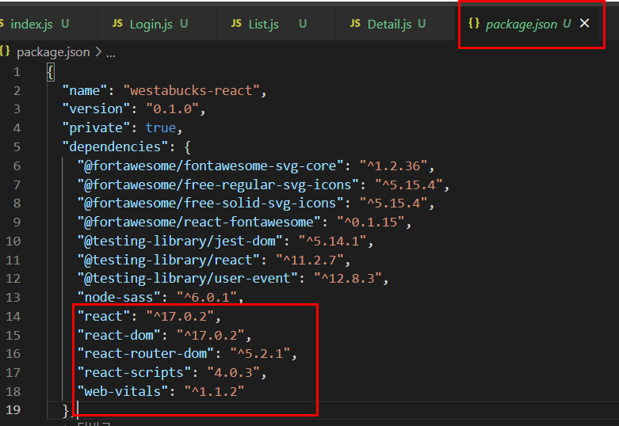
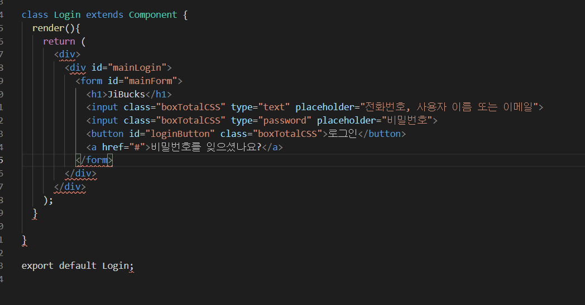
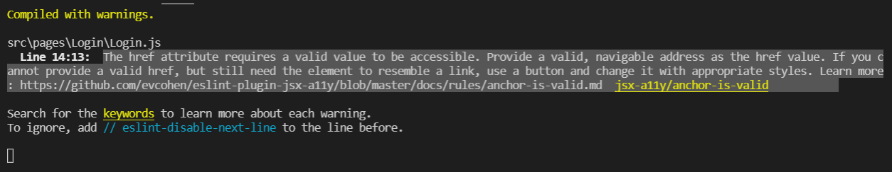
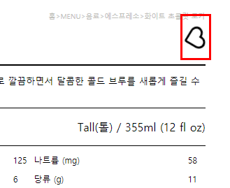
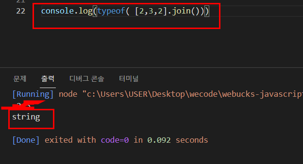
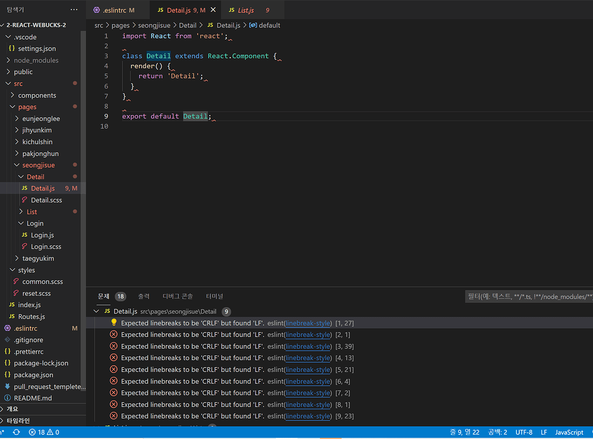
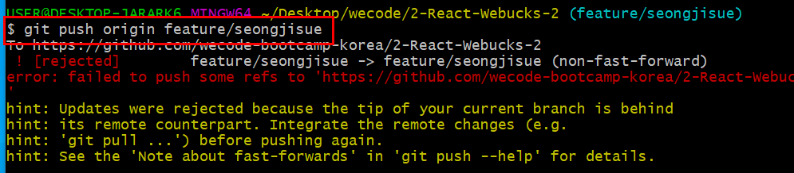
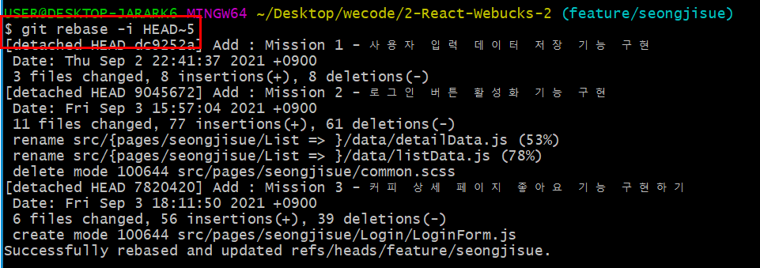
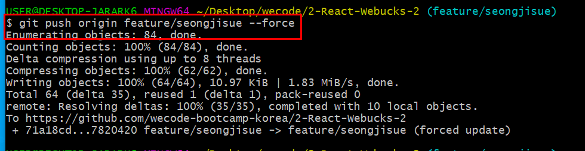

> **TL;DR** — 위코드 3주차부터 질문하고 에러 난 것들을 따로 기록으로 남기기 시작했다. npm 취약점 경고, JSX self-closing tag, 운영체제별 개행문자 문제, git commit 메시지 수정까지 — 같은 실수를 반복하지 않으려고 남긴 기록이다.

난이도 : ★☆☆☆☆

## ✅ 상황 (Situation)

위코드 3주차에 접어들면서 질문하고 에러가 난 것들을 그때그때 기록으로 남기기 시작했다. 생활코딩에서 강조하던 말이 있다.

> 질문하기 · 설명서 보기 · 나의 상태를 분석하기 · 검색하기 — 실력자가 되기 위해 필수

같은 에러가 다시 나왔을 때 손쉽게 대처하려면 지금 정리해두는 게 낫겠다고 판단했다.

## ✅ 목표와 내 역할 (Task)

한 주 동안 나온 질문·에러·해결 과정을 빠짐없이 기록하는 것. 팀 프로젝트(webucks)를 리액트로 옮기는 과정에서 나온 문제들이 대부분이었다.

## ✅ 한 것 (Action)

### npm install 취약점 경고

`react-router-dom`을 설치하려고 `npm install react-router-dom --save`를 실행했는데 `found 3 moderate severity vulnerabilities` 경고가 떴다. 업데이트를 하라는 경고인데, `package.json`에 `"react-router-dom": "^5.2.1"`이 이미 있으면 실행에는 문제가 없었다. 경고는 업데이트를 권하는 것일 뿐, 파일 자체는 정상 생성됐다.



*npm install 시 취약점 경고가 기록되는 화면*

### git clone 시 node_modules는 어떻게 되나

궁금했던 부분: 팀원이 `git clone`을 하면 `node_modules`도 같이 받아지는지, 아니면 각자 `npm install`을 해야 하는지.

답은 후자였다. `npm install`을 하면 `node_modules`가 자동으로 만들어지지만, `package.json`의 `dependencies`에 없는 패키지까지 받아지는 건 아니다. 필요한 패키지는 `npm install <패키지명> --save`로 직접 추가해야 한다.

### JSX self-closing tag 오류

webucks 프로젝트의 HTML을 그대로 복사해서 JSX에 붙였더니 폼 관련 타입 오류가 났다.

```
(property) JSX.IntrinsicElements.form: React.DetailedHTMLProps<React.FormHTMLAttributes<HTMLFormElement>, HTMLFormElement>
```

원인은 self-closing tag 문제였다. HTML에서는 `<input>`처럼 닫는 태그 없이 써도 되지만, JSX에서는 `<input />`처럼 반드시 닫아줘야 한다.



*어느 태그가 문제인지 빨간 밑줄로 표시된 화면*

`<a>` 태그의 `href` 속성도 마찬가지였다. 유효한 값 없이 `href`를 비워두면 접근성 경고가 났다.

> href 속성에 접근하려면 유효한 값이 필요합니다. href 값으로 유효하고 탐색 가능한 주소를 제공하거나, 링크와 유사한 요소가 필요하다면 버튼을 쓰고 스타일을 바꾸세요.

해결은 간단했다. `href="#"`처럼 링크 값을 채워주면 됐다. 자세한 내용은 [eslint-plugin-jsx-a11y anchor-is-valid 문서](https://github.com/evcohen/eslint-plugin-jsx-a11y/blob/master/docs/rules/anchor-is-valid.md)에 정리돼 있다.



*href 관련 에러 내용*

### JSX에서 Font Awesome이 안 나오는 문제

바닐라 코딩으로 만든 webucks의 HTML을 리액트로 옮겼는데 Font Awesome 아이콘만 안 나왔다. HTML과 JSX는 문법이 다르기 때문에 Font Awesome을 쓰는 방식도 달랐다. `npm`으로 패키지를 설치하고 import한 뒤 컴포넌트 태그로 써야 했다. [설치 방법 참고](https://www.digitalocean.com/community/tutorials/how-to-use-font-awesome-5-with-react).



*해결 방법을 찾은 참고 링크 화면*

### 문자열 뒤집기

배열에는 `reverse()`가 있는데 문자열에는 없다. 문자열을 뒤집으려면 `split("")`으로 한 글자씩 배열로 쪼갠 다음 `reverse()`를 적용해야 한다. 배열 안의 숫자를 `join()`하면 결과는 항상 문자열이 된다.



### 운영체제별 개행문자(LF/CRLF) 문제

깃허브 레포를 clone해서 `npm install`까지 마쳤는데 에러가 발생했다. 원인은 운영체제 차이였다 — push한 팀원은 맥, 나는 윈도우였다.

노션에 있던 대로 `.eslintrc.json`을 수정하고 VSCode 우측 하단에서 CRLF를 LF로 바꿔봤지만 에러는 계속됐다.

- 수정 전 에러: ``Delete `␍`eslintprettier/prettier``
- 수정 후 에러: `Expected linebreaks to be 'CRLF' but found 'LF'.eslintlinebreak-style`

`.eslintrc`는 공용 파일이라 임의로 고치지 않고, 대신 모든 `.js` 파일의 개행문자를 CRLF에서 LF로 직접 바꿨더니 해결됐다. 유닉스 계열(Linux/macOS)은 `\n`(LF)만으로 줄바꿈이 되지만, 윈도우는 `\r\n`(CRLF)이 있어야 줄바꿈으로 인식한다는 게 원인이었다.

멘토님께 여쭤본 결과, 코드를 추가로 넣을 필요 없이 파일 생성 시 LF로 자동 변환되도록 설정하는 게 맞는 방향이라는 답을 받았다.



*CRLF/LF 관련 에러 상황*

### git commit 메시지 수정하기

이미 `git push`까지 마친 커밋의 메시지를 나중에 고쳐야 하는 상황이 생겼다. 그냥 로컬에서 커밋 메시지만 수정하고 다시 push하면 에러가 났다.

```bash
git rebase -i HEAD~5          # 최근 커밋 5개 불러오기
# pick을 r(reword)로 바꾸고 저장
# 순서대로 뜨는 커밋들의 메시지를 하나씩 수정하고 저장
git push origin feature/브랜치이름 --force   # 원격 커밋 메시지 강제로 덮어쓰기
```

[참고한 글](https://velog.io/@mayinjanuary/git-%EC%BB%A4%EB%B0%8B-%EB%A9%94%EC%84%B8%EC%A7%80-%EC%88%98%EC%A0%95%ED%95%98%EA%B8%B0-changing-commit-message)을 보고 그대로 따라 하니 해결됐다.



*에러 상황*



*git rebase -i 실행 화면*



*--force로 push한 결과*

### SCSS import 위치

`@mixin`으로 파라미터를 받아 조건을 걸었는데 스타일이 적용되지 않았다. 원인은 구글 폰트를 SCSS에 적용할 때 별도 import가 필요했던 것 — 폰트 제공 페이지에서 import 구문을 그대로 가져오면 됐다.

`common.scss`에 넣은 `box-sizing`, `font-family`를 모든 SCSS 파일에 적용하려면 각 SCSS 파일에서 import해야 하는지도 궁금했는데, 멘토님 답은 이랬다.

1. 처음부터 완전한 정답은 없다
2. 나름의 기준을 갖고 import해서 쓴 다음(생각 없이 하면 안 된다 — 이유가 있어야 한다)
3. 동작하면 개발자 도구를 열어서 해당 SCSS 파일이 총 몇 번 import되고 있는지 확인해본다

## ✅ 결과 (Result)

질문과 에러를 그때그때 기록하는 습관을 들이기 시작한 첫 주였다. 이후에 같은 종류의 에러(특히 JSX 문법 관련, git 관련)를 마주쳤을 때 이 글을 다시 찾아보며 훨씬 빠르게 해결할 수 있었다.

## ✅ 배운 점 / 아쉬운 점

- 잘한 점 — 에러를 그냥 넘기지 않고 원인까지 파고들어서 기록해둔 것. 특히 CRLF/LF 문제처럼 원인을 모르면 재발하는 종류의 이슈는 기록해두길 잘했다.
- 잘한 점 — 혼자 끙끙대지 않고 멘토·팀원에게 바로 질문한 것. 결과적으로 훨씬 빨리 풀렸다.
- 아쉬운 점 — 당시엔 질문 하나하나가 사소해 보여서 정리가 산발적이었다. 카테고리별로 묶었으면 더 찾기 쉬웠을 것 같다.
- 아쉬운 점 — `.eslintrc` 같은 공용 설정 파일을 건드릴 때의 영향 범위를 처음엔 잘 몰랐다. 지금이라면 팀 컨벤션부터 먼저 확인했을 것.
- 다음엔 — 에러 기록을 남길 때 "문제 → 원인 → 해결"을 처음부터 템플릿화해서 쓰면 나중에 검색하기 더 편할 것 같다.

## 참고한 링크

- [eslint-plugin-jsx-a11y — anchor-is-valid](https://github.com/evcohen/eslint-plugin-jsx-a11y/blob/master/docs/rules/anchor-is-valid.md)
- [DigitalOcean — How To Use Font Awesome 5 With React](https://www.digitalocean.com/community/tutorials/how-to-use-font-awesome-5-with-react)
- [개행문자(CRLF/LF) 문제 해결 참고](https://saengmotmi.netlify.app/trouble%20shooting/2020-06-28%20delete%20cr%20prettier/)
- [git commit 메시지 수정하기](https://velog.io/@mayinjanuary/git-%EC%BB%A4%EB%B0%8B-%EB%A9%94%EC%84%B8%EC%A7%80-%EC%88%98%EC%A0%95%ED%95%98%EA%B8%B0-changing-commit-message)
