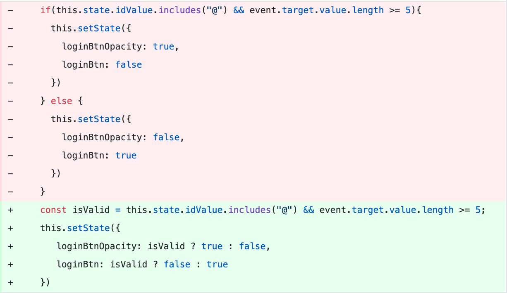
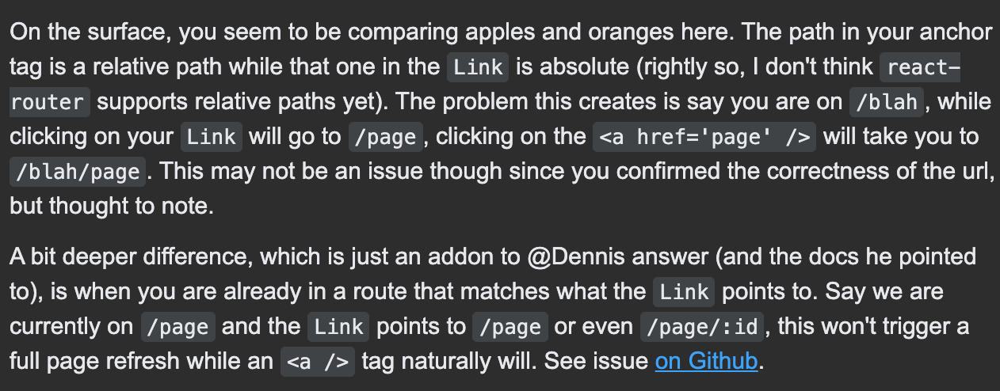

> **TL;DR** — 코드 리뷰를 받기 전에 필요한 건 리팩토링이다. SCSS 분리, nesting, 동적 className, 구조분해 할당, `Array.map` 활용, import 순서까지 — Foundation 기간에 팀이 지켜야 했던 프론트엔드 리팩토링 규칙을 정리했다.

난이도 : ★☆☆☆☆

내가 모르는 오류를 찾고 코드의 안정성을 지키려면 코드 리뷰(코멘트)가 필수인데, 그 전에 먼저 해야 할 게 리팩토링이다. 해도 해도 끝이 없었다.


## ✅ 상황 (Situation)

Foundation 3~4주차, 팀 프로젝트 코드를 리뷰받기 전에 리팩토링 규칙을 정리해야 했다. 각자 다르게 짠 코드를 하나의 컨벤션으로 맞추는 작업이었다.

## ✅ 목표와 내 역할 (Task)

팀에서 합의한 리팩토링 규칙을 정리하고, 프론트엔드 코드(SCSS, JSX)에 실제로 적용하는 것.

## ✅ 한 것 (Action)

### 1. reset.scss와 common.scss는 index.js에서 한 번만 import

- 초기화 세팅은 `reset.scss`, 팀이 공통으로 쓰는 스타일은 `common.scss`에 둔다
- `index.html` → `index.js` → `<Routes />`의 관계를 생각해보면 왜 `index.js`에서 한 번만 import하면 되는지 이해할 수 있다
- 변수·mixin처럼 재사용할 것들은 `variables.scss`, `mixin.scss`로 따로 분리해서 필요한 SCSS 파일에서 import한다

```scss
* {
  box-sizing: border-box;
  margin: 0;
  padding: 0;
}
```

### 2. Sass nesting 적용하기

일반 CSS 그대로 두면 결국 하나로 합쳐지는 파일이기 때문에, 내가 작성한 스타일이 의도치 않게 다른 파일의 요소에 영향을 줄 수 있다. nesting을 적용해서 스코프를 명확히 해야 한다.

```scss
* {
  font {
    &size {}
    &weight {}
  }
}
```

### 3. className 동적으로 쓰기 — 인라인 스타일 대신 3항연산자

스타일을 바꿀 때 인라인으로 바로 줄 수도 있지만, CSS 파일을 쓰고 있으니 클래스를 동적으로 바꾸는 방식을 쓴다.

```html
<button
  onClick={this.handleCommentInputBtn}
  className={this.state.commentBtn ? "activated" : "deactivated"}
>
  로그인
</button>
```

```css
.activated {
  color: #0095f6;
}

.deactivated {
  color: #b5e1ff;
}
```

### 4. 구조분해 할당(destructuring)

객체·배열에 적용할 수 있는 ES6 문법으로, 긴 코드를 간결하게 만들 수 있다.

```javascript
// 적용 전
handleInput = e => {
  this.setState({
    value: e.target.value,
  });
  // ...
};

// 구조분해 할당 적용
handleInput = e => {
  const { value } = e.target;
  this.setState({
    value: value,
  });
  // ...
};

// key-value 이름이 같을 때는 축약 가능(ES6 객체 단축 속성명)
handleInput = e => {
  const { value } = e.target;
  this.setState({
    value,
  });
  // ...
};

const { idValue } = this.state;
```

함수 안뿐 아니라 `render` 안에서도 `state`, `props` 객체에 구조분해 할당을 적용하면 코드가 간결해진다.

```javascript
render() {
  const { email } = this.state;
  const { handleInput } = this;
  return (
    <input
      onChange={handleInput}
      value={email}
    />
  );
}
```

### 5. Boolean 값과 3항연산자 활용

Boolean 타입의 특성을 이용하면 조건 분기 코드를 더 간결하게 쓸 수 있다.



*위코드 노션 참고 자료*

### 6. 반복 코드는 Array.map()으로

- `map`으로 반환하는 JSX 요소마다 고유한 `key` 값이 있어야 한다
- `key`는 제일 바깥 태그에 부여한다
- 반복할 데이터(`INFO` 같은 변수)를 `render` 안에서 선언하면 렌더링마다 새로 생성되므로, 컴포넌트 바깥(보통 `.js`나 `.json` 파일로 분리)에서 선언한다

```javascript
// footerData.js
export const INFO = [
  { id: 1, content: "도움말" },
  { id: 2, content: "홍보 센터" },
  { id: 3, content: "API" },
  { id: 4, content: "채용정보" },
  { id: 5, content: "개인정보처리방침" },
  { id: 6, content: "약관" },
  { id: 7, content: "위치" },
  { id: 8, content: "인기 계정" },
];

// Footer.js
import { INFO } from './footerData.js';

render() {
  return (
    // ...
    {INFO.map(el => {
      return (
        <li key={el.id}>
          <a href="">{el.content}</a>
        </li>
      );
    })}
  );
}
```

### 7. 계산된 속성명으로 중복 핸들러 줄이기

`input` 태그의 `name` 속성을 활용하면 여러 개의 input 핸들러를 하나로 합칠 수 있다. `name` 값은 `value`처럼 `e.target.name`으로 가져올 수 있다. 단, `name` 속성은 input 태그에서만 쓴다.

```javascript
// before
handleEmail = e => {
  const { value } = e.target;
  this.setState({
    email: value,
  });
};

handlePw = e => {
  const { value } = e.target;
  this.setState({
    password: value,
  });
};

render() {
  return (
    <>
      <input className="emailInput" type="text" onChange={this.handleEmail} />
      <input className="pwInput" type="password" onChange={this.handlePw} />
    </>
  );
}
```

```javascript
// after — 계산된 속성명으로 하나의 핸들러로 통합
handleInput = e => {
  const { value, name } = e.target;
  this.setState({
    [name]: value
  });
};

render() {
  return (
    <>
      <input className="emailInput" type="text" name="email" onChange={this.handleInput} />
      <input className="pwInput" type="password" name="password" onChange={this.handleInput} />
    </>
  );
}
```

### 8. `<a>` vs `<Link>`

`<a>` 태그는 새로고침 하듯 HTML을 통째로 다시 받아오는 반면, `<Link>`는 컴포넌트만 갈아 끼운다. 렌더링 최적화를 위해 `<Link>`를 쓴다. ([참고](https://stackoverflow.com/questions/43087007/react-link-vs-a-tag-and-arrow-function))



*위코드 노션 참고 자료 — 영어 문서라 힘들었던 부분*

### 9. import 순서 지키기

추가로 SCSS 파일에는 mixin 파일을 import하고, common과 reset은 `index.js`에서만 import해야 한다. import 순서는 다음과 같이 맞춘다.

1. 라이브러리 — React 관련 패키지 → 외부 라이브러리
2. 컴포넌트 — 가까운 컴포넌트부터 먼 컴포넌트 순
3. 함수·변수·설정 파일
4. 이미지 등 미디어 파일(`.png` 등)
5. CSS 파일(`.scss`)

## ✅ 결과 (Result)

팀 전체가 같은 리팩토링 규칙을 공유하게 됐고, 이후 코드 리뷰에서 스타일 관련 지적이 눈에 띄게 줄었다. 특히 `className` 동적 처리와 import 순서는 이후 프로젝트에서도 계속 지킨 규칙이 됐다.

## ✅ 배운 점 / 아쉬운 점

- 잘한 점 — 팀 전체가 공통 규칙(SCSS 분리, import 순서)을 문서로 남겨서 리뷰 때마다 반복 지적되는 걸 줄인 것.
- 잘한 점 — 계산된 속성명으로 핸들러를 통합하는 패턴을 이 시기에 확실히 체득한 것 — 이후 프로젝트에서 계속 재사용했다.
- 아쉬운 점 — 처음엔 `state`를 직접 참조하는 습관이 남아 있어서 구조분해 할당 적용이 늦었다.
- 아쉬운 점 — Sass nesting을 처음부터 적용하지 않아서 나중에 스타일 충돌을 리팩토링하며 걷어내야 했다.
- 다음엔 — 프로젝트 시작 시점에 컨벤션 문서(reset/common 분리, import 순서)를 먼저 정하고 시작할 것.

## 참고한 링크

- [Stack Overflow — React Link vs a tag](https://stackoverflow.com/questions/43087007/react-link-vs-a-tag-and-arrow-function)
- [MDN — Array.prototype.map()](https://developer.mozilla.org/ko/docs/Web/JavaScript/Reference/Global_Objects/Array/map)
- [MDN — 계산된 속성명](https://developer.mozilla.org/ko/docs/Web/JavaScript/Reference/Operators/Object_initializer#%EA%B3%84%EC%82%B0%EB%90%9C_%EC%86%8D%EC%84%B1%EB%AA%85)
