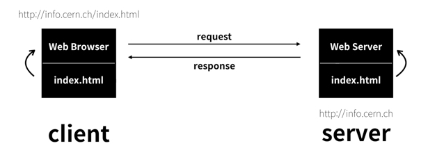
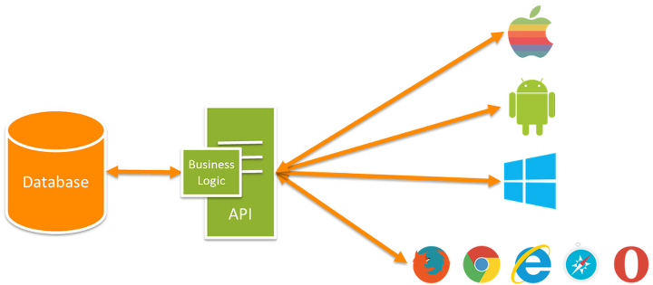
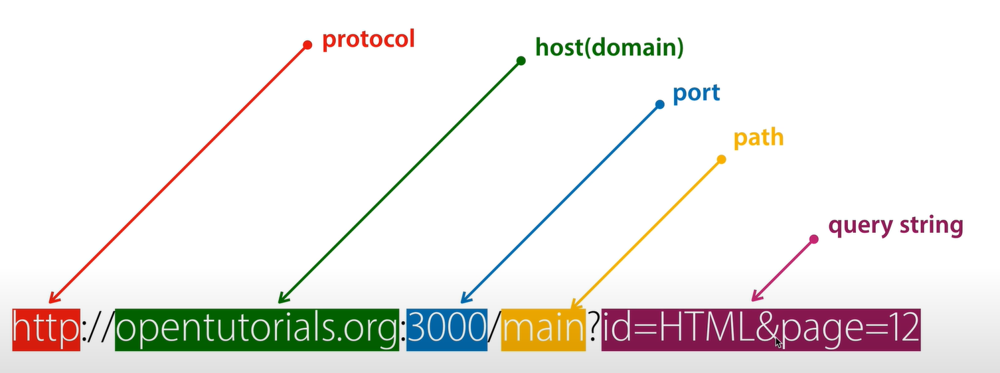
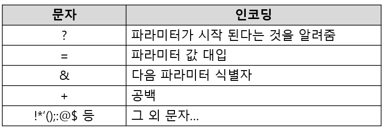
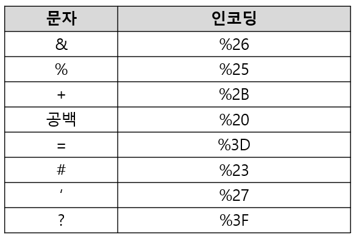
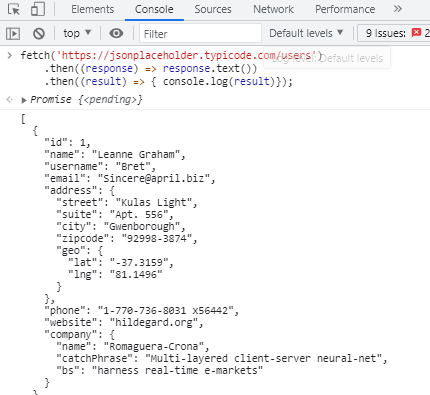
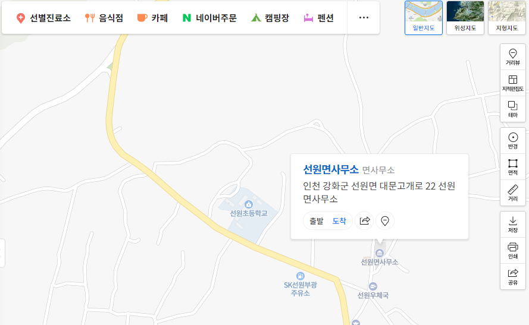
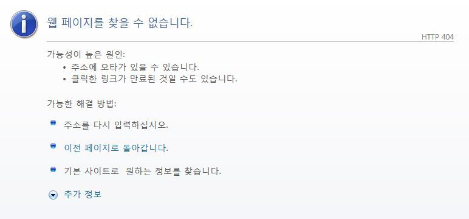
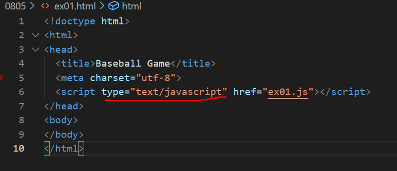

> **TL;DR** — 브라우저와 서버는 request/response를 최소 1번 주고받으며 통신한다. 1️⃣ URL 구조와 2️⃣ JSON 포맷, 3️⃣ AJAX 통신 방식을 알아야 이후 fetch·axios 코드가 이해된다.

난이도 : ★★★☆☆

1️⃣ `request/response` 2️⃣ `URL 구조` 3️⃣ `JSON` 4️⃣ `AJAX` 5️⃣ `HTTP 상태 코드`

## ✅ 왜 알아야 하나

fetch나 axios로 API를 호출하기 전에, 애초에 브라우저와 서버가 어떻게 데이터를 주고받는지부터 알아야 한다. URL이 어떻게 구성되고, 응답 데이터가 왜 JSON 형태로 오고, AJAX가 왜 필요했는지를 순서대로 짚어본다.

## ✅ 웹이란 (World Wide Web)

- 인터넷에 연결된 사용자들이 서로 정보를 공유할 수 있는 공간
- 텍스트·이미지·소리·영상 같은 멀티미디어 정보를 하이퍼텍스트나 AJAX 방식으로 연결해 제공
- 하이퍼텍스트 : 문서 내부에 다른 문서로 연결되는 참조를 넣어 문서끼리 서로 참조 가능하게 하는 기술
- 브라우저와 서버는 통신할 때 request(요청)·response(응답)를 최소 1번은 주고받음
- 개발자 도구의 Network 탭에서 이 구조를 직접 확인할 수 있음



## ✅ API란 (Application Programming Interface)

내가 만들 애플리케이션에서 다른 애플리케이션을 제어할 수 있게 해주는 것. UI가 사용자와 시스템의 인터페이스라면, API는 시스템과 시스템 사이의 인터페이스다. 여기서 "시스템"은 프로그램, 브라우저, 운영체제, 하드웨어 등을 포괄한다.



## ✅ 웹 프로그래밍 주요 용어

| 용어 | 정의 |
|------|------|
| URL | 웹의 특정 데이터를 나타내는 문자열. `https://호스트/경로/쿼리` |
| 쿼리 | 데이터에 대한 세부 요구사항(있을 수도 없을 수도 있음). `=`와 `&`로 구분 |
| 경로 | 서버 데이터 중 원하는 데이터를 특정. 경로와 쿼리는 `?`로 구분 |
| 호스트 | 전 세계 서버 중 하나를 특정 (도메인 이름 포함) |
| HTTP | 텍스트 전송 프로토콜. `https`는 보안(secure)이 강화된 버전 |
| 프로토콜(스킴) | 통신하는 두 주체가 지켜야 하는 규약 (port 번호, http, https, FTP, SMTP 등) |
| IP 주소 | 네트워크상에서 특정 컴퓨터를 식별하는 주소 |
| Port 번호 | IP가 컴퓨터를 식별한다면, 포트는 그 컴퓨터에서 구동 중인 프로그램을 구분 |
| DNS(도메인) | IP 주소를 사람이 외우기 쉽게 매핑한 문자열 |







## ✅ JSON이란 (JavaScript Object Notation)

- 데이터 저장·전송에 널리 쓰이는 경량 데이터 교환 포맷
- 사람과 기계 모두 이해하기 쉽고 용량이 작음
- 자바스크립트 객체 형식과 유사하지만 규칙이 더 엄격함
  - key는 반드시 큰따옴표(`""`)로 표기
  - value가 문자열이면 큰따옴표로 표기
  - `null`은 되지만 `undefined`는 value로 쓸 수 없음
  - 데이터 포맷이라 주석을 넣을 수 없음
- `JSON.parse()` — 문자열(JSON) → 자바스크립트 객체 (역직렬화)
- `JSON.stringify()` — 자바스크립트 객체 → 문자열(JSON) (직렬화)



```javascript
// fetch 문법은 뒤에서 다시 다룸 — 여기선 결과 차이만 확인
fetch('https://jsonplaceholder.typicode.com/users')
  .then((response) => response.text())
  .then((result) => console.log(result)); // JSON 데이터 출력

fetch('https://www.naver.com/')
  .then((response) => response.text())
  .then((result) => console.log(result)); // 화면을 그리는 HTML 코드 출력
```

## ✅ AJAX (Asynchronous JavaScript And XML)

- 브라우저의 `XMLHttpRequest` 객체를 이용해 페이지 전체를 새로고침하지 않고 필요한 데이터만 불러오는 기법 (예: 구글맵)
- 자바스크립트를 이용한 비동기 통신 — 클라이언트와 서버 간에 데이터를 부분적으로 주고받는 기술
- 초창기에는 페이지 전체를 다시 로드하는 하이퍼링크 방식이 주류였는데 비효율적이었음
- 구현 방법 : `fetch` + `.then()` 메서드, 또는 `XMLHttpRequest` 객체 직접 사용



```javascript
// XMLHttpRequest로 직접 구현한 예시 — 지금은 fetch/axios로 대체됨
const xhr = new XMLHttpRequest();
xhr.open('GET', 'https://learn.codeit.kr/api/members');
xhr.onload = function () {
  console.log(xhr.response);
};
xhr.onerror = function () {
  alert('Error!');
};
xhr.send();
```

**함정 — fetch로 JSON을 보낼 때 Content-Type을 빠뜨리면**

```javascript
fetch('https://example.com/api/users', {
  method: 'POST',
  body: JSON.stringify({ name: 'Jery' }),
  // headers 없이 보내면 서버가 body를 어떤 타입으로 봐야 할지 알 수 없음
});

fetch('https://example.com/api/users', {
  method: 'POST',
  headers: { 'Content-Type': 'application/json' }, // 서버가 body를 JSON으로 파싱하려면 필요
  body: JSON.stringify({ name: 'Jery' }),
});
```

`fetch`는 `headers`를 명시하지 않아도 요청 자체는 보내지지만, 서버(특히 Express 같은 프레임워크)는 `Content-Type` 헤더를 보고 body를 어떻게 파싱할지 결정한다. JSON 문자열을 보내면서 이 헤더를 빠뜨리면 서버 쪽에서 body가 파싱되지 않거나 빈 값으로 도착하는 문제가 생길 수 있다.

## ✅ HTTP 상태 코드



| 대역 | 의미 |
|------|------|
| 100번대 | 정보성 응답 |
| 200번대 | 요청 성공 |
| 300번대 | 리다이렉션 — 추가 작업 필요 |
| 400번대 | 클라이언트 쪽 문제 |
| 500번대 | 서버 쪽 문제 |

자주 마주치는 코드만 추리면 이렇다.

| 코드 | 의미 |
|------|------|
| 200 (OK) | GET 조회 성공 / POST 생성 성공 / PUT 수정 성공 / DELETE 삭제 성공 |
| 201 (Created) | 리소스가 요청대로 생성됨. POST 성공 시 200 대신 오기도 함 |
| 301 (Moved Permanently) | 요청 리소스의 URI가 영구적으로 변경됨 |
| 304 (Not Modified) | 캐시 목적 — 응답이 수정되지 않았으니 캐시본을 계속 써도 됨 |
| 400 (Bad Request) | 요청 자체에 문법 오류 등 문제가 있음 |
| 401 (Unauthorized) | 신원이 확인되지 않은 사용자의 요청 |
| 403 (Forbidden) | 신원은 확인됐지만 해당 리소스 접근 권한이 없음 |
| 404 (Not Found) | 요청한 URL의 리소스를 찾을 수 없음 |
| 429 (Too Many Requests) | 일정 시간 내 요청이 지나치게 많음 |
| 500 (Internal Server Error) | 알 수 없는 서버 내부 에러 |
| 503 (Service Unavailable) | 서버 점검 중이거나 트래픽 폭주로 서비스 불가 |

## ✅ Content-Type

request/response의 바디에 담긴 데이터가 어떤 타입인지 나타내는 헤더다. 이 헤더가 있으면 바디 데이터를 직접 확인해서 타입을 추론할 필요가 없다.

| 분류 | 예시 |
|------|------|
| 텍스트 | `text/plain`, `text/css`, `text/html`, `text/javascript` |
| 이미지 | `image/bmp`, `image/gif`, `image/png` |
| 오디오·비디오 | `audio/mp4`, `video/mp4` |
| application | `application/json`, `application/octet-stream`, `application/xml`, `application/x-www-form-urlencoded` |
| 기타 | `multipart/form-data` (여러 종류 데이터를 하나로 합친 타입) |



## ✅ 비동기 실행 관련 문법 종류

1. 콜백을 바로 전달하는 전통적인 비동기 함수 — `setTimeout(콜백, 시간)`, `setInterval(콜백, 시간)`, `addEventListener`
2. `Promise` — 작업 상태 정보를 나타냄 (다음 글에서 다룸)
3. `async/await` — 최근 나온 비동기 처리 방식, 동기 코드처럼 읽힘 (다음 글에서 다룸)

```javascript
console.log('a');
setTimeout(() => { console.log('b'); }, 2000);
console.log('c');
// 출력 순서 : a, c, b(2초 뒤)
```

## ✅ 정리

- 브라우저와 서버는 request/response로 통신하고, URL은 `호스트/경로?쿼리` 구조를 가짐
- JSON은 key·문자열 value에 반드시 큰따옴표를 쓰는 엄격한 데이터 포맷 — `parse`(문자열→객체), `stringify`(객체→문자열)
- AJAX는 페이지 전체 새로고침 없이 필요한 데이터만 불러오는 기법. 지금은 `fetch`/`axios`로 구현하는 게 일반적임
- HTTP 상태 코드는 첫 자리로 대역을 구분함 — 2xx 성공, 4xx 클라이언트 오류, 5xx 서버 오류
- Content-Type 헤더로 바디 데이터의 타입을 명시함

## 참고한 링크

- [자바스크립트 비동기 처리와 콜백 함수](https://joshua1988.github.io/web-development/javascript/javascript-asynchronous-operation/)
- [React | axios란? (feat. Fetch API)](https://velog.io/@shin6403/React-axios%EB%9E%80-feat.-Fetch-API)
