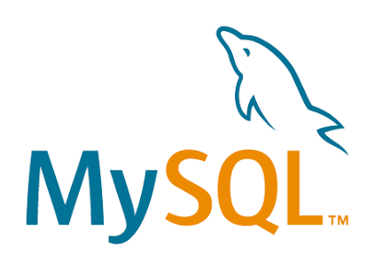
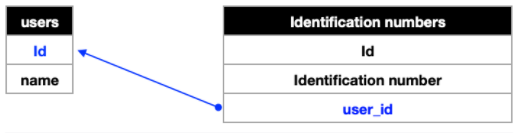
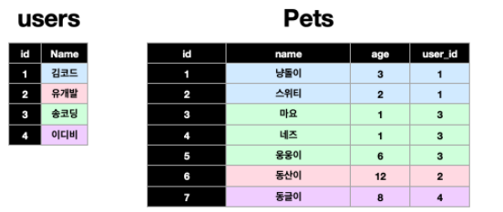
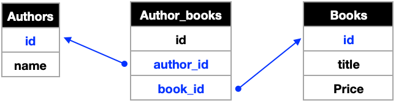

> **TL;DR** — 데이터베이스는 데이터를 오래, 체계적으로 보존하기 위한 저장소다. 관계형 DB(MySQL)는 테이블 간 관계를 SQL로 다루고, 비관계형 DB(MongoDB)는 대용량 데이터 처리에 유리하다. PK/FK로 테이블 관계(1대1·1대다·다대다)를 맺고, 정규화로 중복 데이터를 줄인다.

난이도 : ★☆☆☆☆

1️⃣ `관계형 vs 비관계형` 2️⃣ `PK / FK` 3️⃣ `정규화`

## ✅ 왜 알아야 하나

위코드 학습 목표는 다음과 같았다.

- 데이터베이스(Database)의 개념 이해하기
- 관계형 데이터베이스(RDBMS)가 무엇이고 왜 쓰는지 이해하기
- 테이블(Table)이 무엇인지, Column과 Row를 설명할 수 있기
- 테이블 관계 — One to One, One to Many, Many to Many 예시 나열하기
- Primary Key와 Foreign Key의 관계를 설명하고 테이블에 지정할 수 있기
- 관계형과 비관계형 데이터베이스의 차이 알기
- ERD로 데이터 관계를 모델링할 수 있기

## ✅ 데이터베이스와 DBMS란

쉽게 말하면 데이터베이스는 데이터 + 베이스(저장소), DBMS는 그걸 관리하는 도구다.

- 컴퓨터 시스템에 저장된 정보·데이터를 모두 모아놓은 집합
- 수많은 데이터를 관리하기 위한 수단으로 사용됨
- 추가·삭제·검색·수정·이동 등의 기능(CRUD)을 제공함
- Oracle, MySQL, MS SQL 등이 대표적인 관계형 데이터베이스임
- 이 데이터베이스를 관리하는 도구가 DBMS(DataBase Management System)이고, SQL 언어와 데이터베이스를 연결해주는 역할을 함
- DBMS 중에서도 가장 많이 쓰이는 종류가 RDBMS(관계형 데이터베이스 관리 시스템)임


*데이터 저장소 개념도*

## ✅ 왜 굳이 데이터베이스에 저장하나

안전성, 기능성, 신뢰성, 체계적 관리를 위해서다.

1. **오랜 기간 저장·보존하기 위해서** — 메모리에만 있는 데이터는 애플리케이션이 종료되면 사라진다. 필요한 자료를 계속 보존하려면 데이터베이스가 필요하다.
2. **체계적으로 보존·관리하기 위해서** — 데이터는 오래 저장하는 것만으로는 부족하고, 필요할 때 쉽게 꺼내 쓸 수 있어야 의미가 있다. 데이터베이스는 데이터를 체계적으로 정리해서 저장하기 때문에 다시 찾을 때도 어렵지 않다.

## ✅ 관계형 vs 비관계형 — 뭐가 다른가

### 관계형 데이터베이스 (MySQL 등)

- 데이터 사이의 관계에 기초를 둔 시스템
- 각 테이블이 서로 독립적인 대상이 아니라 상호 연관성을 가지고 연결돼 있음
- 데이터는 표(행과 열)로 저장됨 — 행은 각 엔티티, 열은 속성을 나타냄
- 표준화로 데이터 중복성을 최소화할 수 있음
- SQL(Structured Query Language)로 데이터를 쿼리함 — 복잡한 쿼리와 유연한 데이터 분석에 유리함

### 비관계형 데이터베이스 (MongoDB 등)

- BigData처럼 많은 양의 데이터를 저장하는 데 효과적임
- 여러 시스템에 데이터를 클러스터링해서 유지 보수 비용을 줄일 수 있음
- 대기 시간을 줄이고 처리량을 향상시킴
- SQL을 사용하지 않음




*관계형 데이터베이스와 비관계형 데이터베이스 예시*

### 관계형 DB가 강조하는 ACID

관계형 데이터베이스가 신뢰성을 보장하는 근거로 자주 언급되는 게 ACID 원칙이다.

| 속성 | 의미 |
|---|---|
| 원자성(Atomicity) | 트랜잭션 안의 작업은 전부 성공하거나 전부 실패함(부분 반영 없음) |
| 일관성(Consistency) | 트랜잭션 전후로 데이터베이스는 항상 정합성이 맞는 상태를 유지함 |
| 격리성(Isolation) | 동시에 실행되는 트랜잭션들은 서로 영향을 주지 않음 |
| 지속성(Durability) | 커밋된 트랜잭션의 결과는 시스템 장애가 나도 유지됨 |

### 비관계형 DB와 CAP 이론

분산 시스템으로 구성되는 비관계형 DB는 흔히 CAP 이론으로 설명된다 — 일관성(Consistency)·가용성(Availability)·분할 내성(Partition tolerance) 세 가지를 동시에 완벽히 만족할 수는 없고, 네트워크 분할 상황에서 둘 중 하나를 선택해야 한다는 이론이다. MongoDB 같은 문서형 DB는 상황에 따라 일관성 모델을 조정할 수 있게 설계돼 있다.

### 헷갈렸던 MySQL 용어 정리

- 테이블 = 릴레이션 = 엔티티
- 열 = 컬럼 = 필드
- 행 = 로우 = 레코드
- 인덱스
- 트리거(Trigger)

## ✅ PK와 FK

PK는 테이블의 고유 인덱스, FK는 테이블끼리 관계를 맺기 위한 PK의 참조값이라고 이해하면 된다.

### PK (Primary Key)

- 모든 데이터를 식별하는 주 식별자 컬럼 — 이 고유값으로 테이블의 특정 데이터를 가져올 수 있음
- 중복 불가, `NULL` 불가 — 고유 번호이기 때문에 없거나 중복돼서는 안 됨
- 함수적 종속 관계를 가짐
- `AUTO_INCREMENT` 같은 자동 증가 옵션을 주는 경우가 많음

### FK (Foreign Key)

- 테이블 간의 관계(1대1, 1대다, 다대다)를 맺어주는 외부 식별자 컬럼
- 두 테이블이 종속 관계를 가질 때 그 접점이 되는 컬럼을 FK로 지정해서 서로 참조하게 함
- FK를 가진 테이블이 자식 테이블, 참조되는 테이블이 부모 테이블임
- 자식 테이블에 데이터를 넣을 때 부모 테이블에 없는 값을 참조하면 오류가 발생함
- `ON DELETE CASCADE` — 부모 테이블의 행이 삭제되면 자식 테이블의 관련 행도 함께 삭제됨
- `ON DELETE SET NULL` — 부모 테이블의 행이 삭제되면 자식 테이블의 관련 컬럼이 `NULL`로 설정됨

```sql
create table emp(
  eno varchar2(4),
  ename varchar2(10),
  job varchar2(6),
  mgr varchar2(4),
  hdate date,
  sal number,
  dno varchar2(2),
  constraint emo_eno_pk primary key (eno), -- CONSTRAINT 제약_조건_이름 PRIMARY KEY (컬럼)
  constraint emp_eno_fk foreign key (dno) references dept (dno)
  -- CONSTRAINT 제약_조건_이름 FOREIGN KEY (컬럼) REFERENCES 참조할_테이블 (참조할_컬럼)
);
```

## ✅ 테이블 간의 관계

### One To One

테이블 A의 로우와 테이블 B의 로우가 정확히 1대1로 매칭되는 관계다. A 테이블의 PK와 B 테이블의 FK가 하나씩 정확히 매칭된다. 즉 A의 데이터 하나는 B의 데이터 하나와만 연결되고, 그 반대도 마찬가지다.



*1대1 매칭*

### One To Many

테이블 A의 로우 하나가 테이블 B의 여러 로우와 연결되는 관계다. A의 PK 하나에 B의 FK 여러 개가 매칭된다. 하나의 로우만 갖는 쪽이 One, 여러 로우를 갖는 쪽이 Many다.



*1대다 매칭*

### Many To Many

테이블 A의 여러 로우가 테이블 B의 여러 로우와 연결되는 관계다. 예를 들어 한 작가가 여러 책을 쓸 수 있고, 한 책에도 여러 작가가 있을 수 있다.

정규화 1법칙(테이블의 한 행에는 딱 하나의 데이터만 들어가야 함)을 지키려면 다대다 관계는 직접 표현할 수 없고, 중복을 줄이기 위해 중간 테이블을 둔다. 이 중간 테이블에 별도의 PK(id)를 두는 이유는 고유하게 식별하기 위해서다.



*다대다 관계 — 중간 테이블은 중복 제거와 정규화 1법칙을 지키기 위해 생김*

## ✅ 정규화란

기본 목표는 테이블 간 중복 데이터를 허용하지 않는 것이다. 중복을 없애면 무결성(Integrity)을 유지할 수 있고, DB 저장 용량도 줄일 수 있다.

| 단계 | 내용 |
|---|---|
| 제1 정규화 | 테이블의 컬럼이 원자값(하나의 값)을 갖도록 테이블을 분해함 |
| 제2 정규화 | 제1 정규화한 테이블에 완전 함수 종속을 만족하도록 테이블을 분해함 — 기본키의 부분집합이 결정자가 되어선 안 됨. 즉 테이블을 여러 개로 나눈다는 뜻 |
| 제3 정규화 | 제2 정규화한 테이블에서 이행적 종속을 없애도록 테이블을 분해함 — A→B, B→C가 성립할 때 A→C가 성립되는 관계를 제거함 |
| BCNF 정규화 | 제3 정규화한 테이블의 모든 결정자가 후보키가 되도록 테이블을 분해함 |

## ✅ Summary

- 관계형 DB(MySQL)는 테이블 간 관계와 SQL 쿼리에 강하고, 비관계형 DB(MongoDB)는 대용량 데이터 처리와 유연한 스키마에 강함
- PK는 테이블의 고유 식별자, FK는 다른 테이블을 참조해서 관계를 맺는 컬럼임
- 테이블 관계는 1대1·1대다·다대다로 나뉘고, 다대다는 정규화 1법칙 때문에 중간 테이블로 표현함
- 정규화는 중복 데이터를 줄여 무결성을 지키고 저장 용량을 아끼기 위한 과정임

## 참고한 링크

- [관계형과 비관계형의 차이점](https://ko.strephonsays.com/what-is-the-difference-between-relational-and-nonrelational-database)
- [정규화 정리](https://mangkyu.tistory.com/110)
