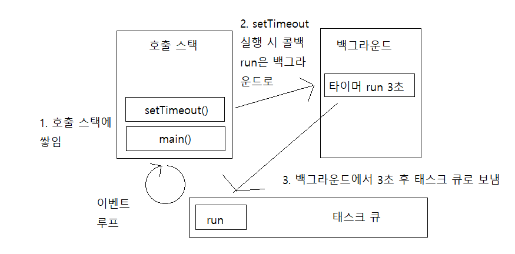
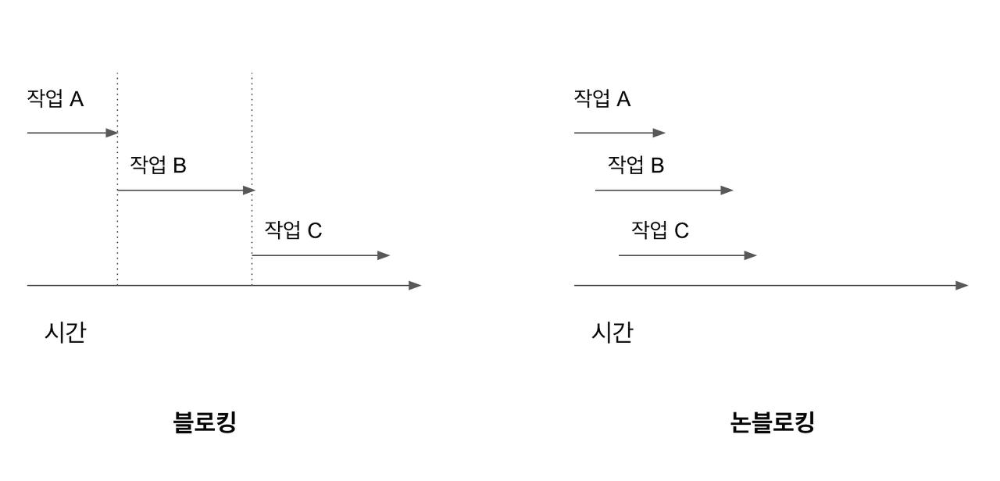
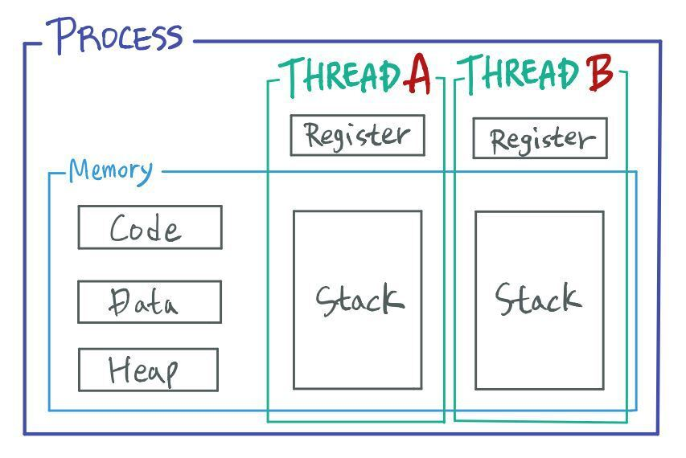
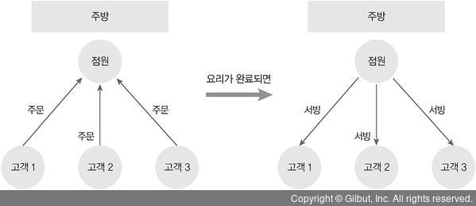

> **TL;DR** — Node.js는 싱글 스레드지만 백그라운드(libuv)와 이벤트 루프 덕분에 논 블로킹 방식으로 동시성을 흉내낸다. 호출 스택 → 백그라운드 → 태스크 큐 → 호출 스택으로 이어지는 순환 구조를 이해하면 비동기 실행 순서가 왜 그렇게 되는지 보인다.

난이도 : ★★☆☆☆

1️⃣ `이벤트 루프` 2️⃣ `블로킹 / 논 블로킹` 3️⃣ `프로세스 vs 스레드`

## ✅ 왜 알아야 하나

Node.js를 쓰다 보면 "싱글 스레드인데 왜 여러 요청을 동시에 처리하는 것처럼 보이지?"라는 의문이 생긴다. 이 질문에 제대로 답하려면 이벤트 루프가 어떻게 도는지, 블로킹과 논 블로킹이 뭐가 다른지, 프로세스와 스레드가 어떤 관계인지까지 알아야 한다. 위코드 노드 세션 첫 주에 이 개념들을 정리했다.


## ✅ Node.js란

공식 문서 기준으로 특징을 정리하면 이렇다.

- Chrome V8 자바스크립트 엔진으로 빌드된 자바스크립트 런타임이다(서버 자체는 아니다)
- 원래 자바스크립트는 실행 속도 문제로 브라우저 안에서만 돌았는데, V8이 나오면서 터미널에서도 동작할 수 있게 됐다
- V8과 함께 C/C++로 구현된 libuv 라이브러리를 쓴다 — Node가 알아서 V8과 연결해준다
- 하나의 자바스크립트 언어로 브라우저와 서버를 동시에 만들 수 있다
- XML 대신 JSON 형식으로 데이터를 주고받는다

> 서버란 네트워크를 통해 클라이언트에 정보·서비스를 제공하는 컴퓨터 또는 프로그램이다. 보통 클라이언트(요청을 보내는 브라우저·데스크톱 프로그램)의 요청에 응답한다.

## ✅ 이벤트 루프 동작 원리

이벤트가 발생할 때 미리 지정해둔 콜백을 실행하는 방식이다. 함수 호출이 발견되면 호출 스택(call stack)에 쌓이고, 코드가 끝날 때까지 이벤트 처리를 반복하기 때문에 "이벤트 루프"라고 부른다.

핵심 구성 요소 세 가지다.

- **이벤트 루프** — 이벤트 발생 시 호출할 콜백들을 관리하고, 실행 순서를 결정하는 역할
- **백그라운드** — `setTimeout` 같은 타이머나 이벤트 리스너가 대기하는 곳. 멀티 스레드로 동시 실행 가능하고 C++로 구성돼 있다(자바스크립트 언어가 아니다)
- **태스크 큐(콜백 큐)** — 이벤트 발생 후 백그라운드가 타이머·리스너의 콜백을 보내는 곳. 정해진 순서대로 콜백이 줄을 선다



**실행 절차**

1. 콜백이 하나씩 호출 스택에 쌓인다
2. 비동기 함수(예: `setTimeout`)가 실행되면 타이머와 함께 백그라운드로 이동한다
3. 백그라운드에서 지정된 시간을 센 뒤 태스크 큐로 보낸다(큐는 여러 개일 수 있다)
4. 호출 스택이 전부 비워지면 태스크 큐의 콜백을 호출 스택으로 올린다
5. 올라간 콜백을 호출 스택에서 실행한다

> 호출 스택에 콜백이 많이 쌓여 있으면 `setTimeout`에 지정한 시간대로 실행되지 않을 수 있다. `setTimeout`을 0초로 둬도 브라우저 환경에서는 기본적으로 4ms 지연이 있다.

## ✅ 직접 확인해보기

```javascript
// 호출 스택, 백그라운드, 태스크 큐를 생각하며 실행 순서를 확인한다
function oneMore() {
    console.log('one more');
}
function run() {
    console.log('run run');
    setTimeout(() => {
        console.log('wow');
    }, 0);
    new Promise((resolve) => {
        resolve('hi');
    }).then(console.log);
    oneMore();
}
setTimeout(run, 5000);

// 실행 순서: run run -> one more -> hi -> wow
```

**왜 Promise가 setTimeout(0)보다 먼저 실행될까 — 마이크로태스크 vs 매크로태스크**

콜백이 대기하는 큐는 사실 한 종류가 아니다. `setTimeout`·`setInterval`의 콜백은 매크로태스크 큐(태스크 큐)로, `Promise.then/catch/finally`의 콜백은 마이크로태스크 큐로 들어간다. 이벤트 루프는 호출 스택이 비워질 때마다 "매크로태스크 하나 실행 → 마이크로태스크 큐를 전부 비움"을 반복하는데, 이때 마이크로태스크 큐가 매크로태스크 큐보다 항상 먼저 처리된다. 그래서 `setTimeout(fn, 0)`으로 지연 시간을 0으로 줘도, 이미 대기 중인 `Promise` 콜백이 먼저 실행된다.

**용어 정리**

- **I/O** — 동시에 처리될 수 있는 작업. 파일 시스템 접근이나 네트워크 요청 같은 입출력을 말한다
- **논 블로킹** — 이전 작업이 끝날 때까지 기다리지 않고 짧은 시간 안에 다음 작업을 수행하는 것. 동시 실행이 아니라 작업 순서를 바꿔주는 것뿐이다



## ✅ 실무에서는 이렇게 쓴다 — 프로세스 vs 스레드

- **프로세스** — 운영체제가 할당하는 작업 단위. Node나 웹 브라우저 같은 프로그램은 각각 독립된 프로세스이고, 프로세스끼리는 메모리 같은 자원을 공유하지 않는다
- **스레드** — 프로세스 내에서 실행되는 흐름 단위. 프로세스는 스레드를 여러 개 만들어 작업을 동시에 처리할 수 있고, 부모 프로세스의 자원을 공유한다. 같은 주소의 메모리에 접근하고 데이터도 공유할 수 있다. Node가 실행되면 하나의 프로세스 안에 여러 스레드가 생기지만, 직접 제어할 수 있는 스레드는 하나뿐이다 — 그래서 에러로 멈추지 않도록 관리가 중요하다
- **멀티 스레딩** — 하나의 프로세스 안에서 여러 스레드를 사용. CPU 작업이 많을 때 쓰고, 프로그래밍 난도가 높다
- **멀티 프로세싱** — 여러 프로세스를 사용. I/O 요청이 많을 때 쓰고, 상대적으로 프로그래밍이 쉽다
- **워커 스레드** — CPU 작업이 많을 때 멀티 스레드를 쓸 수 있게 해주는 것. 대표적으로 암호화, 파일 입출력, 압축에 쓰인다



**스레드 + 블로킹 조합별 예시**

1. **싱글 스레드, 블로킹** — 카운터 직원이 주문을 받고 주방 직원이 요리해서 서빙까지 끝낸 다음 손님을 받는다. 단점은 다음 손님이 아무것도 못 하고 기다려야 한다는 것.
2. **싱글 스레드, 논 블로킹** — 카운터 직원이 주문을 받고 바로 다음 손님을 받는다. 주방은 요리해서 먼저 나오는 것부터 서빙한다(Node가 채택한 방식). 단점은 점원이 아프면 문제가 생기고, 주문이 몰리면 주방이 버거워지며 주문 나오는 순서가 뒤바뀔 수 있다는 것.
3. **멀티 스레드, 블로킹** — 카운터 직원이 주문을 기다리는 동안 주방 직원이 여러 명이라 각 주문을 동시에 처리한다. 단점은 손님이 줄면 노는 주방 직원이 생길 수 있고, 직원 고용·해고에 비용이 든다는 것.



## ✅ Summary

- Node.js는 V8 + libuv 조합으로 싱글 스레드·논 블로킹 방식을 구현함
- 이벤트 루프는 호출 스택 → 백그라운드 → 태스크 큐 → 호출 스택 순으로 순환하며 콜백 실행 순서를 결정함
- 프로세스는 독립된 작업 단위, 스레드는 프로세스 안의 실행 흐름임 — Node는 싱글 스레드+논 블로킹을 기본으로 채택함

## 참고한 링크

- [Node.js 공식 문서](https://nodejs.org/ko/docs/)
