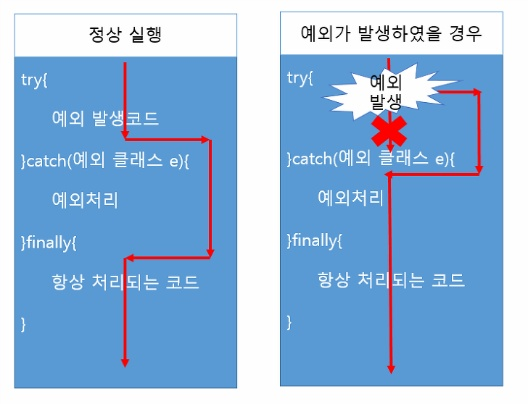

> **TL;DR** — `export`는 여러 값을 내보낼 때, `export default`는 단일 값을 내보낼 때 쓴다. 예외 처리는 동기 코드면 `try~catch~finally`로, 비동기 코드면 콜백 내부에서 직접 잡거나 Promise 체인의 `.catch`로 잡아야 한다.

난이도 : ★☆☆☆☆

1️⃣ `export vs export default` 2️⃣ `try~catch~finally` 3️⃣ `에러 객체 종류`

## ✅ 왜 알아야 하나

모듈을 나눠서 개발하다 보면 `export`와 `export default`를 섞어 쓰게 되는데, 둘의 차이를 정확히 모르면 import 할 때 자꾸 헷갈린다. 또 자바스크립트는 싱글 스레드 기반이라 에러가 하나 터지면 이후 코드가 전부 멈춘다. 에러를 터미널에 그냥 찍는 대신 사용자가 볼 수 있는 화면(view)에서 처리하려면 예외 처리 방법을 제대로 알아야 한다.



## ✅ export와 export default의 차이

`export`는 여러 개를 내보낼 때, `export default`는 단일 값 하나만 내보낼 때 쓴다. A 모듈(파일)에서 B 모듈의 변수나 함수를 쓰기 위해 사용하는 문법이다.

**`export`로 내보내고 `import`로 받기**

```javascript
// export.js
export let a = 3; // 하나씩 export 할 수 있음
export let b = () => { console.log(a); };
export { a as A, b }; // 한 번에 export 할 수도 있음

// import.js
import { A, b as B } from './export.js'; // 똑같이 {}로 가져옴
console.log(A); // 3 출력
```

**`export default`로 내보내고 `import`로 받기**

```javascript
// export.js
let a = 3;
let b = () => { console.log(a); };
let c = [a, b];
export default a; // 단일 값으로 내보낼 때
// let d = { b, c };
// export default d; // 위 주석과 같은 의미 — 다수 값을 객체로 묶어서 내보냄
export default { b, c };

// import.js
import { default as D } from '../export.js'; // 단일 값으로 받을 때
import D from '../export.js'; // {default as ...}는 생략 가능
D.b(); // 3 출력
console.log(D.c[0]); // 3 출력
```

여러 값을 `export default`로 내보내야 한다면 객체로 묶어야 한다는 점이 핵심이다.

**함정 — export default는 파일당 하나만** — `export default`는 한 모듈(파일)에 단 하나만 존재할 수 있다. 여러 값을 기본 내보내기로 두 번 이상 쓰면 문법 에러가 난다. 값을 여러 개 내보내야 한다면 위 예시처럼 객체 하나로 묶어서 `export default`하거나, 애초에 이름 있는 `export`를 여러 번 쓰는 방식을 쓴다.

**실전 팁 — named export가 더 안전할 때가 많다** — 이름 있는 `export`는 import할 때도 원래 이름을 그대로 써야 해서(별칭은 `as`로 명시) 어디서 어떤 값이 왔는지 추적하기 쉽고, 이름을 잘못 적으면 바로 에러가 난다. 반면 `export default`는 import할 때 아무 이름이나 붙일 수 있어서 편하지만, 모듈마다 이름이 제각각이 되면 검색·리팩터링이 어려워질 수 있다. 번들러(webpack, Rollup 등)가 안 쓰는 코드를 제거하는 트리 셰이킹(tree-shaking)도 이름 있는 export 쪽이 더 잘 동작하는 경향이 있다.

## ✅ 에러와 예외는 다르다

에러(Error)와 예외(Exception)는 구분되는 개념이다. **에러**는 메모리 부족, 스택 오버플로우처럼 발생하면 복구하기 쉽지 않은 심각한 문제를 말하고, **예외**는 발생해도 수습할 수 있을 정도로 덜 심각한 문제를 말한다. 우리가 다루는 "예외 처리"는 프로그램이 예외 상황에서 멈춰버리는 것을 막기 위한 작업이다.

## ✅ 동기식 예외 처리

자바스크립트는 싱글 스레드 기반이라 사용자 실수나 서버 오류가 발생하면 다음 코드를 실행하지 않고 작업이 중단된다. 터미널에 에러 메시지만 찍는 것보다 사용자가 볼 수 있는 view 단에서 처리해주는 게 낫다.

| 키워드 | 역할 |
| --- | --- |
| `try` | 에러가 발생할 것 같은 부분을 감싼다. 중첩해서 여러 번 쓸 수도 있음 |
| `catch(err)` | `try`에서 에러가 발생하면 작업을 중단하고 즉시 넘어와 처리함. `throw`로 상위 `catch`에 던질 수도 있고 `err.message`로 에러 내용을 확인할 수 있음 |
| `finally` | 에러 발생 여부와 상관없이 무조건 실행되는 구역 |
| `throw` | `catch`에서 처리하지 못한 에러를 그보다 상위 `catch`로 넘길 때 사용 |
| `new Error('message')` | 사용자가 임의로 만드는 에러 객체. 소괄호 안에 에러 메시지를 적고 `err.message`로 접근 가능 |
| `err.name`, `err.message` | `name`은 에러 객체의 종류, `message`는 부가 설명을 확인할 때 씀 |

```javascript
// childErr.js
export let array = (a) => {
    try {
        if (a > 0) {
            return a;
        } else {
            throw new Error('a의 값은 양수입니다'); // 사용자 임의 에러 발생
        }
    } catch (err) {
        throw err; // 상위로 에러 던지기
    } finally {
        console.log('childErr 마무리');
    }
};

// parentErr.js
import { array } from '../array.js';
try {
    console.log(array(10)); // 에러 발생 안 함
    console.log(array(-1)); // 에러 발생 — catch 실행
} catch (err) {
    console.error(err.message);
} finally {
    console.log('parentErr 마무리');
}
```

## ✅ 비동기식 예외 처리

`try` 문 안에 비동기 함수(예: `setTimeout`)가 있다고 가정하면, `try`는 동기적으로 실행되고 `setTimeout`은 비동기이기 때문에 `try~catch`로는 에러를 잡을 수 없다. 이 경우 `setTimeout` 콜백 안에서 직접 `try~catch`로 처리해야 한다.

`fetch`는 자체 예외 처리 방식이 있고, `async` 함수는 반환값이 Promise이기 때문에 동일하게 `.catch`로 처리한다.

```javascript
fetch('https://www.error.www')
    .then((response) => response.text())
    .then((result) => { console.log(result); }) // fulfilled일 때
    .catch((error) => { console.log('Hello'); throw new Error('test'); }) // reject일 때
    .then((result) => { console.log(result); })
    .then(undefined, (error) => { })
    .catch((error) => { console.log('JS'); })
    .then((result) => { console.log(result); })
    .finally(() => { console.log('final'); });
```

## ✅ 실무에서는 이렇게 쓴다 — 에러 객체 종류

에러를 던질 때 어떤 에러 객체를 쓸지 구분해두면, 상위 `catch`에서 종류별로 다르게 처리할 수 있다.

| 객체 종류 | 설명 |
| --- | --- |
| `RangeError` | 숫자 변수나 매개변수가 유효한 범위를 벗어났을 때 |
| `ReferenceError` | 잘못된 참조를 했을 때 |
| `SyntaxError` | 코드를 분석하는 중 잘못된 구문을 만났을 때 |
| `TypeError` | 변수나 매개변수가 유효한 자료형이 아닐 때 |
| `Error()` | 종류에 상관없이 사용자가 임의로 만드는 에러 인스턴스 |

## ✅ Summary

- `export`는 다중 값, `export default`는 단일 값(다수면 객체로 묶어서) 내보낼 때 씀
- 동기 코드의 예외는 `try~catch~finally`, 비동기 코드는 콜백 내부 `try~catch` 또는 Promise `.catch`로 처리함
- 에러 객체 종류(`RangeError`, `ReferenceError`, `SyntaxError`, `TypeError`)를 구분해서 던지면 상위에서 분기 처리하기 쉬움

## 참고한 링크

- [예외 처리(try~catch) 정리](https://ebbnflow.tistory.com/268)
- [MDN — Error 객체](https://developer.mozilla.org/ko/docs/Web/JavaScript/Reference/Global_Objects/Error)
