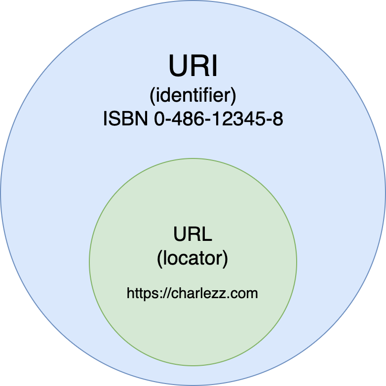

> **TL;DR** — 프론트가 서버로 데이터를 보낼 때는 REST API 규칙과 URI 형식을 지켜야 한다. CRUD는 데이터 처리의 4가지 기본 동작이고, HTTP 메소드(GET/POST/PUT/PATCH/DELETE)가 이 동작을 URL에 매핑하는 방식이다.

난이도 : ★☆☆☆☆

1️⃣ `CRUD` 2️⃣ `HTTP 메소드` 3️⃣ `REST API`

## ✅ 왜 알아야 하나

프론트에서 서버로 데이터를 보낼 때 REST API 규칙을 따라야 하고, URI 형식도 맞춰야 한다. 처음 fetch로 서버와 통신할 때는 그냥 GET, POST만 쓰면 되는 줄 알았는데, 실제로는 요청 목적에 따라 메소드를 구분해서 써야 한다는 걸 알게 됐다. CRUD와 HTTP 메소드, REST API 개념을 한 번에 정리한다.

## ✅ CRUD란

대부분의 소프트웨어가 갖는 기본적인 데이터 처리 기능인 Create(생성), Read(읽기), Update(갱신), Delete(삭제)를 묶어 부르는 말이다. 사용자 인터페이스가 갖춰야 할 기능(정보의 참조·검색·갱신)을 가리키는 용어로도 쓰인다.

| 이름 | 조작 | SQL |
| --- | --- | --- |
| Create | 생성 | INSERT |
| Read | 읽기(또는 인출) | SELECT |
| Update | 갱신 | UPDATE |
| Delete | 삭제(또는 파괴) | DELETE |

## ✅ HTTP 메소드 종류

REST에서는 GET, POST, PUT, PATCH, DELETE에 따라 표기 방법이 다르다.

| 메소드 | 설명 |
| --- | --- |
| GET (조회) | body를 쓰지 않고 Query String Parameter로 URL 뒤에 값을 붙여 보낸다. 서버에 자원(resource)을 보내달라고 요청하는 것으로, 자원은 클라이언트에 전달만 될 뿐 변경되지 않는다. 브라우저 주소창에 주소를 입력하면 항상 GET으로 요청된다 |
| POST (추가) | 서버에 자원을 보내면서 생성해 달라고 요청한다. 회원가입을 하면 DB에 새 회원 정보가 등록되고, 사진을 업로드하면 웹사이트에 등록된다. fetch의 두 번째 파라미터로 method를 `POST`로, JSON 객체를 body에 담아 보낸다 |
| PUT (전체 수정) | 자원을 업데이트하거나, 자원이 없으면 새로 생성해 달라고 요청한다. 회원정보 수정 등에 쓰인다. PUT과 PATCH 중 헷갈리면 PUT을 쓰면 된다 |
| PATCH (부분 수정) | 자원의 일부 업데이트를 요청한다. 회원정보 일부 수정에 쓰인다 |
| DELETE (삭제) | 자원의 삭제를 요청한다. body가 필요 없다 |

```javascript
// GET 방식 — id값이 3인 정보만 조회
fetch('https://learn.codeit.kr/api/members/3')
  .then((response) => response.text())
  .then((result) => { console.log(result); });

// POST 방식 — 새 멤버 생성
const newMember = {
  name: 'Jery',
  email: 'jery@naver.com',
  department: 'engineering',
};
fetch('https://learn.codeit.kr/api/members', {
  method: 'POST',
  body: JSON.stringify(newMember), // JS 객체 -> JSON 문자열
})
  .then((response) => response.text())
  .then((result) => { console.log(result); });

// PUT 방식 — id값이 2인 멤버 수정
const memberA = {
  name: 'Alice',
  email: 'alice@codeitmall.kr',
  department: 'marketing',
};
fetch('https://learn.codeit.kr/api/members/2', {
  method: 'PUT',
  body: JSON.stringify(memberA),
})
  .then((response) => response.text())
  .then((result) => { console.log(result); });

// DELETE 방식 — id값이 2인 멤버 삭제
fetch('https://learn.codeit.kr/api/members/2', {
  method: 'DELETE', // GET과 마찬가지로 body가 필요 없음
})
  .then((response) => response.text())
  .then((result) => { console.log(result); });
```

## ✅ REST API란

- REST는 REpresentational State Transfer의 약어로, 웹을 이용할 때의 제약 조건을 정의하는 소프트웨어 아키텍처 스타일이다.
- HTTP URL로 자원(Resource)을 명시하고, HTTP 메소드(GET, POST, PUT, DELETE)로 해당 자원에 CRUD를 적용하는 것을 의미한다.
- 한마디로 HTTP의 장점을 살리려는 통신 규약이다.
- 로이 필딩(Roy Fielding)의 2000년 박사 학위 논문에서 소개됐다. RESTful API는 이 규약을 바탕으로 리소스 중심으로 설계하고, 기능에 맞게 HTTP 메소드를 사용해 설계한 API를 말한다.

## ✅ REST의 특징 6가지

- **인터페이스 일관성** — 일관적인 인터페이스로 분리돼야 한다.
- **무상태(Stateless)** — 각 요청 간 클라이언트의 context·세션 같은 상태 정보를 서버에 저장하지 않는다.
- **캐시 처리 가능** — 클라이언트는 응답을 캐싱할 수 있다. 캐시를 통해 대량의 요청을 효율적으로 처리한다.
- **계층화** — 클라이언트는 대상 서버에 직접 연결됐는지, 프록시를 거쳤는지 알 수 없다.
- **Code on Demand** — 자바 애플릿이나 자바스크립트를 제공해 서버가 클라이언트를 실행시킬 로직을 전송, 기능을 확장할 수 있다.
- **클라이언트/서버 구조** — 아키텍처를 단순화하고 작은 단위로 분리해, 클라이언트와 서버 각 파트가 독립적으로 구분되고 서로의 의존성이 줄어든다.

## ✅ REST API 설계 규칙과 예시

- **소문자를 사용한다**

  ```
  # X
  http://cocoon1787.tistory.com/users/Post-Comments
  # O
  http://cocoon1787.tistory.com/users/post-comments
  ```

- **언더바(`_`) 대신 하이픈(`-`)을 사용한다**

  ```
  # X
  http://cocoon1787.tistory.com/users/post_comments
  # O
  http://cocoon1787.tistory.com/users/post-comments
  ```

- **마지막에 슬래시를 포함하지 않는다**

  ```
  # X
  http://cocoon1787.tistory.com/users/
  # O
  http://cocoon1787.tistory.com/users
  ```

- **행위를 포함하지 않는다**

  ```
  # X
  http://cocoon1787.tistory.com/users/post/1
  # O
  http://cocoon1787.tistory.com/users/1
  ```

- **파일 확장자는 URL에 포함하지 않는다**

  ```
  # X
  http://cocoon1787.tistory.com/users/photo.jpg
  # O
  http://cocoon1787.tistory.com/users/photo
  ```

## ✅ URL과 URI의 차이

- **URI** — 특정 리소스를 식별하는 통합 자원 식별자(Uniform Resource Identifier)다. 웹 기술에서 사용하는 논리적·물리적 리소스를 식별하는 고유한 문자열 시퀀스다.
- **URL** — 흔히 웹 주소라고 하며, 컴퓨터 네트워크 상에서 리소스가 어디 있는지 알려주는 규약이다. URI의 서브셋이다.



## ✅ Path Parameter와 Query Parameter의 차이

정리하면, 리소스를 식별하고 싶으면 Path Variable을 쓰고, 정렬이나 필터링을 한다면 Query Parameter를 쓴다.

```
/products?id=13  # 페이지는 고정된 상태로 id가 13인 상품만 조회
/products/13      # 상세 페이지로 이동한 뒤 id가 13인 상품을 조회
```

## ✅ Summary

- CRUD는 데이터 처리의 4가지 기본 동작(Create/Read/Update/Delete)이고, HTTP 메소드가 이를 URL에 매핑함
- REST API는 URL로 자원을 명시하고 HTTP 메소드로 CRUD를 적용하는 아키텍처 스타일임
- 리소스 식별은 Path Parameter, 정렬·필터링은 Query Parameter로 구분해서 씀

## 참고한 링크

- [URL, URI의 차이점](https://www.charlezz.com/?p=44767)
- [Path Variable과 Query Parameter의 차이점](https://ryan-han.com/post/translated/pathvariable_queryparam/)
