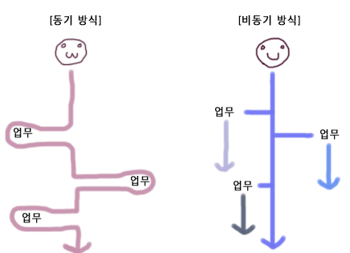
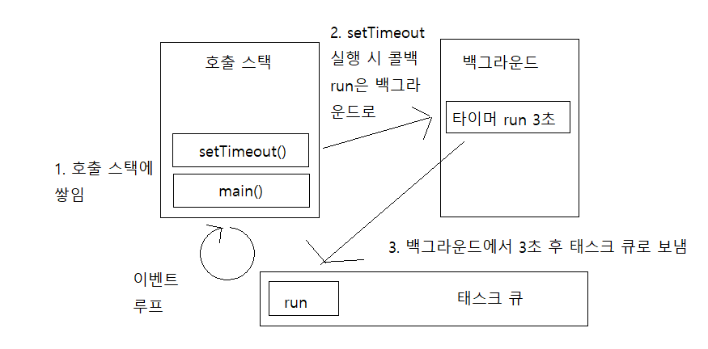
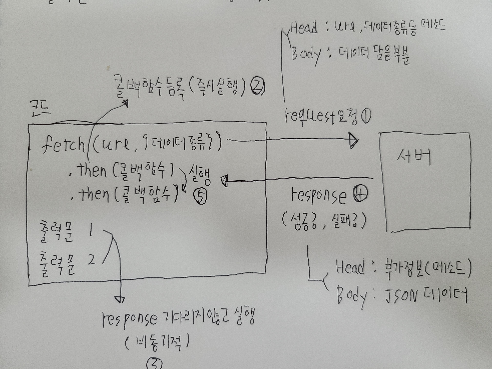
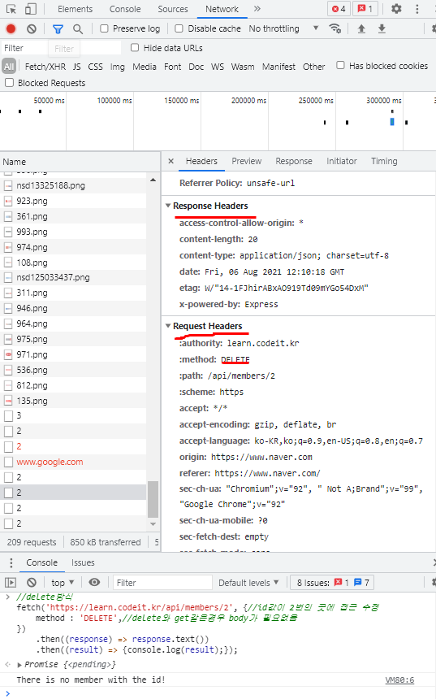

> **TL;DR** — 비동기는 서버 응답을 기다리지 않고 다음 코드를 먼저 실행하는 방식이다. 1️⃣ 이벤트 루프가 왜 필요한지 알아야 2️⃣ `fetch`·`Promise`·`async/await`가 왜 그렇게 생겼는지 이해된다.

난이도 : ★★★★☆

1️⃣ `이벤트 루프` 2️⃣ `fetch/Promise` 3️⃣ `then/catch/finally` 4️⃣ `async/await`

## ✅ 왜 알아야 하나

`setTimeout`이나 `fetch`를 코드 순서대로 실행되겠거니 생각하고 쓰면 결과가 예상과 다르게 나온다. 원인은 자바스크립트의 비동기 처리 방식 — 이벤트 루프 — 에 있다. 이 글의 전제가 되는 배경 지식은 웹브라우저 구동 원리([이전 글](https://zibu-story.tistory.com/126) 참고)다.

## ✅ 비동기란 — 이벤트 루프와 함께 이해하기

**용어 정리**

- 런타임 : 프로그램이 실행되고 있는 동안 존재하는 환경
- 메모리 힙 : 메모리 할당을 담당하는 공간
- 콜스택 : 코드가 호출되면서 쌓이는 곳

**비동기의 특징**

1. 웹페이지를 리로드하지 않고 데이터를 불러오는 방식
2. 서버에 요청을 보낸 뒤 응답을 기다리지 않고 다음 코드를 먼저 실행함
3. 대표 사례로 `setTimeout`, `async`, `fetch` 등이 있음
4. 실행 순서가 코드 작성 순서와 다를 수 있음 — 오래 걸릴 것 같은 작업을 따로 빼두고 나머지를 먼저 실행
5. 이벤트 발생 시 호출되는 콜백을 태스크 큐에 전달하고, 콜스택이 비어 있을 때만 태스크 큐의 콜백을 콜스택으로 넘김 — 이게 이벤트 루프의 핵심 동작
6. 자바스크립트(특히 Node)가 비동기를 선호하는 이유는 대기 시간 없이 다음 작업을 처리해 전체 작업 시간을 줄일 수 있기 때문

```javascript
// 생각한 순서 : 1 → 2 → 3, 실제 출력 순서 : 1 → 3 → 2
console.log('Hello');            // 1번 — 바로 실행
setTimeout(function () {          // 2번 — 백그라운드로 빠짐 (이벤트 루프)
  console.log('Bye');
}, 3000);
console.log('Hello Again');       // 3번 — 바로 실행

// 주의 — setTimeout의 시간은 "최소 대기 시간"일 뿐, 콜스택이 바쁘면 더 늦게 실행될 수 있음
```





## ✅ fetch 함수란

프론트가 서버에 원하는 데이터를 요청할 수 있게 해주는 함수. 백엔드가 데이터를 보내도 fetch(또는 이에 준하는 통신 수단) 없이는 프론트에서 받을 방법이 없다.

- 첫 번째 인자로 URL을, 두 번째 인자(옵션 객체)로 POST·DELETE 등에 필요한 head·body를 전달함
- 서버 응답은 `Promise` 객체에 담겨 오고, 성공/실패 상태(status)를 담은 그 Promise가 `.then()`의 콜백 인자로 전달됨
- 콜백 안에 콜백을 계속 쌓는 "콜백 지옥"을 피하기 위해 Promise 체이닝 방식을 씀

**실행 순서**

1. `fetch`로 request를 보냄 (Promise는 `pending` 상태)
2. `then` 안의 콜백을 이벤트 리스너에 등록해두고, 응답을 기다리지 않고 다음 동기 코드를 먼저 실행
3. 서버 응답이 오면 Promise가 `fulfilled` 상태가 되고, 등록해둔 콜백이 실행됨
4. 이후 `then`들이 순차적으로 실행됨 (단, 각 `then`은 Promise를 리턴해야 체이닝이 이어짐)

**직렬화 · 역직렬화**

- 직렬화 : 자바스크립트 객체 → JSON 문자열 (`JSON.stringify`)
- 역직렬화 : JSON 문자열 → 자바스크립트 객체 (`JSON.parse`, 또는 fetch의 `response.json()`)

```javascript
console.log('출력1');
fetch('https://www.google.com/')          // URL만 넣으면 기본 GET
  .then((response) => response.text())     // 응답 객체를 문자열로 역직렬화
  .then((result) => console.log(result, '출력3')); // 화면을 그릴 HTML/JS 코드
console.log('출력2');

// 실행 순서 : 출력1 → 출력2 → 출력3
```



## ✅ Request — 서버에 데이터 요청하기

- Head : request에 대한 부가 정보(메서드 등). GET·DELETE는 body가 필요 없음
- Body : 실제 데이터. 보통 POST·PUT에서 사용

| 메서드 | 용도 | 사용법 |
|--------|------|--------|
| GET | 조회 | URL에 id 등을 포함해서 요청 |
| POST | 추가 | 두 번째 인자로 body에 JSON 객체, method는 `POST` |
| PUT | 수정 | URL에 id를 지정하고 body에 JSON 객체, method는 `PUT` |
| DELETE | 삭제 | body 불필요 |

```javascript
// GET
fetch('https://learn.codeit.kr/api/members/3')
  .then((response) => response.text())
  .then((result) => console.log(result));

// POST
let newMember = { name: 'Jery', email: 'jery@naver.com', department: 'engineering' };
fetch('https://learn.codeit.kr/api/members', {
  method: 'POST',
  body: JSON.stringify(newMember) // 객체 → JSON 문자열
})
  .then((response) => response.text())
  .then((result) => console.log(result));

// PUT
let memberA = { name: 'Alice', email: 'alice@codeitmall.kr', department: 'marketing' };
fetch('https://learn.codeit.kr/api/members/2', {
  method: 'PUT',
  body: JSON.stringify(memberA)
})
  .then((response) => response.text())
  .then((result) => console.log(result));

// DELETE
fetch('https://learn.codeit.kr/api/members/2', { method: 'DELETE' })
  .then((response) => response.text())
  .then((result) => console.log(result));
```

## ✅ Response — 서버로부터 응답 받기

- Head : 부가 정보(상태 코드 포함)
- Body : 실제 데이터(JSON 형식)
- 응답 데이터 종류는 개발자 도구 Network 탭에서 확인 가능 — `.text()`로 찍으면 화면을 그릴 JS/HTML 코드, 순수 데이터는 JSON 포맷으로 옴



## ✅ Promise 객체

- request에 대한 서버 응답 작업의 상태 정보(status)를 나타냄. 서버 응답은 Promise 객체에 담겨서 옴

| 상태 | 의미 |
|------|------|
| `pending` | 작업 진행 중 |
| `fulfilled` | 작업 성공 — 성공 정보를 가진 Promise 리턴 |
| `rejected` | 작업 실패 — 실패 정보를 가진 Promise 리턴 |

- `.text()` — `fulfilled` 상태면 응답 바디를 문자열로 변환한 값을 담은 Promise를 리턴
- `.json()` — 응답 바디의 JSON 데이터를 자바스크립트 객체로 역직렬화한 값을 담은 Promise를 리턴. JSON이 아니면 에러가 나며 `rejected` 상태가 됨
- 콜백 인자로 executor 함수(`resolve`, `reject`)를 받아 Promise를 직접 생성할 수도 있음
  - executor : Promise 생성 시 자동 실행됨
  - `resolve` : Promise를 `fulfilled`로 만듦
  - `reject` : Promise를 `rejected`로 만듦

```javascript
new Promise(function (resolve, reject) {
  setTimeout(function () {
    resolve(1);
  }, 2000);
})
  .then(function (result) {
    console.log(result); // 1
    return result + 10;
  })
  .then(function (result) {
    console.log(result); // 11
    return result + 20;
  })
  .then(function (result) {
    console.log(result); // 31
  });
```

## ✅ then, catch, finally

- `then` — 응답이 왔을 때 실행할 콜백을 미리 등록. 첫 번째 `then`의 리턴값이 다음 `then`의 인자로 전달됨(Promise 체이닝)
- `then`의 첫 번째 파라미터는 `fulfilled`일 때, 두 번째 파라미터는 `rejected`일 때 실행할 콜백
- `catch`는 `then(undefined, 콜백)`의 축약형. 보통 체이닝 맨 마지막에 둠
- `finally`는 성공·실패 상관없이 무조건 실행되며 파라미터가 없음

**리턴값에 따른 다음 Promise 상태**

- 리턴값이 Promise → 동일한 상태의 Promise를 리턴
- 리턴값이 기본/참조 타입 → 무조건 `fulfilled`로 리턴
- 리턴값 없음 → `fulfilled` + `undefined`로 리턴
- 콜백 내부에서 에러 발생 → `rejected` + 해당 Error 객체
- 콜백 자체가 없음 → 이전 Promise와 동일한 상태·결과 유지

```javascript
fetch('https://www.error.example')
  .then((response) => response.text())
  .then((result) => console.log(result))                          // fulfilled일 때
  .catch((error) => { console.log('에러1'); throw new Error('test'); }) // rejected일 때
  .then((result) => console.log(result))
  .then(undefined, (error) => {})
  .catch((error) => console.log('에러2'))
  .then((result) => console.log(result))
  .finally(() => console.log('종료')); // 성공/실패 무관하게 항상 실행
```

## ✅ async, await로 더 편하게 쓰기

- `await` — Promise가 `fulfilled`가 될 때까지 기다렸다가 성공 결과를 리턴함
- `async` — 함수 앞에 붙여 비동기 함수임을 표시함
- `await`은 `async` 함수 안에서만 사용 가능
- Promise를 익숙한 동기 코드처럼 다룰 수 있게 해주는 문법
- `rejected` 상태를 대비해 `try~catch~finally`를 함께 씀
- `async` 함수는 항상 Promise를 리턴함

```javascript
async function fetchAndPrint() {
  console.log(2);
  const response = await fetch('https://jsonplaceholder.typicode.com/users');
  console.log(7);
  const result = await response.text();
  console.log(result);
}

console.log(1);
fetchAndPrint();
console.log(3);
console.log(4);
console.log(5);
console.log(6);
// 실행 순서 : 1, 2, 3, 4, 5, 6, 7, (result)
```

## ✅ axios vs fetch

axios는 브라우저와 Node.js를 위한 Promise 기반 HTTP 비동기 통신 라이브러리다.

| axios | fetch |
|-------|-------|
| 요청 객체에 URL 포함 | 요청 객체에 URL 없음(별도 인자) |
| 서드파티 라이브러리 — 설치 필요 | 브라우저 내장 — 설치 불필요 |
| XSRF 보호 제공 | 별도 보호 없음 |
| `data` 속성 사용 (객체 그대로) | `body` 속성 사용 (문자열화 필요) |
| `status === 200`, `statusText === 'OK'`면 성공 | 응답 객체의 `ok` 속성으로 성공 판단 |
| 자동으로 JSON 변환 | `.json()` 메서드 직접 호출 필요 |
| 요청 취소·타임아웃 지원 | 기본 미지원 |
| HTTP 요청 가로채기(인터셉터) 가능 | 기본 미지원 |

```javascript
const axios = require('axios');

axios
  .get('/user?ID=12345')
  .then(function (response) {
    console.log(response); // 성공
  })
  .catch(function (error) {
    console.log(error); // 실패
  })
  .then(function () {
    // 항상 실행
  });
```

## ✅ 정리

- 비동기는 요청 후 응답을 기다리지 않고 다음 코드를 먼저 실행하는 방식이며, 이벤트 루프가 콜스택이 빌 때 태스크 큐의 콜백을 밀어 넣는 방식으로 동작함
- `fetch`는 요청을 Promise로 감싸고, `.then()` 체이닝으로 성공/실패를 처리함
- Promise는 `pending → fulfilled/rejected` 3가지 상태를 가지며, `then`의 리턴값에 따라 다음 Promise의 상태가 결정됨
- `catch`는 `then(undefined, 콜백)`의 축약형, `finally`는 성공/실패 무관 항상 실행됨
- `async/await`은 Promise 체이닝을 동기 코드처럼 읽히게 해주는 문법이며, 에러 처리는 `try~catch`로 함
- axios는 fetch보다 편의 기능(자동 JSON 변환, 요청 취소, 인터셉터)이 많지만 별도 설치가 필요함

## 참고한 링크

- [fetch - ko.javascript.info](https://ko.javascript.info/fetch)
- [자바스크립트 Promise 쉽게 이해하기](https://joshua1988.github.io/web-development/javascript/promise-for-beginners/)
- [이벤트 루프 실제 동작 예시](https://www.youtube.com/watch?v=8aGhZQkoFbQ)


