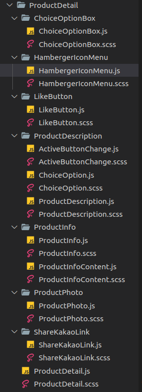

> **TL;DR** — 1차 프로젝트 첫 주, 프론트엔드로 상품 상세 페이지를 맡았다. HTML·CSS 물량전 끝에 컴포넌트를 쪼개고, `ref` 활용법을 제대로 익힌 한 주였다.

난이도 : ★☆☆☆☆

## ✅ 상황 (Situation)

1차 프로젝트 첫 주는 프론트엔드 주간이다. 프로젝트 주가 시작되기 전 주말에 백엔드 데이터 모델링을 먼저 짜고, 월요일에 멘토의 모델링 리뷰를 받은 뒤, 화요일까지 HTML·SCSS를 작성하고, 수요일엔 컴포넌트 분리와 기본 기능, 목요일엔 심화 기능을 구현하는 흐름이었다. 목요일까지 끝내야 하는 이유는 금요일이 코드 리뷰이고 주말부터는 바로 백엔드 주간이 시작되기 때문이다.



## ✅ 목표와 내 역할 (Task)

상품 상세 페이지 전담. 옵션 선택에 따른 가격·수량 변동, 후기 별점, 좋아요, 스크롤 이동까지 상세 페이지의 인터랙션 전반을 구현하는 게 목표였다.

## ✅ 한 것 (Action)

- 상품 옵션 선택 시 하단에 선택 내역이 추가되는 기능
- 옵션 선택 창에서는 하단 상세 정보가 안 보이도록 처리
- 메뉴 클릭 시 해당 섹션으로 스크롤 이동 (`ref` + `scrollIntoView`)
- 좋아요 버튼 색상 토글
- 하단 상세 설명 영역을 참고 사이트 디자인대로 구현

라우팅에서 페이지별로 공통 레이아웃(`TopNav`, `Footer`)을 다르게 적용하는 부분도 정리했다. 로그인 페이지에는 네비게이션을 빼고, 나머지 페이지는 감싸는 방식이다.

```javascript
<Switch>
  <Route exact path="/login" component={Login} />
  <>
    <TopNav />
    <Route exact path="/list" component={List} />
    <Route exact path="/detail" component={Detail} />
    <Footer />
  </>
</Switch>
```

가장 많이 부딪힌 건 `ref`였다. `this.변수명.current`로 특정 위치까지의 값을 구할 수 있는데, 위치를 상수로 넣으면 브라우저마다 값이 달라져서 제대로 동작하지 않는다. `current`를 직접 참조해야 한다. 자식 컴포넌트로 `ref`를 넘길 때는 `forwardRef`가 필요했다.

호버 이벤트로 햄버거 메뉴를 다루는 부분도 구현했다. 햄버거 버튼에는 `fixed`, 하위 메뉴에는 `absolute`를 적용해서 위치를 고정했다.

## ✅ 결과 (Result)

- 상품 상세 페이지의 옵션 선택, 좋아요, 스크롤 이동, 후기 기능을 기간 내 완성했다.
- 팀 회의에서 정한 역할 분담표대로 각자 파트(로그인/회원가입, 메인 nav·footer, 상품 리스트, 이미지 슬라이더, 상세 후기, 상세 제품 정보)를 병렬로 진행해 큰 충돌 없이 병합했다.

## ✅ 배운 점 / 아쉬운 점

**잘한 것**

- `ref`를 부모→자식으로 전달하는 방법, 다중 `ref`를 객체로 관리하는 방법(이름을 `refs`로 지으면 안 된다는 것도 이번에 알았다), `scrollIntoView`로 코드를 줄이는 방법까지 확실히 익혔다.
- SCSS 클래스명과 경로를 신경 써서 지어서 팀원과 머지할 때 충돌이 거의 없었다.

**아쉬운 것**

- 상세 페이지 레이아웃을 처음부터 한 번에 짜고 이슈별로 나눠 작업했는데, 이 방식이 맞는 접근인지 여전히 확신이 없다. 이전 이슈에서 작업한 코드를 다른 이슈에서 다시 건드릴 일이 생기면 팀원 모두 코드를 고쳐야 하는 게 아닌지 궁금증이 남았다.
- 회원가입 API 설계에서 "필드마다 따로 검증 요청을 보낼지, 한 번에 묶어서 보낼지" 트레이드오프를 놓고 고민했는데 결론은 "merge를 무서워하지 말자"였다. 정답이 있다기보다 자원 소모와 안정성 사이의 선택 문제라는 걸 알게 됐다.


## 참고한 링크

- [React로 카카오톡 공유 버튼 구현하기](https://ellismin.com/2020/09/share-kakao/)
- [프론트엔드 레포지토리](https://github.com/wecode-bootcamp-korea/fullstack2-1st-keudaran-studio-frontend)
