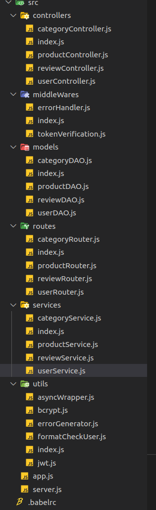

> **TL;DR** — 1차 프로젝트 둘째 주, 백엔드로 회원가입 API를 맡았다. 프론트가 구현의 반복이라면 백엔드는 예외 처리의 연속이라는 걸 체감한 한 주였다.

난이도 : ★★☆☆☆

## ✅ 상황 (Situation)

1차 프로젝트 둘째 주는 백엔드 주간이다. 시작 전 주말에 Prisma로 데이터를 모델링하고 API 분담을 다시 맞췄다. 월~수요일에 API 기능을 구현하고 수요일엔 멘토와 리팩토링, 목요일엔 팀원 코드를 머지해서 풀스택으로 맞춰보고 기능이 정상 동작하는지 테스트하는 흐름이었다.

## ✅ 목표와 내 역할 (Task)

회원가입 API 전담. 아이디 중복 확인, 비밀번호·이메일·전화번호 형식 검증, 회원가입, 그리고 원래 계획엔 없었지만 필요해져서 추가한 회원 탈퇴까지 담당했다.

## ✅ 한 것 (Action)

- 아이디 중복 체크 API
- 비밀번호/이메일/전화번호 형식 검증 API
- 회원가입 API (토큰 발행 포함)
- 정규식으로 회원가입·로그인 입력값을 검증하는 유틸

회원가입 API를 어떻게 나눌지 고민이 많았다. 두 가지 방식을 놓고 멘토에게 질문했다.

1. **필드를 다 채운 뒤 한 번에 POST** — 요청·응답이 한 번이라 효율적이지만, 모든 데이터를 한 번에 받아야만 유효성 검사를 할 수 있다.
2. **필드마다 따로 fetch로 검증** — 아이디 입력만으로도 즉시 검증할 수 있어 안정적이지만, fetch 호출이 여러 번이라 자원 소모가 크다.

멘토의 답은 절충안이었다. 아이디 중복 확인은 별도 버튼으로 그때만 API를 호출하고, 비밀번호 확인처럼 프론트 state끼리 비교로 충분한 부분은 서버로 보내지 않는다. 전화번호 중복은 본인 인증 전까지는 허용해도 된다는 조언도 받았다. 이 논의를 바탕으로 최종 API를 이렇게 나눴다.

- 아이디 중복 체크 (버튼 클릭 시 GET 요청)
- 회원가입 (필수 필드 검증은 서버에서, 포커싱 처리는 프론트에서)
- (2차 프로젝트로 미룬 것) 이메일 인증, 휴대폰 인증

두 방식을 놓고 저울질한 트레이드오프를 표로 정리하면 아래와 같다.

| 방식 | 장점 | 단점 |
| --- | --- | --- |
| 필드를 다 채운 뒤 한 번에 POST | 요청·응답이 한 번이라 효율적 | 모든 데이터를 받아야만 유효성 검사 가능 |
| 필드마다 따로 fetch로 검증 | 아이디 입력만으로도 즉시 검증 가능해 안정적 | fetch 호출이 여러 번이라 자원 소모 큼 |
| 채택한 절충안 | 아이디 중복 확인만 별도 API로, 비밀번호 확인처럼 state끼리 비교로 충분한 부분은 서버로 안 보냄 | — |

middleware와 util을 따로 구성해서 팀원들이 공용으로 쓸 수 있게 만들었고, 에러 상태 코드에 따라 메시지를 반환하는 `errorGenerator`도 이때 정리했다.

## ✅ 결과 (Result)

- 회원가입·탈퇴·아이디 중복 체크 API를 기간 내 완성했다.
- 팀 전체가 공용으로 쓸 middleware·util·에러 핸들링 패턴을 정리해서 공유했다.
- 사용자 정보가 담기는 요청(회원가입, 탈퇴, 아이디 중복 체크)은 전부 POST로 통일해서 쿼리 스트링 노출 위험을 없앴다.

## ✅ 배운 점 / 아쉬운 점

**잘한 것**

- 백엔드는 예외 처리가 핵심이라는 걸 체감했다 — 정규식 기반 검증, 반복되는 조건문을 객체화해서 줄이는 패턴을 이번에 확실히 익혔다.
- 테이블을 삭제하고 마이그레이션 파일 없이 다시 마이그레이션하려면 `npx prisma migrate dev`를 쓰면 된다는 것처럼, 자잘하지만 실무에서 계속 쓸 Prisma 명령어들을 정리해뒀다.

**아쉬운 것**

- 에러가 발생했을 때 에러 객체 안에 구분 정보를 어떻게 담아야 하는지, 다른 방법이 있는지는 이번 주에 답을 못 찾았다.
- 아이디 중복 체크를 별도 API로 분리하면서, 검증 완료 여부를 테이블에 boolean으로 저장해야 하는지도 결론을 못 냈다 — 다음 프로젝트에서 다시 고민하기로 했다.

## 참고한 링크

- [Node.js 회원가입 API 구현](https://velog.io/@hjulee12/Nodejs-practice.-데이터베이스-모델링-및-blog-API-구현)
- [백엔드 레포지토리](https://github.com/wecode-bootcamp-korea/fullstack2-1st-keudaran-studio-backend)
