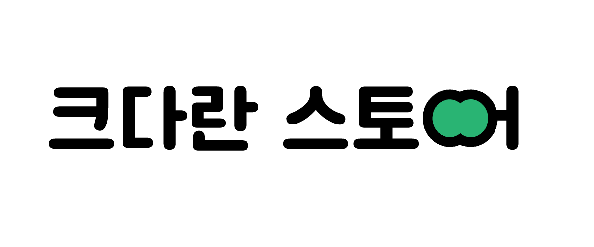

> **TL;DR** — 위코드 1차 프로젝트(쇼핑몰 클론)에서 프론트는 상품 상세 페이지, 백엔드는 회원가입 API를 맡았다. 2주 동안 완성한 기능과 기술 스택, 진행 과정에서 얻은 협업의 교훈을 총정리한다.

난이도 : ★☆☆☆☆

## ✅ 상황 (Situation)

위코드 부트캠프 1차 프로젝트. 팀 단위로 실제 서비스를 클론하는 첫 프로젝트였고, "조구만 스토어"라는 커머스 사이트를 클론하는 팀에 배정됐다. 프로젝트 기간은 2주, 첫 주는 프론트엔드, 둘째 주는 백엔드로 나눠 진행했다.




## ✅ 목표와 내 역할 (Task)

- **프론트엔드**: 상품 상세 페이지 전담
- **백엔드**: 회원가입 API 전담 (아이디 중복 검사, 회원 탈퇴 API 포함)
- 공통 유틸(에러 생성기, 포맷 체커)은 중복되는 부분이 있어서 별도 모듈로 분리하는 작업도 맡았다

## ✅ 한 것 (Action)

### 프론트엔드 — 상품 상세 페이지

- 상품 ID 기준 동적 라우팅 구현
- 상품 상세 API와 연동해 상품 정보를 동적으로 렌더링
- 옵션 클릭 시 수량·가격 변동 기능
- 좋아요 기능, 별점 후기 기능
- 호버·클릭·타이머에 따른 썸네일 이미지 변경
- `ref`를 사용한 클릭 시 스크롤 이동

가장 오래 붙잡고 있던 건 `ref`였다. 처음엔 이동 위치를 함수로 계산해 하드코딩에 가깝게 다뤘는데, 브라우저마다 위치가 달라져서 제대로 동작하지 않았다. `scrollIntoView`로 바꾸고 나서야 해결됐다.

```javascript
// 수정 전 — 이동 위치를 함수로 계산
changePositionScroll = whereMovePosition => {
  const movePosition = this.multiRefs[whereMovePosition]?.current
    ? this.multiRefs[whereMovePosition].current.offsetTop
    : 0;
  const moveScroll = movePosition => {
    window.scrollTo({ top: movePosition, left: 0, behavior: 'smooth' });
  };
  if (whereMovePosition === 'infoRef') moveScroll(movePosition);
  else if (whereMovePosition === 'reviewRef') moveScroll(movePosition);
  else moveScroll(movePosition);
};

// 수정 후 — scrollIntoView로 단순화
changePositionScroll = whereMovePosition => {
  this.multiRefs[whereMovePosition]?.current.scrollIntoView({
    behavior: 'smooth',
  });
  this.setState({
    isInfoColor: whereMovePosition === 'infoRef',
    isReviewColor: whereMovePosition === 'reviewRef',
  });
};
```

`ref`를 자식 컴포넌트로 넘길 때는 `forwardRef`를 썼다.

```javascript
// ProductInfo.js
export default React.forwardRef((props, ref) => {
  return <ProductInfo {...props} forwardRef={ref} />;
});
```

옵션 배열에서 특정 항목의 수량을 바꾸는 로직도 리팩토링했다. `map`으로 매번 배열 전체를 순회하는 대신 `findIndex`로 대상만 찾아 갱신하는 방식으로 바꿨다.

```javascript
// 수정 전
increaseCounter = id => {
  this.setState({
    choiceOptionArray: this.state.choiceOptionArray.map(option => {
      if (option.id !== id) return option;
      if (option.choiceCount >= option.quantity) {
        alert('재고량을 다시 확인하세요');
        return option;
      }
      return { ...option, choiceCount: option.choiceCount + 1 };
    }),
  });
};

// 수정 후
increaseCounter = id => {
  const { choiceOptionArray } = this.state;
  const selectedIndex = choiceOptionArray.findIndex(option => option.id === id);
  const newOptions = [...choiceOptionArray];
  const selectedOption = newOptions[selectedIndex];
  if (selectedOption.choiceCount >= selectedOption.quantity) {
    alert('재고량을 다시 확인하세요');
    return;
  }
  newOptions[selectedIndex] = {
    ...selectedOption,
    choiceCount: selectedOption.choiceCount + 1,
  };
  this.setState({ choiceOptionArray: newOptions });
};
```

boolean 상태 3개(좋아요, 메뉴 위치, 공유하기)를 각각 if/else로 다루던 코드도 `role` 인자를 받는 함수 하나로 합쳤다.

```javascript
// 수정 후
changeStateEventShow = role => {
  const { isLikedProduct, isMovePositionMenu, isSharedLinkMenu } = this.state;
  this.setState({
    isLikedProduct: role === 'like' && !isLikedProduct,
    isMovePositionMenu: role === 'move' && !isMovePositionMenu,
    isSharedLinkMenu: role === 'share' && !isSharedLinkMenu,
  });
};
```

### 백엔드 — 회원가입 API

- 전달받은 값의 유효성 체크 유틸 구현
- 회원가입 시 토큰을 발행해 자동 로그인 처리
- 아이디 중복 검사 API
- 회원 탈퇴 API (비밀번호 복호화·일치 여부 확인 후 Hard Delete)
- 공용 유틸(에러 생성기, 포맷 체커) 분리

정규식으로 회원가입 입력값을 검증하는 유틸을 만들었다.

```javascript
// formatCheckUser.js
const checkColumnPattern = str => ({
  space: str.search(/\s/) !== -1,
  special: /[~!@#$%'"`^&*()_,.\-=[+|<>?:{}]/.test(str),
  korean: /[ㄱ-ㅎㅏ-ㅣ가-힣]/.test(str),
  number: /[0-9]/.test(str),
  english: /[a-zA-Z]/.test(str),
});

const checkFormatColumn = (value, key) => {
  const pattern = checkColumnPattern(value);
  const isInvalid = {
    username: value.length < 5 || pattern.space || pattern.special || pattern.korean,
    email:
      value.slice(-4) !== '.com' || !value.includes('@') || pattern.space || pattern.korean,
    phoneNumber:
      value.slice(0, 3) !== '010' ||
      value.length !== 11 ||
      pattern.space ||
      pattern.special ||
      pattern.korean ||
      pattern.english,
    password:
      value.length < 8 || pattern.space || !pattern.special || pattern.korean || !pattern.english,
    realName: value.length > 4 || pattern.space || pattern.special || pattern.number || pattern.english,
  };
  return !isInvalid[key];
};
```

에러 상태 코드에 따라 메시지를 반환하는 wrapper도 만들었다.

```javascript
// errorGenerator.js
const DEFAULT_HTTP_STATUS_MESSAGES = {
  400: 'Bad Request',
  401: 'Unauthorized',
  403: 'Forbidden',
  404: 'Not Found',
  409: 'Duplicate',
  500: 'Internal Server Error',
  503: 'Temporary Unavailable',
};

const errorGenerator = (statusCode = 500, message) => {
  if (typeof statusCode !== 'number') {
    DEFAULT_HTTP_STATUS_MESSAGES[statusCode] = '상태 코드 타입이 잘못됐습니다';
  }
  if (!DEFAULT_HTTP_STATUS_MESSAGES[statusCode]) {
    DEFAULT_HTTP_STATUS_MESSAGES[statusCode] = '정의되지 않은 상태 코드입니다';
  }
  const err = new Error(message || DEFAULT_HTTP_STATUS_MESSAGES[statusCode]);
  err.statusCode = statusCode;
  throw err;
};
```

### 일정

| 구분 | 기간 | 내용 |
| --- | --- | --- |
| 프론트 | 10/01(금) | 초기 세팅, 멘토 설명, 역할 분담 |
| 프론트 | 10/02~03(토·일) | 데이터 ORM 설계, 초기 세팅 pull |
| 프론트 | 10/04~06(월~수) | HTML·SCSS 세팅, 컴포넌트 분리, 이슈별 브랜치 구현 |
| 프론트 | 10/07(목) | 마무리, 코드 리뷰, 리팩토링, 최종 머지 |
| 프론트 | 10/08(금) | 최종 마무리, 멘토 Q&A |
| 백엔드 | 10/09~10(토·일) | 최종 머지, API 재분배, `schema.prisma` 작성 |
| 백엔드 | 10/11~12(월·화) | API 기능 구현, 코드 리뷰, Wrapper/Util 구성 |
| 백엔드 | 10/13(수) | 기능 구현분 머지 |
| 백엔드 | 10/14(목) | 프론트·백엔드 병합, 데이터 INSERT, fetch 연동 |
| 백엔드 | 10/15(금) | 발표 준비 |

일정을 겪으며 확인한 사실 세 가지 — 프로젝트 기간에는 최대한 많이 모이는 게 좋고, 일정표상 시작일보다 실제 시작은 항상 앞당겨지며, 팀원과 소통하지 않으면 머지 지옥에 빠진다는 것이었다.

### 기술 스택

| 분야 | 스택 |
| --- | --- |
| Frontend | JavaScript, Scss, React, React Router, HTML |
| Backend | Node.js, Express, Prisma, Nodemon, MySQL, Bcrypt, JWT, Cookies, Layered Pattern, RESTful API |
| Common | Git, GitHub, Prettier, ESLint, Postman |
| Communication | Slack, Zoom, Notion |

## ✅ 결과 (Result)

- 2주 만에 프론트(상품 상세 페이지 전체 기능)와 백엔드(회원가입·탈퇴 API)를 완성해 AWS로 배포했다.
- `ref` 사용법(부모→자식 전달, 다중 ref 객체 관리, `scrollIntoView`)을 확실히 체득했다.
- 정규식 기반 유효성 검사 유틸, 상태 코드별 에러 생성기 등 재사용 가능한 유틸을 팀에 공유했다.
- 다 끝내지 못한 것도 있었다 — 쿠키·토큰 기반 로그아웃 처리, Soft Delete, 장바구니 기능, 카카오 공유하기는 다음 프로젝트로 넘겼다.

## ✅ 배운 점 / 아쉬운 점

**잘한 것**

- 마감 직전까지 몰아붙이면 오히려 짧은 시간에 많은 기능을 완성할 수 있다는 걸 체감했다. (좋은 습관은 아니지만 부트캠프 특유의 압축 학습 효과가 있었다.)
- 초반에 내 몫을 빨리 끝내야 팀원을 도울 시간적 여유가 생긴다는 걸 배웠다 — 다음 프로젝트에서도 유효한 전략이었다.

**아쉬운 것**

- 협업 소통이 가장 어려웠다. 스타트업 때는 혼자 주장하고 밀어붙이면 됐는데, 팀 프로젝트에서는 조율이 필요했다. 변수명을 지을 때도 나는 이해되는데 남이 보면 헷갈리는 경우가 많아서 코드 리뷰에서 자주 지적받았다.
- 사용자 관점에서 컴포넌트를 설계하는 습관이 아직 부족했다 — view만 잘 나오면 된다는 생각을 버리고, 실제 서비스라면 어떤 부분을 더 다듬어야 할지 고민하는 습관을 2차 프로젝트에서 키우기로 했다.

다음 프로젝트에서는 소통과, 남이 봐도 이해되는 코드 짜기, 이 두 가지를 개선하기로 했다.


## 참고한 링크

- [프론트엔드 레포지토리](https://github.com/wecode-bootcamp-korea/fullstack2-1st-keudaran-studio-frontend)
- [백엔드 레포지토리](https://github.com/wecode-bootcamp-korea/fullstack2-1st-keudaran-studio-backend)
- [클론 원본 사이트 — 조구만 스토어](http://www.jogumanstore.com/)
