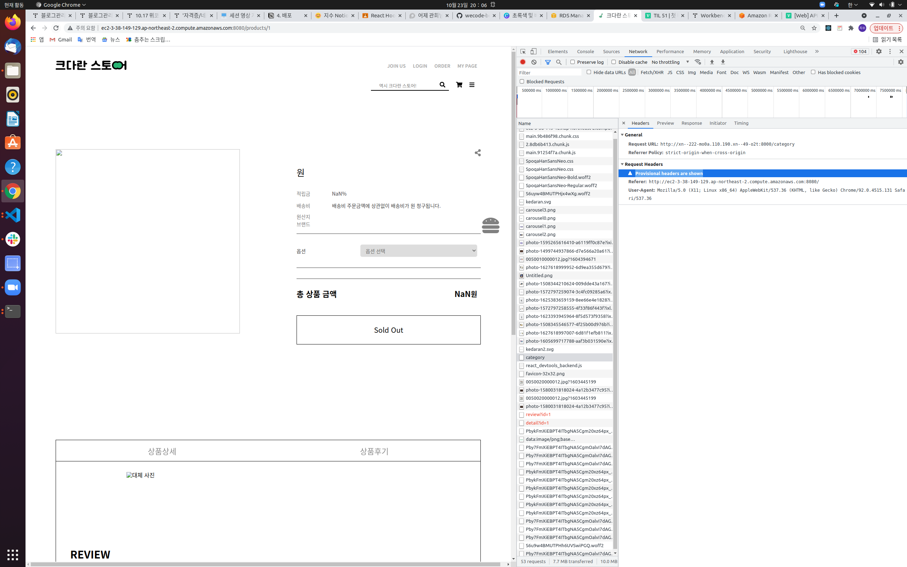

> **TL;DR** — 1차 프로젝트 마지막 주. 함수형 컴포넌트로 전환하고, `useEffect` 의존성 배열을 다시 이해하고, AWS 배포까지 마무리했다.

난이도 : ★★☆☆☆

## ✅ 상황 (Situation)

1차 프로젝트 마지막 주다. 새로 배운 리팩토링, AWS 배포, 함수형 컴포넌트(hook)를 적용하면서 기존 코드를 정리하는 주간이었다. 프로젝트가 끝났다고 긴장을 늦추면 안 되는 게, 2차 프로젝트가 바로 이어지기 때문이다.


## ✅ 목표와 내 역할 (Task)

- 프론트·백엔드 self-refactoring 및 멘토 코드 리뷰 반영
- `hook` 세션 학습 후 클래스 컴포넌트를 함수형으로 전환
- AWS 배포 완료

## ✅ 한 것 (Action)

옵션 선택 시 배열에 담는 로직을 스프레드 연산자로 다시 정리하고, `reduce`로 총 가격 계산 로직을 다시 짰다. `ref` 관련 함수도 세션 영상을 다시 보고 `scrollIntoView()`로 정리했다.

가장 크게 배운 건 `useEffect`의 의존성 배열이었다.

- 의존성 배열이 없으면 리렌더링될 때마다 계속 실행됨
- 빈 배열이면 딱 1번(`componentDidMount`처럼) 실행됨
- 배열에 값을 넣으면 그 값이 바뀔 때마다 실행됨

배포 중에 브라우저에서 계속 발생한 경고도 처리했다.



```
Warning: Can't perform a React state update on an unmounted component.
```

메모리 누수 경고였고, `useEffect`의 클린업 함수로 언마운트 시 상태 업데이트를 막아 해결했다.

증가/감소 카운터 함수도 코드 리뷰를 거치며 리팩토링했다. 처음엔 `increase`/`decrease` 두 함수로 나눠져 있었는데, 인자로 `name`을 받아 하나로 합칠 수 있는지 멘토에게 질문했다.

```javascript
// 통합 시도
plusMinusCounter = (id, name) => {
  const MIN_LIMIT_OPTION_NUM = 1;
  this.setState({
    choiceOptionArray: this.state.choiceOptionArray.map(option => {
      if (option.id !== id) return option;
      if (
        option.choiceCount < MIN_LIMIT_OPTION_NUM &&
        option.choiceCount >= option.quantity
      ) {
        alert('재고량과 1개 이상 선택 여부를 확인하세요');
        return option;
      }
      return {
        ...option,
        choiceCount: name === 'plus' ? option.choiceCount + 1 : option.choiceCount - 1,
      };
    }),
  });
};
```

멘토의 피드백은 "합치면 코드 양은 줄지만 조건문이 늘어서 가독성 면에서는 분리하는 게 낫다"는 것이었다. 대신 `map` 안에 로직이 몰려 있는 부분을 `findIndex` 기반으로 다시 리팩토링해줬다.

```javascript
increaseCounter = id => {
  const { choiceOptionArray } = this.state;
  const selectedIndex = choiceOptionArray.findIndex(option => option.id === id);
  const newOptions = [...choiceOptionArray];
  const selectedOption = newOptions[selectedIndex];

  if (selectedOption.choiceCount >= selectedOption.quantity) {
    alert('재고량을 다시 확인하세요');
    return;
  }

  newOptions[selectedIndex] = {
    ...selectedOption,
    choiceCount: selectedOption.choiceCount + 1,
  };

  this.setState({ choiceOptionArray: newOptions });
};
```

이후 AWS 인스턴스를 구성하고 배포를 마쳤다. 배포 중 에러가 나면 개발자 도구의 Source 탭에서 에러 위치를 먼저 확인하고, 콘솔에 에러가 안 뜨면 API 경로에 직접 요청을 보내 데이터가 제대로 오는지부터 확인하는 순서로 디버깅했다.

## ✅ 결과 (Result)

- 프론트·백엔드 리팩토링을 마치고 AWS 배포를 완료했다.
- 함수형 컴포넌트(hook) 전환을 연습용 예제로 익혀 2차 프로젝트에 적용할 준비를 마쳤다.
- `npm install --save` / `-g` / `--save-dev` 옵션 차이처럼 그동안 관행적으로만 쓰던 명령어들의 의미를 정리했다.

## ✅ 배운 점 / 아쉬운 점

**잘한 것**

- 코드 리뷰에서 "가독성을 고려한 시도" 자체를 긍정적으로 평가받았다 — 정답이 아니어도 트레이드오프를 고민하는 과정이 중요하다는 걸 배웠다.
- `useEffect` 의존성 배열의 세 가지 동작(없음/빈 배열/값 배열)을 명확히 구분하게 됐다.

**아쉬운 것**

- 우분투 환경에서 gif 파일을 다루는 방법을 끝내 완전히 숙지하지 못한 채 다음 주로 넘어갔다.
- 2차 프로젝트를 앞두고 React 초기 세팅과 함수형 컴포넌트 연습을 더 해두고 싶었는데 이번 주말 안에는 다 끝내지 못했다.

## 참고한 링크

- [Node.js 회원가입 API 구현](https://velog.io/@hjulee12/Nodejs-practice.-데이터베이스-모델링-및-blog-API-구현)
- [React 상태 업데이트 경고 해결](https://velog.io/@ohgoodkim/-에러노트-Cant-perform-a-React-state-update-on-an-unmounted-component)
- [AWS 첫 배포 기록](https://velog.io/@dabin0219/TIL-51-첫-배포-AWS)
