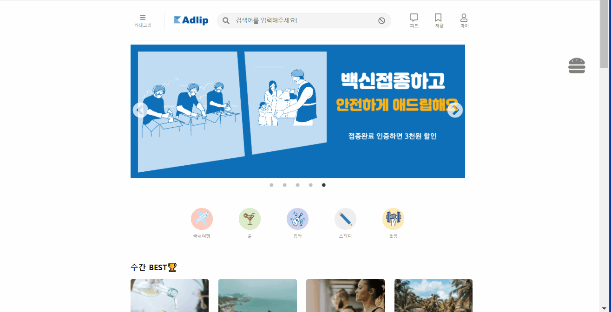

> **TL;DR** — 2차 프로젝트에서 레이아웃 전반과 검색 기능·검색 모달을 맡아 2주 만에 구현했고, 재사용 가능한 컴포넌트 설계와 소통의 중요성을 배웠다.


난이도 : ★☆☆☆☆

위코드 마지막 프로젝트 여정을 끝냈다. 배포 기간인 3주차에 이 글을 썼지만, 갑작스러운 할머니 상 때문에 디테일하게 담지 못한 부분이 있어 양해를 구한다. 느낀 점을 한 줄로 정리하면 — **배움에는 끝이 없다.**

클론한 사이트는 [프립(Frip)](https://www.frip.co.kr/)이고, 팀 로고는 아래와 같다.


## ✅ 상황 (Situation)

프론트엔드 5명, 백엔드 2명으로 구성된 팀에서 프립(Frip)을 클론하는 2차 프로젝트를 진행했다. 시작 전 주 금요일에 팀 발표가 났고, 시작 주 월요일에 클론 페이지가 공개됐다. 시작 전 주 금요일에 미리 모여 진행 방식을 논의한 덕분에 1차 프로젝트보다는 수월하게 시작할 수 있었다.

## ✅ 목표와 내 역할 (Task)

레이아웃 전반(Header, Nav, Footer, 메인페이지, 상위 카테고리 4개)을 담당했고, 주요 기능으로는 검색과 검색 모달을 맡았다. 모달은 외부 라이브러리를 쓸 수도 있었지만 가능한 한 직접 구현했고, 캐러셀이나 카드 컴포넌트는 팀원이 만든 코드를 누구나 재사용할 수 있게 다듬었다.

- **1주차** — 전반 레이아웃(Header, Nav, Footer, MainPage, ParentCategory, SubCategory)
- **2주차** — 기능 구현과 레이아웃 보완(SearchBox, TeamInfo, CardComponent, Carousel)
- **특이사항** — 메인페이지에서 id를 전달해 리스트 페이지 → 디테일 페이지 순으로 데이터를 넘기는 구조를 설계



## ✅ 한 것 (Action)

### 진행 상황 및 스케줄

프로젝트 시작 전 주 금요일에 팀원들과 모여 전반적인 진행 방식을 미리 논의했고, 3주차에는 회고록 작성, 기업협업 준비 이력서, 리팩토링·페이지 오류 보완을 진행할 예정이었다.

**1주차**

- **10/25(월) at. 서울역** — 초기 세팅 및 이슈 생성, 함수형 컴포넌트와 styled-components 도입, 초기 세팅 클론, 백엔드 모델링 구현
- **10/26(화) at. 서울역** — 본격 작업 시작, Nav 컴포넌트 레이아웃 구성 및 기능 구현, 홈페이지 이미지 소싱, rebase 세션 듣고 develop 브랜치 생성, 백엔드 모델링 결과 프론트와 공유
- **10/27(수) at. 집** — 페이지별 라우팅과 id 값 전달 방식 논의, 백엔드 모델링 결과 공유
- **10/28(목) at. 종로** — 카테고리 페이지 구현, 멘토에게 리팩토링 리뷰, footer 레이아웃 구현(footer·Nav·Header 마무리), 팀원·멘토 피어리뷰 반영
- **10/29(금) at. 종로** — cardList 목데이터 작성 후 List 페이지 카드리스트 재활용, 캐러셀 재활용, styled-components 리팩토링, 한 파일에 scss까지 작성, mixin style.css로 재구성, 검색 값 로컬스토리지 저장, 레이아웃 전체 구현 완료

**2주차**

- **11/01(월) at. 서울역** — 백엔드 API 가공 시작, 검색 시 로컬 저장이 한 템포 느린 문제 발견, 검색 모달 구현 중, 비동기·동기 오류와 모달 오류로 커뮤니티에 질문 다수
- **11/02(화) at. 을지로입구** — 모달창 열고 닫는 기능과 검색 지연 문제 추가 질문, 멘토와 줌으로 1:1 코드 리뷰
- **11/03(수) at. 을지로입구** — 모달·검색엔진 관련 추가 질문에 멘토가 줌 리뷰 진행, 프론트·백엔드 각자 진행 상황 공유 후 프론트끼리 1차 병합
- **11/04(목) at. 을지로입구** — 검색 마무리 및 메인페이지 추가 모달 구현, 팀 소개 페이지 구현, 백엔드 데이터 연결 및 수정, 전역 상태 관리 특강, 카카오 로그인은 전역 상태로 관리하며 헤더에서 로그인 여부 체크, 저녁에 백엔드 데이터로 프론트 테스트, 팀원 전체 기능 마무리
- **11/05(금) at. 서울역** — 최종 merge 및 충돌·에러 보완, PPT 작성 및 발표 리허설, 오프라인 발표, 멘토·팀원들과 커피타임 및 회식

### 사용한 기술 스택

| 분야 | 기술 스택 |
| --- | --- |
| Frontend | JavaScript, styled-components, React, React Hook, HTML, RESTful API, 전역 상태 관리 |
| Common | Git, GitHub, Git Rebase, Prettier, ESLint |
| Communication | Slack, Zoom, Notion |

개선이 필요하다고 느낀 부분은 카카오·네이버 API 활용, Context API·Redux, 비동기·동기 처리, 외부 라이브러리 사용이었다.

## ✅ 결과 (Result)

레이아웃 전반과 검색·모달 기능을 2주 안에 완성해 예정대로 발표까지 마쳤다. 다만 시간이 부족해 못 다룬 기능들이 있었다.

**부족한 부분, 하고 싶었지만 못한 것**

- **Redux** — 전역 상태 관리 중 하나인데, 굳이 쉬운 Context API를 두고 왜 쓰는지 궁금했다
- **카카오 지도** — 카카오 API로 소셜 로그인을 구현할 때는 프론트가 바로 정보를 받는 게 아니라 백엔드가 카카오 백엔드로 요청 후 데이터를 받아야 한다는 건 알았다. 네이버 지도도 위도·경도를 넘겨 같은 방식으로 요청할 수 있는지 궁금했다
- **state 비동기 → 동기 전환** — 콜백을 첫 번째 인자로 넘겨도 안 되는 경우가 있었는데, 그 원인이 궁금했다
- **페이지네이션 정렬** — 상품 개수에 따라 페이지가 자동으로 나뉘는 기본 원리가 궁금했고, 직접 구현까지는 못 해봤다

**깨달은 것 중 중요한 것**

- **모달 레이아웃 구현** — 전체 태그로 감싸고, 그 안에 모달 외부 태그와 모달 태그로 구성한다. 모달 태그는 흰 배경에 클릭 시 state를 true로, 모달 외부 태그는 opacity 0.8에 검정 배경, state는 false로 두면 된다
<!-- 이미지 제안: 전체 태그 안에 모달 외부 태그(반투명 배경)와 모달 태그(흰 배경)가 겹친 레이어 구조도 -->
- **styled-components 쉽게 쓰는 법** — styled-component는 표현식을 변수에 담는 형식이라 fontawesome이나 외부 컴포넌트에는 직접 style을 지정할 수 없다. 각 컴포넌트 태그에 속성을 넘겨 `props => props.xx`로 받아 재사용하는 방법과, mixin.js처럼 함수형 CSS 컴포넌트를 미리 만들어 인자로 값을 받는 방법 두 가지를 활용했다
- **비동기·동기와 렌더링 시점** — 비동기는 기다리는 동안 다른 동작을 실행하고, 동기는 기다렸다가 실행한다. 렌더링이 한 템포 늦게 나오는 문제(두 번째 렌더링에서 첫 번째 값이 나오는 현상)는 `useEffect`로 렌더링 시점을 특정하거나, state 첫 번째 인자로 콜백을 넣어 동기적으로 처리해서 해결한다
- **전역 상태 관리(Context API)** — 원래 React는 부모에서 props로 넘긴 값을 자식이 쓰는 구조인데, 자식에서 부모로 값을 넘기고 싶을 때 주로 쓴다. 예를 들어 Nav.js에 Search.js의 검색값을 넘기고 싶으면 Search를 전역 상태로 만들면 된다. App.js에서 Context 객체를 만들어 최상위 컴포넌트를 감싸고, state를 값으로 내려주면 각 컴포넌트에서 props처럼 받아 쓸 수 있다

## ✅ 공유하고 싶은 코드

**1. mixin.js로 styled-components를 가독성 있게 정리**

```javascript
import { css } from 'styled-components';

const colorStyleGroup = {
  whiteColor: '#FFFFFF',
  headerBgColor: '#f4f4f4',
  headerColor: '#777777',
  navColor: '#858585',
  AdlipColorBold: '#1187cf',
  AdlipColor: '#53B7E7',
  AdlipColorSoftly: '#e8f5fc',
  footerContentColor: '#666666',
  footerIconColor: '#9b9b9b',
  footerMenuColor: '#333333',
  middleCategoryTextColor: '#aaaaaa',
};

const widthStyleGroup = {
  topHorizontalWidth: '100wv',
  secondTopWidth: '768px',
  searchModalWidth: '600px',
};

const flexStyleGroup = (justify, align, direction) => css`
  display: flex;
  justify-content: ${justify || 'flex-start'};
  align-items: ${align || 'flex-start'};
  flex-direction: ${direction || 'row'};
`;

const fontStyleGroup = (size, color, weight) => css`
  font-size: ${size || 'none'};
  color: ${color || 'none'};
  font-weight: ${weight || 'normal'};
`;

const widthHeightStyleGroup = (width, height) => css`
  width: ${width || 'none'};
  height: ${height || 'none'};
`;

const marginStyleGroup = margin => css`
  margin: ${margin};
`;

const paddingStyleGroup = padding => css`
  padding: ${padding};
`;

const firstTopTagStyle = height => css`
  ${flexStyleGroup('center')}
  ${widthHeightStyleGroup(widthStyleGroup.topHorizontalWidth, height)}
`;

const commonHoverStyle = (fontSize, bold) => css`
  cursor: pointer;

  &:hover {
    ${fontStyleGroup(fontSize || '', colorStyleGroup.AdlipColor, bold)}
    transform: scale(1.1);
  }
`;

const mixinStyle = {
  colorStyleGroup,
  widthStyleGroup,
  flexStyleGroup,
  fontStyleGroup,
  widthHeightStyleGroup,
  marginStyleGroup,
  paddingStyleGroup,
  firstTopTagStyle,
  commonHoverStyle,
};

export default mixinStyle;
```

**2. 검색어 입력 후 엔터 시 로컬 저장 + 페이지 이동 + 최근 검색어 목록**

최근 검색어 중 하나를 클릭하면 검색 input에 값이 들어가고 페이지가 자동으로 이동하도록 구현했다.

```javascript
const localValue = localStorage.getItem('search');
const [searchValueArray, setSearchValueArray] = useState(
  JSON.parse(localValue) || []
);
const [searchContent, setSearchContent] = useState('');
const [isSearchBoolean, setSearchBoolean] = useState(false);
const history = useHistory();

const listPageMove = deliverData => {
  history.push({
    pathname: `/category/${deliverData}/searchAll`,
    state: deliverData,
  });
};

const searchOnchange = e => {
  setSearchContent(e.target.value);
};

const searchEnterEvent = e => {
  e.preventDefault();
  setSearchBoolean(false);
  listPageMove(searchContent);
  setSearchValueArray([...searchValueArray, searchContent]);
  localStorage.setItem(
    'search',
    JSON.stringify([...searchValueArray, searchContent])
  );
};

const DeleteSearchData = searchData => {
  const dataIndex = searchValueArray.indexOf(searchData);
  searchValueArray.splice(dataIndex, 1);
  setSearchValueArray(searchValueArray);
  localStorage.setItem('search', JSON.stringify(searchValueArray));
};

const pushInputValueAtMotal = e => {
  setSearchContent(e.target.innerText);
  console.log(searchContent);
  listPageMove(searchContent);
  setSearchBoolean(false);
};
```

## ✅ 배운 점 / 아쉬운 점

1차 프로젝트는 프로젝트 자체가 처음이라 어떻게 진행해야 할지 몰랐다면, 2차 프로젝트는 진행 방식은 알지만 새 기술(styled-components, React Hook, 함수형 컴포넌트, 전역 상태 관리, git rebase)을 어떻게 적용할지가 막막했다. 프론트엔드·백엔드로 나뉘어 한 영역에 집중할 수 있었지만 구현할 레이아웃과 기능이 많아 시간이 부족한 건 1차와 똑같았다. 데이터는 초반에는 목데이터로, 2주차부터 백엔드 데이터로 전환해서 썼다.

여기서 가장 중요한 걸 깨달았다 — **결국 소통이다.** 1차보다 팀원들과 교류를 훨씬 많이 했고, 내가 맡지 않은 기능도 같이 고민하고 해결하는 방향으로 움직였다. 아직 못 써본 기능이 많아 걱정도 되지만, 이 흐름이면 못 할 게 없다고 생각한다.

이 여정을 헤쳐나가게 해준 원동력은 질문이었다. 처음엔 커뮤니티에 글 남기는 것도, 정리하는 것도 부담이었지만, 그냥 물어봤을 때와 스스로 고민하고 찾아본 뒤 질문했을 때는 확실히 차이가 있었다. 오히려 혼자 고민하는 것보다 시간을 절약할 수 있었고, 검색으로 안 나오는 부분까지 알게 되는 계기가 됐다. 주로 모달·검색 기능과 렌더링 지연 오류를 질문했고, 여러 멘토가 다양한 방법으로 답을 줬다.

**Self Q&A**

- **Q. 1차와 다르게 이번엔 다양한 기술을 썼는데 어땠나?** — 처음엔 익숙하지 않아 막막했지만, 공식 문서와 검색으로 원칙을 지키면서 나만의 편한 방식(mixin 등)을 만들어냈다.
- **Q. styled-components의 props 대신 mixin을 선택한 이유는?** — props로 넘기면 함수형으로 써야 해서 중복 컴포넌트는 재사용할 수 있지만, width·height처럼 비슷한 속성끼리는 묶을 수 없다. mixin은 함수형 CSS 컴포넌트를 만들어 인자로 값을 받을 수 있어 재사용성이 더 좋았고, import도 줄었다.
- **Q. 모달창을 라이브러리 대신 직접 구현한 이유는?** — 라이브러리는 CSS 속성만 바꿔서 미리 만들어진 기능을 쓸 수 있지만 디테일 수정에는 제한이 있다. 동작 원리를 직접 알아야 나중에 라이브러리도 제대로 쓸 수 있다고 생각했다.

## 참고한 링크

- [프론트엔드 GitHub — fullstack2-2nd-ADLIP-frontend](https://github.com/wecode-bootcamp-korea/fullstack2-2nd-ADLIP-frontend/pulls)
- [백엔드 GitHub — fullstack2-2nd-ADLIP-backend](https://github.com/wecode-bootcamp-korea/fullstack2-2nd-ADLIP-backend)
- [클론 대상 — 프립(Frip)](https://www.frip.co.kr/)
