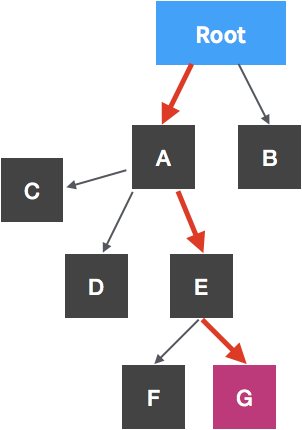
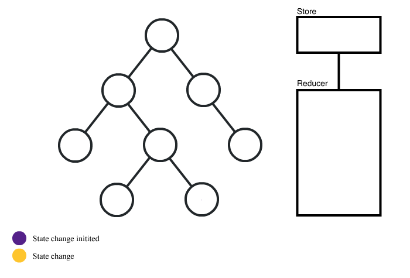

> **TL;DR** — Redux는 자바스크립트 앱을 위한 예측 가능한 전역 상태 컨테이너다. Action·Reducer·Store 세 가지 개념과 `useSelector`·`useDispatch` 두 훅만 구분하면 실무 코드는 대부분 읽힌다.

난이도 : ★★☆☆☆

1️⃣ `Action / Reducer / Store` 2️⃣ `useSelector / useDispatch` 3️⃣ `combineReducers`


## ✅ 왜 알아야 하나

전역 상태 관리의 끝판왕이라 불리는 Redux다. Context API로도 전역 상태를 관리할 수 있지만, 기본 구조와 개념만 이해하면 오히려 Context API보다 명확하게 정리되는 부분이 있다. 이번 글에서 다음 네 가지를 확인하는 게 목표였다.

- React에서 전역 상태 관리 라이브러리로서 Redux가 필요한 이유를 이해한다
- Action, Dispatch, Reducer, Store 등 Redux의 핵심 개념을 이해한다
- react-redux가 제공하는 `useSelector`, `useDispatch` 훅을 사용할 수 있다
- Redux가 상태 관리를 위해 도입한 제약(순수 함수, 불변 객체)을 이해한다

실습 코드는 위코드에서 제공한 [redux-exercise](https://github.com/wecode-bootcamp-korea/redux-exercise) 저장소 기준이다.

## ✅ Redux를 왜 쓰는가

Redux 공식 정의는 "자바스크립트 앱을 위한 예측 가능한 상태 컨테이너"다. 실무에서 쓰는 이유는 크게 두 가지다.

- props로 필요한 하위 컴포넌트까지 값을 계속 내려줘야 하는 props drilling을 피할 수 있음
- 불필요한 리렌더링을 줄일 수 있음



*props로 넘겨줄 때 — 중간 컴포넌트까지 값을 전달만 하기 위해 거쳐야 한다*



*Redux를 사용할 때 — 필요한 컴포넌트가 store에서 직접 값을 구독한다*

## ✅ 핵심 개념

Redux의 기본 개념 세 가지와, 이를 다루는 메서드 네 가지를 구분해야 한다.

**기본 개념**

| 용어 | 의미 |
| --- | --- |
| 액션(Action) | 애플리케이션의 상태를 어떻게 변경할지 추상화한 표현. 단순 객체이며 `type` 프로퍼티를 반드시 가져야 함 |
| 리듀서(Reducer) | 애플리케이션의 다음 상태를 반환하는 함수. 이전 상태와 액션을 받아 처리하고 다음 상태를 반환함 |
| 스토어(Store) | 애플리케이션의 상태를 저장·조회하고, 액션을 보내거나 상태 변화를 감지할 수 있게 API를 제공하는 객체 |

**사용 메서드**

| 메서드 | 역할 |
| --- | --- |
| `useDispatch` | 액션을 생성하는 함수를 인자로 받아 객체를 반환한다. 리듀서를 거쳐 스토어를 직접 업데이트할 때 사용(쓰기 전용) |
| `useSelector` | `index.js`에서 `Provider`로 전달한 store를 인자로 받고, 콜백 함수로 특정 리듀서의 값을 조회한다(읽기 전용) |
| `createStore` | 앱의 상태 트리 전체를 보관하는 Redux 저장소를 생성한다. 앱 내에는 단 하나의 저장소만 있어야 함 |
| `combineReducers` | 컴포넌트별로 작성한 리듀서를 하나의 리듀서로 통합할 때 사용한다 |

## ✅ 직접 확인해보기

초기 세팅은 다음 명령으로 한다.

```bash
npm install redux react-redux
```

**1. action 생성 — 리듀서에서 state에 따라 실행될 함수 정의**

```javascript
// actions/index.js

export const addCart = (item) => {
  return {
    type: "ADD_ITEM",
    payload: item,
  };
};

export const deleteCart = (items) => {
  return {
    type: "DELETE_ITEM",
    payload: items,
  };
};
```

**2. reducer 생성 — action의 type에 따라 새 상태 반환**

첫 번째 인자는 state, 두 번째 인자는 action이다. 보통 switch 문으로 작성하고, state 초기값도 여기서 설정한다.

```javascript
// reducers/cartReducer.js

const cartReducer = (state = INITIAL_STATE, action) => {
  switch (action.type) {
    case "ADD_ITEM":
      return [...state, action.payload];
    case "DELETE_ITEM":
      return [...action.payload];
    default:
      return state;
  }
};

export default cartReducer;

const INITIAL_STATE = [
  {
    isChecked: true,
    product_name: "플루크 new 피그먼트 오버핏 반팔 티셔츠 FST701",
    product_id: 1304,
    product_img: "/images/tShirt.jpg",
    price: 33250,
  },
  // ...(생략)
];
```

**3. combineReducers로 reducer 병합**

인자로 리듀서들을 프로퍼티로 가진 객체를 받는다.

```javascript
// reducers/index.js

import { combineReducers } from "redux";
import cartReducer from "./cartReducer";

export default combineReducers({ cartReducer });
```

**4. store 생성 및 Provider에 전달**

Context API처럼 최상위에서 감싸서 하위 컴포넌트 어디서든 접근할 수 있게 한다.

```javascript
// index.js

import { Provider } from "react-redux";
import { createStore } from "redux";
import rootReducer from "./store/reducers";

const store = createStore(rootReducer);

// ...(생략)

ReactDOM.render(
  <React.StrictMode>
    <Provider store={store}>
      <Routes />
      <GlobalStyle />
    </Provider>
    // ...(생략)
  </React.StrictMode>
);
```

**5. useSelector로 state 값 읽기**

```javascript
// CartList.js

import { useSelector } from "react-redux";
// ...(생략)

export default function CartList() {
  const cartItems = useSelector((store) => store.cartReducer);
  // ...(생략)
}
```

**6. useDispatch로 state 값 수정**

```javascript
// ProductCard.js

import React from "react";
import { useDispatch } from "react-redux";
import styled from "styled-components";
import CartIcon from "./CartIcon";
import { addCart } from "../store/actions";

function ProductCard({ item }) {
  const dispatch = useDispatch();

  return (
    <Card>
      {/* ...(생략) */}
      <AddCartBtn onClick={() => dispatch(addCart(item))} />
      {/* ...(생략) */}
    </Card>
  );
}
```

## ✅ 실무에서는 이렇게 쓴다

위 코드 순서(action → reducer → combineReducers → store/Provider → useSelector/useDispatch)가 Redux를 붙이는 기본 흐름이다. 컴포넌트가 늘어날수록 리듀서를 도메인별로 쪼개고 `combineReducers`로 합치는 구조가 유지보수에 유리했다. `useSelector`는 조회 전용, `useDispatch`는 변경 전용이라는 역할 구분을 지키는 게 핵심이었다.

## ✅ Summary

- Redux는 Action·Reducer·Store 세 개념으로 전역 상태를 예측 가능하게 관리하는 라이브러리임
- 상태를 읽을 때는 `useSelector`, 상태를 바꿀 때는 `useDispatch`로 역할이 분리됨
- 리듀서가 여러 개로 늘어나면 `combineReducers`로 하나의 rootReducer로 합쳐서 `createStore`에 넘김

## 참고한 링크

- [Redux 핵심, Part 1: Redux Overview and Concepts](https://ko.redux.js.org/tutorials/essentials/part-1-overview-concepts)
- [리덕스(Redux)는 왜 쓰는 건데⁉](https://wooder2050.medium.com/%EB%A6%AC%EB%8D%95%EC%8A%A4-redux-%EB%8A%94-%EC%99%9C-%EC%93%B0%EB%8A%94-%EA%B1%B4%EB%8D%B0-2eaafce30f27)
- [redux-exercise (실습 레포)](https://github.com/wecode-bootcamp-korea/redux-exercise)
