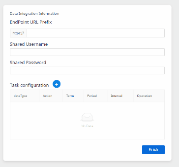
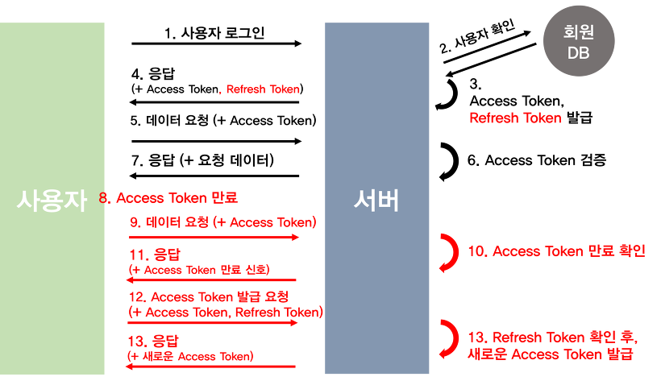
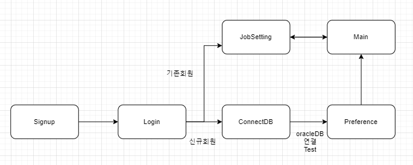
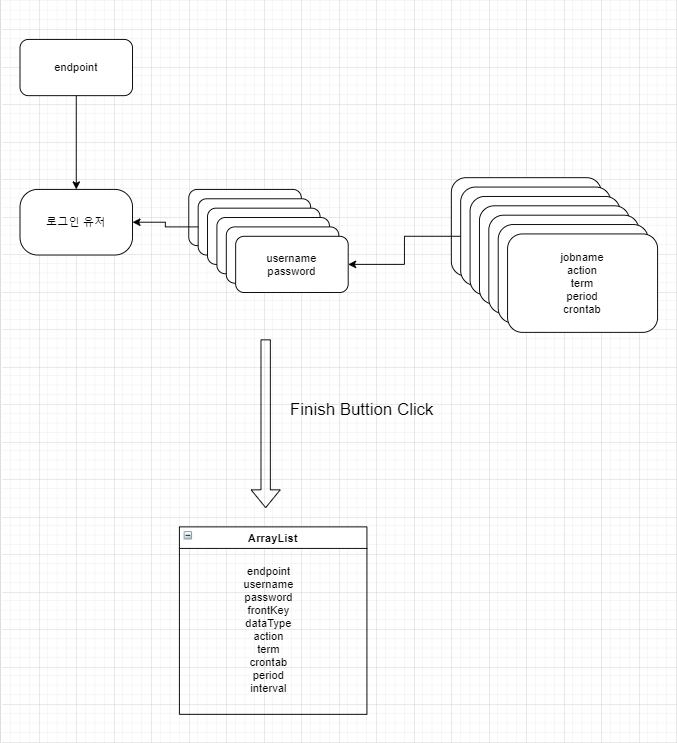
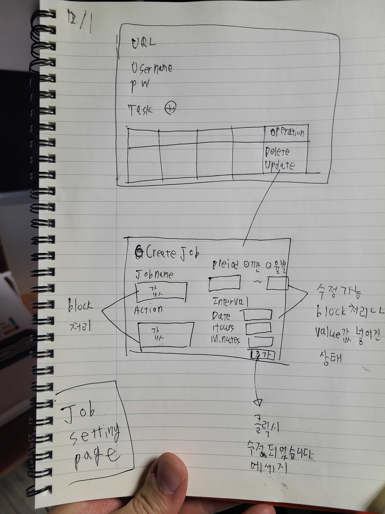
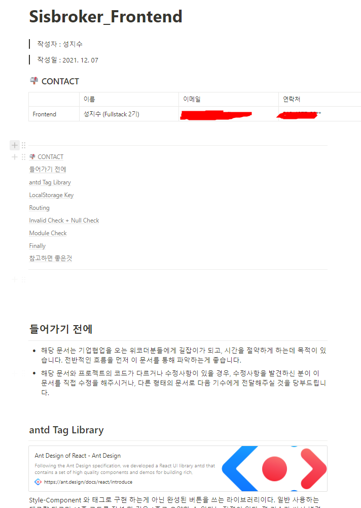

> **TL;DR** — 기업협업 4주 동안 프론트엔드 담당자 혼자로 이전 기수가 못다한 스케줄링 CRUD와 토큰 인증을 구현하고, 마지막 주는 다음 기수를 위한 문서화에 집중했다.

난이도 : ★☆☆☆☆

기업협업 시즌 동안 많은 걸 생각하게 됐고, 실제로 기업에서 일하는 느낌을 받으면서 앞으로 어떻게 해야 할지 목표가 생겼다. (AWS 배포는 못 했고, 기업 정보를 노출할 수 없어 사진으로 대체한다.)




이 글은 기업협업 회고 내용을 담고 있지만, 회사 자료를 외부에 유출할 수 없어 사전에 허락받은 부분만 담았다. 위코드 수강생 중 기업협업 관련 문의가 있으면 댓글로 남겨주면 된다.

## ✅ 상황 (Situation)

2차 프로젝트 3주차에 기업협업 희망 기업을 투표하는 과정에서 거리순으로 지원했고, 가장 가까웠던 아이비즈로 배정됐다. 프론트엔드는 나 혼자, 백엔드는 2명이 함께한 팀이었다. 보통은 사수가 있어야 하지만 이 회사에는 15년 차 자바 백엔드 개발자인 대표님만 있어서, 초반에는 프론트엔드 쪽 조언을 구할 곳이 마땅치 않았다.

프로젝트는 Blackboard LEARN 시스템과 클라이언트(대학 기관)의 학사 정보 데이터를 통합하는 데이터 연동 SaaS 플랫폼 구축이었다. 클라이언트가 학사 관리를 수월하게 이용할 수 있도록 설계된 프로젝트였다.

## ✅ 목표와 내 역할 (Task)

전반적인 프론트 기능은 이전 기수가 못다한 부분을 구현했고, 디자인·기획은 대표님과 상의하며 진행했다. 구체적으로 다음 네 가지를 맡았다.

- Refresh 토큰과 Access 토큰
- 스케줄링 CRUD
- 라우팅 block, 유저 1명당 스케줄 ID 생성 및 스케줄 ID 1개당 다수 스케줄 생성
- 전반적인 문서화, 리팩토링

## ✅ 한 것 (Action)

### 진행 상황 및 스케줄

프로젝트 기간에 비해 여유 있게 진행됐고, 추가 기능을 더 구현하지 못한 게 아쉬운 지점이었다.

| 주차 | 일정 | 내용 |
| --- | --- | --- |
| 1주차 | 11/15(월) | 첫 미팅, 프로젝트 설명 |
| | 11/16(화) | 코드 분석 |
| | 11/17(수) | 코드 분석 |
| | 11/18(목) | 위코드데이, 소헌님 상담 |
| | 11/19(금) | 대표님 미팅, 프론트 전반 가이드 안내 |
| | 11/20~21(토·일) | 오라클 클라이언트 설치, 30% 마무리 |
| 2주차 | 11/22(월) | 스케줄링 관련 코드 파악 |
| | 11/23(화) | 스케줄링 코드 파악 및 리팩토링 |
| | 11/24(수) at. 홍대 | 프론트·백엔드 연결해서 오류 찾기, 2기와 합류 |
| | 11/25(목) 위코드데이(선릉) | 인자에 따라 alert 메시지를 반환하고 정규식을 체크하는 공통 함수 구현 |
| | 11/26(금) at. 자택 | 스케줄링 코드 수정 |
| | 11/27~28(토·일) | 메인 페이지 코드 파악, 진행한 부분 리팩토링 |
| 3주차 | 11/29(월) | 대표님과 스케줄링 관련 미팅, 추가 기능 코드 재수정 |
| | 11/30(화) | 다른 페이지에서 같은 스케줄링 기능을 쓰는 부분을 공통 컴포넌트로 분리 |
| | 12/01(수) | 스케줄링 toggle 시 상황 부여 및 백엔드 요청 처리 |
| | 12/02(목) 위코드데이(을지로) | crontab, 변수명, 데이터 타입 관련 대표님과 질의 |
| | 12/03(금) at. 자택 | 대표님이 지적한 부분 수정 |
| | 12/04~05(토·일) | 백엔드에서 5초씩 늘어나는 부분 코드 파악, 마지막 오류 체크·수정 |
| 4주차 | 12/06(월) | 대표님과 점심, 백엔드와 마지막 오류·기능 테스트 |
| | 12/07(화) | 코드·기능 전반 문서화(Notion), 최종 점검 및 대표님과 마지막 회의, 팀 회식 |
| | 12/08(수) at. 홍대 | 문서화 다듬기 + README 작성 |
| | 12/09(목) at. 자택 | 팀별 발표 PPT 작성, 기업협업 회고록 TIL 작성 |
| | 12/10(금) at. 서울역 | 수료식 |

### 사용한 기술 스택

| 분야 | 기술 스택 |
| --- | --- |
| Frontend | JavaScript, styled-components, React, React Hook, HTML, RESTful API, antd |
| Common | Git, GitHub, Git Rebase, Prettier, ESLint |
| Communication | Slack, Zoom, Notion, Teams |

개선이 필요하다고 느낀 부분은 Context API·Redux였다. antd 라이브러리 사용법은 [공식 문서](https://ant.design/docs/react/introduce)를 참고했다.

### Refresh 토큰과 Access 토큰

- **Refresh 토큰** — 모든 요청마다 refresh를 체크해서, 있으면 access 토큰만 재발급하고 없으면 모든 키를 삭제한 뒤 로그아웃시킴
- **Access 토큰** — 모든 요청마다 access를 체크해서, 없으면 재발급받은 뒤 다시 fetch 요청을 보냄



### 라우팅 block, 유저당 스케줄 ID 생성 구조

- **신규 유저** — 회원가입 → 로그인 → connectDB → preference → 메인 → JobSetting
- **기존 유저** — 회원가입 → 로그인 → main → JobSetting



로그인한 유저 1명당 하나의 endpoint, endpoint 1개당 다수의 username, username 1개당 다수의 dataType을 만들 수 있는 구조였다. 다만 완료 버튼을 클릭하면 body에는 여러 객체로 이뤄진 배열이 담겨서 전송됐다.



### 스케줄링 CRUD

<!-- 이미지 제안: 유저 1명당 endpoint, endpoint 1개당 username, username 1개당 dataType으로 이어지는 CRUD 데이터 흐름도 -->

**Create** — `+` 버튼 클릭 시 `onClick` 이벤트로 `getTotalList` 함수가 실행되고, 가공된 객체가 `totalJob` state 배열에 들어가 화면을 렌더링한다.

```javascript
// CommonScheduling.js
const getTotalList = () => {
  // onClick 이벤트
  const {
    dataType,
    action,
    term,
    totalPeriod,
    monthly,
    date,
    hours,
    minutes,
    frontKey,
  } = jobInfo;
  const { username, password } = bbInfo;
  const period = monthTab === 1 ? totalPeriod : monthly?.join();
  const interval = `Date: ${date}, Hours: ${hours}, Minutes: ${minutes}`;
  let crontab = `${minutes} ${hours} ${date || '*'} ${period} *`;
  const validation =
    dataType && action && !isTermInvalid && !checkMonth && hours && minutes;
  if (!validation) {
    alert(errorMessage('nullMs'));
    return;
  }
  let newJobData = {
    frontKey: frontKey === undefined ? jobTotal.length : frontKey, // update일 때도 고려
    username,
    password,
    dataType,
    action,
    term: term || '',
    period,
    interval,
    crontab,
  };
  // ...(생략)
  } else {
    // create일 때
    setJobTotal(jobTotal?.length ? [...jobTotal, newJobData] : [newJobData]);
  }
  setIsModalAction(!isModalAction);
};
```

**Read** — `componentDidMount` 시점에 GET 요청으로 state에 저장한 뒤 View 단에 뿌려준다.

```javascript
// CommonScheduling.js
useEffect(() => {
  const isJobsettingPage = location.pathname !== '/jobsettings';
  if (isJobsettingPage) {
    // url block check
    setIsUrlModify(false);
    return;
  }
  fetch(`${LOCAL_GET_GETLIST_API}`, {
    headers: {
      'Content-Type': 'application/json',
      Authorization: localStorage.getItem('token-access'),
    },
  })
    .then(res => res.json())
    .then(({ data }) => {
      console.log(data);
      setIsUrlModify(data?.length);
      setBbInfo({
        ...bbInfo,
        endpoint: data?.length ? data[0].endpoint : '',
      });
      setJobTotal(
        data?.map((job, index) => {
          // 하나씩 데이터 가공
          const crontabArr = job.crontab.split(' ');
          return {
            ...job,
            frontKey: index,
            period: job.crontab.split(' ')[crontabArr.length - 2],
            interval: `Date: ${
              job.crontab.split(' ')[crontabArr.length - 3] || 0
            }, Hour: ${
              job.crontab.split(' ')[crontabArr.length - 4] || 0
            }, Minute: ${
              job.crontab.split(' ')[crontabArr.length - 5] || 0
            } `,
          };
        })
      );
    });
}, []);
```

**Update** — 클릭한 객체를 받아 필수 값을 state에 저장한 뒤 생성 모달의 초기값으로 지정하고, 나머지 수정 가능한 데이터는 `onChange` 시 state에 반영한다. 완료 버튼을 누르면 수정된 데이터를 포함해 POST 요청을 보낸다.

```javascript
// TaskListTable.js
{
  title: 'Operation',
  dataIndex: 'Operation',
  render: (_, clickJob) =>
    jobTotal.length >= 1 && (
      <div>
        {/* ...(생략) */}
        <Popconfirm
          title='Sure to update?'
          onConfirm={() => handleModal(clickJob)}
        >
          <a>Update</a>
        </Popconfirm>
      </div>
    ),
},

// CommonScheduling.js
const handleModal = updateData => {
  if (!updateData?.username && (!bbInfo.username || !bbInfo.password)) {
    // update일 경우 username·password 체크 생략
    alert(errorMessage('nullMs'));
    return;
  }
  // ...(생략)
  setIsOperationUpdate(updateData?.username ? true : false); // update 시 createJob에서 block 처리
  const reset = {
    // update 시 바꾸지 않는 데이터는 그대로 유지
    frontKey: updateData?.frontKey === '' ? '' : updateData?.frontKey,
    dataType: updateData?.dataType || '',
    action: updateData?.action || '',
    term: updateData?.term || '',
    startDate: '',
    endDate: '',
    totalPeriod: '',
    monthly: '',
    date: 0,
    hours: 0,
    minutes: 0,
  };
  setUpdateBodyData({
    // 백엔드에서 받은 데이터
    clientId: updateData?.clientId || '',
    id: updateData?.id || '',
    toggle: updateData?.toggle || 0,
    endpoint: updateData?.endpoint || '',
  });
  setIsModalAction(!isModalAction);
  setCheckMonth('');
  setJobInfo(reset);
  setMonthTab(1);
};

const getTotalList = () => {
  // ...(생략, create와 동일)
  let updateJobData = {
    ...newJobData,
    ...updateBodyData,
  };
  if (updateJobData.frontKey !== undefined) {
    const deleteJob = jobTotal.filter(job => {
      // 클릭한 요소 빼고 나머지
      return job.frontKey !== updateJobData.frontKey;
    });

    setJobTotal([...deleteJob, updateJobData]);
  } else {
    // ...(생략)
  }
  setIsModalAction(!isModalAction);
};
```

**Delete** — 사용자가 추가한 데이터라면 state에서 삭제하고, DB에서 받은 데이터라면 id를 body에 담아 fetch 요청을 보낸다.

```javascript
// TaskConfig.js
const handleDelete = async record => {
  let resSuccess = true;
  if (record.id) {
    resSuccess = await fetchDelete(record.id);
  }
  resSuccess &&
    setJobTotal(
      jobTotal.filter(item => {
        return item.frontKey !== record.frontKey;
      })
    );
};

const fetchDelete = async jobId => {
  const response = await fetch(`${LOCAL_GET_DELETEJOB_API}`, {
    method: 'DELETE',
    headers: {
      'Content-Type': 'application/json',
      Authorization: localStorage.getItem('token-access'),
    },
    body: JSON.stringify({ id: jobId }),
  });
  const data = await response.json();
  if (data.message === 'jwt expired') {
    const isTokenChange = await tokenCheck();
    isTokenChange ? fetchDelete() : history.push('/login');
  } else {
    resMessageAlert(data.message);
    return data.message === 'JOB DELETED';
  }
};
```

### 문서화, 리팩토링

문서화는 [이 영상](https://www.youtube.com/watch?v=lBxXKJyAJ28)을 참고했다.

styled-components를 전반적으로 mixin으로 통일했다.

```javascript
// mixin.js
import { css } from 'styled-components';

const colorStyleGroup = {
  white: '#FFFFFF',
  pageColumn: ' #232e3c',
  inputBorder: '#ededed',
  inputShadow: '#9c88ff',
  inputPlaceholder: '#bcbcbc',
  cautionTextStyle: '#d63939',
  buttonBackground: '#086ad8',
  testButtonBackground: '#3ae374',
  settingMenuFont: '#333333',
  mainPageInfoColor: '#0000008a',
};

const flexStyleGroup = (justify, align, direction) => css`
  display: flex;
  justify-content: ${justify};
  align-items: ${align};
  flex-direction: ${direction};
`;

const inputHoverStyle = () => css`
  outline: none;

  &:focus {
    box-shadow: 0px 0px 0px 3px rgba(156, 136, 255, 0.7);
    transition: 0.5s ease-in-out;
  }

  &::placeholder {
    ${fontStyleGroup('14px', colorStyleGroup.inputPlaceholder)}
  }
`;
```

공통 에러 메시지와 응답에 따른 처리는 `CommonFunction` 모듈로 분리했다.

```javascript
import { LOCAL_GET_REFRESH_API } from '../../utils/config';

export const errorMessage = what => {
  // error에 따른 메시지
  const message = {
    nullMs: '빈값을 입력해주세요',
    resStateAlse: '통신 에러',
    // ...(생략)
  };
  return message[what];
};

export const resMessageAlert = message => {
  // response 메시지를 alert 메시지로 변환
  const KorMessage = {
    'SIGNUP SUCCESS': '회원 가입을 성공했습니다.',
    'INVALID INPUT': '입력이 잘못되었습니다.',
    // ...(생략)
  };
  KorMessage[message] ? alert(KorMessage[message]) : console.error(message);
};

export const isValidCheck = (what, testObject) => {
  const invaild = {
    email:
      /([\w-\.]+)@((\[[0-9]{1,3}\.[0-9]{1,3}\.[0-9]{1,3}\.)|(([\w-]+\.)+))([a-zA-Z]{2,4}|[0-9]{1,3})(\]?)$/,
    // ...(생략)
  };
  return !invaild[what].test(testObject);
};

export const isValidErrorMessage = (what, testObject) => {
  // invalid check에 따른 error 메시지 반환
  return isValidCheck(what, testObject) ? errorMessage(what) : '';
};

export const dataToPageMove = where => {
  // response 메시지에 따른 이동 경로
  const routing = {
    'NEW USER': '/connectdb',
    // ...(생략)
  };
  return routing[where];
};

export const tokenCheck = async () => {
  // refresh check
  const refreshResult = await fetch(`${LOCAL_GET_REFRESH_API}`, {
    method: 'GET',
    headers: {
      'Content-Type': 'application/json',
      Authorization: localStorage.getItem('token-access'),
      Refresh: localStorage.getItem('token-refresh'),
    },
  });
  const refreshData = await refreshResult.json();
  if (refreshData.message === 'NO AUTHORIZED') {
    resMessageAlert(refreshData.message);
    localStorage.clear();
    return false;
  } else if (refreshData.message === 'ACCESS TOKEN IS REFRESHED') {
    localStorage.setItem(
      'token-access',
      JSON.stringify(refreshData.newAccessToken)
    );
    return true;
  } else console.error(refreshData.message);
};
```

Preference 페이지와 JobSetting 페이지는 같은 모달을 쓰되 세부 기능만 다르게 구현했다.



문서화는 다음 기수가 바로 알아볼 수 있도록 최대한 세밀하게 준비했다.



## ✅ 결과 (Result)

**부족한 부분, 하고 싶었지만 못한 것**

- **Redux** — 전역 상태 관리 중 하나인데, 이번엔 실제로 적용해보지 못했다

| 항목 | 이전(이전 기수) | 이후(본인 작업) |
| --- | --- | --- |
| 스케줄링 CRUD | 미완성 상태로 인계 | Create/Read/Update/Delete 전체 구현 완료 |
| 토큰 인증 | 미구현 | Refresh/Access 이중 토큰으로 자동 재발급·로그아웃 처리 |
| 프로젝트 문서화 | 없음 | 다음 기수가 바로 이어받도록 Notion에 상세 문서화 |

**깨달은 것 중 중요한 것**

- **Refresh 토큰** — 토큰을 하나만 발급하면 만료 시 바로 로그아웃된다. 하지만 2시간짜리와 2주짜리 두 개로 나누면, 첫 번째 토큰이 만료돼도 두 번째 토큰이 살아있으면 재발급하고, 둘 다 만료되면 로그아웃시키면 된다. 이중으로 검사할 수 있어 토큰을 더 효율적으로 관리할 수 있다
- **CRUD** — Read·Create는 쉬운데 Update가 까다로울 수 있다. 수정할 데이터와 수정하지 않을 데이터를 state로 나눠 관리하고, 수정된 데이터만 변경한 뒤 id로 비교해서 해당 state(객체의 프로퍼티)만 바꾸는 방식으로 처리했다
- **antd 라이브러리** — 이전 기수가 antd로 태그를 구성해뒀는데, 처음엔 정의된 속성에 맞춰 구현해야 하는 게 번거로웠지만 쓰다 보니 10줄 쓸 걸 한 줄로 줄일 수 있었고, 복잡한 버튼도 이미 정의된 태그를 가져다 쓰면 됐다

## ✅ 배운 점 / 아쉬운 점

우리는 프론트엔드가 나 혼자, 백엔드가 2명이었다. 보통은 사수가 있어야 하지만 우리가 간 곳은 15년 차 자바 백엔드 개발자인 대표님만 있었다. 초반에는 프론트엔드 쪽 조언을 구할 곳이 없어 난감했지만, 그래도 백엔드 관점에서 많이 배웠다. 추가 기능 구현보다는 이전 기수가 짜놓고 간 코드를 리팩토링하는 데 중점을 뒀는데, 코드를 파헤쳐보니 기능이나 View 단이 미완성인 부분이 있어서 대표님과 미팅을 자주 했다.

3주차쯤엔 CRUD 구현, refresh 토큰 등 추가로 해야 할 일이 늘어나 바빴고, 모듈 통일과 가독성, 백엔드와 맞춘 에러 처리까지 생각보다 할 일이 많았다.

마지막 주차에는 문서화를 진행했는데, 문서 자체에 초점을 맞추기보다 코드를 직접 보며 이해해야 한다는 걸 다시 깨달았다. 누가 봐도 이 프로젝트를 이렇게 이어받으면 된다는 감이 오도록 준비하는 게 목표였다.

전반적으로 아쉬운 점도 있었지만, 다른 사람의 코드를 분석하는 일이 얼마나 중요한지, 리팩토링과 변수명 하나도 빼놓을 수 없는 부분이라는 걸 깨달은 프로젝트였다.

## 참고한 링크

- [Download and install the Oracle client for Windows at IU](https://kb.iu.edu/d/agpr)
- [개발 문서화는 왜 하는 걸까?](https://blog.kmong.com/%EC%83%88%EB%A1%9C%EC%9A%B4-%ED%8C%80%EC%9B%90%EC%9D%84-%EA%B2%A9%EB%A0%AC%ED%9E%88-%ED%99%98%EC%98%81%ED%95%98%EB%8A%94-%EB%B2%95-bf42f7159309)
- [Redis 기본 정리](https://brunch.co.kr/@jehovah/20)
- [서비스 지향 아키텍처(SOA)](https://docs.microsoft.com/ko-kr/dotnet/architecture/microservices/architect-microservice-container-applications/service-oriented-architecture)
- [node-schedule](https://www.npmjs.com/package/node-schedule)
- [달채비 개발팀이 생각하는 CS 기초란](https://www.notion.so/CS-bfbe0736a3714d34bc5e21e754f8c38c)
