> **TL;DR** — 자바는 컴파일 언어와 인터프리터 언어의 특징을 함께 가진 언어다. 설치법만 따라 하기 전에 1️⃣ 왜 이 프로그램들을 깔아야 하는지, 2️⃣ JDK·JRE·JVM이 어떻게 다른지부터 이해하고 넘어간다.

난이도 : ★☆☆☆☆

1️⃣ `자바 실행 원리` 2️⃣ `JDK / JRE / JVM`

## ✅ 왜 알아야 하나

자바를 처음 배울 때는 설치법만 구글링해서 따라 하기 쉽다. 그런데 어떤 방식으로 컴파일되는지, 왜 이 프로그램들을 깔아야 하는지, 이 언어를 왜 쓰는지 정확히 알고 있어야 진짜 내 것으로 만들 수 있다.


## ✅ 자바의 특징

인터프리터 언어는 기계어로 변환하는 과정 없이 한 줄씩 해석해서 바로 명령어를 실행하는 언어다. 컴파일 언어는 전체를 기계어로 변환한 다음 기계(JVM 같은 가상 머신)에 넣고 그 기계어 코드를 실행한다.

- **탄생 배경** — 1991년 미국 썬 마이크로시스템즈에서 가전제품용 프로그램을 목적으로 개발했지만, 초점이 인터넷으로 옮겨가면서 1995년 '자바'라는 이름으로 바뀌었다.
- **객체지향(OOP)** — 클래스(설계도)를 먼저 만들고, 객체끼리 조립·연결해가며 전체 프로그램을 구성하는 기법. 캡슐화·상속·다형성이 핵심 특징이다.
- **컴파일 언어 + 인터프리터 언어** — 시스템에 무관한 2진 클래스 파일을 만들어서, 컴파일 언어에 가까운 속도와 시스템 독립성을 동시에 갖는다. 정확히는 실행 초반에는 JVM이 바이트코드를 한 줄씩 인터프리팅하다가, 반복 실행되는(hot) 코드 구간을 감지하면 **JIT(Just-In-Time) 컴파일러**가 그 부분만 네이티브 기계어로 즉시 컴파일해 캐싱해둔다. 그래서 처음엔 인터프리터처럼 느리게 시작해도 실행이 반복될수록 컴파일 언어에 가까운 속도로 빨라진다 — "왜 자바가 두 방식을 다 쓰는지"의 답이 이 JIT 컴파일에 있다.
- **자동 메모리 관리(가비지 컬렉션)** — 개발자가 메모리에 직접 접근할 수 없다. 객체 생성 시 자바가 자동으로 메모리 영역을 할당하고, 사용이 끝난 객체는 가비지 컬렉터가 자동으로 제거한다.
- **멀티스레드** — 하나의 프로그램에서 여러 작업을 동시에 수행할 수 있다. 일부 작업이 중단되거나 오래 걸려도 전체 프로그램은 계속 동작해서 응답성이 높아진다.
- **동적 로딩** — 실행 시 모든 클래스를 한꺼번에 로딩하지 않고, 필요한 시점에 필요한 클래스만 로딩해서 사용한다.
- **오픈소스 라이브러리** — 오래 사용된 언어라 다른 언어에 비해 검증된 오픈소스와 라이브러리가 풍부하다. 유지보수가 쉽고 작업 속도도 빠르다.

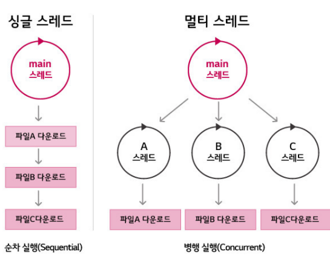

## ✅ 자바 실행 환경 동작 원리

사용자가 `.java` 파일에 코드를 입력하면 `.class` 파일로 컴파일되고, JVM이 이 클래스 파일을 컴퓨터가 이해할 수 있는 언어로 다시 컴파일해서 실행한다.

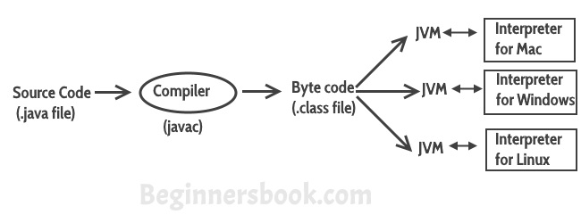

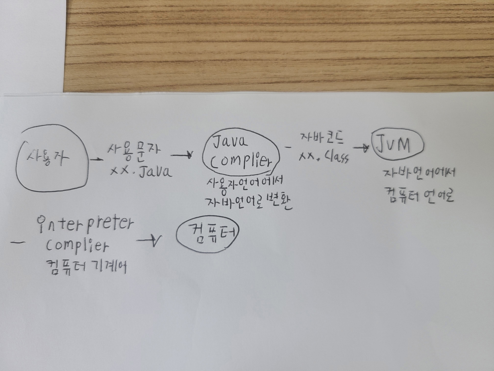

## ✅ JDK, JRE, JVM, Eclipse

메모리 구조를 공부하기 전에 이 네 가지 개념부터 구분해두는 게 좋다.

- **JDK(자바 개발 도구, Java Development Kit)** — JRE + 개발 도구(컴파일러·디버거 등). 개발 시 이것 하나만 설치하면 JRE와 JVM이 함께 설치된다.
- **JRE(자바 실행 환경, Java Runtime Environment)** — JVM + 라이브러리 클래스.
- **JVM(자바 가상머신, Java Virtual Machine)** — 어떤 기기·운영체제에서도 실행될 수 있게 해주고, 메모리를 효율적으로 관리·최적화하는 역할을 한다(가비지 컬렉션도 여기에 포함).
- **Eclipse(개발 툴, IDE)** — 자바 기반 통합 개발 환경으로 어느 운영체제든 자유롭게 이용·수정·배포할 수 있다. 다만 다른 IDE에 비해 최적화가 부족해서 느리다는 평이 있다.

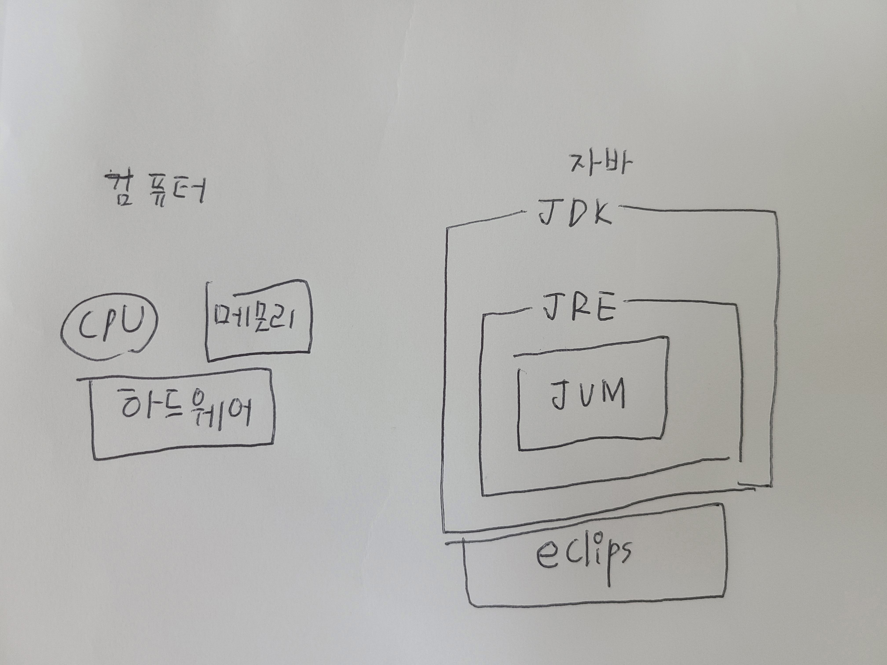

## ✅ 개발 환경 세팅부터 Hello World까지

세팅 시점은 2021년 12월 22일 기준이다.

- 이클립스 자동 정렬 세팅: [hianna.tistory.com/653](https://hianna.tistory.com/653)
- 이클립스 자동완성(Ctrl+Space) 세팅: [devlimk1.tistory.com/9](https://devlimk1.tistory.com/9) — 넣을 값은 `.qwertyuioplkjhgfdsazxcvbnm_QWERTYUIOPLKJHGFDSAZXCVBNM`

### 1. JDK 설치 및 환경 변수 세팅

JDK를 설치하는 이유는 위에서 정리한 개념을 이해하면 자연히 알 수 있다. 참고: [gaeggu.tistory.com/2](https://gaeggu.tistory.com/2)

보통 컴파일된 파일들은 `bin` 폴더 밑에 들어가기 때문에, Path 세팅도 그 `bin`을 가리키도록 한다.

- JDK 설치 — 운영체제에 맞는 버전으로 설치한다. [oracle.com/java/technologies/downloads](https://www.oracle.com/java/technologies/downloads/)
- 환경 변수 세팅 — 시스템 속성 → 환경 변수로 들어간다.
  - `JAVA_HOME` 세팅 — 시스템 변수에서 새로 만들기를 눌러 설치한 JDK 경로를 입력한다. 변수 이름은 자유롭게 정해도 된다.
  - `Path` 세팅 — 시스템 변수의 `Path`를 편집해서 `%JAVA_HOME%\bin`을 추가한다. `JAVA_HOME`으로 지정한 경로 밑의 `bin`을 읽어오겠다는 의미다.

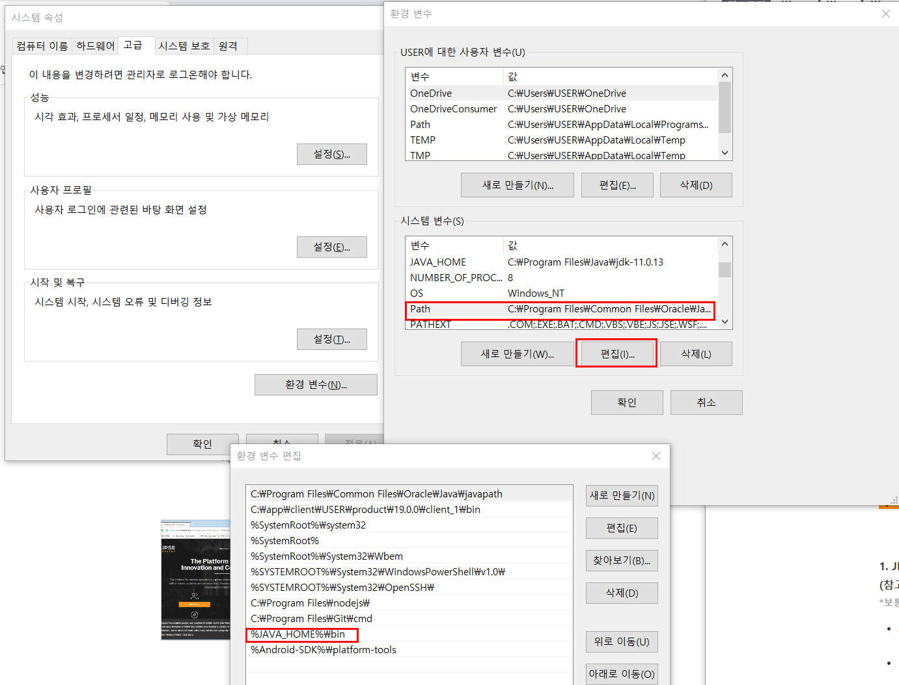

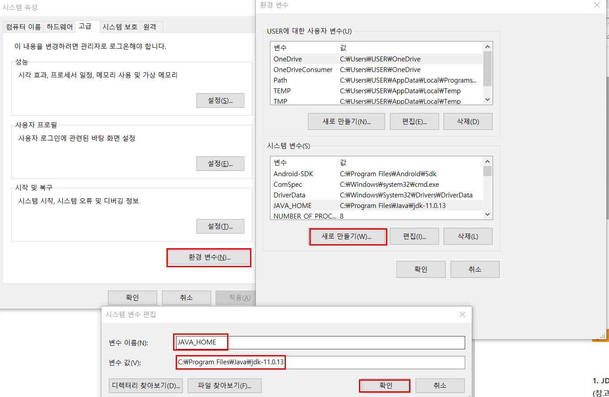

### 2. 이클립스 설치(IDE)

참고: [parkjye.tistory.com/33](https://parkjye.tistory.com/33)

[eclipse.org/downloads/packages](https://www.eclipse.org/downloads/packages/)에서 운영체제에 맞게 "Eclipse IDE for Enterprise Java and Web Developers"를 받으면 된다.

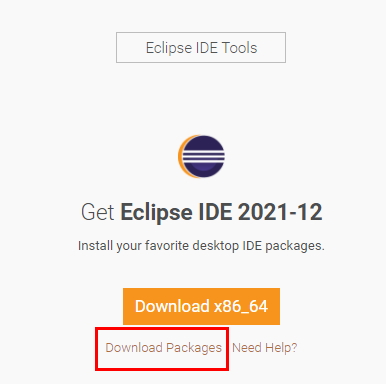

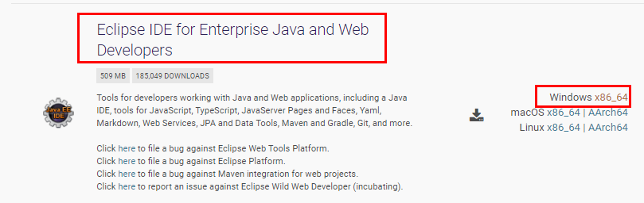

### 3. Hello World 출력

사용자 입력부터 컴파일되는 과정은 위의 실행 환경 동작 원리를 참고한다.

- UTF-8 세팅(한글 깨짐 방지) — 상단 메뉴 Window → Preferences에서 Workspace·CSS·HTML·JSP 등을 전부 UTF-8로 바꿔준다. [설정 가이드](https://gangzzang.tistory.com/entry/%EC%9D%B4%ED%81%B4%EB%A6%BD%EC%8A%A4-%EA%B0%9C%EB%B0%9C%ED%99%98%EA%B2%BD-UTF8-%EC%9D%B8%EC%BD%94%EB%94%A9-%EC%84%A4%EC%A0%95)
- 프로젝트·패키지·클래스 생성 — File → New → Java Project로 프로젝트를 만들고, 프로젝트 우클릭 → New → Class로 패키지와 클래스를 동시에 생성한다. 이때 생성자나 `psvm`(public static void main)도 자동 생성할 수 있다. [참고 가이드](https://comclothing.tistory.com/26)

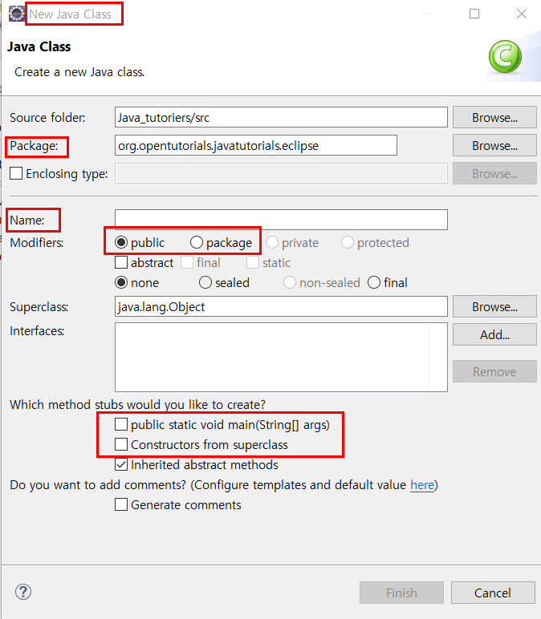

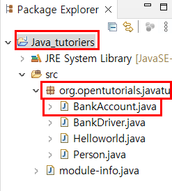

생성한 클래스에 아래 코드를 입력한다.

```java
package org.opentutorials.javatutorials.eclipse; // 패키지명

public class Helloworld { // 클래스명

    public static void main(String[] args) {
        // TODO Auto-generated method stub
        System.out.println("HelloWorld"); // System.out.println은 출력을 위한 메소드
    }

}
```

Ctrl + F11을 누르면 컴파일되어 Console 창에 결과가 뜬다.

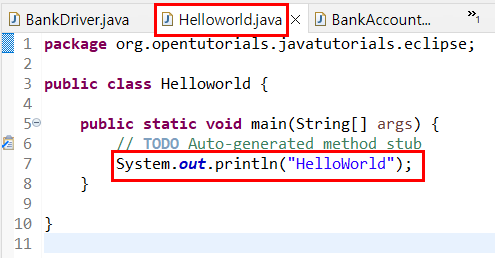

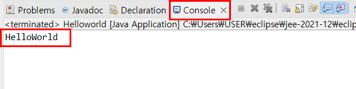


## ✅ 정리

- 자바는 컴파일 언어와 인터프리터 언어의 특징을 함께 가짐 — `.java` → `.class` → JVM 순으로 실행됨
- JDK는 JRE를 포함하고, JRE는 JVM을 포함함 — 개발 시에는 JDK 하나만 설치하면 됨
- 환경 변수 세팅의 핵심은 컴파일된 파일이 모이는 `bin` 폴더를 `Path`에 등록하는 것

## 참고한 링크

- [이클립스 자동 정렬 세팅](https://hianna.tistory.com/653)
- [이클립스 자동완성 세팅](https://devlimk1.tistory.com/9)
- [JDK 설치 및 환경 변수 세팅](https://gaeggu.tistory.com/2)
- [Oracle JDK 다운로드](https://www.oracle.com/java/technologies/downloads/)
- [이클립스 설치 가이드](https://parkjye.tistory.com/33)
- [Eclipse 다운로드](https://www.eclipse.org/downloads/packages/)
- [이클립스 UTF-8 인코딩 설정](https://gangzzang.tistory.com/entry/%EC%9D%B4%ED%81%B4%EB%A6%BD%EC%8A%A4-%EA%B0%9C%EB%B0%9C%ED%99%98%EA%B2%BD-UTF8-%EC%9D%B8%EC%BD%94%EB%94%A9-%EC%84%A4%EC%A0%95)
- [프로젝트·패키지·클래스 생성 가이드](https://comclothing.tistory.com/26)
