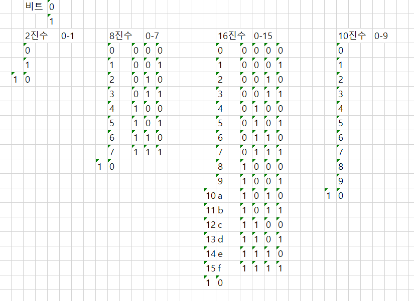
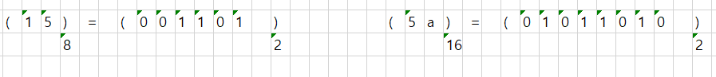
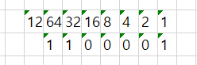
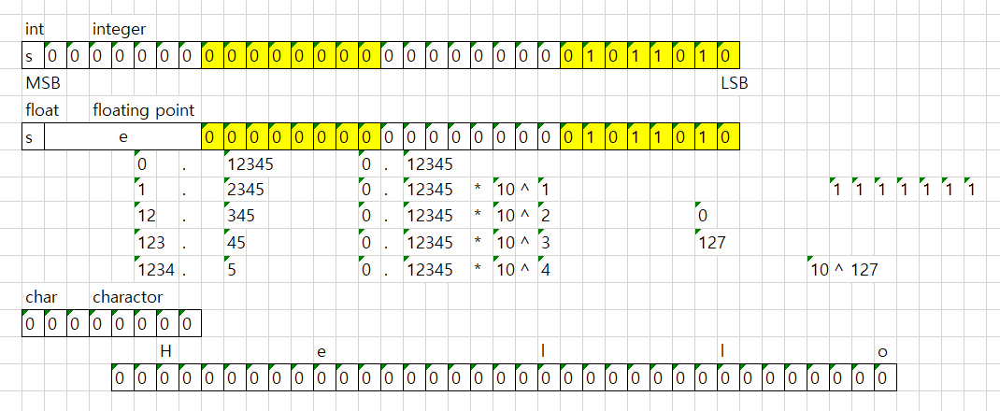
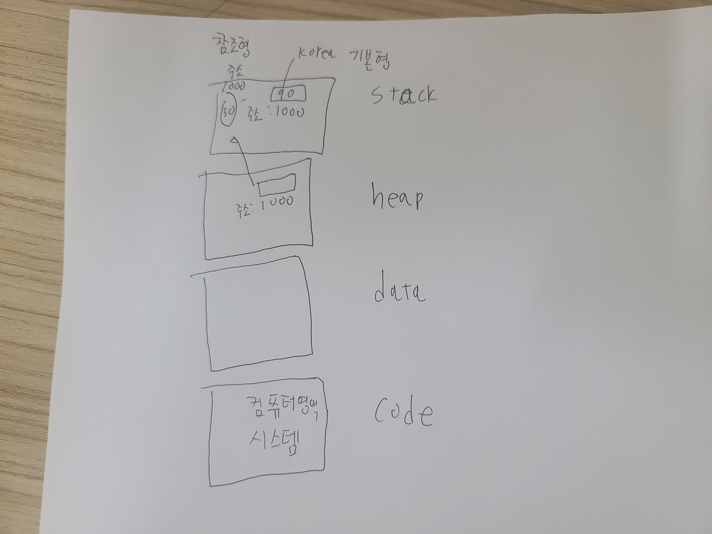
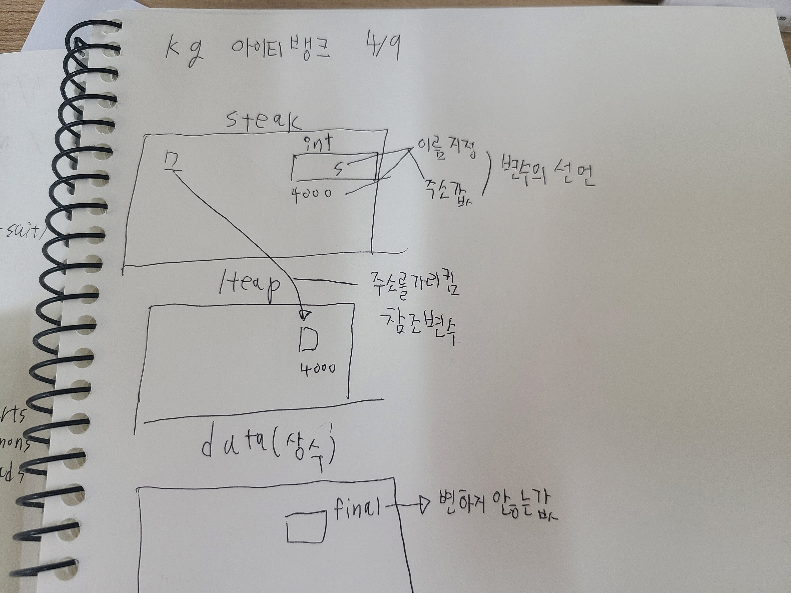
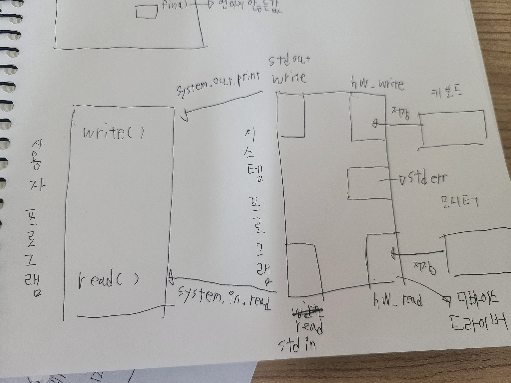

> **TL;DR** — 코드만 칠 줄 아는 것과 원리를 알고 치는 것은 다르다. 1️⃣ 진수·아스키코드, 2️⃣ 타입별 메모리 크기, 3️⃣ Stack/Heap 구조를 알면 자바 변수 한 줄 한 줄이 다르게 보인다.

난이도 : ★☆☆☆☆

1️⃣ `진수 표기법` 2️⃣ `타입별 메모리 크기` 3️⃣ `Stack / Heap`

## ✅ 왜 알아야 하나

이 글은 자바 전반을 다루기 전에 알아야 할 자료구조·데이터 타입·입출력 개념을 정리한 것이다. 몰라도 코드 치는 데는 문제없지만, 단순히 코드만 치는 것보다는 한 줄 한 줄의 이유를 아는 프로그래머가 되고 싶어서 정리했다. 다른 이론보다 오히려 더 중요하다고 생각한다.


## ✅ 진수 이해부터 — 2진수·8진수·16진수·10진수

나중에 정보통신기사 같은 자격증 시험에도 나오는 기본 개념이다.

1. 비트 vs 바이트 — 1바이트 = 8비트
2. 프로그램 메모리 구조를 이해하기 전에 각 진수부터 이해해야 한다
3. 컴퓨터가 받아들이는 모든 정보는 0과 1로 변환되어 메모리(stack, heap)에 저장된다

**아스키코드** — 컴퓨터가 이해할 수 있는 코드. 같이 알아두면 좋은 개념으로 유니코드가 있다.

- 32(아스키코드) → space
- 48(아스키코드) → 0
- 65(아스키코드) → A
- 97(아스키코드) → a

| 진수 | 비트 | 표기법 |
| --- | --- | --- |
| 2진수 | 1비트 | `0b` |
| 8진수 | 3비트 | `0o` |
| 16진수 | 4비트 | `0x` |
| 10진수 | 32비트 | 표기법 없음 |







## ✅ 타입별 메모리 크기

**예외 상황** — `float`나 `long`은 기본적으로 데이터 뒤에 `f`, `l`을 붙여야 한다. 기본 타입이 `double`과 `int`라서 형변환(메모리 사용 크기를 줄이거나 늘리는 것)을 해줘야 하기 때문이다.

```java
long a = 20L;
```

`String`은 이 표에 없는데, 문자열이고 `char`를 여러 개 묶은 객체라고 생각하면 된다(객체 개념은 나중에 따로 다룬다).

타입별 비트 표기는 다음과 같다.

- `int` — 좌측 1개(부호) + 나머지 31개(2진수)
- `float` — 좌측 1개(부호) + 7개(지수) + 24개(소수점 아래 숫자)
- `char` — 좌측 1개(구분) + 7개(비트)

| 구분 | 기본 타입 | 메모리 사용 크기 | 저장 가능한 값 범위 |
| --- | --- | --- | --- |
| 정수 | byte | 1byte (8bit) | -128 ~ 127 |
| 정수 | short | 2byte (16bit) | -2^15 ~ 2^15-1 |
| 정수 | int | 4byte (32bit) | -2^31 ~ 2^31-1 |
| 정수 | long | 8byte (64bit) | -2^63 ~ 2^63-1 |
| 실수 | float | 4byte (32bit) | ±(1.4e-45 ~ 3.4e+38) |
| 실수 | double | 8byte (64bit) | ±(4.9e-324 ~ 1.8e+308) |
| 문자 | char | 2byte (16bit) | 0 ~ 2^16-1 |
| 논리 | boolean | 1byte (8bit) | true, false |



**자주 하는 실수 1 — 오버플로우**

`int`의 최댓값(`2^31-1 = 2147483647`)을 넘기면 에러 없이 조용히 최솟값 쪽으로 넘어간다(wrap-around). 예외가 나지 않기 때문에 디버깅할 때 놓치기 쉽다.

```java
int a = Integer.MAX_VALUE; // 2147483647
System.out.println(a + 1); // -2147483648 — 컴파일·런타임 에러 없이 조용히 넘어감(overflow)
```

**자주 하는 실수 2 — `==`로 Wrapper 타입 비교**

`int`, `long` 같은 기본형이 아니라 `Integer`, `Long` 같은 Wrapper(참조형) 타입을 `==`로 비교하면 값이 아니라 객체 주소를 비교하게 된다. 특히 자바는 `-128 ~ 127` 범위의 `Integer`를 내부적으로 캐싱해서 재사용하기 때문에, 이 범위 안에서는 우연히 `==`가 `true`가 나와서 더 헷갈린다.

```java
Integer a = 127, b = 127;
System.out.println(a == b); // true — 캐시된 동일 객체를 참조

Integer c = 128, d = 128;
System.out.println(c == d); // false — 캐시 범위를 벗어나 서로 다른 객체

// 값 비교는 항상 equals()를 써야 함
System.out.println(c.equals(d)); // true
```

## ✅ 자바 메모리 구조 — Stack, Heap, Data, Code

data와 code 영역은 보통 객체와 함수가 들어가는 부분인데, 이 부분은 나중에 더 배우고 다듬을 예정이다. 참고: [beomseok95.tistory.com/221](https://beomseok95.tistory.com/221)

| 메모리 구조 | 언제 생성? | 실행 범위 | 정의 |
| --- | --- | --- | --- |
| stack(변수) | 함수 실행 때 생성 | 함수 내부 | 이름을 갖는 상자라고 생각하면 이해하기 편하다. 보통 이름으로 값을 담는다 |
| heap(변수) | 사용자 요청 때 생성 | 프로그램 전역 | 주소를 갖고 있고, stack이 이름으로 생성할 때 참조해서 stack에 주소값을 넣을 수 있다 |
| data(상수) | 프로그램 시작 때 생성 | 프로그램 전역 | — |
| code(명령어 데이터) | 자바는 접근 못하는 영역 | 시스템 영역 | — |

### 코드로 확인 — 변수 네이밍 컨벤션

참고: [tecoble.techcourse.co.kr — 변수 네이밍](https://tecoble.techcourse.co.kr/post/2020-04-24-variable_naming/)

- 대소문자는 구분되며 길이 제한은 없음
- 예약어는 사용할 수 없음
- 숫자로 시작할 수 없음
- 특수문자는 `_`와 `$`만 허용
- 변수는 첫 글자를 소문자로 시작하는 명사로 지음
- 여러 단어로 이루어진 이름은 각 단어의 첫 글자를 대문자로 함(카멜 표기법)

변수 할당 예시: `int korean = 90;`

- `int` — stack 영역에 32비트 생성
- `korean` — stack에 생성된 컴퓨터 주소에 붙이는 이름
- `90` — 그 주소 영역에 90을 저장





## ✅ 자바 표준 입출력 방법

아래 내용을 외우는 것보다 원리를 이해하는 게 중요하다. 참고: [travislife.tistory.com/48](https://travislife.tistory.com/48)

**입출력이란?** — CPU로 데이터를 보내거나 받는 것.

**스트림(stream)?** — 데이터가 오가는 길을 하드웨어적으로는 버스, 프로그래밍 레벨에서는 스트림이라고 부른다.

**print, println, printf 차이**

- `print` — 괄호 안 내용을 단순히 출력. 개행 문자(`\n`) 포함 안 됨
- `printf` — C의 printf와 동일. `%d`, `%s` 등을 쓸 때 사용. 개행 문자 포함 안 됨
- `println` — 괄호 안 내용을 출력한 뒤 개행 문자가 포함되어 한 줄 띄워짐

**Scanner 객체**

- 기본 데이터 타입은 Scanner의 메소드로 입력받을 수 있음
- 사용하려면 `util` 패키지의 Scanner 클래스를 import해야 함
- 공백 또는 개행을 기준으로 읽음

```java
Scanner in = new Scanner(System.in); // Scanner 객체 생성
```

| System 클래스 메소드 | 정의 |
| --- | --- |
| in | 표준 입력 스트림. 키보드로 데이터 입력을 받음(input Stream) |
| out | 표준 출력 스트림. 모니터로 데이터를 출력함(print, println, printf) |
| err | 표준 에러 출력 스트림 |

| Scanner 메소드 | 정의 |
| --- | --- |
| next | 다음 토큰을 문자열로 리턴 |
| nextByte | 다음 토큰을 byte 타입으로 리턴 |
| nextShort | 다음 토큰을 short 타입으로 리턴 |
| nextInt | 다음 토큰을 int 타입으로 리턴 |
| nextLong | 다음 토큰을 long 타입으로 리턴 |
| nextFloat | 다음 토큰을 float 타입으로 리턴 |
| nextDouble | 다음 토큰을 double 타입으로 리턴 |
| nextLine | `\n`을 포함하는 한 줄을 읽고 `\n`을 뺀 나머지를 리턴 |
| close | Scanner 사용 종료 |
| hasNext | 입력된 토큰이 있으면 true. 없으면 새 입력이 들어올 때까지 대기하다가 들어오면 true를 리턴. Ctrl+Z가 입력되면 false 리턴 |

| 출력 제어 명령 문자 | 의미 |
| --- | --- |
| %d | 정수 |
| %f | 실수 |
| %c | 문자 |
| %s | 문자열 |
| \t | 띄어쓰기 8번 |
| \n | 줄바꿈 |




## ✅ 정리

- 자바 변수는 결국 0과 1로 변환되어 메모리에 저장됨 — 진수·아스키코드가 그 기초임
- 기본 타입은 저장 범위가 정해져 있음 — `float`, `long`처럼 접미사가 필요한 타입에 주의
- 변수는 stack, 참조 대상은 heap에 저장됨 — 이 구조를 알면 변수 할당 한 줄도 다르게 읽힘

## 참고한 링크

- [자바 메모리 구조](https://beomseok95.tistory.com/221)
- [변수 네이밍 컨벤션](https://tecoble.techcourse.co.kr/post/2020-04-24-variable_naming/)
- [자바 표준 입출력](https://travislife.tistory.com/48)
