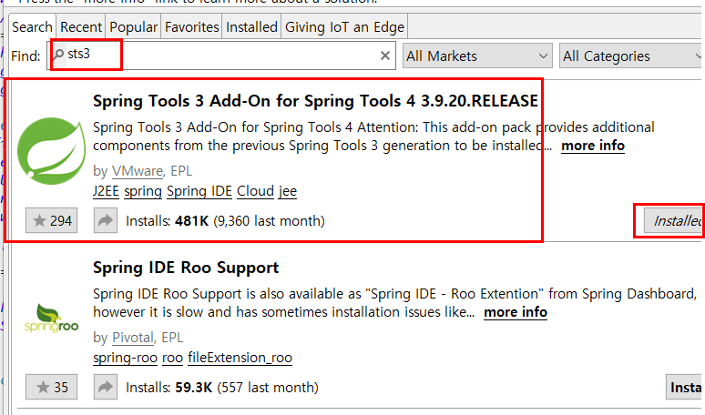
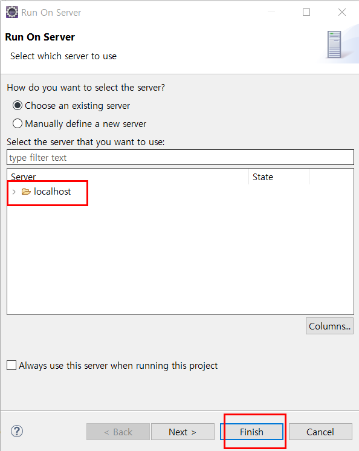
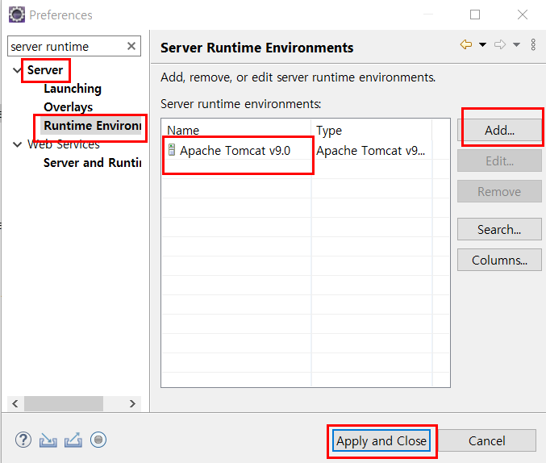
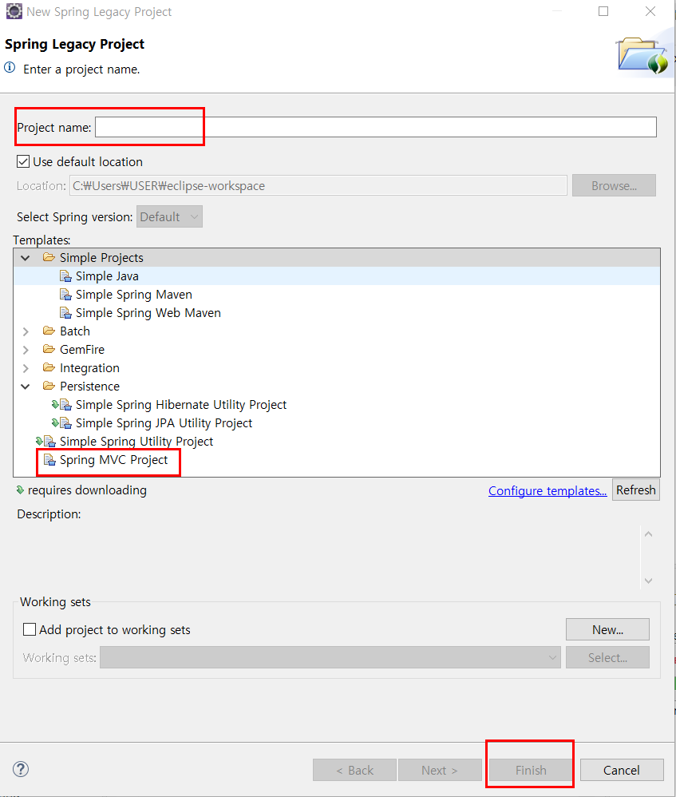

> **TL;DR** — 스프링 레거시 프로젝트를 시작하려면 JDK·STS3·Tomcat·Lombok·JUnit 다섯 가지를 순서대로 설치·연결해야 한다. 각각 왜 필요한지 알고 나면 세팅 자체는 어렵지 않다.

난이도 : ★☆☆☆☆


#### Spring 시작

서버와 이클립스 세팅은 끝났다. 이제 데이터베이스, MyBatis 등을 세팅해야 하는데, 가장 편한 Spring Boot도 있지만 먼저 기본기인 Spring 자체를 마스터해보려고 시작했다. 참고로 Eclipse 대신 IntelliJ를 써도 무방하다.


## ✅ 각각 설치해야 하는 이유

- **JDK** — 자바 통합 개발 환경. 자세한 내용은 [자바 실행 원리와 개발 환경 세팅](/posts/java-basics-runtime-setup) 참고
- **STS** — 스프링 개발을 위한 기본 프레임워크
- **Tomcat** — 웹 서버와 연동해서 실행할 수 있는 자바 환경을 제공해, JSP와 자바 서블릿이 실행될 수 있는 환경을 만들어줌
- **Lombok** — getter, setter, toString 등 반복되는 메서드 작성 코드를 줄여주는 Java 라이브러리
- **JUnit** — 자바용 단위 테스트 도구. 숨겨진 단위 테스트를 정형화된 형태로 끌어내 테스트를 쉽게 만들어주는 프레임워크

## ✅ JDK 설치, 환경 변수 세팅, 이클립스 설치

JDK 11 버전 기준이며, [Oracle 다운로드 페이지](https://www.oracle.com/java/technologies/downloads/#java11-windows)에서 받는다.

**이클립스 한글 설정(필수)** — Eclipse 실행 후 Window 메뉴 → Preferences → Workspace·HTML·CSS·JSP를 전부 UTF-8로 변경한다.

**Eclipse `sts.ini` 수정** — 설치 폴더의 `sts.ini` 파일에 `bin\javaw.exe` 경로를 추가한다.

```ini
# Eclipse 설치 폴더 -> sts.ini 파일 수정
# ...(생략)
-vm
C:\Program Files\Java\jdk-11.0.13\bin\javaw.exe
# ...(생략)
```

## ✅ STS 3 설치 (Spring Tools 3)

STS4가 아니라 **STS3**을 설치해야 한다. [STS 홈페이지](https://spring.io/blog/2019/06/20/spring-tool-suite-3-9-9-released)에서 직접 받거나, Eclipse에서 `Help → Eclipse Marketplace → STS3 Install`로 설치할 수 있다.



## ✅ Tomcat(서버) 설치 및 연결

이클립스에서 Spring Tool 3을 받았다면 **Tomcat 9**으로 다운받아야 한다 — 버전을 헷갈리지 않도록 주의한다.

다운로드 완료 후 Eclipse에서 `Window → Preferences → Server Runtime`에 Tomcat을 추가한다. 이후 `Run As → Run on Server`로 실행해서 브라우저에 Hello World가 출력되는지 확인한다.





## ✅ 프로젝트 생성 및 버전 변경

`File → New → Spring Legacy Project`로 프로젝트를 생성한다. 목록에 Spring Legacy Project가 없다면 STS3 플러그인이 제대로 설치됐는지 먼저 확인한다.



`pom.xml`에서 자바 버전과 스프링 버전을 프로젝트에 맞게 변경한다.

```xml
<!-- pom.xml -->
<java-version>1.6</java-version>
<org.springframework-version>5.0.7.RELEASE</org.springframework-version> <!-- 변경 -->
<org.aspectj-version>1.6.10</org.aspectj-version>
<org.slf4j-version>1.6.6</org.slf4j-version>
</properties>
<!-- ...(생략) -->
<plugin>
    <groupId>org.apache.maven.plugins</groupId>
    <artifactId>maven-compiler-plugin</artifactId>
    <version>2.5.1</version>
    <configuration>
        <source>11</source> <!-- 변경 -->
        <target>11</target>
        <compilerArgument>-Xlint:all</compilerArgument>
        <showWarnings>true</showWarnings>
        <showDeprecation>true</showDeprecation>
    </configuration>
</plugin>
```

## ✅ Lombok 설치 및 연결

[Lombok 설치 페이지](https://projectlombok.org/)에서 jar를 받고, 터미널에서 실행해 IDE에 연결한다.

```bash
java -jar lombok.jar
```

생성한 프로젝트에도 [Maven Repository](https://mvnrepository.com/artifact/org.projectlombok/lombok)의 의존성을 추가한다.

```xml
<!-- pom.xml -->
<dependency>
    <groupId>junit</groupId>
    <artifactId>junit</artifactId>
    <version>4.12</version>
    <scope>test</scope>
</dependency>
<dependency> <!-- 여기부터 추가 -->
    <groupId>org.projectlombok</groupId>
    <artifactId>lombok</artifactId>
    <version>1.18.16</version>
    <scope>provided</scope>
</dependency>
```

```xml
<!-- pom.xml -->
<properties>
    <java-version>1.6</java-version>
    <org.springframework-version>5.0.7.RELEASE</org.springframework-version> <!-- 수정 -->
    <org.aspectj-version>1.6.10</org.aspectj-version>
    <org.slf4j-version>1.6.6</org.slf4j-version>
</properties>
<!-- ...(생략) -->
<plugin>
    <groupId>org.apache.maven.plugins</groupId>
    <artifactId>maven-compiler-plugin</artifactId>
    <version>2.5.1</version>
    <configuration>
        <source>11</source> <!-- 수정 -->
        <target>11</target>
        <compilerArgument>-Xlint:all</compilerArgument>
        <showWarnings>true</showWarnings>
        <showDeprecation>true</showDeprecation>
    </configuration>
</plugin>
<plugin> <!-- 추가 -->
    <groupId>org.apache.maven.plugins</groupId>
    <artifactId>maven-war-plugin</artifactId>
    <version>3.2.0</version>
    <configuration>
        <failOnMissingWebXml>false</failOnMissingWebXml>
    </configuration>
</plugin>
```

**자주 하는 실수** — `pom.xml`에 의존성만 추가하고 IDE용 Lombok 플러그인을 설치하지 않으면, Maven 빌드 자체는 성공하는데 IDE 화면에는 `getter`·`setter`가 안 보인다며 빨간 줄(에러)이 뜬다. Lombok은 컴파일 시점에 어노테이션 프로세서가 바이트코드에 메서드를 주입하는 방식이라 빌드는 문제없이 되지만, IDE는 그 생성 과정을 별도 플러그인 없이는 알지 못해서 코드 편집기에서만 에러로 보이는 것이다. Eclipse는 `java -jar lombok.jar`로 IDE에 직접 연결해야 하고, IntelliJ는 `Settings → Plugins`에서 Lombok 플러그인을 설치해야 한다.

연결이 잘 됐는지 파일을 만들어 콘솔 출력으로 확인한다.

```java
// org.zerock.config -> RootConfig.java
package org.zerock.config;

import org.springframework.context.annotation.Configuration;

@Configuration
public class RootConfig {

}

// org.zerock.config -> WebConfig.java
package org.zerock.config;

import org.springframework.web.servlet.support.AbstractAnnotationConfigDispatcherServletInitializer;

public class WebConfig extends AbstractAnnotationConfigDispatcherServletInitializer {

    @Override
    protected Class<?>[] getRootConfigClasses() {
        return new Class[] { RootConfig.class };
    }

    @Override
    protected Class<?>[] getServletConfigClasses() {
        return null;
    }

    @Override
    protected String[] getServletMappings() {
        return null;
    }
}
```

## ✅ JUnit 세팅

테스트 코드를 실제로 작성하는 방법은 다음 글에서 다룬다. 여기서는 의존성만 추가한다.

```xml
<!-- pom.xml -->
<dependency>
    <groupId>log4j</groupId>
    <artifactId>log4j</artifactId>
    <version>1.2.17</version>
</dependency>
<!-- ...(생략) -->
<dependency>
    <groupId>junit</groupId>
    <artifactId>junit</artifactId>
    <version>4.12</version> <!-- 수정 -->
    <scope>test</scope>
</dependency>
```

```xml
<!-- pom.xml -->
<dependency>
    <groupId>org.springframework</groupId>
    <artifactId>spring-test</artifactId>
    <version>${org.springframework-version}</version>
</dependency>
```

## ✅ 정리

- JDK·STS3·Tomcat·Lombok·JUnit은 순서대로 설치·연결해야 스프링 레거시 프로젝트가 돌아감
- STS3과 Tomcat은 버전 궁합(STS3 ↔ Tomcat 9)을 꼭 맞춰야 함
- pom.xml에서 자바 버전과 스프링 버전을 일관되게 맞추는 게 초기 세팅 오류를 줄이는 핵심임


## 참고한 링크

- [Oracle JDK 11 다운로드](https://www.oracle.com/java/technologies/downloads/#java11-windows)
- [Spring Tool Suite 3.9.9 Released](https://spring.io/blog/2019/06/20/spring-tool-suite-3-9-9-released)
- [Lombok 설치](https://projectlombok.org/)
- [Lombok — Maven Repository](https://mvnrepository.com/artifact/org.projectlombok/lombok)
