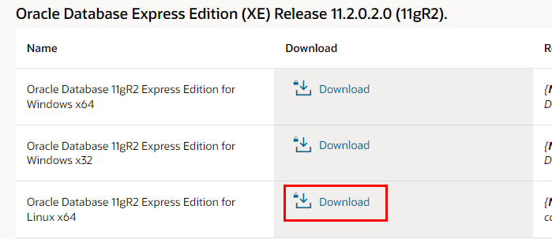
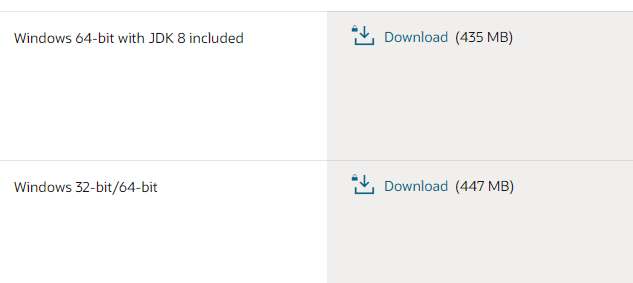
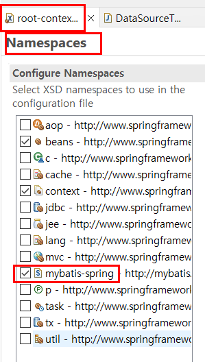

> **TL;DR** — 스프링에서 DB를 붙이려면 DBMS(Oracle) → 클라이언트 툴(SQL Developer) → 자바-DB 연결 인터페이스(JDBC) → 연결 재사용 장치(Connection Pool, HikariCP) → SQL 매퍼(MyBatis) 순서로 계층이 쌓인다. 각 계층이 왜 필요한지 알아야 세팅 중 막혀도 원인을 찾을 수 있다.

난이도 : ★☆☆☆☆

1️⃣ `JDBC` 2️⃣ `Connection Pool(HikariCP)` 3️⃣ `MyBatis SqlSessionFactory`

## ✅ 왜 알아야 하나

스프링에서 DB 연동은 한 번에 되는 게 아니라 여러 계층을 순서대로 쌓아야 한다. Oracle을 설치했다고 끝이 아니고, JDBC로 연결한다고 끝이 아니다. Connection Pool을 안 쓰면 요청마다 연결을 새로 맺고 끊느라 느려지고, MyBatis 없이 순수 JDBC만 쓰면 쿼리 하나 실행하는 데도 보일러플레이트가 너무 많다. 각 도구가 어떤 문제를 해결하려고 존재하는지 알아야 세팅 순서와 이유가 이해된다.

SQL Developer 설치 중 비밀번호 입력을 깜빡하면 계정 접속 자체가 막히니 이 부분만 미리 주의해두면 된다.

## ✅ 각 도구가 필요한 이유

| 도구 | 역할 |
|------|------|
| Oracle 11g Express Edition | DBMS(데이터 관리 시스템) — Mysql로 대체해도 무방함 |
| SQL Developer | 오라클사에서 제공하는 무료 DB 개발 툴, 라이선스 없이 사용 가능 |
| JDBC | 자바 프로그램이 DB와 연결해 데이터를 주고받게 해주는 인터페이스 |
| Connection Pool | WAS가 실행되면서 DB와 미리 맺어둔 connection을 pool에 저장해두고, 요청이 오면 빌려주고 끝나면 반납받는 방식 |
| HikariCP | 스프링부트 기본 Connection Pool. Zero-Overhead가 특징이라 성능이 좋음 |
| MyBatis | 쿼리 기반 애플리케이션에서 가장 많이 쓰는 SQL 매퍼 프레임워크 |
| sqlSessionFactory | DB 연결과 SQL 실행을 관장하는 핵심 객체. DataSource를 참조해 MyBatis와 DB를 연동시킴 |
| Mapper | RDBMS를 자바 객체 지향 모델로 매핑해주는 인터페이스. RDBMS 접근에 필요한 자바 코드를 줄여줌 |
| log4jdbc | Log4j를 JDBC와 연결해 SQL 로그를 다양하게 출력할 수 있게 해주는 오픈소스 |
| DataSource | 여러 개 생성될 수 있는 Connection Pool들을 관리하는 인터페이스 |

## ✅ 직접 세팅해보기

### 1. Oracle 11g Express Edition 설치

[오라클 다운로드 페이지](https://www.oracle.com/database/technologies/xe-prior-release-downloads.html)에서 받는다. 오라클 계정으로 로그인해야 다운로드할 수 있다.



### 2. SQL Developer 설치 및 계정 세팅

[SQL Developer 다운로드 페이지](https://www.oracle.com/tools/downloads/sqldev-downloads.html)에서 받는다. JDK가 있으면 아래 버전, 없으면 위 버전을 받으면 되고, 설치할 때 입력한 비밀번호는 꼭 기억해둬야 한다.



계정을 만들고 권한을 부여한 뒤, 포트도 바꿔둔다.

```sql
-- 계정 생성 및 connect dba 권한 부여
create user book_ex IDENTIFIED BY book_ex;
grant connect, dba to book_ex;

-- 오라클 포트 변경
exec dbms_xdb.sethttpport(9090);
```

### 3. JDBC 연결

`pom.xml`에 [JDBC 드라이버](https://mvnrepository.com/artifact/com.oracle.database.jdbc/ojdbc6)를 추가한다.

```xml
<!-- https://mvnrepository.com/artifact/com.oracle.database.jdbc/ojdbc6 -->
<dependency>
    <groupId>com.oracle.database.jdbc</groupId>
    <artifactId>ojdbc6</artifactId>
    <version>11.2.0.4</version>
</dependency>
```

연결 테스트는 아래처럼 한다. JDBC로 직접 연결하는 방식이라 시간이 오래 걸린다.

```java
package org.zerock.persistence;

import java.sql.Connection;
import java.sql.DriverManager;

import org.junit.Test;

import lombok.extern.log4j.Log4j;

@Log4j
public class JDBCTests {
    @Test
    public void testConnection() throws Exception {
        Class clz = Class.forName("oracle.jdbc.driver.OracleDriver");

        Connection con =
                DriverManager.getConnection("jdbc:oracle:thin:@localhost:1521:XE", "book_ex", "book_ex");
        log.info(con);
        con.close();
    }
}
```

### 4. Connection Pool 세팅 (HikariCP)

`pom.xml`에 [HikariCP](https://mvnrepository.com/artifact/com.zaxxer/HikariCP/3.4.5)를 추가한다.

```xml
<!-- https://mvnrepository.com/artifact/com.zaxxer/HikariCP -->
<dependency>
    <groupId>com.zaxxer</groupId>
    <artifactId>HikariCP</artifactId>
    <version>3.4.5</version>
</dependency>
```

`root-context.xml`에서 HikariConfig를 만들고 DataSource에 주입한다.

```xml
<!-- root-context.xml -->
<bean id="hikariConfig" class="com.zaxxer.hikari.HikariConfig">
    <property name="driverClassName" value="oracle.jdbc.driver.OracleDriver"></property>
    <property name="jdbcUrl" value="jdbc:oracle:thin:@localhost:1521:XE"></property>
    <property name="username" value="book_ex"></property>
    <property name="password" value="book_ex"></property>
</bean>
<bean id="dataSource" class="com.zaxxer.hikari.HikariDataSource" destroy-method="close">
    <constructor-arg ref="hikariConfig"></constructor-arg>
</bean>
```

Connection Pool로 연결하면 이미 맺어둔 connection을 재사용하기 때문에 JDBC 직접 연결보다 훨씬 빠르다.

```java
package org.zerock.persistence;

import java.sql.Connection;

import javax.sql.DataSource;

import org.junit.Test;
import org.junit.runner.RunWith;
import org.springframework.beans.factory.annotation.Autowired;
import org.springframework.test.context.ContextConfiguration;
import org.springframework.test.context.junit4.SpringJUnit4ClassRunner;

import lombok.extern.log4j.Log4j;

@RunWith(SpringJUnit4ClassRunner.class)
@ContextConfiguration("file:src/main/webapp/WEB-INF/spring/root-context.xml")
@Log4j
public class DataSourceTest {
    @Autowired
    private DataSource ds;

    @Test
    public void testConnection() {
        try (Connection con = ds.getConnection()) {
            log.info(con);
        } catch (Exception e) {
            e.printStackTrace();
            log.error(e.getMessage());
        }
    }
}
```

### 5. MyBatis 설정

`pom.xml`에 spring-jdbc, spring-tx, mybatis, mybatis-spring을 추가한다.

```xml
<dependency>
    <groupId>org.springframework</groupId>
    <artifactId>spring-jdbc</artifactId>
    <version>${org.springframework-version}</version>
</dependency>

<dependency>
    <groupId>org.springframework</groupId>
    <artifactId>spring-tx</artifactId>
    <version>${org.springframework-version}</version>
</dependency>

<!-- https://mvnrepository.com/artifact/org.mybatis/mybatis -->
<dependency>
    <groupId>org.mybatis</groupId>
    <artifactId>mybatis</artifactId>
    <version>3.5.6</version>
</dependency>

<!-- https://mvnrepository.com/artifact/org.mybatis/mybatis-spring -->
<dependency>
    <groupId>org.mybatis</groupId>
    <artifactId>mybatis-spring</artifactId>
    <version>2.0.6</version>
</dependency>
```

`sqlSessionFactory`를 등록한다.

```xml
<!-- root-context.xml -->
<bean id="sqlSessionFactory" class="org.mybatis.spring.SqlSessionFactoryBean">
    <property name="dataSource" ref="dataSource"></property>
</bean>
```

```java
@RunWith(SpringJUnit4ClassRunner.class)
@ContextConfiguration("file:src/main/webapp/WEB-INF/spring/root-context.xml")
@Log4j
public class DataSourceTest {
    @Autowired
    private SqlSessionFactory sessionFactory;

    @Test
    public void testConnection2() {
        try (SqlSession session = sessionFactory.openSession()) {
            log.info(session);
        } catch (Exception e) {
            System.out.println("error남");
            e.printStackTrace();
        }
    }
}
```

### 6. Mapper 인터페이스 등록

```java
package org.zerock.mapper;

import org.apache.ibatis.annotations.Select;

public interface TimeMapper {
    @Select("select sysdate from dual")
    String getTime();
}
```

`root-context.xml`의 Namespaces에서 mybatis-spring을 추가한다.



```xml
<!-- root-context.xml Source에 추가 -->
<mybatis-spring:scan base-package="org.zerock.mapper"/>
```

Mapper도 같은 방식으로 연결을 확인한다.

```java
@RunWith(SpringJUnit4ClassRunner.class)
@ContextConfiguration("file:src/main/webapp/WEB-INF/spring/root-context.xml")
@Log4j
public class TimeMapperTests {
    @Autowired
    private TimeMapper timeMapper;

    @Test
    public void testTime1() {
        timeMapper.getTime();
        log.info(timeMapper.getTime());
    }
}
```

```xml
<!-- src/main/resource/org/zerock/mapper/TimeMapper.xml -->
<?xml version="1.0" encoding="UTF-8"?>
<!DOCTYPE mapper PUBLIC "-//mybatis.org//DTD Mapper 3.0//EN"
"http://mybatis.org/dtd/mybatis-3-mapper.dtd">
<mapper namespace="org.zerock.mapper.TimeMapper">
    <select id="getTime2" resultType="string">
        select sysdate from dual
    </select>
</mapper>
```

## ✅ 실무에서는 이렇게 쓴다

로그를 SQL 단위로 보고 싶으면 log4jdbc를 추가로 물린다. `pom.xml`에 의존성을 추가하고, driverClassName과 jdbcUrl을 log4jdbc용으로 바꾼다.

```xml
<dependency>
    <groupId>org.bgee.log4jdbc-log4j2</groupId>
    <artifactId>log4jdbc-log4j2-jdbc4.1</artifactId>
    <version>1.16</version>
</dependency>
```

```properties
# src/main/resources/log4jdbc.log4j2.properties
log4jdbc.spylogdelegator.name=net.sf.log4jdbc.log.slf4j.Slf4jSpyLogDelegator
```

```xml
<!-- root-context.xml -->
<property name="driverClassName" value="net.sf.log4jdbc.sql.jdbcapi.DriverSpy"></property>
<property name="jdbcUrl" value="jdbc:log4jdbc:oracle:thin:@localhost:1521:XE"></property>
```

이렇게 붙여두면 실행되는 SQL과 바인딩 값이 콘솔에 그대로 찍혀서 디버깅이 훨씬 편해진다.

## ✅ Summary

- DB 연동은 DBMS → JDBC → Connection Pool → MyBatis 순서로 계층이 쌓이는 구조임
- Connection Pool(HikariCP)을 쓰면 매 요청마다 연결을 새로 맺지 않아도 돼서 성능이 좋아짐
- log4jdbc를 붙이면 MyBatis가 실행하는 실제 SQL을 로그로 확인할 수 있어 디버깅에 유용함

## 참고한 링크

- [Oracle Database XE Downloads](https://www.oracle.com/database/technologies/xe-prior-release-downloads.html)
- [SQL Developer Downloads](https://www.oracle.com/tools/downloads/sqldev-downloads.html)
- [HikariCP — MVN Repository](https://mvnrepository.com/artifact/com.zaxxer/HikariCP/3.4.5)
- [MyBatis — MVN Repository](https://mvnrepository.com/artifact/org.mybatis/mybatis)
