> **TL;DR** — React Native CLI 윈도우 세팅은 Node·JDK·Python·Android Studio를 순서대로 설치하고 SDK 환경변수를 잡아주는 게 핵심이다. 이 과정에서 한글 경로, node 버전, OpenSSL 관련 에러를 만날 수 있는데 원인만 알면 해결은 금방이다.

난이도 : ★☆☆☆☆

1️⃣ `SDK 환경변수` 2️⃣ `react-native run-android` 3️⃣ `node 버전 호환성`

## ✅ 왜 알아야 하나

React 초기 세팅은 프로젝트를 여러 번 해봐서 어려움이 없었는데, React Native는 완전히 다른 느낌의 초기 세팅이었다. 구글링만으로 처음부터 끝까지 혼자 힘으로 끝내긴 했지만 시간을 많이 썼다. 강의나 책으로 미리 익혀두는 게 훨씬 효율적이었을 것 같다는 생각이 들어서, 세팅 과정과 만났던 에러를 정리해둔다. 추가 사용법이나 문법은 다음에 별도로 정리할 예정이다.

## ✅ 설치 순서

### 1. Node 설치 (LTS 버전)

[Node.js 공식 사이트](https://nodejs.org/ko/)에서 LTS 버전을 받는다.

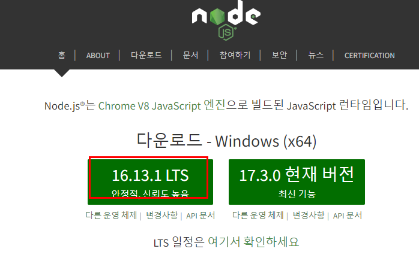

```bash
npm -v
node -v
```

### 2. JDK 설치 및 환경변수 세팅

[JDK 설치 사이트](https://www.oracle.com/java/technologies/downloads/)에서 받는다. React Native에서 자바를 설치하는 이유는, Android Studio가 제공하는 에뮬레이터가 Java·JDK에 의존해서 통신하기 때문이다.

```bash
java -version
```

### 3. Python 설치

[Python 다운로드 사이트](https://www.python.org/downloads/)에서 받는다. 빌드 시스템 자체가 파이썬에 의존하고 있어서 윈도우에서는 별도 설치가 필요하다(맥은 기본 설치돼 있다고 한다).

```bash
python --version
```

### 4. Android Studio 설치

[Android Studio 사이트](https://developer.android.com/studio/index.html)에서 받는다. 작성한 코드로 안드로이드 앱을 빌드하려면 필요하다.

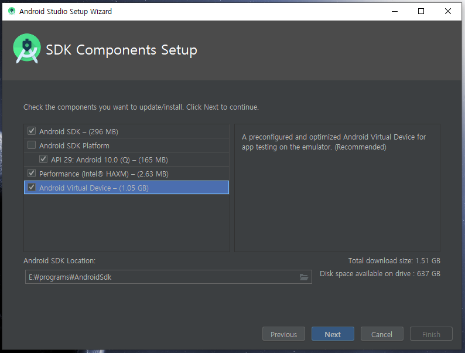

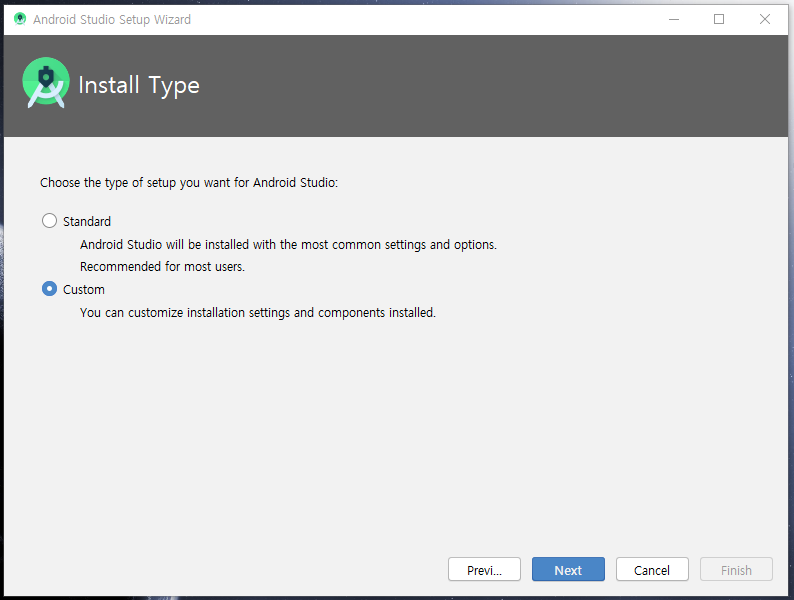

### 5. SDK 환경변수 세팅

Android Studio의 File → Setting에서 SDK 경로를 복사한 뒤, 시스템 환경변수에 등록한다. 변수 이름은 자유롭게, 변수값은 복사한 SDK 경로를 넣으면 된다.

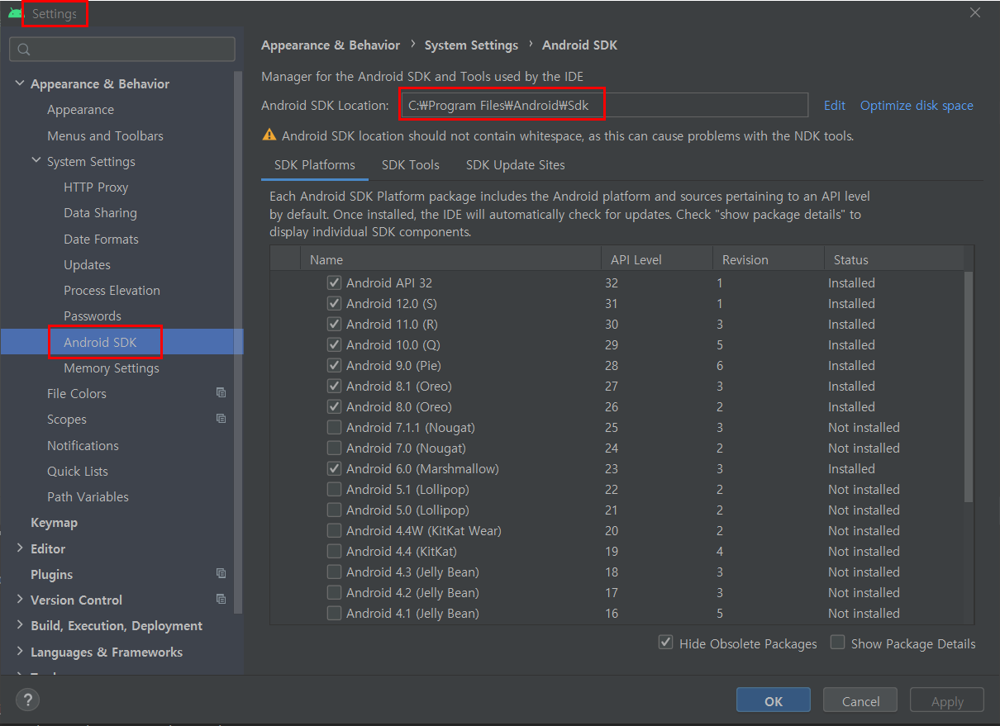

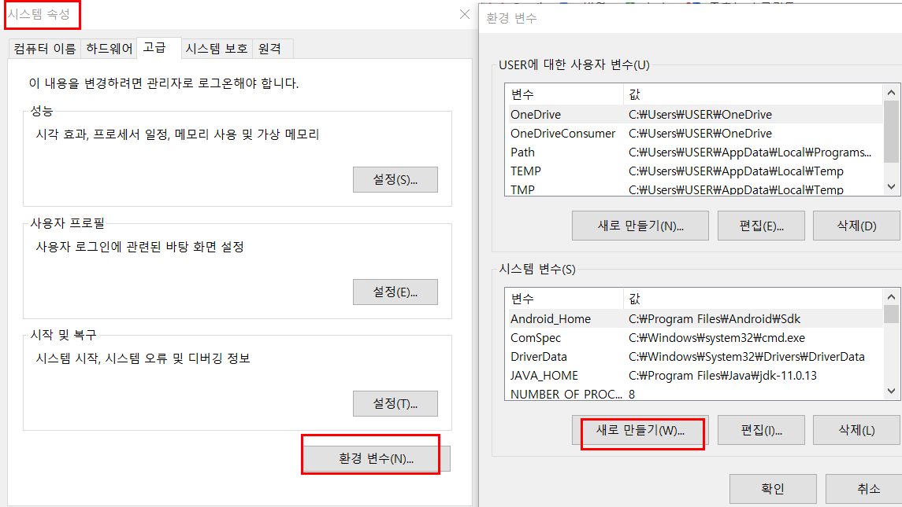

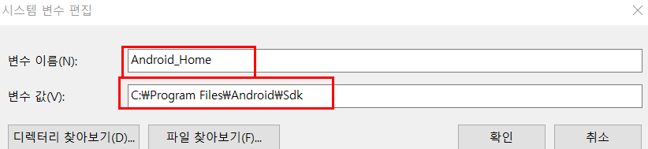

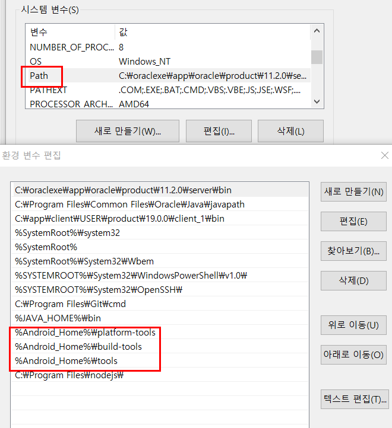

### 6. 에뮬레이터 실행 및 SDK 버전 맞추기

상단 아이콘에서 에뮬레이터를 생성(Create)하고 상단 메뉴 Run으로 실행해 Hello World가 뜨는지 확인한다. SDK 버전이 안 맞으면 나중에 빌드할 때 에러가 날 수 있으니 미리 버전을 맞춰둔다.

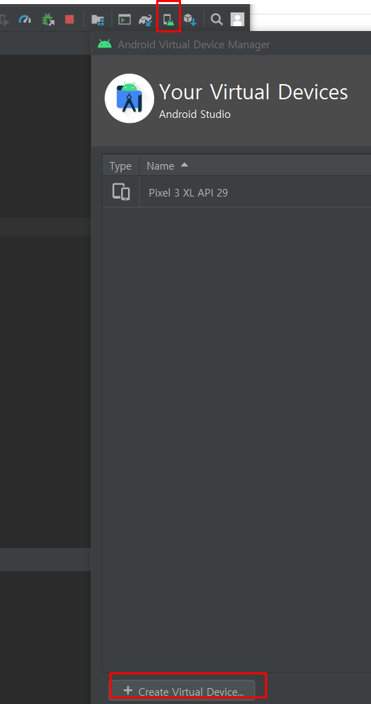

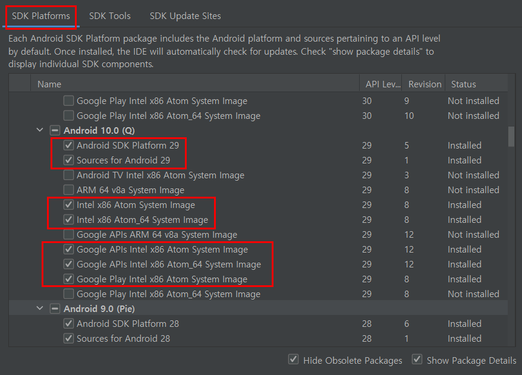

### 7. VS Code에서 React Native CLI 세팅

[VS Code 설치 사이트](https://code.visualstudio.com/download)에서 받는다.

원하는 경로에 폴더를 만들고 React Native CLI를 전역(`-g`) 설치한다.

```bash
npm i -g react-native-cli
```

프로젝트를 초기화한다.

```bash
react-native init
```

VS Code에서 실행을 확인한다.

```bash
react-native run-android
```

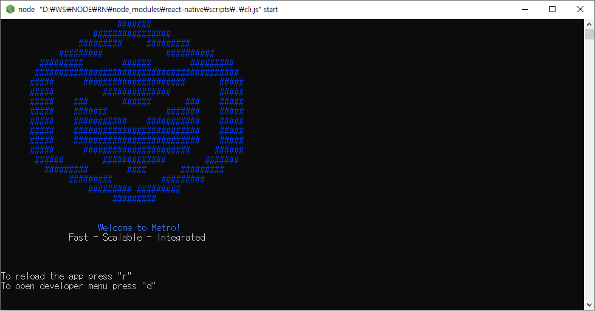

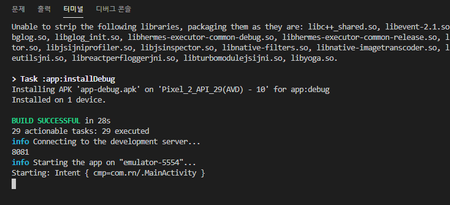

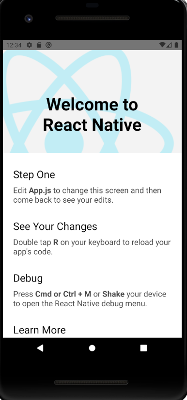

## ✅ 세팅 중 만난 에러와 해결법

여기까지 따라 했는데도 에러가 난다면 아래 명령으로 원인을 진단할 수 있다. 환경변수 설정이 잘 안 돼 있는 경우가 많으니 참고할 것 — 참고로 에러 원인 찾는 데만 이틀이 걸렸다.

```bash
npx @react-native-community/cli doctor
```

### 1. 빌드 시 에러 — 원인은 한글 경로

프로젝트 폴더 경로에 한글이 섞여 있으면 빌드가 깨진다. 영어 경로로 바꿔야 한다.

```
C:\Users\USER\Desktop\위디\widi> npm run android

> widi@0.0.1 android
> react-native run-android

info Running jetifier to migrate libraries to AndroidX. You can disable it using "--no-jetifier" flag.
Jetifier found 886 file(s) to forward-jetify. Using 8 workers...
info Starting JS server...
error Failed to launch emulator. Reason: Emulator exited before boot..
warn Please launch an emulator manually or connect a device. Otherwise app may fail to launch.
info Installing the app...
:ReactNative:Unexpected empty result of running '[node, ...\node_modules\@react-native-community\cli\build\bin.js, config]' command.

FAILURE: Build failed with an exception.

* What went wrong:
A problem occurred evaluating script.
> Error: Cannot find module '...\node_modules\@react-native-community\cli\build\bin.js'
  code: 'MODULE_NOT_FOUND'

BUILD FAILED in 2s
error Failed to install the app. Make sure you have the Android development environment set up: https://reactnative.dev/docs/environment-setup.
```

```
Failed to construct transformer:  Error: error:0308010C:digital envelope routines::unsupported
    at new Hash (node:internal/crypto/hash:67:19)
    at Object.createHash (node:crypto:130:10)
    at stableHash (...\node_modules\metro-cache\src\stableHash.js:19:8)
  opensslErrorStack: [ 'error:03000086:digital envelope routines::initialization error' ],
  library: 'digital envelope routines',
  reason: 'unsupported',
  code: 'ERR_OSSL_EVP_UNSUPPORTED'
}
```

### 2. 빌드는 성공, 에뮬레이터만 안 뜸 — 원인은 node 버전

node 17에서 발생하는 OpenSSL 호환성 문제다. node 17 → 16(LTS)로 다운그레이드하면 해결된다.

```
error: TypeError: Cannot read properties of undefined (reading 'transformFile')
    at Bundler.transformFile (...\node_modules\metro\src\Bundler.js:48:30)
    at processTicksAndRejections (node:internal/process/task_queues:96:5)

Failed to construct transformer:  Error: error:0308010C:digital envelope routines::unsupported
  opensslErrorStack: [ 'error:03000086:digital envelope routines::initialization error' ],
  library: 'digital envelope routines',
  reason: 'unsupported',
  code: 'ERR_OSSL_EVP_UNSUPPORTED'
```

## ✅ Summary

- 설치 순서는 Node(LTS) → JDK → Python → Android Studio → SDK 환경변수 → React Native CLI임
- 프로젝트 경로에 한글이 섞이면 빌드가 깨지므로 영어 경로를 씀
- node 17의 OpenSSL 호환성 문제로 에뮬레이터가 안 뜨면 node 16(LTS)으로 다운그레이드하면 해결됨
- 원인을 못 찾겠으면 `npx @react-native-community/cli doctor`로 환경 진단부터 함

## 참고한 링크

- [Node.js 공식 사이트](https://nodejs.org/ko/)
- [JDK 다운로드](https://www.oracle.com/java/technologies/downloads/)
- [Android Studio 다운로드](https://developer.android.com/studio/index.html)
- [React Native 환경 설정 공식 문서](https://reactnative.dev/docs/environment-setup)
