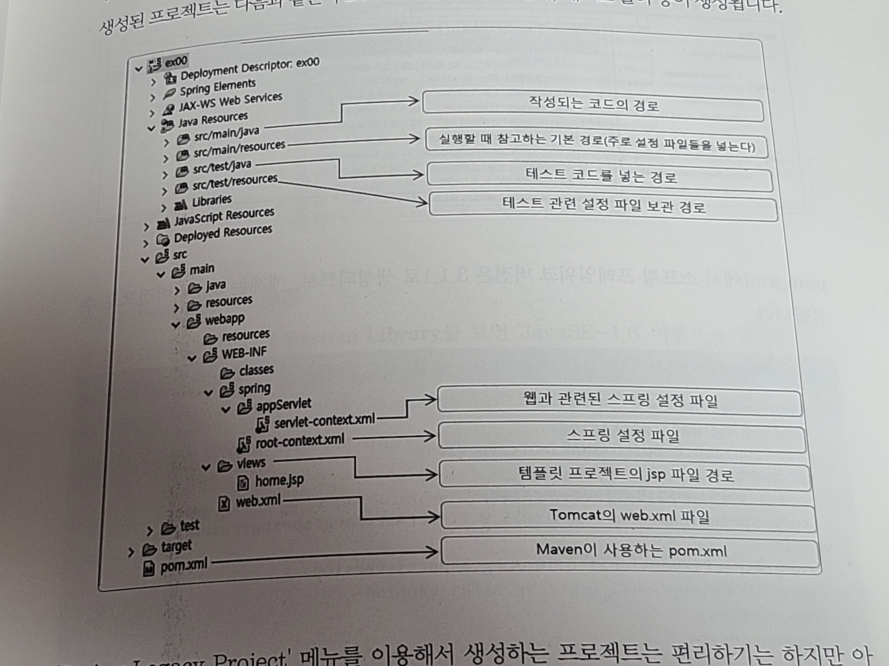
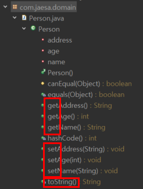
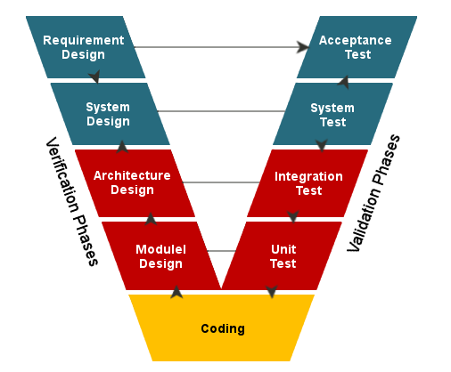

> **TL;DR** — 스프링은 POJO 기반 구성과 의존성 주입(DI)으로 객체 간 결합을 느슨하게 유지하는 프레임워크다. 어노테이션·DI·Lombok·servlet-context.xml/root-context.xml 구분·TDD, 이 다섯 가지만 잡으면 스프링 레거시 프로젝트의 기본 골격이 보인다.

난이도 : ★★☆☆☆

1️⃣ `의존성 주입(DI)` 2️⃣ `어노테이션` 3️⃣ `servlet-context vs root-context`


## ✅ 왜 갑자기 스프링인가

이 블로그를 보던 사람이라면 "왜 갑자기?"라는 생각이 먼저 들 것이다. 원래는 자바스크립트와 React를 주로 했는데 스프링을 시작했다. 이유는 두 가지다 — 금융권에 가고 싶었고, 예전부터 궁금했던 분야였다.

스터디 인원 3명을 구해서 매주 목요일 줌으로 각자 공부한 내용을 공유하기로 했다. 교재는 현업 개발자에게 추천받은 책으로, 좀 오래되긴 했지만 Spring Boot가 아니라 기본기인 Spring 프레임워크부터 마스터해보기로 했다. ([참고 도서](http://www.yes24.com/Product/Goods/64340061))


## ✅ 스프링 프레임워크의 정의 및 특징

([참고](https://joychae.tistory.com/27))

### 왜 써야 하나

- 개발에 필요한 구조가 이미 코드로 갖춰져 있어서, 실력이 부족한 개발자라도 반쯤 완성된 상태에서 필요한 부분을 조립하는 형태로 개발할 수 있음
- 어느 정도 품질이 보장된 구조에 코드를 넣는 방식이라 개발 시간이 단축됨
- 비즈니스 로직을 구성할 때 편리한 지점이 많음(아래 특징 참고)

### 특징

- **POJO 기반 구성** — 특정 라이브러리·프레임워크에 종속되지 않고, 순수 Java 코드로 객체를 자유롭게 구성할 수 있음
- **의존성 주입(DI)** — 외부에서 두 객체 간의 관계를 결정해주는 디자인 패턴. 인터페이스를 사이에 둬서 클래스 레벨에서는 의존 관계가 고정되지 않고, 런타임에 관계를 동적으로 주입함(자세한 내용은 아래에서 다룸)
- **AOP 지원(관점 지향 프로그래밍)** — 공통 기능을 분류해서 원하는 로직에 넣을 수 있게 해 코드 중복을 줄임
- **편리한 MVC 구조** — 역할별로 Model(데이터), View(UI), Controller(모델과 뷰 연결)로 나눠 구성함
- **WAS에 종속되지 않는 개발 환경** — 동적 데이터를 처리하는 서버로서 DB 연동, 데이터 조작, 서버 관리 등을 도와줌

### 스프링 프로젝트 폴더 구조

([참고](https://bokbok-tistory.tistory.com/13))



## ✅ 어노테이션이란

### 정의

- `@`을 이용한 주석. 자바 코드에 특별한 의미를 부여하며, 클래스·메서드·변수 등 거의 모든 요소에 선언할 수 있음
- 실제 데이터가 아니라 데이터를 위한 데이터라는 뜻에서 메타데이터라고도 부름. JDK 5부터 등장
- 컴파일러가 특정 오류를 억제하도록 지시하는 것처럼, 프로그램 코드 자체가 아니라 프로그램에 관한 데이터를 제공하는 정형화된 방법

### 종류와 역할

| 구분 | 종류 | 뜻 |
| --- | --- | --- |
| Lombok 관련 | `@Data` | `@ToString`, `@Getter`/`@Setter`, `@RequiredArgsConstructor` 등을 모두 적용한 것과 같은 효과 |
| | `@AllArgsConstructor` | 모든 필드를 파라미터로 갖는 생성자 생성 |
| | `@NoArgsConstructor` | 파라미터 없는 기본 생성자 생성 |
| | `@EqualsAndHashCode` | `equals`와 `hashCode`를 오버라이딩 |
| Spring Annotation | `@Test` | JUnit에서 테스트 대상 메서드임을 표시 |
| | `@ContextConfiguration` | 지정한 클래스·문자열을 이용해 필요한 객체들을 스프링 객체로 등록 |
| | `@RunWith` | JUnit 테스트를 실행하는 러너를 지정. `SpringJUnit4ClassRunner`를 설정하면 내장 러너 대신 이 러너로 실행됨 |
| Spring 관련 | `@Getter` | `get()` 메서드 자동 생성 |
| | `@Setter` | `set()` 메서드 자동 생성 |
| | `@Log4j` | Lombok으로 로그를 남기기 위한 Logger 변수 생성 |
| | `@Autowired` | 해당 인스턴스 변수에 스프링이 자동으로 Bean을 주입. `new` 연산자와 유사한 역할 |
| | `@Component` | 스프링에게 이 클래스가 관리 대상임을 표시 |

## ✅ 의존성 주입(DI)이란

### 의존성이란

의존성은 하나의 객체가 다른 객체 없이는 제대로 된 역할을 할 수 없다는 뜻이고, 주입은 외부에서 밀어 넣는다는 뜻이다. 둘을 합치면 — 어떤 객체가 필요로 하는 객체를 외부에서 밀어 넣어준다는 의미다. 체인점이 본사에서 식재료를 공급받는 구조와 비슷하다.

### 주입 과정

1. 스프링 프레임워크가 시작되면 스프링이 사용하는 메모리 영역이 만들어지는데, 이를 context라고 부른다. 이때 `ApplicationContext`라는 객체가 생성된다
2. 스프링이 직접 생성·관리해야 하는 객체들에 대한 설정이 필요한데, 이 설정이 `root-context.xml`이다
3. `root-context.xml`에 설정된 태그 내용을 통해 대상 패키지를 스캔한다
4. 해당 패키지 클래스 중 `@Component` 어노테이션이 붙은 클래스의 인스턴스를 생성한다
5. `Restaurant` 객체가 `Chef` 객체를 필요로 한다는 설정이 있으면, 스프링이 `Chef` 객체의 레퍼런스를 `Restaurant` 객체에 주입한다

### 테스트 전 의존성 설정

```xml
<!-- pom.xml -->
<dependency>
    <groupId>log4j</groupId>
    <artifactId>log4j</artifactId>
    <version>1.2.17</version>
</dependency>

<dependency>
    <groupId>junit</groupId>
    <artifactId>junit</artifactId>
    <version>4.12</version>
    <scope>test</scope>
</dependency>
<dependency>
    <groupId>org.projectlombok</groupId>
    <artifactId>lombok</artifactId>
    <version>1.18.16</version>
    <scope>provided</scope>
</dependency>
<dependency>
    <groupId>org.springframework</groupId>
    <artifactId>spring-test</artifactId>
    <version>${org.springframework-version}</version>
</dependency>
```

### 코드 예시

**1. `@Component`로 Bean 등록 허용**

```java
// src/main/java
package org.zerock.sample;
import org.springframework.stereotype.Component;
import lombok.Data;

@Component
@Data
public class Chef {
}
```

**2. `root-context.xml`에서 컴포넌트 스캔 대상 지정**

```xml
<context:component-scan base-package="org.zerock.sample"></context:component-scan>
```

**3. `Chef` 객체를 `Restaurant`에 주입 — 방식별 비교**

```java
// src/main/java

// 필드 주입
@Component
@ToString
public class Restaurant {
    @Autowired
    private Chef chef;
}

// Setter 주입
@Component
@ToString
public class Restaurant {
    @Setter(onMethod_ = {@Autowired})
    private Chef chef;
}

// 생성자 주입 (모든 필드)
@Component
@ToString
@AllArgsConstructor
public class Restaurant {
    private Chef chef;
}

// final 필드 + 생성자 주입
@Component
@ToString
@RequiredArgsConstructor
public class Restaurant {
    private final Chef chef;
}
```

**4. 테스트 코드 작성**

```java
// src/test/java
package org.zerock.sample;

// ...(생략)
@RunWith(SpringJUnit4ClassRunner.class)
@ContextConfiguration("file:src/main/webapp/WEB-INF/spring/root-context.xml")
@Log4j
public class SampleTests {

    @Autowired
    private Restaurant restaurant;

    @Test
    public void test1() {
        System.out.println("test1............");
        log.info("test1...........d....");
        log.info(restaurant);
    }
}
```

## ✅ Lombok을 써야 하는 이유

getter, setter, toString 등의 반복 코드를 줄여주는 Java 라이브러리다. 복잡하고 반복되는 코드가 줄어드는 만큼 가독성과 생산성이 함께 올라간다.



**Lombok 없이 작성한 코드**

```java
package com.jaesa.domain;
public class Person {
    private String name;
    private int age;
    private String address;

    public String getName() {
        return name;
    }
    public void setName(String name) {
        this.name = name;
    }
    public int getAge() {
        return age;
    }
    public void setAge(int age) {
        this.age = age;
    }
    public String getAddress() {
        return address;
    }
    public void setAddress(String address) {
        this.address = address;
    }
    @Override
    public String toString() {
        return "Person [name=" + name + ", age=" + age + ", address=" + address + "]";
    }
}
```

**Lombok을 사용한 코드**

```java
package com.jaesa.domain;
import lombok.Data;
@Data
public class Person {
    private String name;
    private int age;
    private String address;
}
```

## ✅ servlet-context.xml과 root-context.xml의 차이

**Bean이란** 기존 자바에서는 클래스를 생성하고 `new`로 직접 객체를 생성해서 썼다. 스프링에서는 직접 `new`로 생성한 객체가 아니라, 스프링이 생성하고 관리하는 자바 객체를 쓰는데 이걸 Bean이라고 부른다. Bean을 등록하는 방법에는 XML 설정, 어노테이션 설정, Java 설정 방식이 있다.

- **servlet-context.xml** — View와 관련된 객체를 정의한다. 예를 들어 Controller, ViewResolver, Interceptor, MultipartResolver 등의 설정이 여기에 들어간다
- **root-context.xml** — servlet-context.xml과 반대로 View와 관련되지 않은 객체를 정의한다. Service, Repository(DAO), DB 등 비즈니스 로직과 관련된 설정을 담당한다

## ✅ 테스트 주도 개발(TDD)

TDD(Test-Driven Development)는 설계 후 코드를 개발하고 테스트 케이스를 작성하는 일반적인 순서와 달리, 테스트 코드를 먼저 작성한 뒤 실제 코드를 개발하는 절차를 따른다.

**단위 테스트(Unit Test)**

- 가장 작은 단위의 테스트로, 애플리케이션에서 동작하는 하나의 기능·메서드를 독립적으로 검증한다. 즉 애플리케이션을 구성하는 하나의 기능이 올바르게 동작하는지 확인하는 테스트다
- 목적은 문제가 발생했을 때 어느 부분이 잘못됐는지 빠르게 확인하는 것이다. 이 덕분에 코드를 수정해도 문제 지점을 금방 파악할 수 있고, 수정한 코드가 정상 동작하는지 쉽게 확인할 수 있어 변경·유지보수에 유리하다




## ✅ 정리

- 스프링은 POJO 기반 구성과 의존성 주입(DI)으로 객체 간 결합도를 낮추는 프레임워크임
- 의존성 주입은 필드·Setter·생성자(전체 인자·`final` 인자) 네 가지 방식이 있고, 어떤 방식을 쓰든 스프링이 Bean을 대신 생성·주입해줌
- `servlet-context.xml`은 View 관련 설정, `root-context.xml`은 비즈니스 로직 관련 설정으로 역할이 나뉨
- TDD는 테스트 코드를 먼저 작성한 뒤 실제 코드를 개발하는 절차로, 단위 테스트가 그 최소 단위임


## 참고한 링크

- [스프링 프레임워크 정의 및 특징 참고](https://joychae.tistory.com/27)
- [스프링 프로젝트 폴더 구조 참고](https://bokbok-tistory.tistory.com/13)
- [참고 도서](http://www.yes24.com/Product/Goods/64340061)
