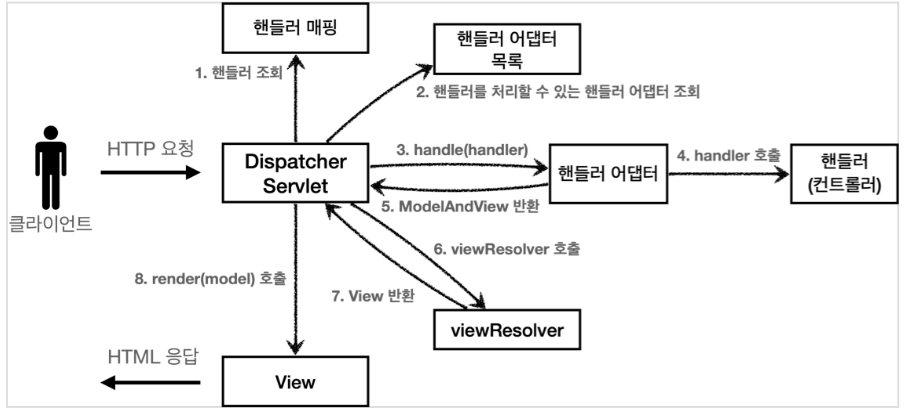

> **TL;DR** — 스프링 MVC는 요청이 DispatcherServlet → Controller → (Service → Model/DB) → ViewResolver 순으로 흐르는 구조다. Controller의 리턴 타입에 따라 어떤 View가 응답으로 나가는지가 달라진다는 것만 이해하면 나머지는 어노테이션 조합 문제다.

난이도 : ★★☆☆☆

1️⃣ `DispatcherServlet` 2️⃣ `Controller 리턴 타입` 3️⃣ `ViewResolver`

## ✅ 왜 알아야 하나

이 챕터를 이해하려면 먼저 백엔드가 Request를 받았을 때 어떤 처리를 하는지 알고 있어야 한다. Node로 프로젝트를 해본 경험이 있어서 감을 잡기는 수월했는데, 그때의 원리는 "Request 요청 → 경로에 따른 Controller 처리 → Service에서 데이터 가공 → Model에서 SQL로 쿼리 실행(DB 접촉)"이었다. 스프링도 세부는 다르지만 이 흐름을 가지고 접근하면 이해가 훨씬 편하다.

특히 어노테이션 하나로 View단을 자동으로 찾아주는 DispatcherServlet 구조가 인상적이었다.

## ✅ 스프링 MVC 패턴의 개념과 장점

- MVC의 주 목적은 Business 로직과 Presentation 로직을 분리하는 것임
- Model, View, Controller 세 부분으로 이루어짐
- 다른 부분은 신경 쓰지 않고 View와 Controller만 신경 쓰면 됨
- 요청을 어노테이션으로 분류해 API를 처리할 수 있음



### 컴포넌트별 역할

**1. 모델(Model)**
- 데이터 저장소(DB 등)와 연동해 입력·출력 데이터를 다룸
- 여러 데이터 변경 작업을 하나의 트랜잭션으로 묶는 역할도 함
- DAO 클래스, Service 클래스가 여기 해당

**2. 뷰(View)**
- 모델이 처리한 데이터로 사용자에게 보여줄 화면을 만듦
- 생성된 화면은 웹 브라우저가 출력하고, View는 HTML/CSS/JS로 브라우저가 그릴 UI를 만듦
- HTML과 JSP로 작성 가능

**3. 컨트롤러(Controller)**
- HttpServletRequest·HttpServletResponse를 거의 직접 안 써도 필요한 기능을 구현할 수 있음
- 다양한 타입의 파라미터·리턴 타입을 사용 가능
- GET/POST 등 전송 방식을 어노테이션으로 처리 가능
- 상속·인터페이스 대신 어노테이션만으로 설정 가능

## ✅ MVC 동작 원리와 순서

코드를 따라 치기 전에 흐름부터 파악하는 게 좋다. 리턴 타입에 따라 응답이 달라진다는 걸 먼저 짚고 간다.

- `void` — 호출한 URL과 동일한 이름의 jsp를 호출
- `String` — 리턴한 문자열과 같은 이름의 jsp를 호출

<!-- 이미지 제안: Request → DispatcherServlet → @RequestMapping Controller → ViewResolver → jsp 응답까지 이어지는 요청 처리 흐름 다이어그램 -->

### 1. Request는 DispatcherServlet이 먼저 받는다

```xml
<!-- web.xml -->
<servlet>
    <servlet-name>appServlet</servlet-name>
    <servlet-class>org.springframework.web.servlet.DispatcherServlet</servlet-class>
    <init-param>
        <param-name>contextConfigLocation</param-name>
        <param-value>/WEB-INF/spring/appServlet/servlet-context.xml</param-value>
    </init-param>
    <load-on-startup>1</load-on-startup>
</servlet>
```

### 2. `@RequestMapping`으로 해당 Controller를 찾아 실행한다

```java
package org.zerock.controller;
// ...(생략)

@Controller
@RequestMapping("/sample/*")
@Log4j
public class SampleController {

    @RequestMapping("")
    public void basic() {
        log.info("basic.................");
    }

    @RequestMapping(value = "/basic", method = { RequestMethod.GET, RequestMethod.POST })
    public void basicGet() {
        log.info("basic get.................");
    }

    @GetMapping("basicOnlyGet")
    public void basicGet2() {
        log.info("basic get only get.................");
    }
}
```

### 3. 리턴값에 따라 ViewResolver가 jsp를 찾아 화면에 보여준다

```xml
<!-- servlet-context.xml -->
<beans:bean class="org.springframework.web.servlet.view.InternalResourceViewResolver">
    <beans:property name="prefix" value="/WEB-INF/views/" />
    <beans:property name="suffix" value=".jsp" />
</beans:bean>
```

파라미터를 받는 방식은 배열, 객체 등 여러 형태가 가능하다.

```java
// 배열
@GetMapping("ex01")
public String ex01(SampleDTO dto) {
    log.info("" + dto);
    return "ex01";
}

@GetMapping("ex02")
public String ex02(@RequestParam("name") String name, @RequestParam("age") int age) {
    log.info("name: " + name);
    log.info("age: " + age);
    return "ex02";
}

@GetMapping("ex02List")
public String ex02List(@RequestParam("ids") ArrayList<String> ids) {
    log.info("ids: " + ids);
    return "ex02List";
}

@GetMapping("ex02Array")
public String ex02Array(@RequestParam("ids") String[] ids) {
    log.info("array ids: " + Arrays.toString(ids));
    return "ex02Array";
}

// 객체 — urlMapping 예: /sample/ex02Bean?list[0].name=aaa&list[1].name=bbb
@GetMapping("ex02Bean")
public String ex02Bean(SampleDTOList list) {
    log.info("list dtos: " + list);
    return "ex02Bean";
}

@GetMapping("/ex04")
public String ex04(SampleDTO dto, @ModelAttribute("page") int page) {
    log.info("dto: " + dto);
    log.info("page: " + page);
    return "/sample/ex04";
}
```

View단은 EL 표현식으로 값을 그대로 꺼내 쓴다.

```jsp
<%@ page language="java" contentType="text/html; charset=UTF-8" pageEncoding="UTF-8"%>
<!DOCTYPE html>
<html>
<head>
<meta charset="UTF-8">
<title>Insert title here</title>
</head>
<body>
    <h2>SampleDTO ${sampleDTO}</h2>
    <h2>Page ${page}</h2>
</body>
</html>
```

### 4. Model단은 인터페이스로 만들어 Controller 인자로 받는다

```java
package org.zerock.domain;

@Data
public class SampleDTO {
    private String name;
    private int age;
}

@Data
public class SampleDTOList {
    private List<SampleDTO> list;

    public SampleDTOList() {
        list = new ArrayList<>();
    }
}
```

## ✅ 파일 업로드 처리 방법

책 기준으로는 파일을 업로드하고 콘솔에 크기·파일명을 출력하는 정도까지만 다룬다. View단 출력이나 DB 저장은 별도로 다뤄야 한다.

**1. `servlet-context.xml`에 multipartResolver를 등록한다** (uploadTempDir 경로에 실제 폴더가 있어야 함)

```xml
<beans:bean id="multipartResolver" class="org.springframework.web.multipart.commons.CommonsMultipartResolver">
    <beans:property name="defaultEncoding" value="utf-8"></beans:property>
    <beans:property name="maxUploadSize" value="10485760"></beans:property>
    <beans:property name="maxUploadSizePerFile" value="2097152"></beans:property>
    <beans:property name="uploadTempDir" value="file:/C:/upload/tmp"></beans:property>
    <beans:property name="maxInMemorySize" value="10485756"></beans:property>
</beans:bean>
```

**2. Controller에서 파일을 받는다**

```java
@GetMapping("/exUpload")
public void exUpload() {
    log.info("/exUpload...............");
}

@PostMapping("/exUploadPost")
public void exUploadPost(ArrayList<MultipartFile> files) {
    files.forEach(file -> {
        log.info("name: " + file.getOriginalFilename());
        log.info("size: " + file.getSize());
    });
}
```

**3. View단에서 multipart 폼을 만든다**

```jsp
<%@ page language="java" contentType="text/html; charset=UTF-8" pageEncoding="UTF-8"%>
<!DOCTYPE html>
<html>
<head>
<meta charset="UTF-8">
<title>Insert title here</title>
</head>
<body>
    <form action="/sample/exUploadPost" method="post" enctype="multiPart/form-data">
        <div><input type="file" name="files"></div>
        <div><input type="file" name="files"></div>
        <div><input type="file" name="files"></div>
        <div><input type="submit"></div>
    </form>
</body>
</html>
```

## ✅ 실무에서는 이렇게 쓴다

**궁금했던 것** — 보통 프로젝트에서는 View단을 프론트나 퍼블리셔가 만들고 fetch로 요청하면 백엔드는 데이터 가공과 DB CRUD만 담당한다. MVC 중 View가 굳이 왜 필요한지 의문이 들었는데, 프론트가 분리되기 전에는 백엔드가 View단까지 처리했기 때문에 그 흔적이 남아 있는 것으로 이해하고 있다.

**오류 해결** — 스프링은 서버를 Tomcat으로 띄우는데, 프로젝트를 새로 만들 때마다 계속 새 서버를 만들다 보면 동일한 포트·서버 충돌 에러가 난다.

```
Port 8080 required by Tomcat v9.0 Server at localhost is already in use. The server may already be running in another process, or a system process may be using the port. To start this server you will need to stop the other process or change the port number(s).
```

해결 방법은 기존 서버를 영구 삭제하고 재시작하는 것이다.

## ✅ Summary

- MVC 흐름은 DispatcherServlet → `@RequestMapping` Controller → ViewResolver 순서로 이어짐
- Controller 리턴 타입(`void`/`String`)에 따라 어떤 jsp가 응답으로 나가는지가 결정됨
- 파일 업로드는 `CommonsMultipartResolver` 등록 + `MultipartFile` 파라미터로 처리함
- Tomcat 포트 충돌은 기존 서버를 영구 삭제하고 재시작하면 해결됨

## 참고한 링크

- [스프링 MVC 패턴 개념](https://catsbi.oopy.io/f52511f3-1455-4a01-b8b7-f10875895d5b)
- [MVC 구조 이해하기](https://emongfactory.tistory.com/121)
- [Tomcat 포트 충돌 해결](https://to-dy.tistory.com/59)
