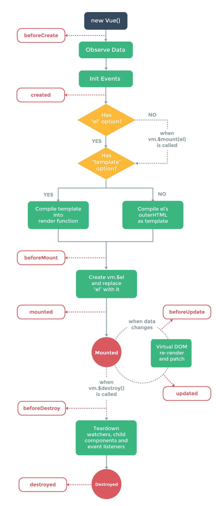

> **TL;DR** — React는 라이브러리, Vue는 프레임워크다. 이 차이가 상태 관리·라우팅을 내장했는지 여부부터 파일 구조까지 이어진다. 같은 덧셈 계산기를 두 프레임워크로 만들어보면 문법 차이가 명확하게 보인다.

난이도 : ★★☆☆☆

1️⃣ `라이브러리 vs 프레임워크` 2️⃣ `단방향 vs 양방향 바인딩` 3️⃣ `렌더링 시점`

## ✅ 왜 알아야 하나

기술 세미나에서 React와 Vue를 비교하며 정리한 내용이다. 둘 다 컴포넌트 기반 UI 라이브러리·프레임워크지만 실제로 같은 로직을 각각 짜보면 상태를 다루는 방식, 이벤트를 거는 방식, 렌더링 시점을 판단하는 방식이 미묘하게 다르다. 면접에서도 자주 나오는 비교 주제라 코드 레벨로 정리해두면 설명하기 편하다.

## ✅ React와 Vue의 특징

1. **React는 라이브러리, Vue는 프레임워크다**(공식 문서 기준)
2. 라이브러리는 필요한 부분만 가져다 쓰기 편하다는 장점이 있지만, redux·recoil 같은 전역 상태 관리나 react-router-dom 같은 라우팅이 기본 내장돼 있지 않다. 프레임워크는 부분적으로만 쓰기는 어렵고 지원하는 방식(computed, data 선언 등)을 그대로 따라야 하지만, 더 많은 기능을 기본 제공해서 편하다.
3. React는 자바스크립트 기반으로 JSX 파일 안에 함수 형태로 컴포넌트를 만들어 HTML을 렌더링한다. CSS는 별도 라이브러리 없이는 같은 파일에서 다루기 어렵다. Vue는 HTML·CSS·JS 영역이 `.vue` 파일 하나 안에 나뉘어 있다.
4. 초기 세팅은 React는 `create-react-app`, Vue는 `vue-cli`로 한다.

## ✅ 같은 컴포넌트로 비교하기

덧셈 계산기(`testA` + `testB` = `total`)라는 동일한 로직을 두 프레임워크로 각각 구현해본다.

### React.jsx

- `state` — 값을 저장하는 변수
- `props` — 부모에서 자식으로 값을 넘길 때 사용
- `useEffect` — 라이프사이클에 따라 렌더링을 통제할 수 있는 훅
- `useState` — 값을 변수에 저장하는 훅, 저장할 때마다 화면이 리렌더링됨
- `useCallback` — 특정 함수를 새로 만들지 않고 재사용하고 싶을 때 사용

```javascript
import { useEffect, useState } from "react";

function App() {
  const [number, setNumber] = useState({ // state에 값 넣기
    testA: 0,
    testB: 0
  });
  const [total, setTotal] = useState(0); // 총합을 저장하는 state

  const handleChange = (e) => { // 입력 시 동작하는 이벤트 함수
    const { name, value } = e.target;
    setNumber({ ...number, [name]: Number(value) });
  };

  useEffect(() => { // testA, testB의 변화가 감지되면 total 값 변경
    setTotal(number.testA + number.testB);
  }, [number]);

  return (
    <div>
      <p>덧셈 계산기 만들기</p>
      <p>testA : <input type='number' name='testA' onChange={handleChange} /></p>
      <p>testB : <input type='number' name='testB' onChange={handleChange} /></p>
      <p>total : <span>{total}</span></p>
    </div>
  );
}

export default App;
```

### Vue.vue

- `name` — 컴포넌트 이름 표기
- `components` — import해서 사용할 컴포넌트 등록
- `data()` — 함수로 정의하고 return한 객체 안에 사용할 변수를 둠
- `props` — 부모에게 받는 props는 객체 안에 type과 default를 지정
- `computed` — 변수를 따로 선언하지 않고 계산된 값을 바로 사용하거나, 값이 들어올 때와 사용될 때의 로직을 다르게 제어하고 싶을 때 사용(getter/setter)
- `methods` — 메서드를 정의하는 자리
- `created`, `mounted` 등 — 라이프사이클 시점에 맞춰 함수가 실행됨
- `watch` — 변수의 변화를 감지해 handler 함수를 실행함. `deep`, `immediate` 옵션으로 첫 실행 여부와 객체 내부 값까지 감지할지 정할 수 있음

```html
<template>
  <div id="app">
    <p>덧셈 계산기 만들기</p>
    <p>testA : <input type='number' name='testA' v-model="number.testA" /></p>
    <!-- v-model로 입력 시 자동으로 testA 변수에 값이 들어감 -->
    <p>testB : <input type='number' name='testB' v-model="number.testB" /></p>
    <p>total : <span>{{ total }}</span></p>
  </div>
</template>

<script>
export default {
  name: 'App',
  data() {
    return {
      number: { // 변수 세팅
        testA: 0,
        testB: 0
      },
    };
  },
  computed: { // total 변수를 따로 만들지 않아도 됨
    total() {
      return Number(this.number.testA) + Number(this.number.testB);
    }
  }
};
</script>

<style>
</style>
```

## ✅ 이벤트 사용 방법

**React** — `onChange`, `onClick` 같은 속성에 콜백 함수를 넣어서 처리한다. 함수를 그대로 호출하는 형태(`addTotalVar()`)로 쓰려면 `() => addTotalVar()`처럼 감싸야 한다. `event` 객체로 값을 컨트롤하거나 `preventDefault`로 기본 동작을 막을 수 있다.

```javascript
<p>testA : <input type='number' name='testA' onChange={handleChange} /></p>
<button onClick={addTotalVar}>더하기 계산</button>
```

**Vue** — `v-on:이벤트`(축약형 `@이벤트`)로 처리하고, `.prevent`나 `.stop` 같은 수식어로 이벤트 발생 시점을 제어할 수 있다. 변수 컨트롤은 `v-model`을 사용한다.

```javascript
<p>testB : <input type='number' name='testB' v-model="number.testB" /></p>
<button @click="addTotalVar">더하기 계산</button>
```

## ✅ 부모에서 state(변수) 수정하는 방법

**React** — `useState` 훅으로 state 변수와 setState 함수를 선언하고, setState 안에 값을 넣어 수정한다. state에 값을 직접 대입하면 에러가 난다(단방향 데이터 흐름 때문).

```javascript
const [test, setTest] = useState(0); // 선언
const testHandler = () => {
  setTest(10); // 수정
  test = 10; // 에러
};
```

**Vue** — `this`를 붙여 변수를 가리키게 하고 값을 바로 대입해도 에러가 나지 않는다.

```javascript
data() {
  return {
    test: 0
  };
},
methods: {
  testHandler() { // 화살표 함수로 선언하면 this 바인딩이 깨져 에러가 남
    this.test = 10; // 값을 바로 대입
  }
}
```

## ✅ 자식에서 부모의 state를 props로 받아 수정하는 방법

컴포넌트 이름은 무조건 대문자로 시작해야 한다. React는 카멜케이스, Vue는 케밥/스네이크 표기를 주로 쓴다.

**React** — 부모에서 선언한 수정 함수를 태그에 `이름={함수명}` 형식으로 전달하고, 자식에서 그 함수를 실행한다. `setState`를 그대로 넘기는 것보다 함수로 감싸서 전달하는 방식을 추천한다.

```javascript
// 부모 컴포넌트
const [child, setChild] = useState(0);
const childChange = (e) => {
  const { value } = e.target;
  setChild(Number(value) + 10);
};
<p>자식에게 props 넘겨서 수정</p>
<ChildCompo childChange={childChange} child={child}></ChildCompo>

// 자식 컴포넌트
function childCompo(props) {
  return (
    <div>
      <p>input : <input type='number' name='testB' onChange={props.childChange} /></p>
      <p>{props.child}</p>
    </div>
  );
}

export default childCompo;
```

**Vue** — 함수는 `@이름="함수명"`, 변수는 `:이름="변수명"` 형식으로 자식에게 전달한다. React는 state를 수정하는 함수를 자식에 내려서 직접 실행시키지만, Vue는 자식이 값을 직접 수정하지 못하고 `v-bind`로 props를 받은 뒤 `$emit`으로 부모에게 이벤트를 올려 수정한다.

```javascript
// 부모 컴포넌트
<p>자식에게 props 넘겨서 수정</p>
<ChildCompo @child-change="childChange" :child="child"></ChildCompo>
<script>
data() {
  return {
    child: 0
  };
},
methods: {
  childChange(value) {
    this.child = Number(value) + 10;
  }
}
</script>

// 자식 컴포넌트
<template>
  <div>
    <p>input : <input type='number' name='testB' @keyup="childChange"></p>
    <p>{{ child }}</p>
  </div>
</template>

<script>
export default {
  name: "ChildCompo",
  props: {
    child: {
      type: Number
    }
  },
  methods: {
    childChange(e) {
      this.$emit("child-change", e.target.value);
    }
  }
};
</script>
```

<!-- 이미지 제안: React(부모가 수정 함수를 자식에 내려 직접 실행) vs Vue(자식이 $emit으로 부모에 이벤트를 올림) — 자식→부모 데이터 흐름 방향을 대비하는 다이어그램 -->

## ✅ 렌더링 시점

**React**
- `componentDidMount` — 첫 렌더링 시
- `componentDidUpdate` — 값이 변경될 때마다
- `componentWillUnmount` — 컴포넌트가 사라질 때

```javascript
useEffect(() => {
  setTotal(''); // state가 변경될 때마다 렌더링
}, [number]);
// []만 넣으면 첫 렌더링 시에만 실행(componentDidMount)
// [state]를 넣으면 변경 시마다 실행(componentDidUpdate)
```

**Vue** (총 8단계 중 핵심 4개)
- `created` — 라이프사이클 중 가장 먼저 실행. 데이터를 처음 불러올 때 사용하며 DOM 접근은 안 됨
- `mounted` — DOM이 메모리에 생성되고 렌더링된 이후 실행됨
- `updated` — 데이터가 변경돼 재렌더링된 이후 실행됨. DOM 관련 로직 처리 가능
- `destroyed` — Vue 인스턴스가 제거된 뒤 실행됨. 모든 인스턴스·디렉티브 바인딩이 해제되고 이벤트도 제거됨



## ✅ 왜 이런 차이가 나는가 — 반응성(reactivity) 구현 방식의 차이

React에서 `state`를 직접 대입하면 에러가 나고, Vue에서는 `this.test = 10`처럼 바로 대입해도 화면이 갱신되는 이유는 두 프레임워크가 "값이 바뀌었다"는 걸 감지하는 방식 자체가 다르기 때문이다.

- **React** — `setState`(또는 `useState`의 setter)를 호출해야만 리렌더링이 예약된다. React는 이전 state와 새 state를 비교(Virtual DOM diffing)해서 바뀐 부분만 실제 DOM에 반영하는데, 이 비교 대상이 되려면 반드시 지정된 함수를 통해 값이 바뀌었다는 신호를 줘야 한다. 그래서 객체·배열도 항상 새로 만들어서(`{ ...state }`) 교체해야 하고, 원본을 직접 건드리면 React가 변경 자체를 감지하지 못한다.
- **Vue (Options API, Vue 2 기준)** — `data()`가 반환한 객체의 각 프로퍼티를 Vue가 내부적으로 getter/setter로 감싸서(`Object.defineProperty`), 값이 대입되는 순간 그 setter가 자동으로 실행되며 리렌더링을 트리거한다. 이 방식 덕분에 `this.value = x`처럼 직접 대입해도 감지가 된다(참고로 Vue 3부터는 `Object.defineProperty` 대신 `Proxy` 기반 반응성 시스템으로 바뀌어서 배열 인덱스 직접 할당 등 Vue 2의 일부 감지 한계가 해소됐다).

## ✅ Summary

- React는 라이브러리, Vue는 프레임워크 — 이 차이가 상태 관리·라우팅 내장 여부와 파일 구조를 가른다
- state 수정 방식이 React는 setState 함수 필수, Vue는 `this`로 직접 대입 가능하다는 점이 가장 큰 문법 차이임
- 부모→자식 데이터 흐름은 둘 다 props로 유사하지만, 자식→부모 방향은 React가 함수를 내려서 직접 실행, Vue가 `$emit`으로 이벤트를 올리는 방식이라 반대 흐름임

## 참고한 링크

- [리액트(React.js) vs 뷰(Vue.js)](https://nyol.tistory.com/148)
- [React와 Vue에서 똑같은 앱을 만들어보고 쓴 차이점 비교(번역글)](https://erwinousy.medium.com/%EB%82%9C-react%EC%99%80-vue%EC%97%90%EC%84%9C-%EC%99%84%EC%A0%84%ED%9E%88-%EA%B0%99%EC%9D%80-%EC%95%B1%EC%9D%84-%EB%A7%8C%EB%93%A4%EC%97%88%EB%8B%A4-%EC%9D%B4%EA%B2%83%EC%9D%80-%EA%B7%B8-%EC%B0%A8%EC%9D%B4%EC%A0%90%EC%9D%B4%EB%8B%A4-5cffcbfe287f)
