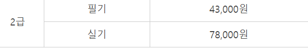
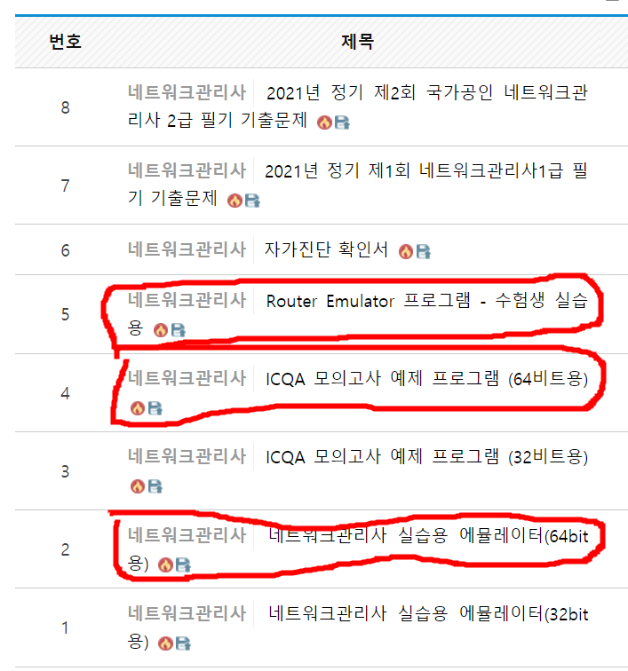

> **TL;DR** — 네트워크관리사 2급 실기는 랜 케이블 작업 → 네트워크 설정 + 이론 문제 → 라우터 설정 순서로 진행된다. 필기 43,000원 실기 78,000원이니 준비물과 공부 순서를 미리 잡아두고 한 번에 붙는 게 낫다.

난이도 : ★☆☆☆☆

1️⃣ `시험 준비물` 2️⃣ `시험 순서` 3️⃣ `배점`

## ✅ 왜 미리 체크해야 하나

네트워크관리사 2급은 필기 43,000원, 실기 78,000원이다. 시험비가 만만치 않아서 웬만하면 떨어지지 말고 한 번에 붙는 게 이득이다. 실기는 랜 케이블 작업 → 네트워크 설정 + 객관식·주관식 문제 → 라우터 설정(명령어 입력) 순서로 진행되고, 각 파트마다 별도로 시간이 주어진다. 랜 케이블 파트는 다 풀고 나가면 그 자리에서 정답 여부를 알려준다.

## ✅ 프로그램 설치 및 준비 사항

**ICQA 예제·실습 프로그램**

1. Router Emulator 프로그램 — 라우터 명령어 연습용
2. ICQA 모의고사 예제 프로그램 — 네트워크 설정 연습용
3. 네트워크관리사 실습용 에뮬레이터 — 실습 문제 풀이용

**랜툴 작업 도구 (구글 검색으로 구매)**

- 랜툴
- 스트리퍼
- 랜 테스터기(선택)
- RJ45(8P) 커넥터
- 랜 케이블

## ✅ 공부해야 할 것

**랜 케이블 작업(다이렉트)**
구매한 랜 케이블로 직접 작업한다. 다이렉트 케이블과 크로스 케이블이 있는데, 시험에는 주로 다이렉트 케이블 문제가 나온다.

- 다이렉트 케이블 — 양쪽 커넥터를 T568B(또는 A) 배열로 동일하게 만듦. PC↔스위치처럼 서로 다른 종류의 장비를 연결할 때 씀
- 크로스 케이블 — 한쪽은 T568A, 반대쪽은 T568B로 배열을 다르게 만듦. PC↔PC, 스위치↔스위치처럼 같은 종류의 장비를 직접 연결할 때 씀(송신·수신 핀을 서로 엇갈리게 배치해야 통신이 되기 때문)
- 참고로 요즘 스위치 장비는 Auto MDI-X 기능으로 케이블 종류를 자동 인식해서 크로스 케이블 없이도 통신되는 경우가 많지만, 자격증 시험은 이 기능이 없는 구형 장비 기준으로 출제된다

**네트워크 설정**
ICQA 모의고사 예제 프로그램으로 연습한다. 파트별로 골라서 반복해서 풀 수 있다.

**객관식·주관식 문제(이론)**
필기 때 이론을 제대로 공부해뒀다면 어렵지 않다. 네트워크 ID 설정, 용어 관련 주관식 문제, OSI 7계층 문제 등이 나온다.

**라우터 명령어**
문제에 맞는 명령어를 직접 입력하는 방식이다. 출제 유형이 정해져 있어서 명령어만 암기하면 다 맞힐 수 있다.

## ✅ 배점 및 신청 방법

**신청 방법**

1. ICQA 홈페이지에 로그인해서 시험 일정을 확인하고 접수일에 신청함 (금액 78,000원)
2. [한국정보통신자격협회](https://www.icqa.or.kr/cn/page/network)에서 접수
3. 마이페이지에서 시험 장소와 시간을 확인함

**배점**

케이블 제작에서 합격 기준을 넘겼다면, 나머지 문제 중 5개 이하로만 틀리면 된다(60점 이상 합격).

- 케이블 제작 : 1문제, 배점 6.5점
- 윈도우 설정 : 8문제, 배점 5.5점
- 리눅스 설정 : 2문제, 배점 5.5점
- TCP/IP 장비 : 3문제, 배점 5.5점
- 보안 : 1문제, 배점 5.5점
- 라우터 : 3문제, 배점 5.5점

## ✅ Summary

- 실기 순서 : 랜 케이블 → 네트워크 설정 + 이론 → 라우터 설정
- 케이블 제작만 통과하면 나머지는 5개까지 틀려도 합격선(60점)
- 준비물은 ICQA 프로그램 3종 + 랜툴 작업 도구

## 참고한 링크

- [햄릿슈닷컴](https://www.hamletshu.com/)
- [네트워크관리사 2급 실기 window server 문제 모음](https://rookie-developer.tistory.com/147?category=1193401)
- [한국정보통신자격협회](https://www.icqa.or.kr/cn/page/network)
