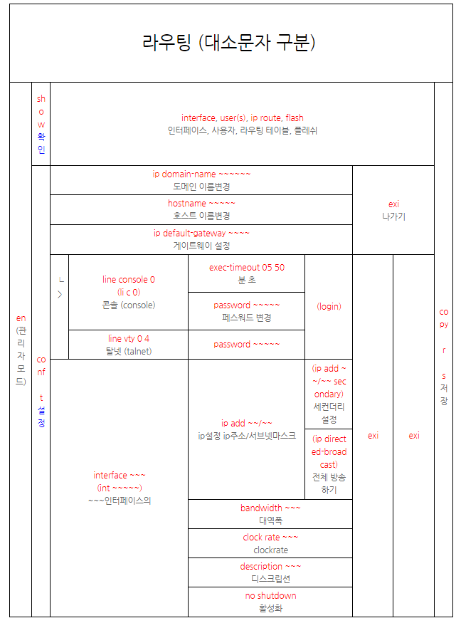

> **TL;DR** — 라우터 설정 문제는 유형이 정해져 있다. `en → conf t → 설정 명령어 → exit → exit → copy r s` 흐름만 몸에 익히면 대부분 풀린다. 명령어를 모르면 `?`를 치고 엔터를 누르면 된다.

난이도 : ★★☆☆☆

1️⃣ `console / telnet 설정` 2️⃣ `interface 설정` 3️⃣ `OSPF`

아직 네트워크관리사 자격증 신청을 안 했거나 에뮬레이터를 다운받지 못했다면 [시험 가이드 글](/posts/network-admin-cert-guide)부터 보고 오는 걸 추천한다.


*라우터 프로그램*


## ✅ 주의사항 및 꿀팁

**실행 방법**

1. 라우터 프로그램 설치
2. [Router Emulator 프로그램 — 수험생 실습용](https://www.icqa.or.kr/cn/board/dataroom/21?page=5)에서 다운로드
3. 한국정보통신자격협회 홈페이지에서 받은 프로그램 실행
4. 주의사항 적힌 부분 꼼꼼히 읽고 문제 풀기

**꿀팁**

- 라우터 번호를 잘 확인하고 입력함
- 명령어를 모르면 `?`를 치고 엔터를 누르면 됨
- "startup-config에 저장하시오"가 나오면 `copy r s`를 반드시 해야 함
- "활성화" 문구가 나오면 `no shutdown`을 해야 함
- 어느 상황에 어떤 명령어와 순서를 써야 하는지 필히 암기함

**명령어 뜻 미리 알아두기** — 뜻을 모르고 외우면 문제 변형에 약해진다.

| 명령어 | 뜻 |
| --- | --- |
| `en` (enable) | 사용자 모드 → 관리자(특권) 모드 진입 |
| `conf t` (configure terminal) | 관리자 모드 → 전역 설정 모드 진입 |
| `line console 0` | 콘솔 포트(직접 연결하는 관리용 포트)로 진입 — 포트가 1개뿐이라 번호는 항상 0 |
| `line vty 0 4` | 가상 터미널(Telnet/SSH) 회선 0~4번, 즉 동시 접속 가능한 5개 세션에 설정을 적용 |
| `no shutdown` | 기본적으로 비활성화(shutdown)돼 있는 인터페이스를 활성화함 |
| `copy r s` (copy running-config startup-config) | 현재 메모리에만 반영된 설정(running)을 재부팅 후에도 남도록 저장(startup)함 |

`line vty 0 4`처럼 "0 4"가 숫자 두 개인 이유는 라우터가 기본으로 5개(0~4)의 가상 터미널 회선만 지원하기 때문 — 그래서 동시에 Telnet 접속할 수 있는 사용자 수도 기본 5명으로 제한된다.

## ✅ 문제 총 정리

> 출제 유형: 정보 확인, console 설정, Telnet 설정, fastethernet 설정, Serial 설정, dhcp 설정, 게이트웨이 설정, OSPF 설정, 네트워크 설정 문제

**전체 흐름**



### 정보 확인

**1. 인터페이스 정보를 확인하고 저장하시오**

```bash
> en
> show interface
> copy r s
```

**2. 접속한 사용자 정보를 확인하고 저장하시오**

```bash
> en
> show user
> copy r s
```

**3. 라우팅 테이블 정보를 확인하고 저장하시오**

```bash
> en
> show ip route
> copy r s
```

**4. 플래시 내용을 확인하고 저장하시오**

```bash
> en
> show flash
> copy r s
```

**5. 프로세서 내용을 확인하고 저장하시오**

```bash
> en
> show process
> copy r s
```

**6. 소프트웨어 버전과 IOS 버전 등을 확인하시오**

```bash
> en
> show version
> copy r s
```

### console 설정 문제

**1. console 0의 패스워드를 icqa로 설정하고 로그인하시오**

```bash
> en
> conf t
> line console 0
> password ICQA
> login
> exit
> exit
> copy r s
```

**2. hostname을 network2로 변경하고 console 0의 password를 route5로 변경 후 로그인하시오**

```bash
> en
> conf t
> hostname network2
> line console 0
> password route5
> login
> exit
> exit
> copy r s
```

**3. console 0의 도메인 명을 AAA로 설정하시오**

```bash
> en
> conf t
> line console 0
> ip domain-name route5
> exit
> exit
> copy r s
```

### Telnet 설정 문제

**1. 텔넷 연결 후 3분 50초 동안 입력이 없으면 세션이 자동 종료되도록 설정하시오**

```bash
> en
> conf t
> line vty 0 4
> exec-timeout 03 50
> exit
> exit
> copy r s
```

**2. ROUTER1 Telnet에 접근하는 Password를 icqa로 설정하고 로그인하시오**

```bash
> en
> conf t
> line vty 0 4
> password icqa
> login
> exit
> exit
> copy r s
```

### Serial 설정 문제

**1. Router2의 Serial 2/0의 대역폭을 2048로 설정하시오**

```bash
> en
> conf t
> interface serial 2/0
> bandwidth 2048
> exit
> exit
> copy r s
```

**2. serial 2/0을 활성화시키시오**

```bash
> en
> conf t
> interface serial 2/0
> no shutdown
> exit
> exit
> copy r s
```

**3. Router2의 Serial 2/0의 clock 속도를 72K로 설정하시오**

```bash
> en
> conf t
> interface serial 2/0
> clock rate 72000
> exit
> exit
> copy r s
```

**4. ROUTER1의 Serial 2/0을 사용 가능하게 IP주소를 192.168.0.101/24와 두 번째 IP 192.168.0.102/24로 설정하고 활성화하시오**

```bash
> en
> conf t
> interface serial 2/0
> ip add 192.168.0.101 255.255.255.0
> ip add 192.168.0.102 255.255.255.0 secondary
> no shutdown
> exit
> exit
> copy r s
```

**5. serial 2/0에 frame relay 방식으로 캡슐화하시오**

```bash
> en
> conf t
> interface serial 2/0
> encapsulation frame relay
> exit
> exit
> copy r s
```

### Fastethernet 설정 문제

**1. FastEthernet 0/0의 Description을 ICQA로 설정하시오**

```bash
> en
> conf t
> interface fastethernet 0/0
> description ICQA
> exit
> exit
> copy r s
```

**2. ROUTER1의 FastEthernet 0/0의 IP를 192.168.0.100/24로 설정하시오**

```bash
> en
> conf t
> interface fastethernet 0/0
> ip add 192.168.0.100 255.255.255.0
> exit
> exit
> copy r s
```

**3. access-list 1이 설정되어 있을 때 FastEthernet 0/0에 적용하시오**

```bash
> en
> conf t
> interface fastethernet 0/0
> ip access-group 1 in
> ip access-group 1 out
> exit
> exit
> copy r s
```

### dhcp 설정 문제

**1. Router1의 DHCP 네트워크를 192.168.100.0/24, 서버 이름은 icqa로 설정하시오**

```bash
> en
> conf t
> ip dhcp pool icqa
> network 192.168.100.0 255.255.255.0
> exit
> exit
> copy r s
```

### 게이트웨이 설정 문제

**1. 기본 게이트웨이를 설정하시오 (IP : 192.168.0.10)**

```bash
> en
> conf t
> ip default-gateway 192.168.0.10
> exit
> copy r s
```

### 네트워크 설정 문제

**1. default network를 192.168.0.10으로 설정하시오**

```bash
> en
> conf t
> ip default-network 192.168.0.10
> exit
> copy r s
```

**2. RIP 환경이 구성되어 있을 때, 라우팅 테이블에 등록되지 않은 목적지로 향하는 패킷은 192.168.1.1 네트워크로 보내도록 Router1에 디폴트 네트워크를 설정하시오 (ip route 0.0.0.0 사용 금지)**

```bash
> en
> conf t
> ip default-network 192.168.1.1
> exit
> copy r s
```

### ospf 설정 문제

**1. 네트워크가 구성되어 있을 때 ospf를 설정하시오. processID와 Area id는 1이며 설정 완료 시 저장한다**

```bash
> en
> conf t
> route ospf 1
> network 192.70.100.0 0.0.0.255 area 1
> exit
> copy r s
```

**2. 아래와 같이 네트워크가 구성되어 있을 때 Router1에 OSPF를 설정하시오 (Process ID와 Area id는 1이다). 192.70.100.1/24 → (Fa 0/0) → Router1(Se 2/0 193.150.60.50/24) — Router2(Se 2/0 193.150.60.55/24) ← (Fa 0/0) ← 170.150.1.1/16**

```bash
> en
> conf t
> route ospf 1
> network 192.70.100.1 0.0.0.255 area 1
> network 193.150.60.50 0.0.0.255 area 1
> exit
> copy r s
```

## ✅ Summary

- 모든 설정은 `en → conf t → 설정 명령어 → exit → exit → copy r s`로 마무리됨
- console·telnet은 line 진입 후 password/login, interface는 IP·bandwidth·no shutdown 조합이 핵심
- OSPF는 process ID와 area id를 문제 지문에서 정확히 뽑아내는 게 관건


## 참고한 링크

- [햄릿슈닷컴](https://www.hamletshu.com/)
- [네트워크관리사 2급 실기 window server 문제 모음](https://rookie-developer.tistory.com/147?category=1193401)
