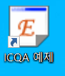
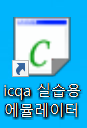

> **TL;DR** — 네트워크 설정 파트는 윈도우 서버 관리도구 GUI 조작이 핵심이다. TCP/IP, DNS, DHCP, FTP·웹사이트, 계정, 보안 정책, 서비스, 스케줄러, Hyper-V까지 설정창 위치와 입력값을 세트로 외워야 한다.

난이도 : ★★☆☆☆

1️⃣ `TCP/IP 서브넷 계산` 2️⃣ `DNS / DHCP 설정` 3️⃣ `로컬 보안 정책`

필요한 프로그램을 아직 설치하지 않았다면 [시험 가이드 글](/posts/network-admin-cert-guide)부터 보고 오는 걸 추천한다.

*각각 설정 부분 선택 가능*

*시험 보는 형식이랑 비슷*

## ✅ 주의사항 및 꿀팁

> ICQA 실습용 에뮬레이터 → 초반 연습용
> ICQA 모의고사 예제 프로그램 → 실제 시험 연습용

**실행 방법**

1. ICQA 실습용 에뮬레이터, ICQA 모의고사 예제 프로그램 설치 — [네트워크관리사 실습용 에뮬레이터(64bit용)](https://www.icqa.or.kr/cn/board/dataroom/18?page=5)
2. 한국정보통신자격협회 홈페이지에서 받은 프로그램 실행
3. 실습용 프로그램 실행 시 원하는 항목을 클릭해서 시작함

**꿀팁**

1. 라우터 번호를 잘 확인하고 입력함

## ✅ 문제 총 정리

> 출제 유형: 네트워크 속성, DNS 설정, DHCP 설정, FTP 사이트 설정, 웹사이트 설정, 로컬 사용자 및 그룹 설정, 서버 로컬 보안 정책 설정, 서버 서비스 설정, 스케줄러 설정, Hyper-V 설정

### 네트워크 속성 : 윈도우 서버 TCP/IP 설정

**1. 네트워크 환경에 제시문제와 같이 IP주소와 서브넷 마스크를 추가하시오**

- IP Address : 10101100.00010000.10010110.01110011
- Subnet Mask : 22bit
- Default Gateway : 192.168.100.254
- DNS Servers : 200.100.100.200
- 추가 Gateway : 192.168.100.253
- 보조 DNS Servers : 201.100.100.201
- 정답 IP·서브넷 : IP 172.16.150.115 / 서브넷마스크 255.255.252.0

**2. 제시문제와 같이 네트워크 환경을 설정하시오**

- IP 주소 : 192.168.192.168
- 서브넷마스크 : C 클래스의 기본값 사용
- 기본 게이트웨이 : 192.168.0.1
- 기본 DNS : 203.111.144.112
- 정답 서브넷 : 255.255.255.0

**3. 제시문제와 같이 네트워크 환경을 설정하시오 (192.168.10.0/24)**

- IP 주소 : 네트워크 할당 주소들 중 가장 큰 주소
- Gateway : 192.168.10.1
- 주 DNS 서버 : 201.100.100.1
- 보조 DNS 서버 : 201.100.100.2
- 정답 IP 주소 : 192.168.10.254

**4. 네트워크를 관리하는 K 사원은 C Class 주소의 네트워크를 가지고 하나의 서브넷당 6개의 호스트를 갖도록 네트워크를 구성하려 한다. 알맞은 네트워크 정보를 설정하시오**

- IP : 192.168.100.59
- Subnet : 하나의 서브넷은 6개의 호스트를 가짐
- Gateway : 192.168.100.62
- DNS : 192.168.100.254
- 정답 서브넷 : 255.255.255.248

**5. 제시문제와 같이 네트워크 환경을 설정하시오**

- IP : 192.168.100.56/29
- IP 주소 : 사용 가능한 첫 번째 주소
- Gateway : 사용 가능한 마지막 IP 주소
- 정답 : IP주소 192.168.100.57 / 서브넷 255.255.255.248 / 게이트웨이 192.168.100.62

### DNS 설정

**1. 관리도구에 제시문제와 같이 DNS 서버를 설정하시오**

- `@ IN SOA ns.icqa.or.kr, admin.icqa.or.kr`
- `(12; Serial`
- `900; Refresh`
- `600; Retry`
- `86400; Expire`
- `7200); Minimum`
- `www IN A 192.168.100.20`
- `ftp IN CNAME www`

설정 내용 : 영역이름 icqa.or.kr / 일련번호 12 / 주서버 ns.icqa.or.kr / 책임자 admin.icqa.or.kr / 새로고침 간격 900초 / 다시 시도 600초 / 만료 86400초 / 최소 기본값 7200초 / 새 호스트 이름 www, IP 192.168.100.20 / 새 별칭 이름 ftp, 대상 호스트 www

### DHCP 설정

**1. 아래 보기와 같이 IP를 할당할 수 있는 DHCP를 설정하시오**

- 범위 : 네트워크관리사
- 설명 : 한국정보통신자격협회
- 분배할 주소 범위 : 192.168.106.1 ~ 254
- 제외할 주소 범위 : 192.168.106.2 ~ 25
- 임대 기간 : 8일
- 서브넷마스크 : 255.255.255.0(24bit)
- 게이트웨이 설정 : 192.168.106.1
- DNS : 192.168.106.2
- 예약 설정 IP : 192.168.106.200
- 예약 이름 : Example
- MAC 주소 : ff-ff-ff-ff-ff
- 설명 : 예약
- 모두 설정한 뒤 활성화함

### FTP 사이트 설정

> 모든 문제의 설정 부분을 모아 만든 문제다. 아래 설정을 할 수 있으면 끝난다. FTP를 2개 설정하라고 하면 바인딩 편집을 해줘야 한다.

**1. 아래 보기와 같이 FTP 사이트를 추가 및 설정하시오**

- FTP 사이트 이름 : ICQA
- 실제 경로 : `C:\inetpub\ftproot`
- IP주소 : 192.168.100.10
- 포트 : 2121
- 엑세스 허용 : 익명 사용자(읽기 권한만)
- 엑세스 거부 IP주소 : 200.115.100.0/24
- 최대 연결 수 메시지 : "최대 접속 인원수를 초과 하였습니다."
- 최대 동시 연결 수 : 3
- 접속 메시지 : "한국FTP"
- 소켓 폴링 사용 안 함
- 데이터 채널 시간 제한 : 45초

### 웹사이트 설정

> 모든 문제의 설정 부분을 모아 만든 문제다. 아래 설정을 할 수 있으면 끝난다. 사이트를 2개 설정하라고 하면 바인딩 편집을 해줘야 한다.

**1. 아래 보기와 같이 웹사이트를 추가 및 설정하시오**

- 웹사이트 이름 : ICQA
- 실제 경로 : `C:\inetpub\ftproot`
- 웹사이트 IP주소 : 192.168.100.10
- 포트 : 80
- 호스트 이름 : `http://www.icqa.or.kr`
- 엑세스 허용 IP 주소 : 192.168.100.0 ~ 255
- 연결 시간 : 180초
- 최대 연결 수 : 10
- 기본 문서 : `index.html`

### 로컬 사용자 및 그룹 설정

> 모든 문제의 설정 부분을 모아 만든 문제다. 아래 설정을 할 수 있으면 끝난다.

**1. 아래 보기와 같이 계정을 추가 및 설정하시오**

- 웹사이트 이름 : ICQA
- 설명 : 한국정보통신자격협회
- 전체 이름 : 전체관리자
- Password : ICQAPass
- 암호 변경할 수 없음
- 암호 사용 기간 제한 없음
- 소속 그룹 : Administrators
- 로컬 경로 : `C:\icqa`
- 연결 끊기 세션 끝내기 : 5분

### 서버 로컬 보안 정책 설정

**1. 아래와 같이 로컬 보안 정책을 설정하시오**

- 패스워드는 최소 10일, 최대 20일 사용 가능
- 패스워드는 3번 로그인 실패 시 30분간 계정 잠금

**2. 아래와 같이 로컬 보안 정책을 설정하시오**

- 암호는 복잡성을 만족해야 함
- 최소 암호 사용 기간 : 10일
- 최대 암호 사용 기간 : 20일
- 3번 틀리면 60분 동안 로그인 불가

**3. 아래와 같이 로컬 보안 정책을 설정하시오**

- 시스템 종료 : Administrators, Backup, Operators
- 시간대 변경 : Administrators, LOCAL SERVICE
- 시스템 시간 변경 : Administrators

**4. 아래와 같이 로컬 보안 정책을 설정하시오**

- 사용자가 로그온하려면 Ctrl + Alt + Del을 눌러야만 로그온할 수 있음

**5. 아래와 같이 로컬 보안 정책을 설정하시오**

- 로그온 시도하는 사용자에게 표시할 제목 : "경고"
- 메시지 : "허가되지 않는 사용자일 경우 법적 책임을 물을 수 있습니다."
- 최대 암호 사용 기간 : 20일
- 최소 암호 사용 기간 : 10일
- 비밀번호 3번 실패 시 20분 계정 잠금

**6. window server 2008 R2에서 administrator 계정 이름을 그대로 쓰면 사전 대입 공격이나 패스워드 추측 공격에 취약해진다. Guest 계정이 활성화되어 있으면 Guest를 통해서도 정보가 새어 나갈 수 있다. 아래와 같이 로컬 사용자에 대한 보안 옵션을 설정하시오**

- Administrator 계정 이름 : icqaadmin
- Guest 계정은 사용 안 함

### 서버 서비스 설정

**1. 원격 사용자가 Telnet으로 파일을 삭제해왔으나 정책이 바뀌어 더 이상 로그온할 필요가 없어졌다. 해당 기능을 중지시키고 다시 시작할 수 없게 설정하시오**
클릭하는 곳 : Telnet 더블클릭해서 설정

**2. "인터넷 정보 서비스 관리자"를 사용하지 않도록 설정하시오**
클릭하는 곳 : World Wide Web Publishing 더블클릭해서 설정

**3. 제시문제와 같이 서비스 관리자를 설정하시오. NAS에서 하드디스크로 데이터 전송을 위해 iSCSI 서비스를 실행하고 재부팅 이후에도 서비스가 유지되도록 설정하시오**
클릭하는 곳 : Microsoft iSCSI Initiator Service 더블클릭해서 설정

**4. 제시문제와 같이 서비스 관리자를 설정하시오(재부팅 시에도 계속되도록). 암호화된 파일을 NTFS 볼륨에 저장할 때 쓰는 핵심 파일 암호화 기술을 제공하는 서비스를 중지하거나 사용 안 하도록 설정하시오**
클릭하는 곳 : Encrypting File System(EFS) 더블클릭해서 설정

### 스케줄러 설정

**1. 제시문제와 같이 작업 스케줄을 추가 설정하시오 (작업 이름은 "ICQA 초대장")**

- 전자 메일 보내기
- 보내는 사람 : admin@icqa.or.kr
- 받는 사람 : network@icqa.or.kr
- 제목 : 초대장
- 텍스트 : "금번 세미나에 귀하를 초대합니다"
- SMTP 서버 : smtp.icqa.or.kr
- 컴퓨터가 다음 시간 동안 유휴 상태인 경우에만 작업 시작 : 15분
- 컴퓨터 유휴 상태가 끝나면 중지
- 작업 실패 시 다시 시작 간격 : 1분

### Hyper-V 설정

**1. 제시문제와 같이 가상 컴퓨터를 생성하시오**

- 이름 : 네트워크관리사
- 가상 컴퓨터 위치 : `C:\Hyper-V\`
- 메모리 : 1024MB
- 가상 하드디스크 이름 : 네트워크관리사.vhd
- 가상 하드디스크 위치 : `C:\Hyper-V\네트워크관리사\`
- 가상 하드디스크 크기 : 64GB
- 나중에 운영체제 설치

## ✅ Summary

- TCP/IP 문제는 결국 서브넷 계산 → 값 대입 순서로 접근함
- DNS·DHCP·FTP·웹사이트는 관리도구 GUI 항목과 입력값을 세트로 암기하는 게 빠름
- 보안 정책·서비스 설정은 "어디를 클릭하는지"가 핵심 — 클릭 위치를 문제와 같이 외워두면 됨

## 참고한 링크

- [햄릿슈닷컴](https://www.hamletshu.com/)
- [네트워크관리사 2급 실기 window server 문제 모음](https://rookie-developer.tistory.com/147?category=1193401)
