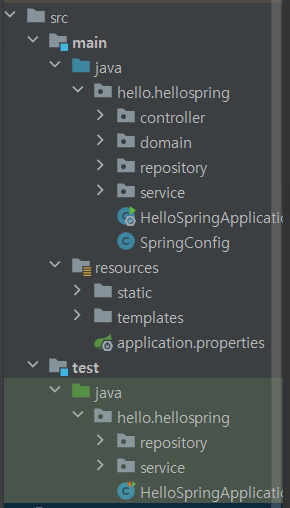
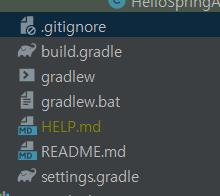
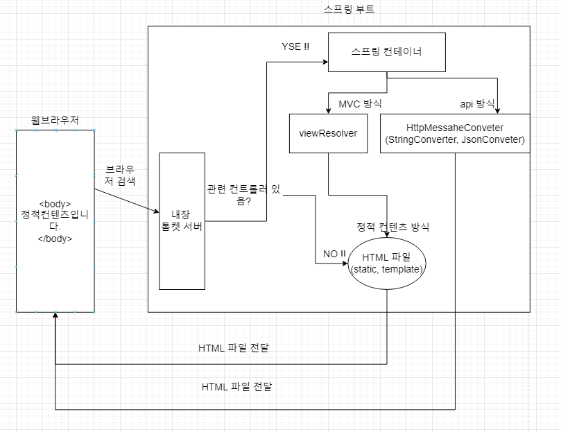

> **TL;DR** — 브라우저가 URL을 요청하면 스프링은 먼저 해당 URL에 매칭되는 빈이 컨테이너에 등록돼 있는지부터 확인한다. 없으면 `static` 폴더의 정적 파일을 그대로 내려주고, 있으면 `@ResponseBody` 여부로 API 응답과 템플릿 렌더링이 갈린다.

난이도 : ★☆☆☆☆

1️⃣ `정적 콘텐츠` 2️⃣ `MVC vs API` 3️⃣ `ViewResolver`

## ✅ 왜 알아야 하나

스프링을 처음 배울 때 `localhost:8080/hello`처럼 URL 하나만 쳤는데 그게 정적 파일인지, 컨트롤러가 응답한 건지, 템플릿이 렌더링된 건지 구분이 안 됐다. 이 흐름을 모르면 "왜 내가 만든 컨트롤러가 안 먹히지?" 같은 문제를 디버깅하기 어렵다. 인프런 김영한님의 스프링 입문 강의를 들으며 정리한 내용이다.

- 코드: [깃허브 Repository](https://github.com/seong-ji-sue/springboot-inflearn-kimyounghan-basic)


## ✅ 프로젝트 폴더 구조

프로젝트를 생성하면 기본적으로 아래 폴더들이 생긴다. 이 중 `controller`, `domain`, `repository`, `service`는 직접 만든 폴더다.





1. `src/main/java` — 클래스와 인터페이스 등 자바 파일이 위치하는 폴더
2. `src/resources/static` — 정적 리소스 파일이 위치하는 폴더
3. `src/resources/templates` — HTML에 데이터를 바인딩해서 보여줄 때 쓰는 템플릿 파일 폴더
4. `src/resources/application.properties` — 애플리케이션 실행 시 자동으로 로딩되는 설정 파일 (WAS, 데이터베이스 등)
5. `src/test/java` — `main`에서 작성한 코드를 단위 테스트하는 폴더
6. `BoardApplication.java` — `SpringApplication.run()`으로 웹 애플리케이션을 실행하는 진입점
7. `build.gradle` — 사용하는 라이브러리를 관리하는 빌드 설정 파일

## ✅ 요청이 들어왔을 때 동작 순서

인프런 김영한님의 「스프링 입문 - 코드로 배우는 스프링 부트, 웹 MVC, DB 접근 기술」 강의 내용을 정리한 순서다.



1. 브라우저에서 `localhost:8080/hello-test`를 요청한다.
2. 내장 톰캣 서버가 `hello-test`에 매칭되는 빈이 등록돼 있는지 스프링 컨테이너에 물어본다.
3. 등록돼 있지 않으면 `resources/static` 폴더에서 `hello-test.html` 파일을 찾아 그대로 브라우저에 전달한다.
4. 빈으로 등록돼 있다면 `@ResponseBody`가 붙어 있는지 확인한다. 붙어 있으면 API 방식으로 `HttpMessageConverter`가 문자열이나 객체를 변환해서 전달한다. 없으면 `ViewResolver`가 `templates` 폴더에서 리턴 문자열과 이름이 같은 HTML 파일을 찾아 브라우저에 전달한다.

## ✅ MVC 방식과 API 방식의 차이

### MVC 방식

model, view, controller로 역할을 나눠서 데이터를 전달하고 화면에 표시하는 방식이다. 백엔드에서 View까지 담당해야 하거나, 정적 콘텐츠를 유동적으로 바꾸고 싶을 때 쓴다.

동작 순서는 다음과 같다.

1. 컨트롤러가 querystring의 `name` 값을 파라미터로 받는다.
2. `Model` 객체에 `name`이라는 key로 값을 담아 넘긴다.
3. `hello-template`을 리턴하면 해당 HTML 파일에 모델 값이 바인딩돼서 렌더링된 결과가 반환된다.

```kotlin
/**
 * MVC 방식
 * @param name
 * @param model
 * @return
 */
@GetMapping("hello-mvc")
public String helloMvc(@RequestParam("name") String name, Model model) {
    model.addAttribute("name", name);
    return "hello-template";
}
```

```html
<!-- name에 값을 넣어서 보여줌 -->
<!-- Thymeleaf 사용 -->

<html xmlns:th="http://www.thymeleaf.org">
<body>
<p th:text="'hello ' + ${name}">hello! empty</p>
</body>
</html>
```

### API 방식

HTML과 템플릿 엔진을 거치지 않고 결과를 그대로 넘기는 방식이다. 프론트엔드와 분리해서 협업할 때 주로 쓴다.

동작 순서는 리턴한 문자열이 `HttpMessageConverter`에 전달되고, 여기에 속한 `StringConverter` 또는 `JsonConverter`가 브라우저에 전달하는 흐름이다.

```dart
/**
 * API 방식
 * 받은 데이터를 문자열 그대로 화면에 출력
 * @param name
 * @return
 */
@GetMapping("hello-string")
@ResponseBody
public String helloString(@RequestParam("name") String name){
    return "hello" +name;
}

/**
 * API 방식(JSON 방식)
 * html이 아닌 데이터를 그대로 넘김
 * @param name
 * @return
 */
@GetMapping("hello-api")
@ResponseBody
public Hello helloApi(@RequestParam("name") String name) {
    Hello hello = new Hello();
    hello.setName(name);
    return hello;
}
static class Hello {
    private String name;
    public String getName() {
        return name;
    }
    public void setName(String name) {
        this.name = name;
    }
}
```


## ✅ 정리

- 요청이 들어오면 스프링은 빈 등록 여부부터 확인함 — 없으면 `static` 정적 파일, 있으면 어노테이션에 따라 API/템플릿으로 분기
- MVC 방식은 서버에서 View까지 렌더링, API 방식은 데이터만 그대로 전달
- `@ResponseBody` 유무가 두 방식을 가르는 핵심 분기점임

## 참고한 링크

- [스프링 입문 - 코드로 배우는 스프링 부트, 웹 MVC, DB 접근 기술](https://www.inflearn.com/course/%EC%8A%A4%ED%94%84%EB%A7%81-%EC%9E%85%EB%AC%B8-%EC%8A%A4%ED%94%84%EB%A7%81%EB%B6%80%ED%8A%B8/dashboard)
