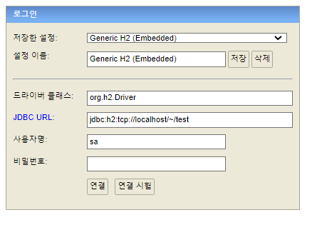
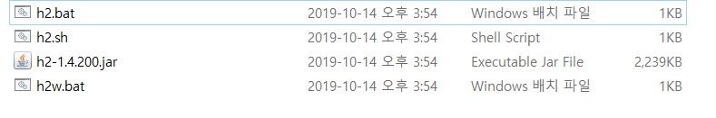

> **TL;DR** — DB 연결 방식은 Connection을 직접 다루는 순수 JDBC → 중복 코드를 줄인 JDBC Template → 쿼리 자체를 안 써도 되는 JPA 순으로 발전했다. JDBC Template은 여전히 쿼리를 직접 작성해야 하지만, JPA는 `EntityManager`가 대신 처리해준다.

난이도 : ★★☆☆☆

1️⃣ `H2 Database` 2️⃣ `JDBC Template` 3️⃣ `JPA`

## ✅ 왜 알아야 하나

Map에 데이터를 저장하며 실습하던 단계를 지나 실제 데이터베이스에 연결하려면 JDBC Template과 JPA 중 하나를 선택해야 한다. 두 방식이 뭐가 다른지, 왜 굳이 순수 JDBC에서 JDBC Template으로, 다시 JPA로 넘어왔는지 흐름을 알아야 각 방식을 언제 쓸지 판단할 수 있다. 공부용으로 용량이 작은 H2 데이터베이스를 사용했다.


- 코드: [깃허브 Repository](https://github.com/seong-ji-sue/springboot-inflearn-kimyounghan-basic)


## ✅ H2 데이터베이스 설치

1. [Archive Downloads](https://www.h2database.com/html/download-archive.html)에서 1.4.200 버전을 설치한다.
2. 설치한 폴더에서 `h2.bat`을 실행한다.

   
3. 터미널 실행과 동시에 접속 URL을 아래처럼 설정하고 접속한다.

   
4. 아래 쿼리를 작성하고 `Ctrl + Enter`로 실행한다.

```sql
-- 테이블 생성 쿼리
create table 테이블_이름
(
    id bigint generated by default as identity, -- 데이터 생성 시 id 증가
    name varchar(255),
    age bigInt,
    primary key (id)
);
```

### 프로젝트 코드에서 DB 연결 설정

1. 환경설정(`main/resources/application.properties`)

```stylus
//데이터베이스 연결 설정
spring.datasource.url=jdbc:h2:tcp://localhost/~/test
spring.datasource.driver-class-name=org.h2.Driver
spring.datasource.username=sa

//JPA 사용 시에만
spring.jpa.show-sql=true
spring.jpa.hibernate.ddl-auto=none
```

2. 라이브러리 설치(`build.gradle`)

```clean
//JDBC 설치
implementation 'org.springframework.boot:spring-boot-starter-jdbc'
//JPA 설치
implementation 'org.springframework.boot:spring-boot-starter-data-jpa'
```

## ✅ JDBC Template 방식

준비사항은 라이브러리 설치, `JdbcTemplate` 사용, `DataSource` 빈 등록이다.

```reasonml
private final JdbcTemplate jdbcTemplate;

public JdbcTemplateMemberRepository(DataSource dataSource) {
  jdbcTemplate = new JdbcTemplate(dataSource);
}
```

기존 순수 JDBC는 `Connection`, `PreparedStatement`, `ResultSet` 객체로 직접 DB에 연결했다. 중복되는 코드를 줄이기 위해 JDBC Template 방식을 도입했지만, 쿼리문 자체는 여전히 직접 작성해야 하는 번거로움이 남는다.

```java
//JDBC(순수 방식)
@Override
 public Personsave(Person person) {
	 String sql = "insert into person(name) values(?)";
	 Connection conn = null;
	 PreparedStatement pstmt = null;
	 ResultSet rs = null;
	 try {
		 conn = getConnection();
		 pstmt = conn.prepareStatement(sql,Statement.RETURN_GENERATED_KEYS);
		 pstmt.setString(1, person.getName());
		 pstmt.executeUpdate();
		 rs = pstmt.getGeneratedKeys();
		 if (rs.next()) {
			 member.setId(rs.getLong(1));
		 } else {
			 throw new SQLException("id 조회 실패");
		 }
		 return person;
	 } catch (Exception e) {
		 throw new IllegalStateException(e);
	 } finally {
		 close(conn, pstmt, rs);
	 }
 }
```

```java
//JDBC Template 방식
@Override
    public Person save(Person person) {
        SimpleJdbcInsert jdbcInsert = new SimpleJdbcInsert(jdbcTemplate);
        jdbcInsert.withTableName("person").usingGeneratedKeyColumns("id");
        Map<String, Object> parameters = new HashMap<>();
        parameters.put("name", person.getName());

        Number key = jdbcInsert.executeAndReturnKey(new MapSqlParameterSource(parameters));
        person.setId(key.longValue());
        return person;
    }

private  RowMapper<Person> personRowMapper() {
        return ((rs, rowNum) -> {
            Person person = new Person();
            person.setId(rs.getLong("id"));
            person.setName(rs.getString("name"));
            person.setAge(rs.getInt("age"));
            return person;
        });
    }
```

## ✅ JPA 방식

준비물은 라이브러리 설치, `EntityManager` 사용, domain 클래스에 `@Entity` 추가와 `id`에 `@Id @GeneratedValue(strategy = GenerationType.IDENTITY)` 추가, 그리고 환경 변수 추가다.

```stylus
//resources/application.properties
spring.jpa.show-sql=true //JPA가 생성하는 SQL을 출력한다
spring.jpa.hibernate.ddl-auto=none 
//JPA는 테이블을 자동으로 생성하는 기능을 제공하는데
//none으로 설정하면 해당 기능을 끈다
```

```cpp
private EntityManager em;

    public JpaPersonRepository(EntityManager em) {
        this.em = em;
    }
```

기존 JDBC에서 반복되던 코드를 줄이고, 쿼리문을 직접 작성하지 않아도 JPA가 대신 만들어준다.

```inform7
@Override
    public Person save(Person person) {
        em.persist(person);
        return person;
    }
```

## ✅ 정리

- 순수 JDBC — `Connection`/`PreparedStatement`/`ResultSet`을 직접 다뤄야 해서 중복 코드가 많음
- JDBC Template — 중복 코드는 줄었지만 쿼리는 여전히 직접 작성해야 함
- JPA — `EntityManager`가 쿼리 생성까지 대신 처리해서 코드가 가장 짧아짐

## 참고한 링크

- [스프링 입문 - 코드로 배우는 스프링 부트, 웹 MVC, DB 접근 기술](https://www.inflearn.com/course/%EC%8A%A4%ED%94%84%EB%A7%81-%EC%9E%85%EB%AC%B8-%EC%8A%A4%ED%94%84%EB%A7%81%EB%B6%80%ED%8A%B8/dashboard)


