> **TL;DR** — HTTP는 Stateless라서 매 요청마다 "나 누구야"를 증명해야 한다. 그 방법이 JWT(클라이언트가 토큰 보관)와 Session(서버가 상태 보관)이고, 둘 다 장단점이 있다.

난이도 : ★★☆☆☆

1️⃣ `JWT (Token 방식)` 2️⃣ `Session 방식` 3️⃣ `OAuth 소셜 로그인`

## ✅ 왜 알아야 하나

로그인을 구현하다 보면 "토큰을 어디에 저장해야 하나?", "세션이랑 뭐가 다르지?" 라는 질문이 반드시 나온다. 면접에서도 쿠키·세션·JWT 차이를 물어보는 건 기본이다.

그냥 로그인을 구현하면 생기는 문제점부터 파악하면 왜 Token과 Session이 필요한지 자연스럽게 이해된다.

**단순 로그인만 하면 생기는 문제**

- 로그인 유지 불가능
- 다음 요청 때 회원 정보를 매번 넘겨줘야 함
- 회원 정보가 요청 Body에 노출됨

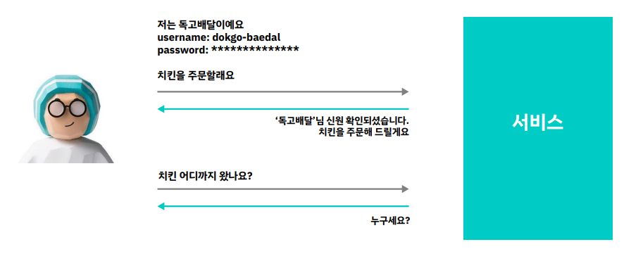

**로그인 구현 시 필요한 기능**

프론트에서 담당하는 것:
- 권한 없는 페이지에 접근하지 못하도록 하는 구조 만들기
- 특정 사용자에게만 보이는 버튼 처리
- 자동 로그인, 로그인 후 상태 유지
- 로그인 상태에서 로그인 페이지 재접근 시 리다이렉트 처리
- 비로그인 상태에서 마이페이지 접근 시 리다이렉트 처리

백엔드에서 담당하는 것:
- 사용자를 식별할 수 있는 수단 만들기 (Token, Session 등)
- 사용자마다 권한 생성 및 관리
- 사용자 접근 및 동작 제어 수단 만들기
- Validation Check

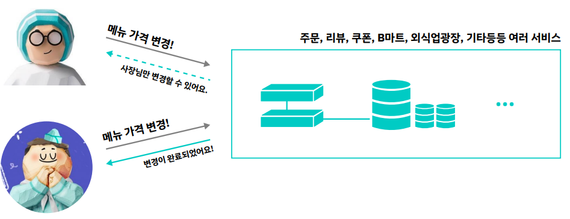

## ✅ JWT 처리 방식 (클라이언트 관리)

**JWT란?**

- JSON Web Token의 약자
- 신원 증명 수단 — 일종의 마패
- HTTP는 Stateless라서 서버가 클라이언트를 식별할 수 없기 때문에, 서버가 회원 정보를 암호화해서 클라이언트에게 보관하게 함
- 클라이언트는 토큰을 보관했다가 요청할 때마다 함께 전송함

**동작 방식**

1. 클라이언트가 로그인 정보를 서버에게 전달함
2. 서버는 로그인 정보 확인 후 해싱으로 암호화된 Token을 클라이언트에게 전달함
3. 클라이언트는 암호화된 Token으로 이후 모든 요청에서 인증을 받을 수 있음 (단, Token을 보관하고 있어야 함)

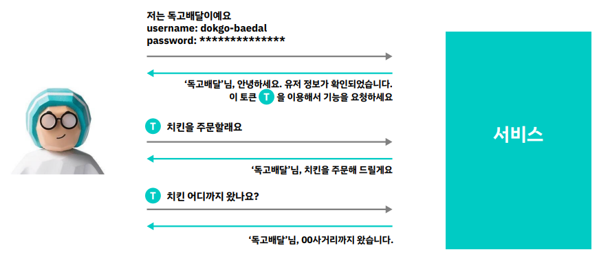

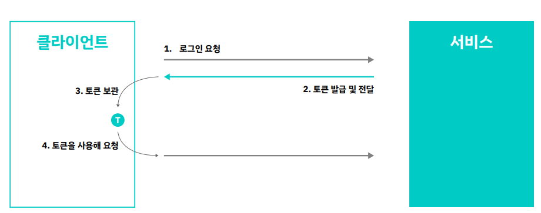

**JWT 내부 구조**

> 정확하게 몰라도 됨 — 백엔드에서 처리함. 참고: [JWT 공식 홈페이지](https://jwt.io/)

- **HEADER** — 암호화 규칙(해싱), 토큰 타입
- **PAYLOAD** — 데이터(클레임)
- **SIGNATURE** — 암호화를 위한 데이터, base64(인코딩 규격), 복호화 불가능

```json
// HEADER
{ "alg": "HS256", "type": "JWT" }

// PAYLOAD
{ "sub": "123456", "name": "John", "iat": 1516239022 }

// SIGNATURE
HMACSHA256(
  base64UrlEncode(header) + "." + base64UrlEncode(payload),
  MY_SECRET_KEY
)
```

**해싱이란?**

- 헤더의 암호화 규칙과 페이로드의 데이터, 시크릿 키로 암호화하는 방법
- 특정 규격으로 데이터를 변환하는 것, 단방향
- 시크릿 키는 반드시 필요함
- 서버에서 유효한지 해시 키로 비교함

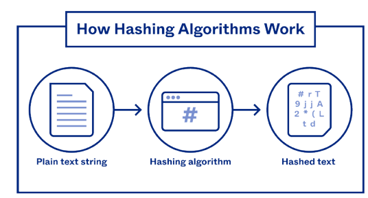

**JWT 문제점**

- secret key가 노출되면 그 값으로 로그인 시도 가능
- Header와 Payload는 복호화 가능하기 때문에 정보 유출 위험 있음
- 물리적 탈취는 어렵지만 사용자 실수로 탈취당할 수 있음
- 쿠키에 저장하면 악성 사이트 방문 시 정보 탈취 위험 (CSRF)
- localStorage에 저장하면 스크립트 태그 주입으로 탈취 가능 (XSS)
- 함수 스코프에 저장하면 로그인 유지 불가능

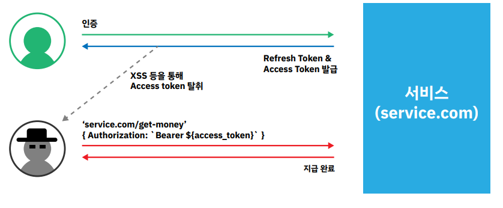

**해결 방법: Access Token + Refresh Token**

- **Access Token** — 서버로부터 짧은 유효 기간으로 메모리에 발급되는 Token
- **Refresh Token** — 서버가 가지고 있는 Token, HttpOnly Cookie로 발급 (JS로 접근 불가)

흐름:

1. 클라이언트가 서버로 로그인 요청
2. 서버는 Access Token을 짧은 시간으로 설정해 클라이언트에게 전달. Refresh Token은 서버가 보관
3. Access Token이 만료되면 서버에서 Refresh Token을 체크해 Access Token을 새로 발급해 클라이언트에게 전달

> Access Token 만료 타이밍에 Refresh Token까지 탈취되면 막을 방법이 없다. 프론트에서 혼자 할 수 있는 것은 없고, 절대적인 보안은 없기 때문에 최대한 안털리게 하는 것이 목표다.

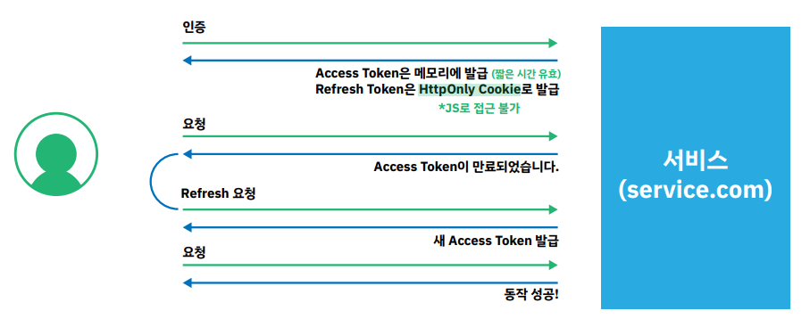

## ✅ 세션 방식 (서버 관리)

> 세션 스토리지와 세션은 다른 개념이다. 세션 아이디는 HTTP 쿠키에 저장한다.

**세션이란?**

- 실체가 없는 추상적인 무언가
- 사용자의 로그인 이후 로그아웃 혹은 로그인 만료까지의 시간
- 서버에 유저 정보를 저장하고 클라이언트에게 세션 아이디를 줘서 가지고 있게 함
- 용량 제한이 없음
- 쿠키를 사용해서 세션 아이디를 클라이언트에게 전달함
- 웹 브라우저가 종료되면 세션 쿠키는 삭제됨

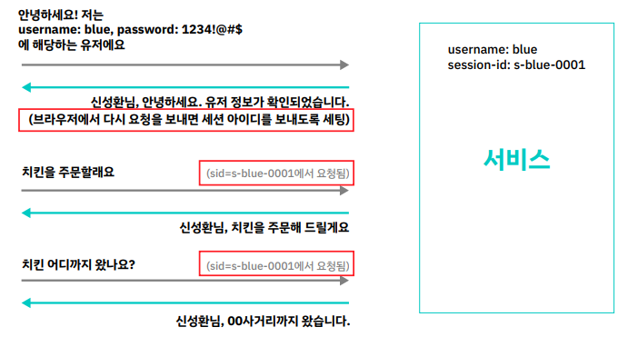

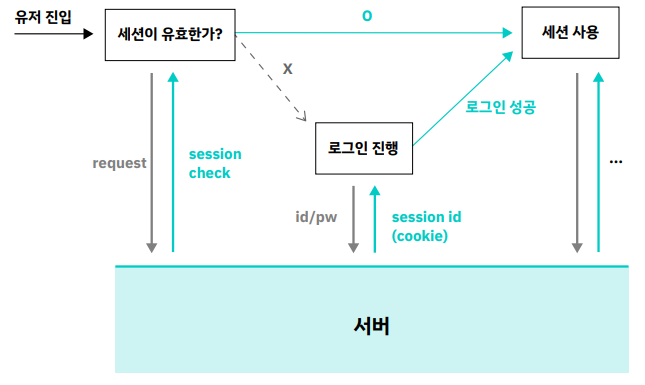

**HTTP 쿠키란?**

- 웹 브라우저에 전송하는 작은 데이터 조각
- 동일 요청 시 브라우저에 저장된 데이터와 함께 전송됨
- HTTP는 Stateless이기 때문에 로그인 상태 유지가 가능하다는 것이 엄청난 장점
- 세션 관리, 개인화, 트래킹 목적으로 사용됨
- 별도 암호화 없음
- 모든 요청마다 쿠키가 함께 전송되기 때문에 성능 저하 원인이 될 수 있음
- 세션이 만료될 때 삭제됨

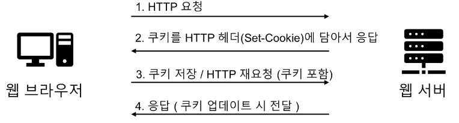

**쿠키 관련 정책**

> 프론트에서는 쿠키를 별도로 설정하지 않기 때문에 이 정도만 알아도 된다. 자세한 내용은 [MDN 쿠키 정책](https://developer.mozilla.org/ko/docs/Web/HTTP/Cookies) 참고.

- **Secure 쿠키** — HTTPS 프로토콜 상 암호화된 요청일 경우에만 전송됨. 민감한 정보는 절대 쿠키에 저장하면 안 됨
- **HttpOnly 쿠키** — XSS 공격 방지를 위해 JavaScript API에서 접근 불가
- **SameSite 쿠키** — CSRF 공격에 대응하는 방법

**JWT vs 세션 — 무엇을 써야 하나?**

- JWT는 프론트에서 저장·관리하기 때문에 백엔드 비용이 감소함. 세션은 반대임
- JWT는 보안에 취약한 반면, 세션은 그나마 덜 위험함
- 세션은 하나의 서버에서 관리하기 때문에 재부팅하면 메모리에 있는 것들이 모두 날아감
- 동시 접속자 수, 서비스 규모 등 여러 측면을 고려해서 선택해야 함

## ✅ 클라이언트에서 데이터를 저장하는 방법

브라우저에 저장하는 방식: **Cookies, localStorage, sessionStorage**

**localStorage**

- key/value로 데이터를 저장함
- JavaScript를 통해서만 데이터에 접근 가능함
- 직접 지울 때까지 삭제되지 않음
- 5MB 저장 공간
- 서버에 전송 불가 (클라이언트에서만 조회 가능)
- String으로 타입이 제한됨 — 직렬화가 필요함

**sessionStorage**

- Session은 기간, sessionStorage는 저장 공간을 의미함
- 브라우저가 꺼지면 데이터 소실 (보안 측면에서 유리)
- 5~10MB 저장 공간
- 서버에 전송 불가 (클라이언트에서만 조회 가능)
- 같은 URL의 창을 여러 개 열어도 각각 별도의 sessionStorage를 가짐

**Cookies**

- 각 데이터마다 만료일(expiration date)이 설정됨
- 4KB 이하 저장 공간
- SSR에서 사용되는 데이터를 주로 저장함
- API 요청마다 서버로 함께 전송됨 (header에 `Access-Control-Allow-Credentials: true` 설정 필요)
- HttpOnly flag로 클라이언트 접근을 차단할 수 있음

확인 방법: F12 (개발자 도구) → 애플리케이션 탭

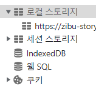

## ✅ 소셜 로그인 — OAuth

**OAuth란?**

- 허가된 다른 서비스(구글, 카카오 등)를 통해 로그인 권한을 위임하는 것
- 권한에 따라 원본 서버(구글)의 유저 정보를 가져오거나 권한을 위임받은 동작을 할 수 있음
- 인증 자체만 사용할 수도 있음

**클라이언트가 보는 과정**

서비스에서 구글 로그인 클릭 → 구글 로그인 모달 뜸 → 아이디/비밀번호 입력 → 구글 승인되면 로그인 성공!

**전체 흐름**

1. 클라이언트가 서버로 구글 계정 로그인 요청
2. 구글로 리다이렉션 후 클라이언트가 구글에 로그인 요청
3. 구글 서버가 클라이언트에게 임시 값을 주고 주소 접근을 허용함
4. 클라이언트가 서버로부터 임시 값과 허용한 주소 값을 전달함
5. 서버는 클라이언트에게 받은 정보로 구글에 접근 허용 요청을 보냄. 이때 서비스 등록 시 받은 구글 시크릿 키도 함께 보냄
6. 구글이 서버로부터 받은 시크릿 키와 클라이언트로부터 받은 임시 값, 주소를 통해 확인하고 접근 승인함

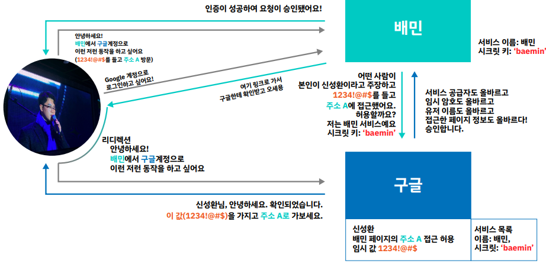

**CORS란? 해결 방법**

다른 환경에서 요청이 들어올 때 막아주는 정책이다.

- 프론트 로컬 환경에서는 CORS 검증을 해제할 수 있지만, 배포 환경에서는 백엔드가 처리해야 함
- 쿠키 정책과는 별개임

```bash
# 로컬 환경에서 CORS 검증 해제 (터미널에서 실행 — Windows)
"C:\\Program Files\\Google\\Chrome\\Application\\chrome.exe" --disable-web-security --user-data-dir="C:\\chrome"
```

## ✅ 정리

- HTTP는 Stateless이기 때문에 로그인 상태 유지를 위한 별도 수단이 필요함
- JWT는 클라이언트가 토큰을 보관하는 방식. 서버 비용이 낮지만 보안에 취약함
- 세션은 서버가 유저 정보를 보관하는 방식. 보안은 상대적으로 낫지만 서버 부담이 있음
- Access Token(단기) + Refresh Token(장기, HttpOnly Cookie) 조합으로 보안을 강화함
- 저장소별 특성: localStorage(영구·JS 전용) / sessionStorage(탭 단위·탭 닫으면 삭제) / Cookie(서버 전송 가능·용량 제한)
- OAuth는 제3자(구글·카카오)에게 인증을 위임하는 방식!

## 참고한 링크

- [MDN — HTTP 쿠키](https://developer.mozilla.org/ko/docs/Web/HTTP/Cookies)
- [JWT 공식 홈페이지](https://jwt.io/)
