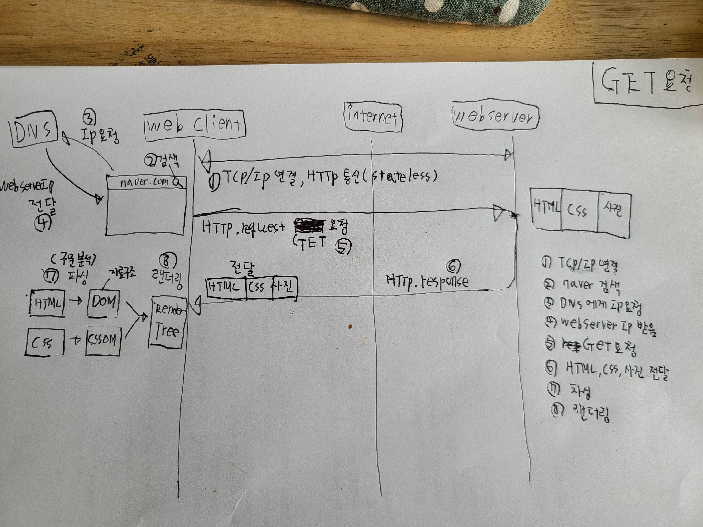
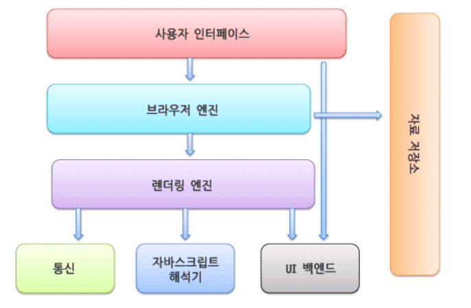
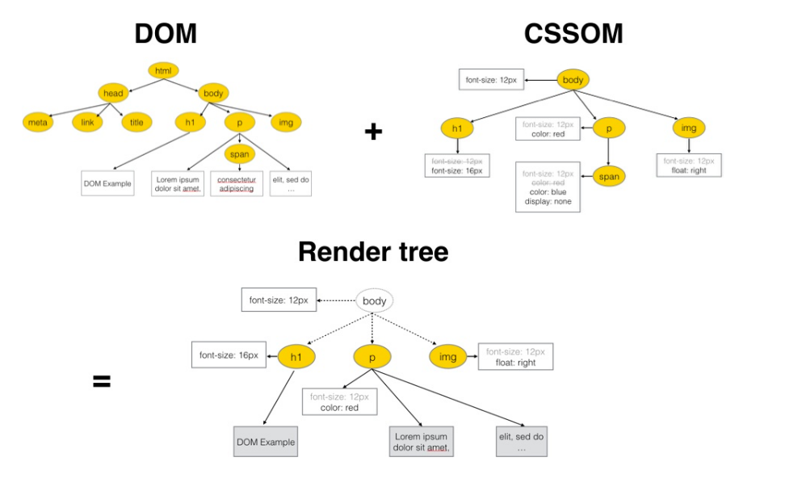
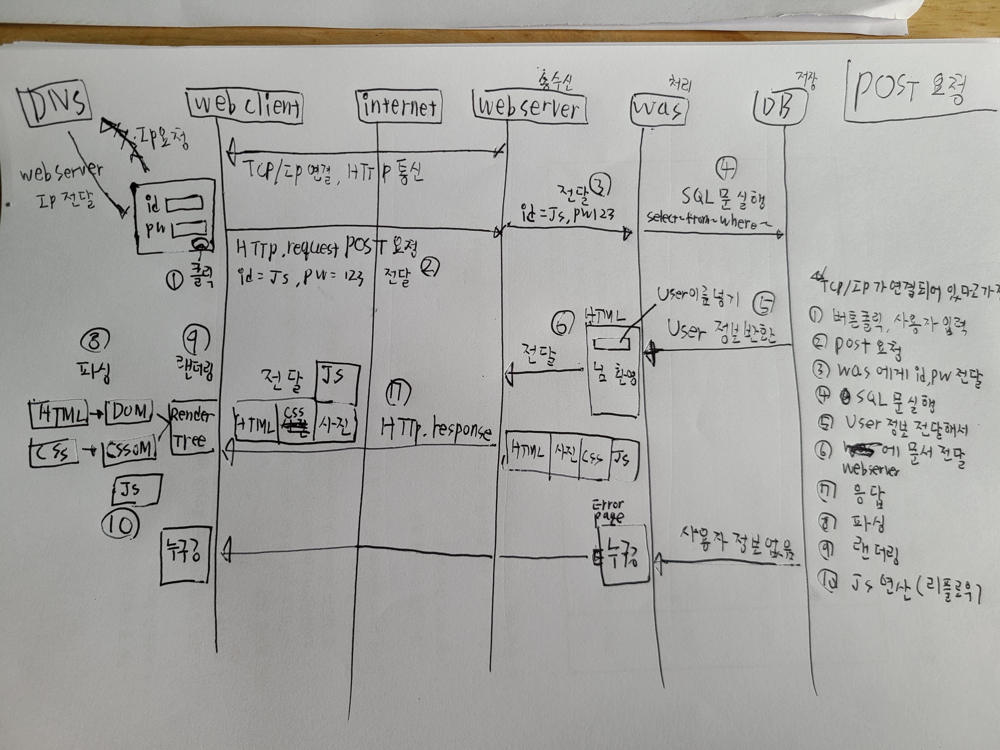
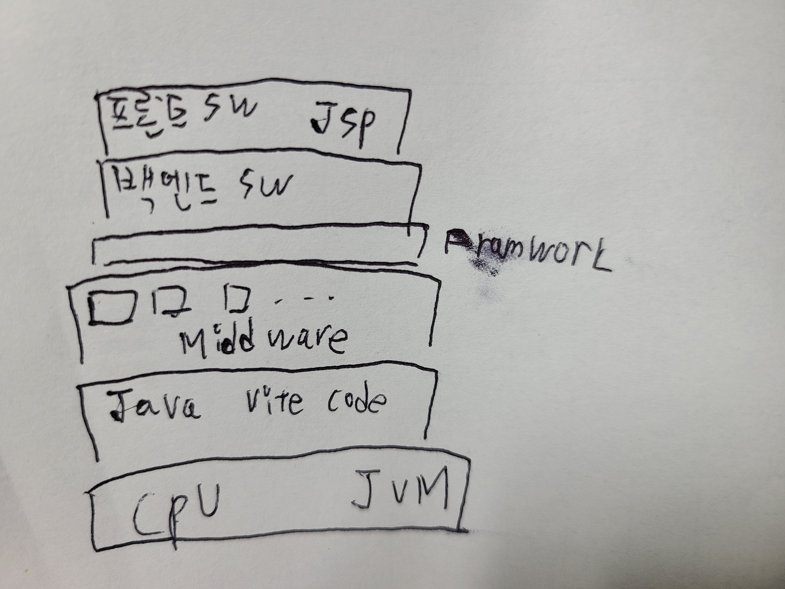

> **TL;DR** — 브라우저가 URL을 입력받는 순간부터 화면에 픽셀이 찍힐 때까지, 요청 종류(GET/POST)와 렌더링 파이프라인을 이해하면 성능 문제의 절반은 예측할 수 있다.

난이도 : ★★☆☆☆

1️⃣ `GET / POST 흐름` 2️⃣ `브라우저 렌더링 파이프라인` 3️⃣ `Reflow 최적화`

## ✅ 왜 알아야 하나

면접에서 "naver.com을 입력하면 무슨 일이 일어나나요?" 라는 질문은 지금도 빠지지 않는다. 단순 암기가 아니라 GET/POST의 차이, 브라우저가 HTML을 받아 DOM으로 만드는 과정, 그리고 왜 Reflow가 비용이 크고 어떻게 줄이는지까지 연결해서 설명할 수 있어야 한다.

웹 서비스 특징 3가지를 먼저 잡아두면 흐름이 쉽게 보인다.

**웹 서비스 기반 특징**

- HTML과 HTTP 통신 방식을 기본으로 함
- TCP/IP 연결을 가정하고 시작하면 HTTP 통신이 됨
- HTTP는 Stateless — 요청마다 독립적, 상태를 기억하지 않음

**문서를 다루는 3요소 (각각 분리됨)**

- **자료구조** — HTML (비선형 트리)
- **UI** — CSS
- **제어** — JavaScript

**클라이언트 웹 브라우저를 구성하는 3요소**

- 구문 분석하는 **Parser**
- 그래픽 **렌더링** 엔진
- 연산할 수 있는 **스크립트** 엔진

## ✅ GET 요청 흐름 (READ)

**DNS (Domain Name Server)** — 사람이 읽기 쉬운 도메인과 실제 IP를 매핑해놓은 서버다.

**GET 요청 키워드**

- HTML, CSS, 이미지 등 정적 파일 전송
- 초창기 웹 구성 방식 (원격지 문서 뷰어)
- 단방향 (Web Server → Client)

**동작 순서**

1. HTTP 통신 기반 TCP/IP 연결
2. 주소창에 URL 입력
3. DNS 서버에 URL 전달 → Web Server의 IP를 클라이언트에게 알려줌
4. 받은 IP로 `http.request GET` 요청을 보냄
5. 요청이 정상 도착하면 `http.response`로 HTML + CSS + 이미지 + JS를 전달함
6. 클라이언트는 받은 HTML + CSS + JS 순으로 파싱(구문 분석)하고 비선형 자료구조인 DOM을 생성함
7. 생성한 DOM을 화면에 렌더링함



## ✅ 브라우저 렌더링 동작 원리

**브라우저 구조**

- **User Interface** — 주소 표시줄, 이전/다음 버튼, 북마크 메뉴 등. 사용자와 상호작용함
- **Browser Engine** — User Interface와 Rendering Engine을 연결함
- **Rendering Engine** — HTML, CSS를 파싱하여 요청한 웹페이지를 표시함
- **Networking** — 각종 네트워크 요청을 수행함
- **JavaScript Interpreter** — JavaScript 코드를 해석하고 실행함. 크롬은 V8 엔진을 씀
- **UI Backend** — 체크박스, 버튼과 같은 기본 위젯을 그려줌
- **Data Persistence** — localStorage나 Cookie 같은 보조 기억장치에 데이터를 저장함



**DOM 생성 과정 (아래 순서대로 동작)**

**1. HTML, CSS 파싱 → DOM, CSSOM 트리 구축**

렌더링 엔진이 HTML, CSS 문서를 파싱해서 브라우저가 이해할 수 있는 DOM과 CSSOM으로 변환함.

**2. Render 트리 구축**

DOM과 CSSOM을 결합해 렌더 트리를 만듦. `meta`나 `display: none` 속성은 렌더와 관계없기 때문에 포함되지 않음.

**3. JavaScript 파싱과 실행**

`<script>` 태그를 만나면 JavaScript 파일을 파싱하고, JavaScript 엔진이 해석 후 AST를 생성함. AST를 기반으로 인터프리터가 실행하고, 중간 코드인 바이트 코드를 생성해 실행함.

**4. 레이아웃 (리플로우)**

브라우저 화면의 어느 위치에 어느 크기로 출력될지 계산하는 단계. 비용이 발생하는 작업이다.

**5. 페인트 (Paint)**

리플로우가 발생한 레이아웃을 실제 화면에 그려주는 작업. 텍스트, 색, 이미지, 그림자 효과가 모두 처리됨.



**Reflow 최적화 방법**

리플로우(레이아웃 재계산)는 비용이 크기 때문에 최소화하는 것이 성능 최적화의 핵심이다.

- **스타일 변경 시 가장 하위 노드부터 변경** — 버블링·캡처링으로 상위 노드에 영향을 미칠 수 있어서 범위를 좁혀야 함
- **인라인 스타일 사용 금지** — 파싱 시 레이아웃에 영향을 받아 리플로우가 추가로 발생함
- **애니메이션 노드는 `position: fixed` 또는 `absolute` 지정** — 전체 노드와 분리되어 해당 노드만 리플로우가 발생하도록 제한할 수 있음
- **`table` 레이아웃 사용 금지** — 작은 변경에도 테이블 전체 너비를 재계산하고 모든 노드가 리플로우됨
- **CSS 하위 선택자 최소화** — 선택자가 깊어지면 CSSOM 트리 깊이가 깊어지고 렌더 트리 생성 시간이 늘어남

```css
/* 피해야 할 예 */
.reflow_box .reflow_list li .btn {
  display: block;
}

/* 권장 예 */
.reflow_list .btn {
  display: block;
}
```

- **DOM 사용 최소화** — `createDocumentFragment`를 사용해 한 번에 DOM을 추가하면 DOM 접근을 최소화할 수 있음
- **계산된 스타일 정보 캐시** — 브라우저는 레이아웃 변경을 큐에 저장했다가 한 번에 실행해 리플로우를 줄임. 하지만 `offsetTop`, `scrollTop` 같은 계산된 스타일 정보를 요청할 때마다 큐를 비우기 때문에, 해당 값을 변수에 저장해두고 사용해야 함

```js
let top = el.offsetTop, left = el.offsetLeft, elStyle = el.style;
```

## ✅ POST 요청 흐름 (WRITE)

GET이 정적 파일을 받아오는 방식이라면, POST는 사용자의 입력에 따라 서버가 동적으로 응답을 만드는 방식이다.

**POST 요청 키워드**

- 양방향 (Client ↔ Web Server)
- 사용자의 입력에 따라 화면이 변화함 (동적)
- 처리 담당 **WAS**의 등장 — Web Server는 송수신만 처리 가능하기 때문
- 상태의 전이를 기억하는 **DB**의 등장 — HTTP는 무상태이기 때문
- 상황에 따라 HTML을 동적으로 변경하는 **JavaScript**의 등장
- Web Server에서 상태를 기억하는 **Cookie**의 등장
- WAS에서 구성한 **MVC 패턴** 등장
- Web Service + WAS + DB = **3 Tier Web Solution**
- 성능 이슈 제어 포인트: DB 응답 시간, WAS 처리 연산(Service), 네트워크 속도
- 성능 이슈 해결 방법: DB 튜닝, APM 모니터링(Scouter, 제니퍼 솔루션)

**동작 순서 (예: 로그인)**

1. HTTP 통신 기반 TCP/IP 연결
2. 클라이언트가 id, password 입력 후 로그인 버튼 클릭
3. `http.request POST` 요청 — id 데이터 전달
4. Web Server가 받자마자 WAS에게 넘김
5. WAS가 SQL문으로 DB에 데이터 조회 (`SELECT ~ FROM ~ WHERE id = tester`)
6. 찾은 데이터를 WAS에서 만든 HTML Form에 넣어 새 HTML 동적 생성
7. 새로 만든 HTML을 Web Server에 전달
8. `http.response`로 HTML + CSS + 이미지 + JS 전달
9. 클라이언트는 파싱 후 DOM 생성
10. 상황에 따라 JS가 다른 DOM을 렌더링해서 클라이언트에게 보여줌



## ✅ JSON 데이터 전달 방식

GET, POST 요청과 과정은 동일하나 Web Server에서 HTML 대신 JSON으로 데이터만 넘겨준다.

**키워드**

- Web Client가 발전하면서 UI가 다양해져서 JSON 데이터만 보내고 클라이언트에서 만드는 방식으로 변화함
- 다양한 UI 제어를 위해 **Front Framework** 등장 (React, Vue)
- 요청이 주로 Create / Read / Update / Delete이기 때문에 이를 method로 만든 **RESTful API** 등장
- Internet과 Web Server 사이의 보안 — IPS, SSL, WAF

**동작 순서**

1. Web Client가 RESTful API 요청 (CRUD)
2. Web Server에서 JSON 데이터 전달
3. DOM Tree 구성
4. 받은 JSON 데이터로 Web Client가 데이터 삽입 후 리렌더링

## ✅ 컴퓨터 구조 (USER 계층)

컴퓨터 구조는 **HW, 커널(OS), User** 3가지로 구성된다. HW부터 커널까지를 플랫폼이라고 한다.

**USER 계층 구성**

1. **JVM** — 소프트웨어에서 CPU를 Java로 구현함
2. **Java bytecode** — 사용자가 입력한 코드를 기계어로 해석하는 역할
3. **Middleware** — 백엔드 소프트웨어가 동작할 수 있게 해주는 역할, WAS가 있음
4. **Framework** — 사용자의 코드 실수 방지를 위해 미리 형식을 맞춤, Spring이 있음
5. **백엔드 소프트웨어**
6. **프론트 소프트웨어** — JSP 등



## ✅ 정리

- GET은 정적 파일을 단방향으로 받아오는 방식, POST는 사용자 입력으로 서버가 동적으로 응답을 만드는 방식임
- 브라우저 렌더링 파이프라인: HTML·CSS 파싱 → DOM·CSSOM 생성 → 렌더 트리 → 레이아웃(리플로우) → 페인트
- 리플로우는 비용이 크기 때문에 최소화 전략(하위 노드 변경, 인라인 스타일 금지, position 분리, DOM 일괄 추가, 스타일 값 캐시)이 필요함
- REST API 방식에서는 JSON만 주고받고 렌더링은 클라이언트가 담당함!

## 참고한 링크

- [웹브라우저 동작 방식 (Naver D2)](https://d2.naver.com/helloworld/59361)
- [널널한 개발자 유튜브 — 웹 기본 동작](https://youtu.be/4Sfned8HLzk)
